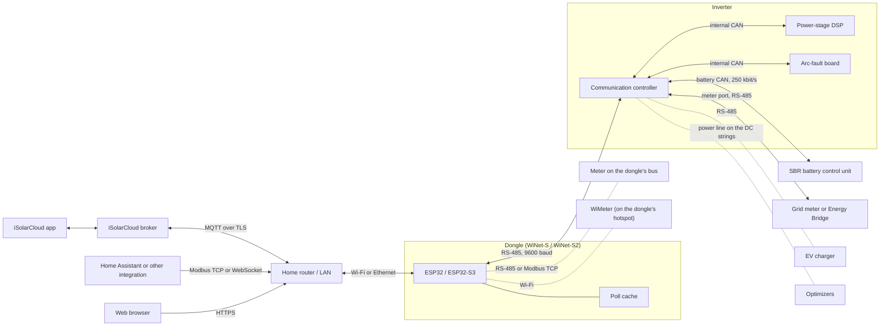

# The big picture

A Sungrow residential solar system looks like a few boxes on a wall, but from a communications
point of view it is a small network of computers. This page explains which box talks to which,
over what kind of link, how often, and where your data ends up. Later chapters go into each link
in detail.

## The cast

A typical installation has some or all of these parts:

- **The inverter.** An SG5.0RS (a *string inverter*: solar panels in, household AC out) or an
  SH10RS (a *hybrid inverter*: it also charges and discharges a battery). Either way, the inverter
  is not one processor. A **communication controller** handles every external port and keeps the
  inverter's whole register map in memory. A separate **DSP** (digital signal processor) runs the
  power electronics, and an arc-fault detection board sits beside it. Nothing outside the inverter
  ever talks to the DSP directly.
- **The battery.** An SBR192 (or another SBR size) is a column of battery modules with a **battery
  control unit** (BCU) on top. The BCU does all the battery management and talks to the hybrid
  inverter over a **CAN bus**, a robust two-wire bus common in cars and batteries. The battery has
  no network connection of its own.
- **The dongle.** A WiNet-S or WiNet-S2 plugs into the inverter's communication port. It is a
  small Wi-Fi and Ethernet computer whose job is to read the inverter over **RS-485** (a simple
  two-wire serial bus) and make that data available to the cloud and to your local network.
- **Accessories.** Depending on the site: a grid **energy meter**, an **Energy Bridge**, an
  **EV charger**, panel-level **optimizers**, and Sungrow's Wi-Fi accessories, the **WiMeter** and
  **WiProxy**.

Everything the dongle knows about the inverter, battery and meter, it learns by asking the
inverter's communication controller. The controller in turn has already collected those values
from its DSP, its battery and its meter over its own internal links.

## How it is wired

Solid lines are present on most sites; dotted lines are optional accessories.

### Inside the inverter

The communication controller is the hub. It polls its DSP over an internal CAN bus, reads its own
grid meter on a dedicated **meter port** roughly every 100 ms, exchanges frames with the battery
every fraction of a second, and stores the results as **Modbus registers**: numbered 16-bit slots
that hold values such as "PV power" or "battery state of charge". Modbus is the request/response
protocol that almost every solar device speaks; one side (the *master*) asks, the other (the
*slave*) answers.

Values that come from the DSP change at most once every 0.6 to 0.8 s. Asking the inverter more
often than that returns the same numbers. See [Inside the inverters](07-inside-the-inverters.md).

### The battery behind the inverter

The battery does not appear on the dongle's bus as a separate wire. The hybrid inverter translates
the BCU's CAN data into Modbus registers and answers on the BCU's behalf at its own RS-485
addresses 200 and up. On a hybrid site with two SBR192 stacks the dongle therefore sees three
devices (the inverter and two stacks) on one cable that physically reaches only the inverter. See
[Inside the battery](08-inside-the-battery.md).

### Meters, chargers and the Energy Bridge

An energy meter can sit in one of two places:

1. On the **inverter's meter port**, where the inverter itself is the master. This is the normal
   arrangement for export control and battery management, because the inverter needs the grid
   reading many times a second. The dongle only sees the finished meter values in the inverter's
   registers.
2. As a **device of the dongle**, added by hand by an installer and polled by the dongle like any
   other Modbus slave, either on its RS-485 bus or over the network.

An **Energy Bridge** takes the place of the grid meter on a hybrid inverter's meter port. An
**EV charger** also hangs off the hybrid inverter. The inverter tells the dongle when either is
present, and the dongle adds it to its device list, but the shipped dongle firmware never polls
their values cyclically. See [Meters](../reference/devices/meters.md) and
[EV charger and Energy Bridge](../reference/devices/ev-charger-and-energy-bridge.md).

### Optimizers

Panel-level optimizers and rapid-shutdown devices are hosted by the inverter: they talk to an
optimizer controller inside the inverter over power-line signalling on the DC strings. Only the
WiNet-S2 can reach them, by sending special frames to the inverter, which relays them. See
[Optimizers and MLPE](../reference/devices/optimizers-and-mlpe.md).

## The dongle's three faces

Towards the house network, the dongle presents three separate faces:

| Face | What it is | Who uses it |
|---|---|---|
| iSolarCloud uplink | One long-lived MQTT session over TLS to a Sungrow broker, for example `iot.isolarcloud.com` or a regional host such as `auiot.isolarcloud.com`, port 16668 | the iSolarCloud app and web portal, Sungrow support |
| Local web UI | HTTPS on port 443, with a JSON REST API and a WebSocket channel | your browser, the app in its local mode, some integrations |
| Modbus TCP | The Sungrow register map served on port 502 (and a TLS variant on 516) | Home Assistant and other energy-management tools |

All three draw on the same **poll cache**: the dongle's in-memory copy of the last values it read
from each device. None of them makes the dongle read the inverter any faster.

## What flows where, and how often

### Dongle and inverter

The dongle is the only master on its RS-485 bus. After start-up it reads the inverter's full
register set, which takes roughly 10 to 13 s at 9600 baud. From then on, with the SH10RS and
SG5.0RS, it uses a Sungrow-specific "what changed?" request: each round, typically every 0.4 to
0.8 s, the inverter returns only the registers that have moved by more than a small threshold.
Battery stacks are refreshed about every 2.5 to 5 s. Slow values such as settings and firmware
versions are read only at start-up and on a rescan. Details are in
[Talking to the inverter](03-talking-to-the-inverter.md).

### Dongle and cloud

The dongle sends **run data** for each device every **5 minutes** by default, a minute or two after
each 5-minute boundary. Other messages carry device identity and capabilities, online/offline
status, fault records and parameter changes; they go out on connect, on change, or on slower
timers. When you open "Live data" in the app, the cloud asks the dongle for a 10-second stream of
selected values, served from the same cache.

Commands flow the other way on the same session: parameter reads and writes, time setting, log
export, firmware updates. The dongle never accepts an incoming connection from the cloud; it
dials out and keeps the session open. If the session is down, ordinary run data for that period is
not re-sent later, so the app shows a gap. See [Talking to the cloud](04-talking-to-the-cloud.md).

### Dongle and your network

The web UI and Modbus TCP answer from the poll cache whenever you ask. Polling them every second
returns the same value many times; polling every 100 ms only loads the dongle. One exception: a
Modbus "read holding registers" request for a register the dongle does not keep in its cache is
passed through to the inverter as a live read. See [Local access](05-local-access.md).

## Timing at a glance

| Link | Typical pace |
|---|---|
| Inverter DSP to communication controller | every 0.6 to 0.8 s |
| Grid meter on the inverter's meter port | about every 100 ms |
| Dongle to inverter (steady state) | one change request every 0.4 to 0.8 s; values update only when they move |
| Dongle to inverter (start-up or rescan) | full read in about 10 to 13 s |
| Dongle to cloud, run data | every 5 minutes |
| Dongle to cloud, live data (on request) | every 10 s |
| Dongle to cloud, heartbeat | every 30 minutes, plus on connect |

## Where the clock comes from

By default the dongle takes its time from iSolarCloud. The cloud's "set time" command is also the
only thing that, with factory settings, sets the inverter's clock: the dongle broadcasts the new
time to every inverter on its bus, and the SH10RS passes it on to the battery. The time written is
local standard time with no daylight-saving adjustment. Other time sources (NTP, manual, Modbus
TCP) can be selected in the web UI.

## The exception: Bluetooth on the SG5.0RS

The iSolarCloud phone app can also reach an SG5.0RS directly over Bluetooth, through a bridge on
the inverter's own service port. That path does not involve the dongle at all. Neither dongle
uses Bluetooth.

> **What this means for you**
>
> - The dongle is the only part of the system that talks to iSolarCloud. Everything the app shows,
>   and every remote command, has passed through it.
> - The cloud sees your system in 5-minute steps. A local integration can see changes within about
>   a second, but no faster, however quickly it polls.
> - Local control (Modbus TCP writes, web UI settings) and cloud control use the same path to the
>   inverter. A value you write locally is the same register the app would write.
> - If the dongle loses its network, the inverter and battery keep running normally. Only
>   monitoring and remote control stop, and the cloud history has a gap.

## Further reading

- [Inside the dongle](02-inside-the-dongle.md): the hardware, LEDs, button and setup.
- [Talking to the inverter](03-talking-to-the-inverter.md): the RS-485 side.
- [Talking to the cloud](04-talking-to-the-cloud.md): the MQTT link.
- [Local access](05-local-access.md): the web UI and Modbus TCP.
- [Security and privacy](09-security-and-privacy.md): what leaves the house and who can change what.
- Reference: [RS-485 master](../reference/protocols/rs485-master.md),
  [iSolarCloud uploads](../reference/protocols/cloud-messages.md),
  [SH10RS architecture](../reference/devices/sh10rs/architecture.md),
  [SBR192](../reference/devices/sbr192/).
