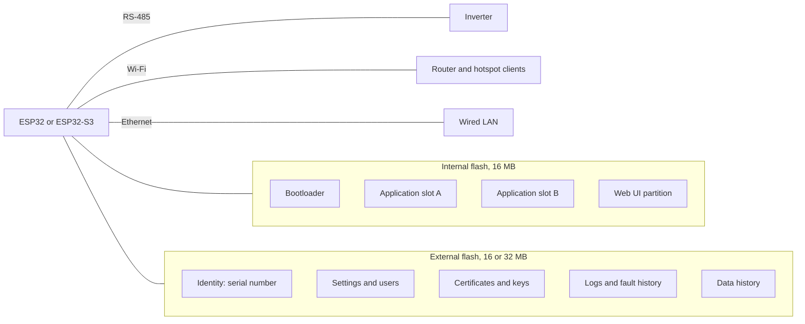
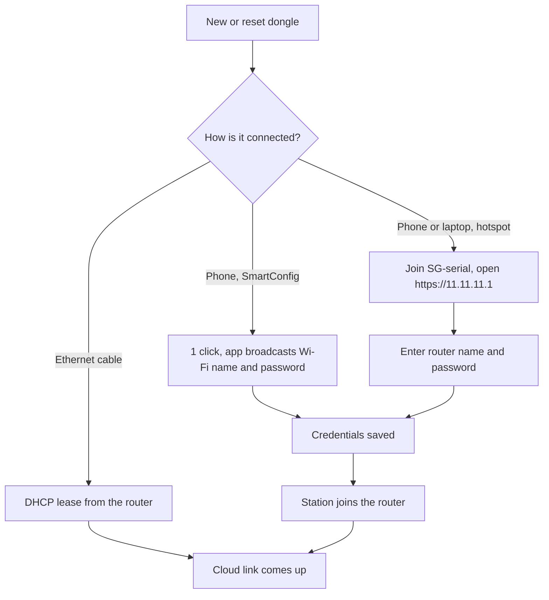

# Inside the dongle

The WiNet-S and WiNet-S2 are small plug-in boxes that sit on the inverter's communication port.
Each contains an Espressif Wi-Fi microcontroller, two flash chips, an RS-485 transceiver, an
Ethernet socket, three LEDs and one button. This page explains what is inside, what the lights
and the button do, how a new dongle gets onto your network, and what a factory reset puts back.

## Two generations, one job

| | WiNet-S | WiNet-S2 |
|---|---|---|
| Era | first generation, around 2019 | second generation |
| Chip | ESP32 (dual-core) | ESP32-S3 (dual-core) |
| Firmware family | `WINET-SV200…` | `WINET-SV300…` |
| Internal flash | 16 MB | 16 MB |
| Extra RAM (PSRAM) | 4 MB, quad SPI | 8 MB, octal SPI |
| External flash | 16 MB | 32 MB |
| Ethernet | the chip's built-in Ethernet controller with an external PHY chip | a WIZnet W5500 Ethernet chip on an SPI bus |
| Watchdog | the chip's own | an external supervisor chip as well |

Both run the same firmware code base, built for two chips. They speak the same RS-485 protocol to
the inverter, offer the same web UI and Modbus TCP server, and use the same iSolarCloud protocol.
To a user, an installer or a program on the network they are almost indistinguishable.

The differences that matter in practice:

- **Ethernet.** The original ESP32 has an Ethernet controller built in, so the WiNet-S pairs it
  with a separate PHY (the chip that actually drives the cable, here a TI DP83848). The ESP32-S3
  has no Ethernet controller, so the WiNet-S2 uses a WIZnet W5500, a self-contained Ethernet chip
  that talks to the processor over SPI (a fast four-wire chip-to-chip bus).
- **Watchdog.** A *watchdog* resets a device that has stopped responding. The WiNet-S relies on
  the ESP32's internal one. The WiNet-S2 adds an external **supervisor** chip that must be
  "kicked" every 500 ms; if the firmware stops kicking it, it resets the board. The WiNet-S2 also
  pings its Wi-Fi router when cloud name lookups fail, and restarts itself (at most once per
  outage) if the router stops answering.
- **Features.** Only the WiNet-S2 supports the SP600 optimizer protocol (panel optimizers and
  rapid-shutdown devices). Only the WiNet-S has a debug feature that streams its log over the
  network (see
  [Security and privacy](09-security-and-privacy.md)).

Neither dongle uses Bluetooth, although both chips have it, and neither has a cellular modem,
although the firmware has fields for one. Secure Boot and flash encryption are not enabled on
either. The full comparison is in [WiNet-S vs WiNet-S2](../reference/hardware/winet-s-vs-s2.md).

## What is on the board

### Two flash chips with different jobs

The **internal flash** holds the program. It has two **application slots**: an update is written
into the slot that is not running, and the dongle switches to it on the next boot. If the new
firmware does not survive its first 30 seconds, the bootloader goes back to the old slot. The web
UI (the HTML page, its scripts and its translations) lives in its own partition and is replaced
alongside the application by every update.

The **external flash** holds everything that makes a particular dongle *that* dongle:

- the **identity file**, with the serial number, cloud server settings, network settings and local
  user data;
- the certificates for the local web server and for Modbus TCP over TLS, the certificate
  authority used to check the iSolarCloud broker, and the public key that checks firmware updates;
- the dongle's own error log, fault history, data history and diagnostic captures;
- the per-region settings templates used by the installer pages.

The external flash is formatted as one LittleFS filesystem. If it ever fails to mount, the dongle
formats it and starts again empty, which loses the serial number and with it the dongle's cloud
identity. Moving an external flash chip between a WiNet-S and a WiNet-S2 also loses the identity.
See [Flash layout](../reference/hardware/flash-layout.md).

### Keeping itself alive

Every 3 seconds a monitoring loop checks memory, the clock and storage. If memory is running low,
the dongle restarts itself, but only at the top of an hour between midnight and 5 am, so a slow
leak causes a quiet night-time reboot rather than a midday outage. See
[Boot and runtime](../reference/hardware/boot-and-runtime.md).

## The LEDs

| LED | Pattern | Meaning |
|---|---|---|
| Blue | off | not connected to a Wi-Fi router (also off on an Ethernet-only dongle, even when the cloud is up) |
| Blue | solid | connected to Wi-Fi, cloud link up (or down for less than a minute) |
| Blue | slow blink, 1 s on / 1 s off | connected, data activity |
| Blue | one 1 s flash every 4 s | connected to Wi-Fi, but no cloud link for a minute or more |
| Blue | fast blink | SmartConfig is listening (see below) |
| Green | blinks once a second | heartbeat; the dongle itself has no active faults |
| Green | off | the dongle has an active fault (red is then on) |
| Green | fast blink | network-config mode |
| Red | on | the dongle itself has a fault |

The red LED reflects only the dongle's own faults. An inverter or battery fault does not light
it; that shows in the app or the web UI. Patterns are in
[LEDs and button](../reference/hardware/leds-and-button.md).

## The button

The button counts short presses (under 1 s, collected until 1 s after the last release) and long
holds. A hold only counts if the button was untouched for 3 s beforehand.

| Gesture | What it does |
|---|---|
| 1 click | Opens **SmartConfig** for 10 minutes. The hotspot goes down while it listens and comes back afterwards |
| 2 clicks | Turns the hotspot **off**, and it stays off across reboots. Ignored while a WiMeter or WiProxy is paired |
| 3 or more clicks | Turns the hotspot **on** (and makes it visible again), and it stays on across reboots |
| Hold more than 5 s | **Network-config mode**, used to pair with a WiProxy; also turns the hotspot on |
| Hold more than 30 s | **Factory reset** |

The dongle's own log message for the factory reset mentions 5 seconds, but a 5-second hold only
enters network-config mode. A reset needs the full 30 seconds.

## Getting a new dongle onto your network

The dongle runs its Wi-Fi in two roles at once: a **station** that joins your router, and an
**access point** (its own hotspot) that phones and laptops can join. A wired Ethernet connection
works alongside both. There are three ways in:

### Ethernet

Plug in a cable and the dongle asks for an address by DHCP. A fixed address can be set in the web
UI and takes effect immediately. When both Ethernet and Wi-Fi are connected, Ethernet carries the
traffic. Remember that the blue LED follows Wi-Fi only.

### SmartConfig

One click opens a 10-minute window in which the dongle listens, without joining any network, for
a Wi-Fi name and password broadcast by the iSolarCloud app. The app encodes them in the lengths of
Wi-Fi packets it sends. The dongle accepts them only if the app also sends the dongle's serial
number (or a generic wildcard value). While SmartConfig listens the blue LED blinks fast and the
hotspot is down. A WiNet-S2 with no saved Wi-Fi network can also pick up Wi-Fi settings relayed
by a neighbouring dongle; see [Setup and provisioning](../reference/protocols/setup-and-provisioning.md).

### The hotspot `SG-<serial>`

Every dongle runs an access point named `SG-` followed by its serial number. It is **open**: there
is no password, whatever the web UI shows in its password field. The dongle sits at
`11.11.11.1` and hands out addresses on `11.11.11.0/24`; at most two clients can join at once.
Through it you reach the same web UI and Modbus TCP server as on your home network. The phone
app's local ("near") mode uses it.

The hotspot is on by default. After every boot and every button activation it broadcasts its name
for 30 minutes and then **hides** it: it keeps running and anyone who knows the name can still
join, but it no longer shows up in a scan. Three clicks make it visible again; two clicks turn it
off. See [Setup and provisioning](../reference/protocols/setup-and-provisioning.md).

### If the dongle cannot reach your router

The dongle keeps trying on its own: quick retries a few seconds apart, then about every 5
minutes, indefinitely, without rebooting. Meanwhile the blue LED stays off, the hotspot is still
there (open, if hidden), and you can join it to correct the Wi-Fi settings. The cloud link is
retried every second once the network is back. The inverter keeps generating throughout; only
monitoring stops, and the 5-minute data for the outage is not sent later.

## One browser at a time

The web UI allows only **one logged-in browser at a time**. Opening a second browser tab, starting
the phone app in local mode, or running a script that connects to the WebSocket logs the first
browser out. This is a common source of confusion when Home Assistant and a person both use the
web interface; see [Local access](05-local-access.md).

## Factory reset

A 30-second hold of the button (or a single write to a special Modbus register, see
[Local access](05-local-access.md#registers-you-must-not-write)) wipes the dongle's settings and
restores the factory copy of its identity file.

| After a reset | |
|---|---|
| Kept | the serial number and other factory settings, data history, the update public key, the iSolarCloud certificate authority, the settings templates |
| Restored to default | the cloud server settings (normally the global broker, until the cloud moves the dongle to its regional one again), local users and passwords, the web and Modbus certificates |
| Lost | Wi-Fi credentials, network settings, logs, fault history, any other configuration |

Because the serial number survives, a reset dongle reconnects to iSolarCloud as the same device
and stays attached to the same plant once it is back on the network.
