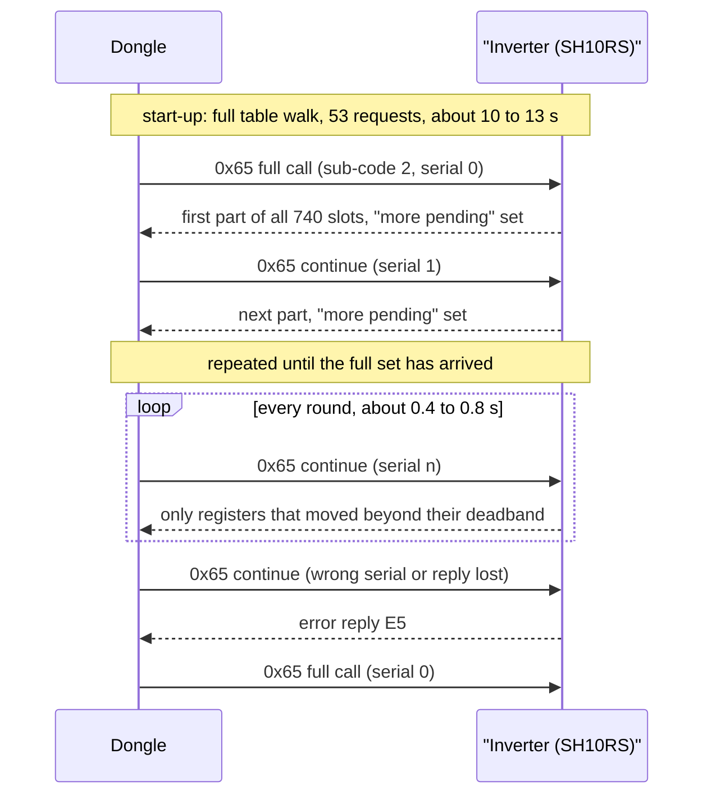

# Talking to the inverter

Everything the dongle knows about your system it learns over one twisted pair of wires. This
chapter explains how that link works: how the dongle finds the inverter, how it decides what to
read, how it keeps hundreds of values up to date over a slow line, and what it writes back on its
own. The exact frames, timings and tables are in the reference pages linked at the end of each
section.

Register numbers in this chapter are the 1-based numbers used in Sungrow's published Modbus
documentation. On the wire the address is one less.

## One pair of wires, one master

The dongle plugs into the inverter's communication port and talks to it over **RS-485**, a
two-wire serial bus designed for long, noisy cable runs. The line runs at **9600 baud** (about
960 bytes per second), 8 data bits, no parity, 1 stop bit.

On top of RS-485 the two sides speak **Modbus RTU**. Modbus is a simple request/response
protocol: a **master** sends "read N registers starting at address A from slave S", and the
**slave** answers. A **register** is one 16-bit value; larger values span two registers, and
Sungrow's inverters send the **low word first**. The dongle is always the master. The inverter
is a slave at its own slave address, and it never speaks unless asked.

A few things follow from this:

- **Everything is serial.** One request is on the wire at a time. The dongle keeps a queue per
  port, and every device on the bus (the inverter, the battery stacks it serves, a meter wired to
  the dongle) waits its turn in that queue.
- **Each request is sent once.** There are no retransmissions. A request that gets no answer
  within **2 s** counts as one lost frame; any good answer clears the count. After **10 lost
  frames in a row** the dongle declares the device offline, blanks some of its values, and starts
  looking for it again.
- **The dongle waits 18 ms** of quiet before each request to the inverter.
- **9600 baud is slow.** A reply carrying 120 registers is 245 bytes and takes about a quarter
  of a second on the wire. That budget shapes almost every design choice below.

Details: [RS-485 Modbus master](../reference/protocols/rs485-master.md).

## Finding the inverter

When the dongle powers up it has to work out who is on the bus. It tries three things in order.

1. **The saved device.** A configured dongle remembers every device it has found, with its slave
   address, and simply starts polling them. On an installed site this is how the inverter is
   found every time; no search is needed.
2. **The "are you there" read.** The dongle sends one **broadcast** read (slave address 0, which
   every device hears) asking for register 30035, "what is your address?". A device that answers
   gives its address. Neither the SH10RS nor the SG5.0RS answers this read on its dongle port, so
   on these inverters the dongle always moves on to the third step.
3. **The serial-number search.** The dongle broadcasts a read that every unidentified device
   answers with its **serial number**, its **device code** (its model number, for example 0x0D1B
   for the SH10RS) and its address. To stop the answers colliding, each device waits a random
   0.1 to 1.1 s before replying. The dongle then tells each device it heard cleanly to stay quiet
   (by writing that device's serial back), and asks again, so that any device whose first answer
   was lost in a collision gets another chance. At most three rounds are run.

The search runs once per boot and again every time the inverter goes offline. While it runs, the
dongle stops all normal polling on that port. A shipped dongle never changes a device's slave
address; the re-addressing step exists in its firmware but is never reached.

Battery stacks are not searched for. On a hybrid site the SH10RS answers on their behalf at slave
addresses 200 to 204, and the dongle adds them from what the inverter reports.

Details: [RS-485 device discovery](../reference/protocols/device-discovery.md).

## Deciding what kind of inverter it is

Once the address is known, the dongle reads a few identity blocks from the inverter. Two results
decide everything that follows:

- The **device type**, derived from the device code. The SH10RS becomes device type 35 (hybrid
  inverter), the SG5.0RS device type 21 (residential string inverter). The device type chooses
  the web pages, the cloud reporting format and the list of values to collect.
- The **protocol type**, from an identification block. Protocols 1, 2 and 4 are older schemes
  that are read register by register. The SH10RS and SG5.0RS report **protocol 3**, which unlocks
  the change stream described below.

Each protocol has a fixed **poll table**: the list of register ranges the dongle collects. For
protocol-3 inverters the table covers 2838 registers in 53 requests. Protocol 2 and 3 inverters
also publish a **capability bitmap** (registers 5520 to 5579) that says which optional features
they have; rows of the table that depend on a missing feature are left out.

The register maps themselves are in
[the RS-485 inverter register table](../reference/appendix/register-tables/rs485-inverters.md).

## The polling model

The dongle polls in **rounds**. At the start of a round it walks the poll table, picks every
request that is due, and queues them all. The next round starts as soon as the last of them has
been answered or has timed out. There is no fixed cycle time: a round takes as long as the line
needs.

Each request has a **poll class** that says how often it is due:

| Class | Typical content |
|---|---|
| every round | live measurements: power, voltages, currents, battery state |
| every 30 s or 60 s | status words and slower values |
| about every 20 min | the inverter's clock |
| every hour | identity, firmware versions, ratings, settings |

A full pass over the protocol-3 table is 53 requests: about 6.6 s of pure wire time, plus the
gaps and the inverter's thinking time, so roughly **10 to 13 s** with batteries attached. That
is fine at start-up, but it would mean every value is at least ten seconds old all the time. For
the SH10RS and SG5.0RS the dongle therefore does something smarter in steady state.

## The change-stream trick

Protocol-3 inverters support a Sungrow-private Modbus function, **0x65**, which works as a
**change stream**. Instead of the dongle re-reading everything, the inverter reports only what
has changed.

- **Full call.** The dongle asks for everything once. The inverter sends every tracked register,
  split over several replies because the set does not fit in one: about 1.7 s of wire time for
  the full set.
- **Continue.** From then on, each round is a single short request carrying a sequence number one
  higher than the last. The inverter answers with only the registers that have moved since it
  last reported them, often just a handful.
- **Deadband.** "Moved" means moved by more than a per-register threshold. Many values must
  change exactly; others have a **deadband** of up to 50 raw units on the SH10RS (for example
  50 W for the main power values), while the SG5.0RS reports the same power values on every
  1 W change. A change to or from zero is always reported.
- **Recovery.** If a reply is lost or the inverter rejects the sequence number, the dongle simply
  sends a new full call. It also sends one every hour to re-synchronise.

The SH10RS tracks 740 register slots this way, the SG5.0RS 667. A steady-state round takes only
about 0.4 to 0.8 s, so about 740 values stay fresh over a 9600-baud line.

There are two catches worth knowing about:

- **Small changes can be invisible.** A value that drifts inside its deadband is not re-sent, so
  the dongle (and anything reading from it) can show a slightly stale number. On the SH10RS this
  is most visible on the power values.
- **Not everything is in the stream.** The dongle decodes only registers 5200 to 7999 from it.
  Settings, the block at 4950 to 5044 and everything from 8000 up are refreshed only by the full
  table walk at start-up, after the device comes back online, or on a forced refresh.

The web interface, Modbus TCP and the cloud uploads all answer from this cached copy, not from
fresh bus reads. That is why a client polling every few seconds often sees the same value twice.

Details: [Modbus function codes](../reference/protocols/modbus-function-codes.md#0x65-change-stream).

## Why some reads stall everything

Behind the inverter's communication controller sits a second processor, the power-stage
**DSP** (digital signal processor), which has no port of its own. A few register windows (for
example 16000 to 17500) are not answered by the controller but **forwarded** to the DSP. The
dongle never polls these windows itself, but a cloud parameter read or a Modbus TCP client can
reach them through the dongle.

A forwarded request is expensive. While it is pending, the controller stops serving its other
Modbus ports: for at least **1.5 s** on the SH10RS and at least **10 s** on the SG5.0RS, counted
from the last forwarded request. The controller also pauses its own reading of the DSP during
that time, so measurement values freeze without any error.

On the dongle side, any on-demand read or write (from the web UI, the cloud or Modbus TCP) jumps
the queue, and **no new poll round starts until it has finished**. A slow parameter operation
therefore pauses fresh data for every device on the port. See
[Inside the inverters](07-inside-the-inverters.md) for the inverter side of this.

## Shifting up to 115200 baud

For bulk transfers the dongle can switch the line to **115200 baud** for a while. It writes the
new rate into a temporary window on the inverter (registers 21004 to 21018), switches its own
port, and checks with two test writes. Everything else on the port is paused meanwhile. The
inverter keeps the faster rate only in memory and falls back to its saved rate after 600 s of
silence, after 5 bad frames in a row, or at a restart, so a failed switch heals itself.

The dongle uses this for firmware transfers to the inverter
([Firmware updates](06-firmware-updates.md)), for inverter log export, and for a cloud-triggered
fast data collection. A periodic "adjust baud" negotiation also exists, but it never runs on the
SH10RS or SG5.0RS: it is never used for hybrid inverters, and on both inverters the feature bit
it checks is clear.

Details: [Baud switch](../reference/protocols/device-discovery.md#baud-switch-to-115200).

## What the dongle writes on its own

Most writes come from a person: an installer page, a cloud setting, a Modbus TCP client. The
dongle passes those through without checking the values; the inverter is the last line of
defence. A few writes, though, the dongle sends by itself:

- **The inverter clock.** After its own clock is set (by the cloud, the web page or Modbus TCP)
  the dongle broadcasts the date and time to every inverter at registers 5000 to 5005. If the
  web option "Inverter time synchronization" is on (it is off by default), it repeats this every
  hour. The time sent is local time in the dongle's configured zone, **without daylight saving**.
  The SH10RS passes the time on to its batteries.
- **Start and stop.** A start or stop command for the whole plant is a broadcast write to
  register 5006.
- **A feed-in limit schedule.** iSolarCloud can download a time-of-day export-limit schedule,
  which the dongle applies at whole hours to the first string inverter (never to a hybrid).
- **Meter sync.** If a meter is wired to the dongle's own bus, the dongle copies ten of its
  readings into the inverter, continuously, at registers 33519 to 33534. While that data keeps
  arriving, the inverter uses it **instead of** its own meter. On a hybrid whose meter is already
  wired to the inverter's meter port, adding a meter to the dongle's bus hands battery and export
  control to the dongle's slower readings. Do not do that.

Details: [Parameter writes and meter sync](../reference/protocols/writes-and-meter-sync.md).

## Adding a second master

Home Assistant users often want to read the inverter directly over RS-485 as well. Modbus RTU
has no way for two masters to share a bus: the dongle does not wait for the line to be free, and
it ends a reply by counting bytes, so a stranger's frame or a late reply breaks its transaction.
**The dongle's port belongs to the dongle.**

The inverter offers a cleaner option: a **second RS-485 terminal** that runs the same Modbus
slave and register map as the dongle port. An external master can poll there without touching
the dongle's bus. A few cautions apply:

- On the SH10RS the same terminal is also used for a parallel link between inverters, an EV
  charger or an LG battery; while it is doing one of those jobs it does not serve an outside
  master.
- The change stream has **one** context shared by both ports. If an outside master also uses
  function 0x65, the two masters keep breaking each other's sequence and both fall back to slow
  full calls. Use ordinary function 3 and 4 reads from the second master.
- A DSP-forwarded read from either port stalls the other port, as described above.

Alternatively, an installer can switch the dongle's port from Modbus master to Modbus RTU slave
("Modbus RTU forwarding"); the dongle then stops polling and acts as a gateway instead. Most
users are better served by the dongle's Modbus TCP server, covered in
[Local access](05-local-access.md).
