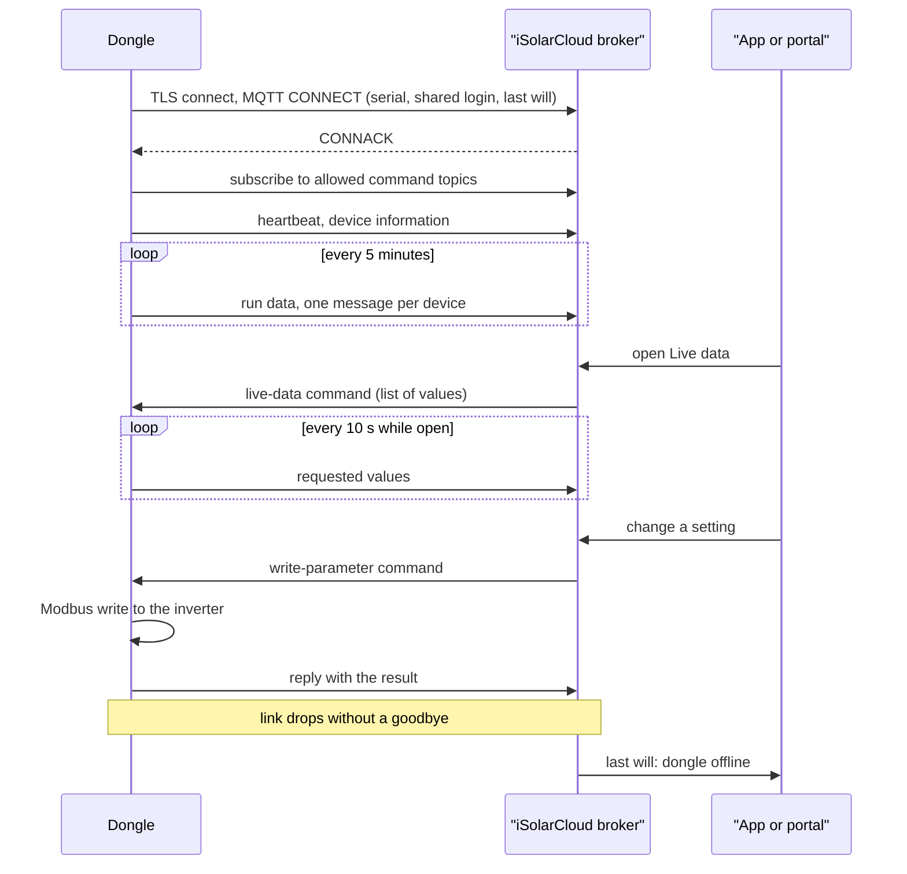

# Talking to the cloud

Out of the box, every WiNet-S and WiNet-S2 keeps a permanent connection to **iSolarCloud**,
Sungrow's monitoring service and the back end of its phone app. This chapter explains in plain
terms what that link is, what leaves the house and how often, what the cloud can send back, and
what happens when the internet goes away. The field-level detail is in the reference pages linked
from each section.

## The link in one paragraph

The dongle opens an encrypted connection to a Sungrow server and keeps it open. The protocol is
**MQTT** (version 3.1.1), a lightweight publish/subscribe messaging protocol common in IoT
devices: the device publishes messages on named **topics**, a server called the **broker** passes
them on, and the device subscribes to the topics it wants to hear. The connection runs over
**TLS**, the same encryption web browsers use. The default broker is `iot.isolarcloud.com` on
port 16668. Uploads and commands both travel over this one session; the dongle never opens a port
that the cloud connects into.

Details: [iSolarCloud MQTT link](../reference/protocols/cloud-mqtt.md).

## Regions and servers

iSolarCloud runs separate regional platforms: global, Europe, Australia, China, India and a few
others, each with its own broker (for example `auiot.isolarcloud.com` for Australia and
`iot.isolarcloud.eu` for Europe). A new dongle always starts on the global default. It does not
pick a region by itself: the cloud moves it with a **server-switch** command naming the new host
and port. The dongle tries the new server, and if it cannot connect within about ten minutes it
normally rolls back to the old one.

Separately, the dongle asks a Sungrow web service which region it is in, until it gets an answer. The request carries
nothing that identifies the unit, so the answer can only be based on its public IP address. One
rule depends on that answer: only units on the **European** platform may keep customised
remote-control settings (below). On every other region the dongle resets them to the factory
defaults within about a second.

## Identity: the serial number is everything

There is no pairing step, no activation code and no per-device secret.

- The dongle identifies itself by its **serial number**: it is the MQTT client id, it appears in
  every topic and in every message.
- The MQTT **username and password are the same on every WiNet-S and WiNet-S2**. They are built
  into the firmware.
- Linking a dongle to a plant happens entirely on the cloud side: the installer or owner registers
  the serial number in the app.
- The dongle checks the server's certificate against a CA file stored on its flash, but it does
  not check that the certificate belongs to the host name it dialled, and it presents no client
  certificate of its own.

What this means for privacy and security is discussed in
[Security and privacy](09-security-and-privacy.md).

## What goes up, and when

The dongle collects all values from its own cache of RS-485 readings
([Talking to the inverter](03-talking-to-the-inverter.md)); cloud uploads never cause extra bus
traffic. Each value is identified by an iSolarCloud **point id**, a number for one quantity of one
device class, and each device under the dongle gets a small number of its own (the dongle itself
is always 247).

| Message | When | What it carries |
|---|---|---|
| Run data | every 5 minutes (adjustable from the cloud), after a random delay of 1 to 3 minutes | the telemetry behind the app's charts and energy totals, one message per device |
| Heartbeat | on connect, every 30 minutes, and shortly after any device goes online or offline | one "communicating or not" flag per device |
| Device information | on every connect | model, serial, firmware version and a capability bitmap per device; the dongle's own network details |
| Status | when it changes, and every 2 hours | operating state of each device |
| Faults | when a device's fault record changes, and hourly | the active fault and alarm codes |
| Parameter changes | when a watched setting on a hybrid inverter changes | the setting's new value |
| Fault history | after a reconnect | faults recorded while the link was down |
| Live data | every 10 s by default, only while someone has Live data open | just the values the viewer asked for |

**Live data** is the closest thing to a fast stream. When someone opens the Live data view in the
app or portal, the cloud asks for a list of up to 400 values per device, and the dongle sends them
at every 10-second boundary until the session is closed. The cloud only offers this for devices
whose capability bitmap says they support it. A separate recording mode for grid
frequency-control services samples every 200 ms around a frequency event and uploads the
recording afterwards.

Details: [iSolarCloud uploads](../reference/protocols/cloud-messages.md).

## How the messages look

Every message is a small **JSON** document in a fixed wrapper (the **envelope**): a message id, a
part count, a sender header with the dongle's model and serial and the local send time, and the
payload itself. All values are sent as strings, scaled the way the cloud expects; a battery level
of 97.5 % travels as `"0.975"`.

Two tricks keep messages small:

- **Chunking.** A payload longer than 2560 bytes is cut into slices and sent as several messages
  with the same id; each slice is sent only after the broker has acknowledged the previous one.
- **Compression.** Each message is compressed in zlib format before sending. TLS is the only
  encryption; there is none at the application level.

Uploads are not re-sent. If the broker does not acknowledge an upload within about 20 s, the
dongle gives up on it.

Details: [iSolarCloud message envelope](../reference/protocols/cloud-envelope.md).

## What comes down

The cloud sends **commands** on topics the dongle subscribes to. Each command carries a numeric
command type, and the dongle replies on a matching reply topic. The main groups are:

- **Read and write device parameters.** The app's remote settings read or write inverter and
  battery registers through the dongle. The dongle does no range checking of its own; the inverter
  rejects values it does not accept.
- **Dongle settings.** The upload period, the hotspot, a reboot, the Modbus TCP server switch, the
  server switch, a feed-in limit schedule, and the **remote-maintenance switch**, which for 24 hours
  allows Sungrow's own service login on the dongle's web interface.
- **Time and time zone.** The cloud sets the time zone (as `UTC+hh:mm`) and broadcasts the time to
  all dongles in a zone. The dongle then sets its clock and passes the time on to the inverter.
- **Firmware jobs.** The cloud tells the dongle where to download firmware for itself, the
  inverter or the battery ([Firmware updates](06-firmware-updates.md)).
- **Diagnostics.** Live data on and off, log export (the dongle uploads inverter or dongle logs to
  a server named in the command), and I-V curve scans.

Only one parameter command is handled at a time; a second one that arrives while the first is
still waiting for the inverter is dropped.

Which groups the dongle accepts is set by a **remote-control mask** that the owner can change on
the dongle's web page. By default every group is allowed (on the WiNet-S, every group except
optimizer layout). No cloud command changes the mask, and the European rule above resets it
outside Europe.

Details: [Cloud commands](../reference/protocols/cloud-commands.md).

## The last will

When the dongle connects, it hands the broker a **last will**: a message saying "the dongle is
not communicating" that the broker publishes on the dongle's behalf if the session ends without a
proper goodbye. A power cut, a lost Wi-Fi link or a crashed router all end that way, so the cloud
learns within a few minutes that the dongle has dropped, without the dongle having to say so. The
keep-alive interval is 120 s, and under the MQTT rules a session that stays silent for 1.5 times
that, 180 s, is considered dead. The next heartbeat after a reconnect
overrides the will.

## When the cloud is unreachable

- **The dongle keeps trying.** It checks the link every second and reconnects as soon as it can.
  There is no growing back-off; only the timeouts of each step (DNS, TCP, TLS) pace the retries.
- **The blue LED tells you.** With the dongle on Wi-Fi, the blue LED stays solid while the cloud is
  connected. After 60 s without the cloud it changes to a single 1 s flash every 4 s. A dongle
  connected only by Ethernet keeps its blue LED off whatever the cloud state.
- **Local access carries on.** The RS-485 polling, the local web interface and the Modbus TCP
  server do not depend on the cloud at all. A Home Assistant integration that reads the dongle
  locally keeps working.
- **History is kept locally, but mostly not re-sent.** The dongle records snapshots of each
  device's values in a fixed-size store on its flash, deleting the oldest when it is full; the
  local app can read them. After an outage, though, the dongle back-fills the cloud only with
  optimizer data. Ordinary inverter, meter and battery run data from the outage is **not**
  re-sent, so the cloud charts show a gap. Faults recorded during the outage are replayed.
- **The clock matters.** Until the dongle has a valid time, it sends no scheduled messages at
  all.

## Sending data somewhere else: third-party upload

Both dongles can also push data to a server of the owner's choosing, alongside iSolarCloud. The
web interface calls this "Third-party cloud". It is off by default. When enabled, the dongle
writes small XML files with measured values for each window of time (5, 15 or 60 minutes, or
"daily"), plus one file for each fault turning on or off, and uploads them by FTP or SFTP. The XML
format is one used by third-party PV monitoring portals.

A few properties are worth knowing before relying on it:

- Plain FTP sends the login in clear, and SFTP host keys are never checked.
- A file is deleted whether its upload worked or not, so an outage loses data.
- The timestamps are local time marked as if they were UTC.
- The "daily" setting actually uploads about every 5 h 48 min.
- Despite the web page's warning, enabling it does not stop the iSolarCloud link.

Details: [Third-party upload](../reference/protocols/third-party-upload.md).
