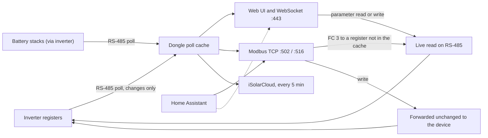

# Local access

The dongle is not only a cloud uplink. On your own network it runs a web server, a Modbus TCP
server and a discovery responder, all reachable without going through iSolarCloud. This page
explains what each one offers, how fresh its data is, and the traps that catch most people who
connect Home Assistant or a similar tool.

## What is listening

| Port | Service | Default |
|---|---|---|
| 443 | HTTPS web UI, REST API and WebSocket | always on |
| 502 | Modbus TCP | on (adjusted by region at first setup, see below) |
| 516 | Modbus TCP over TLS | on |
| 503 to 515 | extra Modbus TCP listeners | off, can be enabled in the web UI |
| 5353/UDP | mDNS discovery | always on |
| 80 | plain HTTP | WiNet-S2 only, and only when a WiMeter was paired at boot |

The web UI and Modbus TCP listen on the dongle's home-network address (Wi-Fi or Ethernet) and also
on its own hotspot at `11.11.11.1`. The web UI also lists IEC 60870-5-104 ports (2404 to 2418) for
utility SCADA systems, but the dongle never actually listens on them. See
[Local services](../reference/protocols/local-services.md).

## The data path

Almost everything you read locally comes out of the **poll cache**, the dongle's copy of the last
values it got from each device. Writes go straight through to the device.

## The web UI on port 443

Open `https://<dongle address>` in a browser. Three things surprise people.

**The certificate warning.** The dongle uses a self-signed certificate that is identical on every
dongle of the same generation, and it is not issued for your dongle's name or address. Browsers
rightly refuse to trust it, so you have to click through the warning. An installer can replace the
certificate from the web UI. See [Web API](../reference/protocols/web-api.md#certificate).

**One session at a time.** The dongle allows only one live WebSocket client. When any client
connects to the WebSocket, even one that never logs in, the dongle closes every other WebSocket
connection and ends its session. When the phone app connects in local mode, it evicts the browser
too. In practice:

- two browser tabs fight each other;
- an integration that uses the WebSocket logs you out of the web UI every time it reconnects, and
  you log it out every time you open the page;
- opening the app's local mode while the web UI is open kicks the browser.

**Idle timeout.** A session ends after 10 minutes without activity (configurable). On the
WebSocket, only a few kinds of request count as activity, so a client that only reads data is
probably logged out about ten minutes after it logged in, however busy it is, and has to
reconnect.

Five failed logins lock that role for 3 minutes, then 10 minutes on the next lockout.

### Roles

There are three login names: `user` (the owner), `admin` (installer) and `develop` (Sungrow
factory, usable only while a remote-maintenance window is open). The role comes from the name
alone. The fine-grained "installer" and "developer" tiers you see on the settings pages are hints
for the user interface; the dongle itself lets any `user` session read and write every inverter
parameter. More on this in [Security and privacy](09-security-and-privacy.md).

## Modbus TCP on port 502

Modbus TCP is the same register-based protocol the dongle uses with the inverter, carried over the
network instead of RS-485. Requests ask for a range of numbered registers from a numbered **unit**
(device).

### What you get

The dongle serves the standard Sungrow Modbus map for each device type it knows: string inverters,
hybrid inverters, meters and battery stacks. The register lists are in the appendix:
[hybrid inverter](../reference/appendix/register-tables/modbus-tcp-hybrid-inverter.md),
[string inverter](../reference/appendix/register-tables/modbus-tcp-string-inverter.md),
[meter](../reference/appendix/register-tables/modbus-tcp-meter.md),
[battery](../reference/appendix/register-tables/modbus-tcp-battery.md). Register numbers there,
as in Sungrow's own documentation, are 1-based: the address in the actual Modbus frame is one
less.

Supported requests are read input registers (function 4), read holding registers (function 3)
and the three common writes (functions 5, 6 and 16), up to 125 registers per read. Other function
codes get no immediate answer; the dongle replies with an error after about 9 seconds.

### Where the values come from

- **Read input** (function 4) is always answered from the cache.
- **Read holding** (function 3) is answered from the cache when every requested register is in the
  device's table. If any is not, the whole request is forwarded to the device as a **live read**
  over RS-485, which is slower and occupies the bus.

32-bit values come low word first, as on the inverter itself.

### How fresh the values are

In steady state the dongle asks the SH10RS or SG5.0RS "what has changed?" every 0.4 to 0.8 s, and
the inverter reports only registers that moved by more than a small step (up to 50 units on the
SH10RS, such as 50 W). Values that stay within their step are not refreshed. Inverter
measurements themselves change at most every 0.6 to 0.8 s. Settings, firmware versions and other
slow values are read only at start-up and on a rescan, so a setting changed elsewhere may not show
up in the cache until then. See [RS-485 master](../reference/protocols/rs485-master.md#how-fresh-the-values-are).

The practical upshot: polling more often than about once a second gains nothing, and a value that
looks "stuck" for a while may simply not have moved past its step.

### Which unit id?

The unit id is **not** the device's RS-485 address. It is the device's position in the dongle's
device list, shown in the web UI as "Forwarding Modbus ID":

| Unit | What answers |
|---|---|
| 1 | normally the inverter (the first device found) |
| 2, 3, … | the next devices; on a hybrid site with two SBR192 stacks, the stacks are units 2 and 3 |
| 247 | the dongle itself |
| anything else | nothing at all; the request just times out |

A hybrid inverter also publishes the unit ids of its batteries in input registers 65000 to 65003,
so a client can find them. A factory reset or a different discovery order can renumber the
devices. A dongle setting (off by default) swaps unit 1 and unit 247.

### Connection etiquette

- At most **three** Modbus TCP clients at once; a fourth is disconnected immediately.
- Send one request, wait for the answer, then send the next. If several requests arrive in one
  network packet, only the last one is answered.
- An idle connection is closed after about 67 s. After a disconnect, wait about a second before
  reconnecting.

### TLS on port 516, and the allow-list

Port 516 serves the same data inside TLS. Like the web UI it uses a certificate shared by every
dongle and asks no client certificate, so it protects against eavesdropping but not against
impersonation. Port 502 can be switched to TLS as well.

The only access control is an **allow-list** of up to five exact client IP addresses (no ranges),
shared by every Modbus TCP listener and configured on the web UI's forwarding page. An empty list
lets everyone in. There is no password and no check on writes.

### The region rule for port 502

At start-up, and when an installer sets the inverter's country, the dongle turns port 502 on or
off according to the inverter's region (some regions on, the rest off), unless someone has
already switched it by hand. The other listeners are not affected. If Modbus TCP stops working
after a country change, check that switch first.

## What Home Assistant integrations actually use

Home Assistant integrations for Sungrow systems reach the dongle in one of two ways.

1. **Modbus TCP on port 502**, unit 1 for the inverter and 2, 3, … for batteries. This is the most
   common approach. It does not log in, so it does not disturb the web UI. Remember that the data
   is the cache, refreshed as described above.
2. **The WebSocket API** at `/ws/home/overview` on port 443, logging in exactly as the web UI does
   and asking for live values per device. This gives the same cached values with friendly names,
   but every reconnect evicts the browser session (and vice versa), and the session probably
   needs re-establishing about every ten minutes. Some clients try a plain WebSocket on port 8082; no
   dongle listens there.

Either way:

- **Faster polling does not make data fresher.** It only adds load. A 5 to 10 s interval is
  plenty for most dashboards, and even 1 s gives no new information.
- **Writes are possible and unchecked.** A Modbus write to the inverter's unit is forwarded to the
  inverter as is. The dongle checks neither range nor permission; the inverter is the only judge.
  Writes also interact with the inverter's own control loops; see
  [Writes and meter sync](../reference/protocols/writes-and-meter-sync.md) and
  [SH10RS control and EMS](../reference/devices/sh10rs/control-and-ems.md).
- **Live reads compete with polling.** Requests for registers outside the cache tables go to the
  bus each time, adding a round trip of up to 2 s and delaying the regular poll.

## mDNS: the dongle announces itself

The dongle answers multicast DNS (mDNS, the "Bonjour" discovery protocol) as
`SUNGROW<serial>.local`, offering a web service called `WiNet-WebServer` on port 80. On a normal
dongle nothing listens on port 80; the real web UI is on 443. The announcement also carries, in
plain text, the serial numbers of the dongle, the inverter and every battery stack, the inverter
model, and the wired IP address when Ethernet is up. Anyone on the network can read it. See
[Local services](../reference/protocols/local-services.md#mdns).

## Registers you must not write

Unit 247 is the dongle's own configuration, about 300 registers. Most are plain settings, but a
few act the moment they are written, with no confirmation:

> **Warning.** Writing **any** value to register **39098** on unit 247 factory-resets and reboots
> the dongle: Wi-Fi and network settings, local users and every other setting are wiped, and the
> first inverter's export limitation is switched off.

Others to leave alone:

- **8021** switches the iSolarCloud link on or off.
- **8022** can lock out every local web login until the next reboot.
- **39100** puts the dongle into factory mode, in which it stops polling the inverter.
- **33106** holds the serial number, which is also the dongle's cloud identity.
- **39101** and **39133** hold the cloud broker host and port.
- **39303** (WiNet-S only) starts streaming the dongle's log to any address on the internet.

The full list is in [Modbus TCP](../reference/protocols/modbus-tcp.md#logger-registers-on-unit-247).
A misconfigured integration that writes a block of registers to unit 247 can do real damage, so
check the unit id before enabling writes.

## Turning the serial port into a Modbus slave

An installer can switch the dongle's RS-485 port from polling the inverter to answering an
external Modbus master ("Modbus RTU forwarding"). While that is on, the dongle stops reading the
inverter entirely, its cache goes stale, and every live read and write is refused. If all values
freeze, check that this mode is off.
