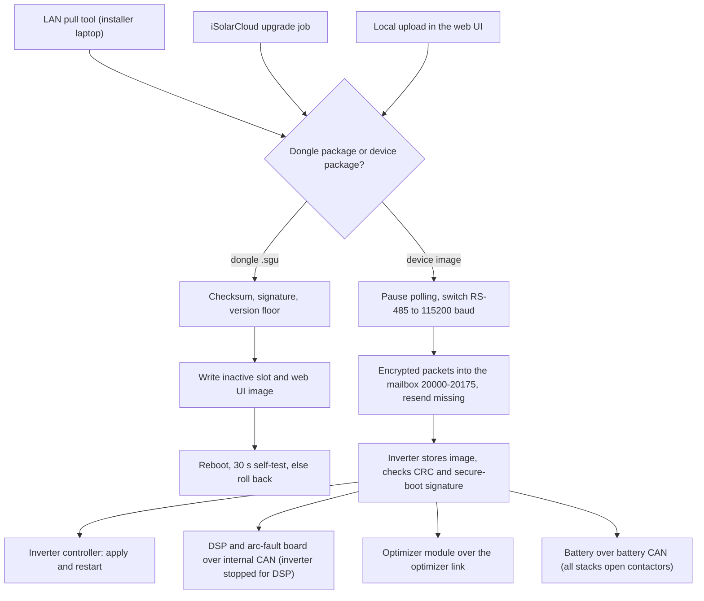

# Firmware updates

Two kinds of firmware update pass through the dongle. The first is the dongle updating **itself**.
The second is the dongle acting as a courier, carrying firmware for the **inverter** and
everything behind it (its power-stage processor, the arc-fault board, optimizers, the battery).
This chapter explains both in plain terms: how packages arrive, what they contain, how they are
checked, and what can go wrong. The byte layouts and full code tables are in the
[firmware-update reference](../reference/firmware-update/).

Register numbers in this chapter are the 1-based numbers used in Sungrow's published Modbus
documentation.

## Three doors into the dongle

A new dongle firmware can arrive by three routes. All three end in the same install routine.

1. **The installer's LAN pull tool.** An installer runs a Sungrow update server on a laptop on the
   local network, logs in to the dongle's web page and types in the laptop's IP address. The
   dongle then **fetches** the package from the laptop over HTTPS, trying a fixed list of ports
   (20001, 20101 and so on). The dongle starts every connection; it never listens for one.
2. **A cloud push.** iSolarCloud sends an upgrade job naming a download server, the target
   devices and up to eight files. The dongle downloads them over HTTPS, FTP or SFTP into a staging
   folder on its flash. With automatic updates enabled, the dongle also asks the cloud once a day
   which packages are available for its devices.
3. **A local upload.** In the dongle's web interface, an administrator picks a package file. The
   browser unpacks it and sends each part to the dongle in turn.

Details: [How a dongle update is delivered](../reference/firmware-update/update-channels.md).

## What a dongle package is

A dongle update is distributed as a `.zip` holding a `.sgu` file (the **container**), a separate
signature file, and a small XML file naming the public key to use. The `.sgu` holds:

- **Two parts.** The **application** (the program the dongle runs) and the **web UI image** (the
  filesystem holding the pages of the local web interface).
- **An MD5 checksum** over the file, which catches a damaged download. It is not a security
  measure: anyone can compute an MD5.
- **An RSA signature.** RSA is a public-key signature scheme: Sungrow signs the package with a
  private key, and the dongle checks the signature with the matching public key it holds. Nothing
  in the package is encrypted; the signature proves who made it.
- **A version string** in the header, compared against the running version and a **version
  floor**. A package at or below the running version is refused unless downgrades have been
  allowed.

The WiNet-S2 adds one rule. From a version floor built into its firmware upwards, the signature
must also be **inside the file**, as a trailer appended after the two parts. A package at or above
that version without the trailer is refused with **error 4104** ("upgrade check error"). The
WiNet-S has no such rule and accepts a package with or without a trailer.

How strong the signature check really is depends on the door: the LAN pull and cloud push routes
install the public key that arrives with the package before checking against it, while the local
upload route checks against the key already on the dongle. See
[Security and privacy](09-security-and-privacy.md).

Details: [The dongle update container](../reference/firmware-update/sgu-container.md).

## Installing: two slots and a 30-second test

The dongle's flash holds **two application slots**. It always runs from one and writes an update
into the other, so the running firmware is never overwritten while it is in use.

1. The package is checked: checksum, signatures, version.
2. The new application goes into the **inactive** slot, the web UI image into its own partition.
3. The new slot is marked "pending" and the dongle reboots into it.
4. The new firmware must confirm that it is healthy within roughly **30 seconds**. If it does not,
   the bootloader (the small start-up program that picks which slot to run) falls back to the old
   slot on the next start.
5. The dongle compares the running version with the package version and reports the outcome. A
   mismatch, for example after a rollback, is reported as **error 4105**.

An update never touches the bootloader or the partition table. That keeps the device recoverable
from a bad application, but it also means the bootloader's rules can never be changed by an
update.

## Firmware for the inverter and battery

The inverter, its DSP (the power-stage processor), the arc-fault board, the optimizer module and
the battery control unit all get their firmware the same way: the cloud (or an installer) gives
the dongle a device package, and the dongle feeds it to the inverter over RS-485. The dongle
never talks to the battery or the DSP directly; the inverter is always the one it hands the
image to.

**On the wire.** The dongle pauses all polling on the port and switches the line up to
**115200 baud** (see [Talking to the inverter](03-talking-to-the-inverter.md#shifting-up-to-115200-baud)).
It then writes to a **mailbox**: a reserved window of registers (20000 to 20175) that the
inverter treats as a channel to its update code rather than as ordinary data. It logs in, writes
a description of the image (name, version, length and checksum), and sends the image in numbered
packets of 208 bytes or 1 KB. Each packet is encrypted. Afterwards it reads back a list of missing
packets and resends them until none are missing. When finished, it switches the line back to
9600 baud.

**On the inverter.** The inverter stores the incoming image in its external flash rather than
applying it straight away, and records which packets have arrived, so an interrupted transfer
can carry on where it stopped. After the last packet it checks:

- the **CRC** (a checksum) against the value the dongle declared;
- the image's **secure-boot signature**, an RSA signature at the end of every image, against a
  public key built into the inverter. While the inverter's signature enforcement is switched on, a
  bad or missing signature stops the update.

The dongle itself checks only the checksum of a device image; the signature check happens in the
inverter.

**Passing it on.** The inverter's next step depends on whom the image is for:

- its **own** controller image: it marks the image for installation and restarts, and its
  bootloader copies the new image into place;
- the **DSP** and the **arc-fault board**: relayed over the inverter's internal CAN bus. The
  inverter **stops producing power** while a DSP update runs;
- the **optimizer module**: relayed over the optimizer link, with the inverter stopped;
- the **battery**: relayed over the battery CAN bus to the master battery control unit, which
  passes it to the other stacks. During a battery update **every stack opens its contactors** and
  stops reporting, so the batteries are offline for the whole update. The image itself takes one
  to two minutes, plus the hand-over between stacks and a restart. The WiNet-S2 starts a battery
  update only when the inverter is not running and PV power is below 500 W. The inverter also
  stops producing power while the battery image is relayed.

A full inverter package is flashed in a fixed order, the other processors first and the inverter's
own controller last.

Details: [Updating the inverter and battery](../reference/firmware-update/device-firmware-relay.md),
[SH10RS as firmware-update relay](../reference/devices/sh10rs/firmware-update.md) and
[SBR192 firmware update](../reference/devices/sbr192/firmware-update.md).

## When it goes wrong

The dongle reports each device and file to the cloud with a four-digit status: codes starting with
1 mean success, 2 failure, 3 in progress. The ones you are most likely to meet:

| Code | What it means in practice |
|---|---|
| 4104 | WiNet-S2 refused an unsigned dongle package. Use the official signed package |
| 4105 | the dongle rebooted but is not running the new version, usually a rollback; the old firmware is still working |
| 2103, 2110 | the download failed or timed out; check the internet connection and try again |
| 2112 | the target device was offline when the job started |
| 2003 | the install failed: the device could not be programmed or the package check failed |
| 2011 | the device rejected the package (its own check failed) |
| 2116 | a combined package meant for devices was offered to the dongle itself |

Behind a device failure the inverter keeps an error word that explains it: the image name
matches none of its parts, the image is not newer than the one installed, the checksum differs,
the signature check failed, or a part behind the inverter stopped answering. The dongle gives up
cleanly rather than hanging: for example when the same packet is lost five times, or when half of
all packets have gone missing. The complete lists are in the reference and in
[Error codes](../reference/appendix/error-codes.md).

## Do not interrupt it

Updates are designed to survive accidents, but not every stage is equally safe.

- **The dongle's own update** is the safest: the old firmware stays in the other slot until the new
  one has proved itself, and a failed start rolls back.
- **The transfer into the inverter** can resume after a power cut, because the inverter records
  which packets it already has.
- **The relay onwards** is the delicate part. While the inverter is programming its DSP or the
  battery, a power cut, a restart or a manual Start can leave a part half-updated. On the SH10RS a
  user Start during a DSP update even restarts the power stage while the image is still being
  transferred. After a battery update a second stack can stay with its contactors open for up to
  about ten minutes before it gives up waiting.

So: start an inverter or battery update only when the system can be left alone until the app
reports success, do not switch the inverter or battery off, and do not press Start or Stop while
it runs. A wrong or truncated image that does get applied can leave a part unable to
start.
