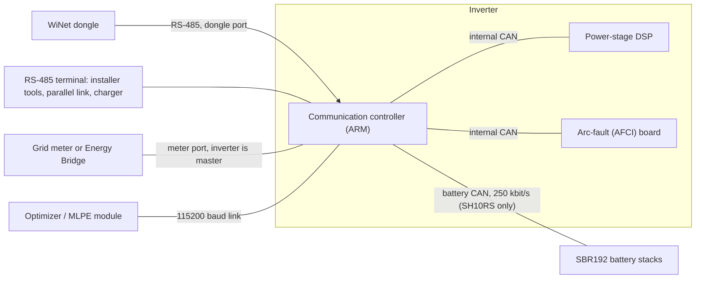
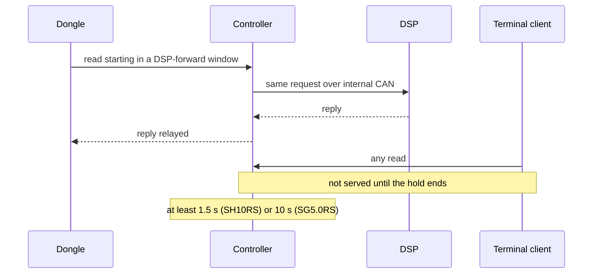

# Inside the inverters

The dongle only ever talks to one chip in the inverter. Several of the inverter's habits make
sense once you know that this chip sits between the dongle and everything else: some reads are
slow, the battery seems to have its own Modbus addresses, and a setting written in the wrong
place can quietly take over the grid meter. This chapter goes through the two inverters these
documents cover, the **SH10RS** hybrid (solar plus battery) and the **SG5.0RS** string inverter
(solar only), from a communications point of view.

Register numbers on this page are the 1-based numbers used in Sungrow's Modbus documentation.
On the wire the address is one less.

## Two processors, one doorway

Each inverter has two main processors:

- The **communication controller** is an ARM microcontroller (an STM32F417 on the SH10RS). It
  owns every external port, answers Modbus requests, runs the battery link, the meter link and
  demand response, and keeps the settings.
- The **power-stage DSP** (digital signal processor; a TI TMS320F28374 on the SH10RS) runs the
  power electronics: MPPT, the grid connection, battery charging and the protection trips, in
  two 18 kHz control interrupts plus a co-processor for the PV boost stages. It
  has no external port of its own. The controller polls it over an internal CAN bus (on the
  SH10RS each value is refreshed about every 0.6–0.8 s) and keeps the results in its own memory.

**Modbus** is the request/response protocol the dongle uses: a master sends "read N registers
starting at address A from slave S", and the slave answers. A **register** is one 16-bit value.
The inverter is a Modbus slave on its dongle port. On some other ports it is the master.

The controller's ports:

| Port | Role of the inverter | What is on it |
|---|---|---|
| Dongle port | Modbus slave, 9600 baud | the WiNet-S or WiNet-S2 |
| Second RS-485 terminal | slave, or master in some modes | installer tools; on the SH10RS also the parallel-inverter link, an EV charger or an RS-485 battery |
| Meter port | master | the grid meter; on the SH10RS optionally an Energy Bridge or an EV charger |
| 115200 baud module link | master and slave | an SP600 optimizer/MLPE module |
| Battery CAN (SH10RS) | master | the SBR battery control units |
| Internal CAN | master | the DSP and the arc-fault board |

The dongle port and the second terminal share the same request handlers, so both answer the same
register map.

## Why some reads are slow

The controller does not keep one flat register file. It looks at the **start address** of each
request and hands the request to the handler for that address window. Most windows are answered
at once from the controller's memory, in about 4–10 ms.

A few windows are not. Their registers live only in the DSP, so the controller forwards the
request over the internal CAN bus and relays the DSP's reply back. These are the **DSP-forward
windows**:

- 16000–17500 and 29500–29899 on both inverters (29900 too on the SG5.0RS);
- 36702–38999 on the SH10RS only.

Forwarding itself is fine. The cost is what the controller does meanwhile: it reserves its
slave-port arbiter for a fixed count of main-loop passes, and it does not release it early when
the DSP has already answered. During that time the other Modbus ports are not read at all, and
the controller's own polling of the DSP stops, so live values quietly stop updating. The hold is
**at least 1.5 s on the SH10RS and at least 10 s on the SG5.0RS** for every forwarded request.
If the DSP answers with a Modbus exception, the controller drops it and the requester simply
times out.

The dongles never poll these windows. They are reached only by pass-through traffic: the
cloud's raw register commands, or a client on the dongle's Modbus TCP server. A Modbus TCP client
that scans address ranges can therefore stall the inverter's serial ports.

On the SH10RS one more register makes it worse. A multi-register write of 170 (0xAA) to 37004
switches on a persistent mode in which every later forwarded write holds the ports for an
effectively unlimited time. Writing another value to 37004 from the same port, or a restart,
undoes it. The same code exists on the SG5.0RS but cannot be reached there.

The battery window 19101–20000 on the SH10RS is a second slow path: those requests are tunnelled
to a battery control unit over CAN, and an unanswered request times out only after at least 1.5 s. Details of every window are in
[the SH10RS register windows](../reference/devices/sh10rs/register-windows.md).

## Answering for the battery

An SBR192 battery stack never sees a Modbus frame from the dongle. Its battery control unit (BCU)
broadcasts its data on the battery CAN bus every second, and the SH10RS keeps the latest frames
in memory. When the dongle reads slave address **200, 201, …, 204**, the inverter answers for
the stack itself, from those frames.

- A stack is bound to a slave address by its serial number, in the order the inverter first saw
  it. The binding survives restarts and does not follow the stack's CAN address or its role in a
  parallel group.
- When a stack stops sending, the inverter marks it offline and then stops answering on its
  address altogether, so the dongle sees timeouts rather than an "offline" value.
- Only one battery window is really forwarded: 19101–20000, the BCU's own service registers,
  wrapped as Modbus RTU and sent over CAN.

How the frames turn into the battery registers 10600–10890, and the gaps in that range, is part
of [Inside the battery](08-inside-the-battery.md).

## The change stream

The dongle polls the inverter over a 9600 baud line, which carries roughly a thousand bytes a
second. The full set of about 740 registers takes close to two seconds on the wire alone.
Both inverters therefore speak a private function code, **0x65**, that the dongles use for
their main polling. A full call returns every tracked register in six or seven replies. After
that, each "continue" call returns only the registers whose value has moved beyond a small
per-register **deadband** since the last time they were reported. The values are the same ones a
normal read returns. They are just sent only when they change.

The deadbands are in raw register units. On the SH10RS the main power values have a deadband of
50 W, so the dongle's power reading can sit up to 50 W away from the truth until it moves
further. The SG5.0RS uses 1 W for the same registers. See
[Modbus function codes](../reference/protocols/modbus-function-codes.md).

## Demand response (DRM)

Australia's inverter standard AS/NZS 4777.2 defines **demand response modes**: a network
operator's **DRED** (demand response enabling device) plugs into the inverter's DRM port and
asserts one of nine commands:

- DRM0: disconnect.
- DRM1 to DRM4: consumption (charging from the grid): no consumption, at most 50 %, at most 75 %,
  or increase consumption.
- DRM5 to DRM8: generation: no generation, at most 50 %, at most 75 %, or increase generation.

The controller reads the DRM lines itself on five analogue inputs, decodes the command, and
passes the resulting state and limits to the DSP. The dongle has no part in it. It can only read
the state (register 5503) and the reason for any power limit (5506, which on the SH10RS reports
512 for any DRM limit; the SG5.0RS power stage has no DRM reason of its own and shows a DRM limit
as an ordinary active-power limitation, 2).

The two inverters differ:

- The **SH10RS** acts on all nine modes, including the power-factor targets of DRM3 and DRM7.
- The **SG5.0RS** has no consumption to limit. It acts only on DRM0 and DRM5–DRM8.

DRM works only when it is enabled (register 30113 = 170) and the country is Australia or New
Zealand (on the SH10RS also country codes 100–105, and not in EMS mode 8). With DRM off the
state reads 255. On the SH10RS, "enabled, no command" reads 254. On the SH10RS the dongle sees the state only while a mode is asserted, because the inverter's
capability bitmap hides the register otherwise.

One trap: when all five inputs are low, the inverter decodes them as DRM0. Enabling DRM with no DRED
attached probably stops the inverter.

## What a grid code changes

The **grid code** (country or region profile, picked at commissioning) is more than a label. It
sets the protection limits for grid voltage and frequency and the power-quality behaviour, such as
the volt-var (Q(U)) reactive-power mode an Australian SG5.0RS runs. It also decides which
features exist. The DRM enable register on the SG5.0RS returns an error unless an AU or NZ code
is active. The SH10RS has a German ripple-control mode, gated on the German code, that is present
but does nothing in this firmware. The dongle's own installer pages come from a per-region
settings template, so the grid code also decides which settings you are offered there. See
[grid codes and DRM](../reference/devices/sh10rs/grid-codes-and-drm.md) and
[device types and grid profiles](../reference/devices/device-types-and-grid-profiles.md).

## The meter port

The grid meter is wired to the inverter, not to the dongle. On this dedicated RS-485 port the
**inverter is the master**. It sends probe frames until a meter answers (normally at address 254),
works out the meter type from the answer, and from then on polls it every 100 ms (every 200 ms
for most types on the SG5.0RS). It also pushes the configured CT ratio to meters that need it.
If 13 requests in a row go unanswered, the meter is declared lost. The last values stay visible
for about 30 more seconds and then become invalid. The results appear to the dongle as ordinary
registers (5601 onward). The export limit, and on a hybrid the battery's charge and discharge
decisions, work from this reading.

On the SH10RS the same port can carry an Energy Bridge (address 246) or share time with an EV
charger, and an app button starts a meter-recalibration session that briefly switches the meter
to the DL/T 645 protocol.

### Why "meter sync" is dangerous on a hybrid

The dongles have a second path. When a Modbus meter is attached to the **dongle's** RS-485
bus, the dongle copies ten of its readings into the inverter, writing 16 registers at 33519 over
and over. For 60 s after each such write the inverter **ignores its own meter port** and uses the
dongle's values instead. The dongle sends no phase currents, and it repeats the same values many
times between its own meter reads.

On a site whose meter is wired to the inverter, those writes would replace the real grid reading
behind the export limit and the battery control with a slower, partial copy. The dongle sends
them only when it has a meter in its own device list. Any other tool that sends them on a hybrid
with its own meter takes over the inverter's view of the grid. See
[writes and meter sync](../reference/protocols/writes-and-meter-sync.md) and
[meters](../reference/devices/meters.md).

## SH10RS and SG5.0RS side by side

| | SH10RS (hybrid) | SG5.0RS (string) |
|---|---|---|
| PV inputs | 4 MPPT | 2 MPPT |
| Battery CAN, slaves 200–204, tunnel 19101–20000 | yes | no |
| Hybrid control registers (13000 range) | yes | no |
| DSP-forward windows | three, hold at least 1.5 s | two, hold at least 10 s |
| Registers in the change stream | 740, power deadband 50 W | 667, power deadband 1 W |
| DRM modes acted on | all nine (DRM0–DRM8) | DRM0, DRM5–8 |
| Meter port extras | Energy Bridge, EV charger, meter recalibration | none |
| Other | parallel-inverter link | an extra encrypted 115200 baud port; an optional relay of foreign-address requests from the backup RS-485 port |

Per-model detail: [SH10RS](../reference/devices/sh10rs/) and [SG5.0RS](../reference/devices/sg5rs/).

## How firmware reaches the parts behind the controller

An inverter update package holds images for several processors. The dongle delivers each image
to the controller through a bootloader mailbox (registers 20000–20175). The controller then
passes each image on to the part it belongs to:

- the **DSP** and the **arc-fault board** over the internal CAN bus. While the DSP is being
  updated the inverter stops producing power.
- the **battery** over the battery CAN bus (SH10RS). The image goes to the master BCU, which
  hands it on to the other stacks. During the session the stacks stop their normal reporting and
  open their contactors.
- an optimizer module over the 115200 baud link.

The sequence, timings and error codes are in
[device firmware relay](../reference/firmware-update/device-firmware-relay.md) and
[SH10RS firmware update](../reference/devices/sh10rs/firmware-update.md). The dongle's own update
is covered in [Firmware updates](06-firmware-updates.md).
