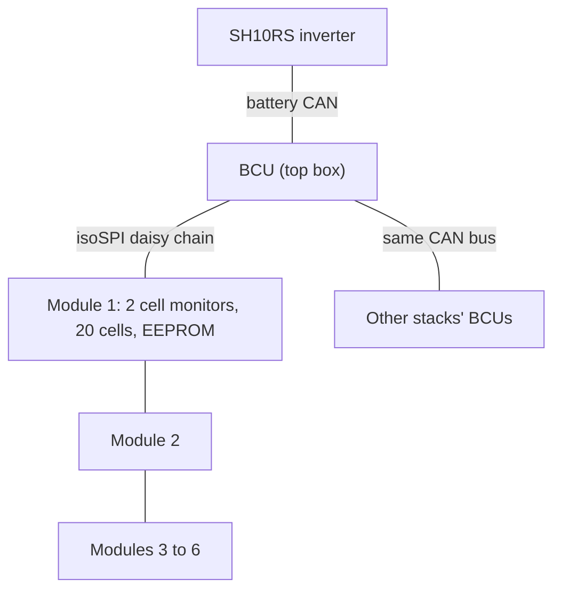
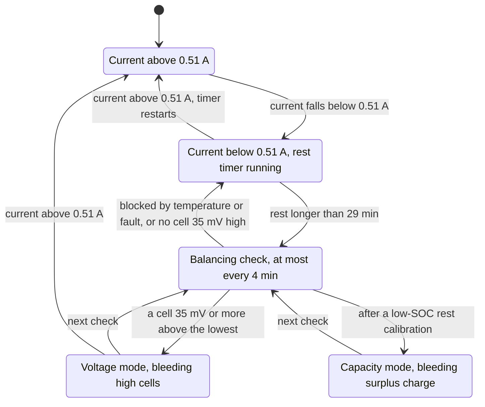

# Inside the battery

An SBR192 is mostly cells, but what decides how it behaves is the small computer on top of it.
That computer measures every cell, keeps its own idea of the state of charge, decides when to
balance, trips protections and, with several stacks, negotiates with its neighbours. This chapter
explains what it does, why the numbers in Home Assistant move the way they do, and why some
batteries hardly ever balance.

Register numbers on this page are the 1-based numbers used in Sungrow's Modbus documentation.
On the wire the address is one less.

## What is in the box

An SBR192 stack is a **battery control unit (BCU)** in the top box sitting on six **modules**.
Each module holds twenty LFP (lithium iron phosphate) cells of 3.2 V nominal in series, so a
stack is 120 cells, 384 V nominal, 50 Ah and 19.2 kWh. Other SBR sizes use the same parts with a
different number of modules, up to eight.

- The BCU is an STM32F417 microcontroller. It keeps its settings, thresholds and counters in
  FRAM (a small non-volatile memory).
- Each module carries its own EEPROM with its serial number, its charge-current derating table and
  a statistics block that includes its cycle counter. A module's history therefore travels with
  the module if it is moved to another stack.
- The BCU talks to the inverter, and to the other stacks, on one CAN bus at 250 kbit/s. A second
  CAN bus links the stacks for firmware hand-over and serves Sungrow's service tools. The inverter
  does not use it.

## How the cells are measured

Every module has two **cell-monitor chips**, each watching ten cells and two temperature sensors.
They use the Analog Devices LTC6811/LTC6813 command set. The exact part is not identified. The
chips of all modules form one **daisy chain** over **isoSPI**, a
transformer-isolated version of the SPI serial bus, so the BCU's low-voltage electronics never
touch the 384 V stack directly.

The BCU runs a fixed schedule:

- **Every 200 ms, cell voltages.** It first sends a *mute* command that switches off any
  balancing current, waits 10 ms, starts a conversion of all cells, reads the results and sends
  *unmute*. Bracketing each reading like this keeps the bleed current from distorting the
  measurement. Voltages are kept to 0.1 mV.
- **Every second, temperatures.**
- **Every 6 s, an open-wire test.** It reads every cell twice, once with a small pull-up current
  and once with a pull-down. A broken sense wire shows up as a large difference.

Every reply carries a checksum. If the chain keeps failing for 3 s, 6 s or 10 s, a
communication-loss alarm rises through levels 1, 2 and 3. The module where the chain broke is
recorded, and the inverter shows it in the faulted-module bitmap (10790).

## Keeping the state of charge honest

The **state of charge (SOC)** is how full the battery is, in percent. A BCU cannot measure it
directly. It keeps a model per module:

- **Coulomb counting.** Every 50 ms it adds the current × time to each module's running total.
  The counting is accurate in the short term but drifts slowly.
- **Low-end rest calibration.** After at least 60 minutes at rest, with the module voltage steady
  to within 5 mV, the BCU compares the cells with a table of open-circuit voltage against
  temperature. At the bottom of that table (about 3.28 V per cell at 25 °C) the voltage is a
  reliable guide to charge, so a module that rests near empty gets its SOC corrected and a fresh
  anchor for learning its capacity. LFP cells have a very flat voltage curve in the middle, so
  this correction only happens near empty. A battery that is never left resting near empty rarely
  gets it.
- **The top end.** At the top the arithmetic does the pinning. The stack shows its fullest module
  once that reaches 95 %, reports 100 % from 99.01 % up, and stops accepting charge as soon as
  any module is full. When it sees a seven-module stack charging at 502 V or more, the inverter
  also sends a one-off command that sets every module's SOC to 100 %. Six-module stacks never
  receive it.

The stack SOC blends the lowest and highest module. Above 95 % it follows the highest module and
below 6 % the lowest; in between it stretches the lowest module's value so the two ends meet. The
stack therefore reads 100 % when its first module is full and 0 % when its first module is empty.

Other counters:

- **Cycles.** Each module counts the charge it has moved, in steps of one fiftieth of its
  *learned* capacity (nominal × state of health), so one full cycle is 100 counts. The stack
  reports module 1's counter. Because the learned capacity shrinks with age, an older stack
  counts cycles a little faster than its amp-hour totals suggest.
- **State of health (SOH)** is the lowest module's value.
- **Internal resistance** (10690) is a formula, not a measurement: 4 mΩ per cell plus a small
  amount per cycle.

## Balancing: a sunny day

Cells in a long series string never stay exactly equal. The fullest cell decides when charging
must stop, so a stack whose cells drift apart loses usable capacity. Balancing fixes that by
**bleeding** the high cells: the cell monitors switch a resistor across each chosen cell and turn
a little of its charge into heat.

Here is what a typical day looks like. The sun is out and by early afternoon the battery is full.
At 100 % the inverter stops charging, and because the panels now cover the house load the
battery current falls to almost nothing. The BCU sees the stack at rest and starts a timer. Half
an hour later the next balancing check (these run at most every four minutes) finds the stack
still resting and compares every cell with the lowest one. A few cells sit more than 35 mV above
it, so their bleed resistors go on. Each cell is switched off again once it is within 15 mV of
the lowest. About 40 minutes after the battery reached 100 % the balancing status turns to
"voltage mode", and 30 to 70 minutes later it goes back to idle.

Now the same battery in a house that cooks dinner at five. A cloud passes, or the evening load
starts, and the battery begins to discharge at more than half an amp. The rest timer starts again
from zero, so the half hour of rest never comes. A house with steady daytime or evening load can
go a long time without seeing balancing.

## Balancing: the rules

- A balancing check runs **at most every four minutes**, as long as balancing is enabled
  (default on) and the BMS has no fault.
- **Rest**: the stack current must be below **0.51 A** and must have stayed there for **more than
  29 minutes**. Any current above 0.51 A, either way, restarts that timer.
- **Temperature gates**: nothing happens if the modules are **10 °C or more apart**, if the
  hottest is **above 44.99 °C**, or if the coldest is **at or below 0 °C**.
- **Which cells**: when the lowest cell is above 3.100 V (3.1001 V or more), cells **35 mV or
  more above the lowest** are bled until they are **within 15 mV** of it. When the lowest cell is
  3.100 V or lower, cells at or above **3.135 V** are bled until they fall below **3.115 V**.
- **Floor**: a cell is never bled below **3.100 V**.
- **Heat**: once a module reaches **70 °C**, no new cells are added to its bleed list.
- **Same cell type**: voltage-mode balancing runs only when every module in the stack has the same
  cell-type code (a letter in the module serial number).

### The second mode

**Capacity mode** works on estimated charge rather than voltage: the BCU bleeds each cell's
surplus charge over a reference cell once it exceeds 3 % of capacity. It starts only after the
low-end rest calibration described above, so in practice it is rare and brief.

### Watching it

- **10683** is the balancing status: 0 idle, 1 capacity mode, 2 voltage mode.
- **10684** is the low-SOC calibration aggregate: 0 inactive, 1 some modules calibrated, 5 all
  modules calibrated. It drops back to 0 as soon as the current exceeds 0.5 A.

Thresholds and formulas: [balancing and SOC](../reference/devices/sbr192/balancing-and-soc.md),
[cell monitoring](../reference/devices/sbr192/cell-monitoring.md).

## Protections

Each protection has **three levels**, each with its own set point, clear point and delay:

- **Level 1** is a warning. For most alarms it also cuts the matching current limit to zero, so a
  high-voltage warning stops charging and a low-voltage warning stops discharging.
- **Levels 2 and 3** set protection bits. Any protection bit cuts **both** limits to zero.
- In the **Fault** state the contactors open. The BCU returns to standby after 10 s without a
  level-3 fault, or shuts down if certain faults persist (from 3 s to 15 min, depending on the
  fault).

Cold weather is a good example. Charging is checked only while current flows in: a coldest cell at
−1 °C raises a warning, −3 °C stops all current. Discharging is allowed much colder: it warns at
**−21 °C** and stops at **−23 °C** (level 3 at −25 °C, clearing at −17 °C). Before any of that, the
derating table in each module's EEPROM has already been trimming the charge current as the cells
cool. After 24 hours at or below 0 °C the master stack also raises the SOC below which discharge
stops to 30 %.

There are SOC floors too. Below 5.00 % the BCU stops discharge. At or below 3.00 % it also asks the
inverter for a forced charge. The inverter adds its own minimum SOC (register 13059), which it
sends to the BCU. See [protections and limits](../reference/devices/sbr192/protections-and-limits.md).

### The deep-discharge latch

If the average cell voltage stays **below 2.0 V for an hour** (or the lowest cell below 1.7 V with
no measurement fault), the BCU decides the battery is deeply discharged and protects itself. It
stops balancing, stops polling its cell monitors and stops updating SOC and the stack checks,
probably to cut its own consumption. Nothing clears this state except a restart of the BCU.

## Several stacks

Up to **four** stacks can share one inverter, all on the same CAN bus.

- Each BCU keeps its CAN address (0–3) in FRAM and resumes it at start-up. Only when two claim the
  same address do they hold an **election** with random numbers. The winner becomes **master**
  with address 0, and later the master is normally the lowest address.
- The master merges the stacks into one **system** view and sends it to the inverter: system SOC
  (the same high/low blend, across stacks), lowest SOH, summed energy, and current limits of
  "number of stacks × the smallest stack limit", capped at 30 A in the usual setup.
- The master decides which stack may close its contactors, **one at a time**, and only when the
  stack's voltage is within about 5 V of the bus. When a waiting stack sits higher than the
  stacks already connected, the master asks the inverter for a forced charge until they meet.
- When connected stacks drift more than 5 % apart in SOC for a minute, the BCUs pull them to a
  common value. This step is not yet confirmed on a running system.

The slave addresses 200, 201, … that the dongle sees come from the inverter's serial-number
registry, not from the CAN address or the master role. See
[parallel stacks](../reference/devices/sbr192/parallel-stacks.md).

## From CAN frames to registers

Every second each BCU sends a block of up to 32 frames on CAN identifiers `0x700 + 0x20·n + k`,
where n is its address and k the frame number. The SH10RS copies the fields into the battery registers
**10600–10890** and serves them on the stack's slave address. Some frames hold several values in
turn: the statistics frame cycles through eight sub-frames that carry module SOCs, cycles, lifetime
amp-hours and the balancing status. The odd gaps in the range come from this:

- **10601–10664**, **10752–10756** and **10807–10820** always read 0xFFFF. No frame feeds them.
- Some 32-bit pairs (10699, 10791–10806) answer only when the read starts at the first register.
  A read that starts on the second register returns nothing.
- The protection and warning words (10667–10674) arrive as hex text, two characters per register
  and in swapped order.
- The stacks' own current limits are not served per stack. They reach the inverter only through
  the master's system frame, as 5635/5636.

On the dongle side, the dongle builds its battery list from the slave addresses the inverter
reports and probes each one, but it adds the batteries only if **every** probed stack answered. See
[registers via the inverter](../reference/devices/sbr192/registers-via-inverter.md) and
[CAN bus](../reference/devices/sbr192/can-bus.md).

## How a battery update travels

A BCU update starts as a file the dongle downloads. The dongle hands it to the inverter through
the inverter's update mailbox. The inverter sends it on the battery CAN bus (identifier
`0x1F0`) to the master BCU. While the update
session runs, the stacks stop their normal reporting and open their contactors, so the battery is
offline for the inverter. When the image is in and checked, the master passes it
to the other stacks over the second CAN bus, then tells the group to shut down and restart. A
stack that misses this stays offline until 10 minutes pass without update traffic. See
[SBR192 firmware update](../reference/devices/sbr192/firmware-update.md).

## Not yet known

- How often capacity-mode balancing (10683 = 1, after 10684 = 1 or 5) runs on a real stack.
- Whether the maximum-discharge-power register (10697) falls below the rated power (10696) when
  the modules derate in the cold.
- The meaning of the bits in the BMS capability word (10699).
