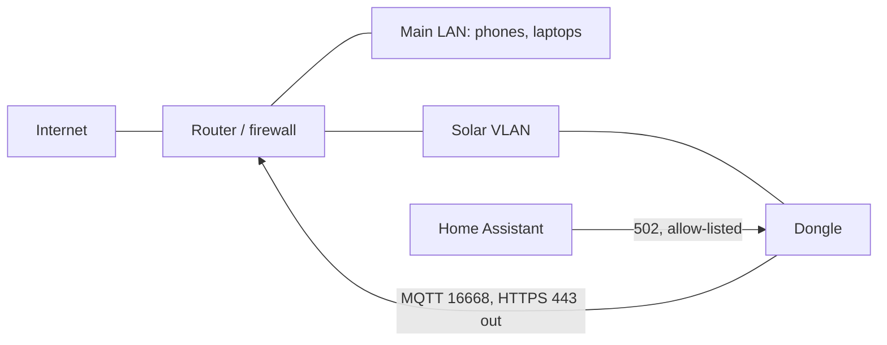

# Security and privacy

This page sets out, plainly, what a WiNet dongle sends out of your house, how it identifies itself,
who can change what, and what you can do about it. It describes behaviour, not attack recipes.
The short version: the cloud link is reasonably protected in transit, while the local network
side assumes everyone on the LAN is trusted.

## What leaves the house

Everything below goes to iSolarCloud over the dongle's single MQTT session, inside TLS.

| What | When | Contents |
|---|---|---|
| Run data | every 5 minutes | power, energy, voltages, battery state and similar values for each device |
| Device identity | on connect, daily, on change | serial numbers, model codes and firmware versions of the dongle, inverter, battery stacks and other devices |
| Dongle details | on connect and on change | the dongle's IP address on your network, the name (SSID) of the Wi-Fi network it joined, Wi-Fi signal strength, Ethernet link state, the cloud server settings |
| Status and heartbeat | on change, every 30 minutes to 2 hours | online/offline and running state of each device |
| Faults | on change and hourly; stored faults replayed after an outage | fault codes with time stamps |
| Parameter changes | when an inverter setting changes | the new value of the setting |
| Live data | only while someone has "Live data" open in the app | selected values every 10 s |
| Log files | only when the cloud requests an export | the dongle's error log, bus captures, inverter and battery logs |

Some smaller items also go up: each time someone loads the local web UI or the app probes the
dongle, a counter is reported to the cloud. Details are in
[iSolarCloud uploads](../reference/protocols/cloud-messages.md).

Log exports are not sent over MQTT: the cloud names an SFTP server, user name and password, and
the dongle uploads the files there. The dongle does not check the server's SSH host key. See
[Diagnostics and log export](../reference/protocols/diagnostics-and-log-export.md).

The dongle also makes a few HTTPS requests of its own: a one-off region lookup and a daily check
for new per-region settings templates. Neither carries the dongle's identity, and neither
verifies the server certificate.

### The optional third-party upload

The web UI can push data to a server of your choosing as XML files over FTP or SFTP, independently
of iSolarCloud. It is off by default. Plain FTP sends the password and data unencrypted, and the
password is stored on the dongle in clear and shown back on the settings page. The upload is tied
to one of the remote-control switches described below, so whoever changes that switch also turns
the upload on or off. See
[Third-party upload](../reference/protocols/third-party-upload.md).

## Identity: the serial number is everything

The dongle logs in to the broker with its **serial number** as client id and a user name and
password that are **the same on every WiNet-S and WiNet-S2**. There is no per-device secret, no
client certificate and no activation step. A plant is bound to a dongle on the cloud side, when
the installer or owner registers that serial number.

Consequences:

- The serial number is printed on the dongle and appears in its hotspot name, its mDNS
  announcement and many of its messages. It is an identifier, not a secret, yet it is the only
  thing that distinguishes your dongle to the cloud.
- The dongle's serial number can be rewritten over the local network (see below). A dongle whose
  serial changes becomes a different device as far as the cloud is concerned.
- A factory reset keeps the serial number, so a reset dongle reappears as the same device.

## The cloud link

- **Transport.** MQTT over TLS to a Sungrow broker on port 16668. The dongle checks the broker's
  certificate chain against a certificate authority stored on its external flash, but it does
  **not** check that the certificate was issued for the broker's host name and sends no server
  name. Any certificate signed by that authority is accepted.
- **Payloads.** Compressed, not separately encrypted. A flag in the topic names suggests payload
  encryption, but it is never applied; TLS is the only protection.
- **What the cloud can do.** Read and write inverter and battery parameters, change dongle
  settings, set the clock, start firmware updates for the dongle and the devices behind it, request
  log exports, run I-V curve scans, turn the hotspot on or off, open the remote-maintenance window,
  and move the dongle to another broker. See [Cloud commands](../reference/protocols/cloud-commands.md).
- **Limiting it.** The web UI's remote-control page has switches for each group of cloud commands.
  On a dongle connected to the European iSolarCloud these choices persist. On every other region,
  the dongle puts the switches back to their factory default (every group allowed; on the WiNet-S
  every group except optimizer layout) within about a second. Elsewhere, the dependable way to
  stop remote commands is to switch the cloud link off with the dongle's cloud switch (unit 247
  register 8021 = 0x55); switching it off on the remote-control page is undone by the same rule.

See [iSolarCloud MQTT link](../reference/protocols/cloud-mqtt.md).

## The local network side

### The open hotspot

The `SG-<serial>` hotspot has **no password**, whatever the web UI shows, and it is on by default.
After 30 minutes its name is hidden, but it keeps running and anyone within Wi-Fi range who knows
or guesses the name can join and reach the web UI and Modbus TCP. During the 10-minute SmartConfig
window after a button click, anyone in range who knows the serial can send the dongle new Wi-Fi
settings. See [Setup and provisioning](../reference/protocols/setup-and-provisioning.md).

### mDNS announcements

Any device on your LAN can ask the dongle, without logging in, for its mDNS record. It contains the
serial numbers of the dongle, the inverter and every battery stack, the inverter model and, with
Ethernet up, the dongle's wired address. See
[Local services](../reference/protocols/local-services.md#mdns).

### Modbus TCP

Modbus TCP has no authentication. The only control is an allow-list of up to five exact client IP
addresses, empty by default (everyone allowed). Anyone who can reach port 502 or 516 can:

- read every value the dongle caches;
- write any holding register of the inverter or battery, with no range check by the dongle;
- write the dongle's own configuration on unit 247: switch the cloud off, lock out the web UI,
  change the serial number or the cloud server, or **factory-reset the dongle with a single write
  to register 39098**.

The TLS variant on 516 uses a server certificate shared by every dongle and asks nothing of the
client, so it hides traffic from passive listeners but does not authenticate anyone. If an
installer configures outbound "client links", where the dongle connects out to a remote Modbus
master, those links get the same unrestricted access and the allow-list does not apply to them.
See [Modbus TCP](../reference/protocols/modbus-tcp.md).

### The web UI

- **Certificate.** A self-signed default certificate, the same on every dongle of a generation,
  whose private key can be extracted from the public firmware. It can be replaced.
- **Roles.** `user` (owner), `admin` (installer) and `develop` (Sungrow). `user` and `admin` each
  have a stored password, which starts as a default shared by every dongle and can be changed;
  the dongle also accepts a rotating, date-keyed password for both roles, so setting your own
  password removes the shared default but does not make the web UI private.
- **No per-parameter permissions.** Any `user` session can read and write every inverter
  parameter, and can send raw Modbus frames to the bus through a pass-through route. The
  "installer only" markings in the settings pages are enforced by the app, not by the dongle.
- **Unauthenticated routes.** A few routes need no login at all, including the ones that upload a
  dongle firmware package. The package's signature check is then the only barrier.
- **The installer "secure login".** The app's commissioning step asks the cloud to confirm an
  installer code, but the dongle's HTTPS call for this does not verify the server certificate, so
  it is weaker than it looks.

See [Web API](../reference/protocols/web-api.md).

### The remote-maintenance window

The `develop` login works only while a 24-hour **remote-maintenance window** ("O&M mode") is open.
It can be opened by an `admin` session on the web UI or **by the cloud**, without anyone at the
site doing anything. A reboot always closes it; a `develop` session that was already logged in is
not ended when the 24 hours run out. While the window is open the dongle also writes more detail to
its serial console. See [Remote access](../reference/protocols/remote-access.md).

### The WiNet-S log stream

The WiNet-S, not the WiNet-S2, can be told by a single Modbus write to unit 247 to stream its
entire system log in plain text to any address and port, inside or outside your network. Nothing
asks for confirmation, and only a reboot stops it. The log includes IP addresses, device
identifiers and cloud and update activity.

### The reverse tunnel that never runs

Both firmwares carry settings and status fields for a vendor reverse tunnel (an ngrok-style client
that would let Sungrow reach the web UI from outside). Nothing in either firmware ever starts it,
and no interface can switch it on. It is inert.

## Firmware integrity

- **Dongle updates** are signed with RSA-2048 and checked against a public key on the dongle. The
  WiNet-S2 refuses unsigned packages at current version numbers; the WiNet-S still accepts unsigned
  packages. The stored key can itself be replaced by an `admin` session, and some update channels
  install the key that comes with the package, so the check is only as strong as the channel. See
  [SGU container](../reference/firmware-update/sgu-container.md).
- **Inverter and battery updates** relayed by the dongle are checked by the dongle only for a
  checksum, not a signature. The inverter verifies its own signature block (RSA-3072) on each image
  before it applies it, while its signature enforcement is switched on (the power-on state of that
  switch is not yet confirmed). See
  [Device firmware relay](../reference/firmware-update/device-firmware-relay.md).
- **Physical access.** Neither dongle has Secure Boot or flash encryption enabled. Anyone with the
  dongle in hand can read both flash chips, including the identity file, and load other firmware
  over the serial port.

## Practical mitigations

- **Put the dongle on its own network segment** (a VLAN or guest network) and let only your
  integration host reach ports 443 and 502. Never forward the dongle's ports from the internet.
  If you also filter outbound traffic, remember that firmware downloads and log exports use FTP or
  SFTP to servers the cloud names, besides MQTT on 16668 and HTTPS.
- **Fill in the Modbus allow-list** with the exact address of your Home Assistant or energy
  manager. Give that host a fixed address.
- **Turn off listeners you do not use**, such as the TLS listener on 516, on the web UI's
  forwarding page.
- **Turn the hotspot off** with two clicks once setup is done. Three clicks, a 5-second hold or a
  cloud command turn it back on. The app's local mode can also work over your home network.
- **Set your own web passwords** for `user` and `admin`, and leave the O&M (remote-maintenance)
  switch closed.
- **Decide about the cloud.** Turning the cloud link off stops telemetry and remote commands, but
  also remote monitoring, app features and firmware updates. In non-European regions the 8021
  cloud switch is the only durable way to refuse remote commands.
- **Be careful with integrations that write.** Check unit ids; never write to unit 247 unless you
  mean to.
- **Keep the dongle physically out of reach** if that matters to you; its contents are not
  protected at rest.
