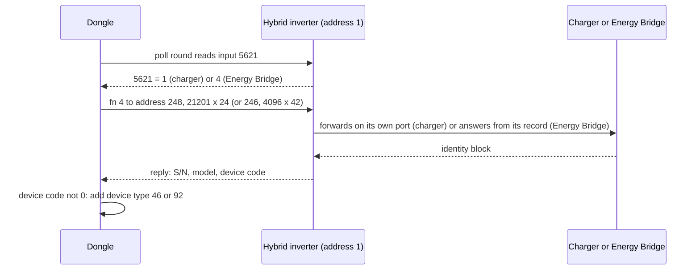

# EV charger and Energy Bridge

No EV charger or Energy Bridge was connected; this page describes how the dongle and inverter firmware treat these
two device types.

Both are **children of a hybrid inverter**. The inverter tells the dongle that one is present through two bits of an
input register, and each sits at a fixed Modbus address, so the dongle never searches for them:

| Device | Dongle device type | Cloud device type | Fixed address | Identity read |
|---|---|---|---|---|
| Sungrow AC EV charger | 46 | 51 | 248 | function 4, 21201, 24 registers |
| Energy Bridge | 92 | 92 | 246 | function 4, 4096, 42 registers |

Register numbers are 1-based, as in Sungrow's Modbus documentation; the address in the frame is one less.

## 1. The trigger: input register 5621

Input register 5621 is part of the inverter's normal poll (every round, gated by the capability bitmap). The dongle
acts on it only for a hybrid inverter (device type 35); for a string inverter the value is stored and nothing else
happens.

| Value of 5621 | Dongle action |
|---|---|
| 6 or more (including the 0xFFFF "no data" value) | Ignored |
| Bit 0 set | Probe the charger at 248, unless a device with that address already exists on the inverter's port |
| Bit 2 set | Probe the Energy Bridge at 246, likewise |
| Bits 1 and 3–15 | Never examined. Values 6 and 7 are rejected by the first rule, so they never probe the bridge |

The probe repeats in **every poll round** until a device with that address exists. Each unanswered probe costs one
2000 ms timeout on the shared bus. Once a device of that address has been seen, a flag stops further probes until the
inverter module is rebuilt (a reboot, or the inverter being re-added), so a removed charger or bridge is not found again
before then.

## 2. The probe request

| Field | Charger | Energy Bridge |
|---|---|---|
| Slave address | 248 (`0xF8`) | 246 (`0xF6`) |
| Function | 4 | 4 |
| Start (frame address) | `0x52D0` (21201) | `0x0FFF` (4096) |
| Count | 24 | 42 |
| Gap before the frame | 18 ms (the inverter's setting) | 18 ms |
| Timeout | 2000 ms | 2000 ms |
| Frame | `F8 04 52 D0 00 18` + CRC | `F6 04 0F FF 00 2A` + CRC |

The reply branch does not check the transaction status and does not count a failure against the inverter. After a
timeout or exception the device-code field reads 0, which is the only failure test.

## 3. Identity blocks

Charger (21201–21224):

| Register | Count | Field | Used by the probe |
|---|---|---|---|
| 21201 | 10 | Serial number (20 characters) | yes |
| 21211 | 4 | not in the input table | no |
| 21215 | 1 | unknown status value | no |
| 21216 | 8 | Model (16 characters) | yes |
| 21224 | 1 | Device code; **0 means "not added"** | yes |

Energy Bridge (4096–4137):

| Register | Count | Field | Used by the probe |
|---|---|---|---|
| 4096 | 1 | Protocol version | no |
| 4097 | 10 | Serial number | yes |
| 4107 | 8 | Model | yes |
| 4117 | 10 | Manufacturer | no |
| 4127 | 1 | Device code; **0 means "not added"** | yes |
| 4128 | 10 | Firmware version | no |

With a non-zero device code the dongle adds the device: parent = the inverter, device type 46 or 92, the inverter's
port, the replying slave address, serial number and model. The device manager accepts at most 15 devices per batch and
applies no device-type filter, as for a battery stack.

## 4. After the device exists: never polled

Each device gets its full point table (62 rows for the charger, 46 for the Energy Bridge; charger rows every 2 s or
hourly for identity, bridge rows every 3 s or every round). The data model's default for its polling switch is **off**
for these two classes, the switch is not persisted, and no path in the WiNet-S2 turns it on: the web, MQTT,
third-party, Modbus-TCP and cloud setters never address that setting for these devices. **The WiNet-S2 therefore never
polls a charger or Energy Bridge cyclically** (the WiNet-S is probably the same). They stay in the device list with serial number, model and device
code only, although the cloud point tables carry 9 charger and 35 Energy Bridge run-data points and the web UI has
charging-station value names.

The point tables are listed in [../appendix/register-tables/rs485-ev-charger.md](../appendix/register-tables/rs485-ev-charger.md)
and [../appendix/register-tables/rs485-energy-bridge.md](../appendix/register-tables/rs485-energy-bridge.md). If polling
were enabled, the generic poll rules of [../protocols/rs485-master.md](../protocols/rs485-master.md) would apply, with an
18 ms gap.

## 5. Inverter side (SH10RS)

### 5.1 EV charger

The SH10RS has a register window, 21201–21999, that it does not serve itself. Any request that starts there, for
**any** slave address, is re-framed and queued to the charger's port; the reply bytes read on that port are written
back unchanged on the **dongle port**. The dongle's read of address 248 is thus answered by a charger behind the
inverter, not by a device on the dongle's bus. With no charger online the job times out and the dongle sees no reply.

| Holding register 33539 ("Charging pile access port") | Charger port |
|---|---|
| 85 (default) | none |
| 161 | the second RS-485 port (forced to 9600 baud); the inverter's RS-485 battery probe shares it by time slots |
| 162 | the meter port, through a shared queue with the meter requests |

Holding register 33538 = 161 reserves the second RS-485 port: no battery or charger traffic from the inverter there,
port at 9600 baud. It is refused while 33539 is not 85, and the other way round.

The inverter is also a master towards the charger:

| Frame | Function, register × count | Purpose |
|---|---|---|
| Identity probe A | 3, 21282 × 16 | 32-byte block used for the secure link |
| Identity probe B | 4, 21224 × 1 | Device code; `0x4381` or `0x4382` expected |
| Energy read | 4, 21308 × 2 | Charged energy (every 2 s) |
| Control value | 0x10, 21203 × 1 | Power or current command |
| Control flag | 0x10, 21212 × 1 | Start (1) / stop (0) |
| Time set | 0x10, 21225 × 6 | Clock, when the charger comes online and then hourly |

The two probes alternate until the charger answers. After 40 unanswered requests the link is lost, and 30 s later the
charger is marked offline. When the charger reports device code `0x4381`, the traffic is encrypted with AES-256. The key
material comes from the 32-byte block and a fixed key that every SH10RS on this firmware shares. PDUs are padded with `0xFF` to 32-byte multiples, encrypted, and framed as address, length, pad count, ciphertext, CRC.

### 5.2 Energy Bridge

The Energy Bridge sits on the SH10RS **meter port** at address 246. Probe D of the meter detection
(`F6 04 10 1F 00 01`) finds it; any valid function 4 reply from 246, while the meter-port mode is automatic and neither
the parallel link nor whole-home backup is on, switches the port to Energy Bridge mode, which replaces the meter poll.
Holding register 32312 = 161 forces this mode ([meters](meters.md#21-settings)).

| Item | Behaviour |
|---|---|
| Periodic reads (frame addresses) | function 4 `0x1041` × 32 every 100 ms pass, `0x1061` × 26 about once per second, `0x1000` × 42 (identity) until the serial number is known |
| Settings pushed (function 6) | `0x1005` = 1 or 0 by the inverter's country class, `0x1006` = 85, `0x100E` = a parameter of the inverter; then `0x107E` is read |
| Request handling | from a 10-entry queue; a reply not received within 1000 ms is dropped; after 3 timeouts the bridge state is reset |
| Values | the bridge's power, phase power, energy and frequency are copied into the inverter's meter values (5601 and up) |
| Status line | GPIO PG4 becomes a debounced (5 ms) input whose state is served in the bridge record |
| Loss | no reply for 30 s raises "bridge communication lost" and clears the mode |

The inverter serves the bridge record to the dongle through its function 4 window 4096–4300; without a bridge the
record's device code is 0, which is what the dongle's 246 probe then reads.

### 5.3 SG5.0RS

The SG5.0RS has neither the 21201 window nor an Energy Bridge mode, and the dongle does not run the 5621 probe for a
string inverter.

## 6. WiNet-S and WiNet-S2

The 5621 trigger, the addresses, the probe registers and the identity offsets are the same in both dongles; the WiNet-S reply handling is probably the same. Both also
have a manual "add charging station" path (device type 46 in the add-device list, route
`/device/addChargingStation`): it probes the same 21201 × 24 block over an address range, checks the reply's status,
length, address, function and byte count, and adds the device as type 46; the web add forces the start address to 248
and the count to 1. The WiNet-S2 web UI drops the charging-pile entry from the add list on its "WiFi-P2" product
variant. The "SP600" code is the optimizer data model, not an EV-charger feature;
only the WiNet-S2 supports it ([optimizers and MLPE](optimizers-and-mlpe.md)).

## 7. Timing summary

| Item | Value |
|---|---|
| Probe repeat | every poll round while the bit is set and no such device exists |
| Probe timeout / gap | 2000 ms / 18 ms |
| Retransmission | none |
| Failed probe | no device, no lost-frame count on the inverter |
| Cyclic poll after the add | none |
| SH10RS charger link loss | 40 unanswered requests, then 30 s |
| SH10RS Energy Bridge loss | 30 s without a reply |

## Not yet known

- The meaning of charger registers 21211–21215.
- Which charger products report device codes `0x4381` and `0x4382`, and the full framing of the encrypted charger
  payload.
- What the Energy Bridge drives on the PG4 status line.
- Whether any dongle firmware version turns on cyclic polling for device types 46 and 92.
