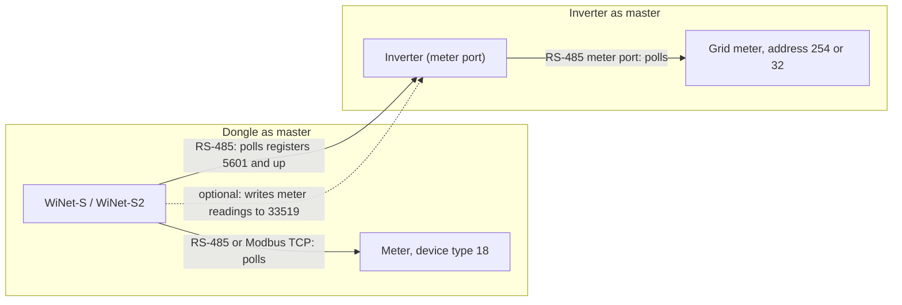

# Energy meters

Apart from the grid meter on a hybrid site's inverter meter port, the description below comes from how the dongle and
inverter firmware treat meters; no other meter was connected.

A Sungrow installation can have an energy meter in two places. It can be a **device of the dongle** (device type 18,
"ammeter"), polled by the dongle like any other Modbus slave. Or it can hang off the **inverter's meter port**, where
the inverter itself is the Modbus master and the dongle only reads the finished values from the inverter's registers.
The two paths share nothing except an optional feature that copies the dongle's meter readings into the inverter.

Register numbers in Sungrow maps are 1-based, as in Sungrow's Modbus documentation, with the frame address one less.
Registers in a meter's own map (section 2) are given as the hexadecimal address sent in the frame.

## 1. Meters on the dongle (device type 18)

### 1.1 How a meter is added

Meters are never discovered automatically. One exists only because an operator added it, from the web UI or the
cloud, with a model code (or a point-table file, section 1.3) and a Modbus address. The equipment driver can poll it
over the dongle's RS-485 port or over a Modbus-TCP client connection. The dongle's web add form places the three built-in
meter models on a network (Modbus-TCP) client slot; the WiMeter and WiProxy use the same driver
([wimeter-and-wiproxy.md](wimeter-and-wiproxy.md)).

Limits: at most 18 device nodes in total on the dongle, a per-port device limit, and at most 59 merged read requests per
device.

### 1.2 Built-in point tables

Three meter models have point tables compiled into both dongles, selected by the model code given at add time:

| Model code | Model | Rows | Register table |
|---|---|---|---|
| 6100 (`0x17D4`) | DTSD1352 | 40 | [rs485-meter-dtsd1352.md](../appendix/register-tables/rs485-meter-dtsd1352.md) |
| 6200 (`0x1838`) | DTSU666 | 28 | [rs485-meter-dtsu666.md](../appendix/register-tables/rs485-meter-dtsu666.md) |
| 6300 (`0x189C`) | S100 | 8 | [rs485-meter-s100.md](../appendix/register-tables/rs485-meter-s100.md) |

All three use one register layout: input registers from 4097, IEEE-754 float32 values across two registers, power
factor at 4141, frequency at 4143, status words at 4153 and 4154. The 6200 and 6300 tables are subsets of the 6100
table. All three are decoded **low word first** (register 2 holds the high half of the float). Whether real meters of
these models send their floats in that order is not confirmed. The 6100 table places two rows at register 4161 (the
phase C power factor and the first energy value), and the energy rows after it are each one value too low. Six energy
values are therefore read from the neighbouring register pair; their intended registers are probably 4163–4173.

This register map is not the meter vendors' public map; it is probably a Sungrow-specific meter firmware option.

### 1.3 Meters defined by a point-table file

Other meters (and other Modbus devices) can be described by an XML point-table file. The header carries a model code,
a device class, a word order and a model string; each point carries the fields of a table row:

| Field | Meaning |
|---|---|
| Model code | Identifies the model |
| Device class | 18 (meter), 11 (environment detector), 13 (box transformer), 14 (tracker), 15 (PID module), 8 (combiner box), 9, 16 |
| Word order | 0–3 (below) |
| Model string | The model name |
| Target value | The value the point fills; an empty entry is read but not stored |
| First register (1-based), register count, Modbus function (1–4) | Where the point is read |
| Poll period | In 100 ms units; ignored for meters, which are read every round |
| End-of-request flag | Bit 0 closes the merged request after this row |
| Multiplier and offset | Applied to the decoded value |
| Wire type | 3 s16, 4 u16, 5 s32, 6 u32, 9 float32, 11 bit |
| Bit expressions | Expressions that derive extra values from single bits |

| Word order | Four bytes b0 b1 b2 b3 become |
|---|---|
| 0 | b0 b1 b2 b3 (high word first) |
| 1 | b3 b2 b1 b0 |
| 2 | b2 b3 b0 b1 (low word first; used by every built-in table) |
| 3 | b1 b0 b3 b2 |

In practice the shipped upload path does not work: `POST /device/importXml/<name>` stores a non-IEC-104 file in a
directory the loader never reads, and nothing else writes the loader's directory, so an uploaded point table cannot
create a device. Of the template classes only 18 (meter) has a data model in the dongle; adding a device of class 8, 9,
11 or 13–16 fails.

### 1.4 Polling and timing

| Item | Value |
|---|---|
| Gap before each request | 1 ms (inverters use 18 ms) |
| Reply timeout | 2000 ms |
| Request size | merged rows, split before 121 registers; function 3 first, then 4, 2, 1 |
| Meter poll rate | every request in every round, whatever the row's period |
| Offline | after 20 consecutive lost replies (inverters: 10) |
| While offline | only the first request is retried, about every 100 s |
| Exception reply | old values kept |

### 1.5 Value decoding and PT/CT ratios

A float32 point is stored as a float in engineering units (V, A, kW, kvar, kVA, kWh, Hz, power factor as a ratio).
Only the exact canonical quiet-NaN pattern `0x7FC00000` is replaced by 0. The web UI prints the float without
applying the table's scale; the scale only sets the number of decimals.

For device type 18 only, the dongle multiplies the decoded values by the user's PT and CT ratios (set in the web
"meter guide"). If either ratio is 0, nothing is scaled.

| Values | Multiplied by |
|---|---|
| Phase and line voltages | PT |
| Currents | CT |
| Powers and energies | PT × CT |
| Power factor, frequency, status words | nothing |

Two further routines exist for meter codes that only a point-table file could define: one computes power factor as
active / apparent power (codes 6031, 6032, 6034), the other applies decimal exponents and sign bits carried in two
status registers (code 6030).

### 1.6 Writes

The meter driver builds no Modbus write. Settings changed for a meter (word order, timeouts, PT/CT) are stored in the
dongle only, so neither the web UI nor the cloud can write to a third-party meter.

## 2. Meters on the inverter's meter port

Both the SH10RS and the SG5.0RS poll their own grid meter on a dedicated RS-485 port (USART4, 9600 8N1) with the
**inverter as master**. The resulting grid power drives export limiting and is served to the dongle as ordinary input
registers: meter active power 5601 (+ import / − export), phase powers 5603–5607, total export and import energy 5611
and 5615, meter frequency 5737, meter reactive power 5738, phase voltages 5741–5743 and currents 5744–5746.

### 2.1 Settings

| Register (holding) | Name | Values | Model |
|---|---|---|---|
| 32312 | Device connected to the METER port | 85 identify automatically, 160 meter, 161 Energy Bridge | SH10RS (reads back a different field) |
| 33143 | Grid/microgrid adaptation | 85 off, 170 on: probe order and period, alternative power source | SH10RS |
| 30053 | Start exhibition mode | 170 stops the meter poll and other internal pollers | both |
| 33498 | Meter reverse connection correction | 85 / 170 | SH10RS |
| 33499 | Meter calibration (button) | write 170 to start (section 2.6) | SH10RS |
| 31228 | Meter CT ratio | 1–65534, default 1 | both |
| 33539 | Charging pile access port | 162 = the charger shares the meter port | SH10RS |

### 2.2 Detection

Until a meter answers, the inverter sends one probe frame at a time in rotation. Frames are standard Modbus RTU, shown
here without the CRC:

| Probe | Frame | Purpose |
|---|---|---|
| A | `FE 03 50 00 00 01` | Read the meter type id at `0x5000`, address 254 |
| B | `20 73 00 00 00 01` | Private function `0x73` to address 32 |
| C | `FE 03 00 3F 00 01` | Read `0x003F`, address 254 |
| D | `F6 04 10 1F 00 01` | Energy Bridge device code, address 246 (SH10RS only) |

The SH10RS probes every 2 s (adaptation on, or once an Energy Bridge was seen) or every 10 s. The SG5.0RS sends B, A, C
every 10 s.

The answer sets a meter type code:

| Code | Address polled | Meter family | SH10RS | SG5.0RS |
|---|---|---|---|---|
| `0x102D` | 32 | Single-phase, 13-register block | yes; also the fallback for an unknown address-254 meter | yes |
| `0x102E` | 32 | Three-phase, 29-register block | yes | yes |
| `0x102F` | 254 | 32-bit power block at `0x0164`, CT written to `0x008E` | dead code (never assigned) | yes; the fallback for an unknown address-254 meter |
| `0x20D5` | 254 | Power block, 16 registers (probably the DTSU666-20) | yes | no |
| `0x1509`–`0x150B` | 254 | Power block plus energy block at `0x0087` | yes | no |
| `0x150E`, `0x150F`, `0x1512` | 254 | `0x11xx`–`0x14xx` register family; `0x1512` takes a CT write at `0x1005` | yes | `0x1512` only |

Because the SH10RS never assigns `0x102F`, an unrecognised address-254 meter is polled at address 32 instead, never
answers there, and never comes online on the SH10RS. The detected type is readable at input 13136 (SH10RS) or 7853
(SG5.0RS).

### 2.3 Polling

| Item | SH10RS | SG5.0RS |
|---|---|---|
| Poll routine | every 100 ms | every 100 ms |
| Request per known meter | every call | every call for `0x102F`, every second call for the others |
| Address-254 families | a fast power request each time, plus one slow request (energy, voltages and currents, frequency) per round of about 5 s | same |
| CT ratio applied to currents | no | yes |
| Data format on the wire | big-endian words, 32-bit values high word first (unlike the inverter's own registers) | same |

With "reverse connection correction" on, the inverter negates the total power and swaps the import and export
counters. For the `0x0164` and `0x102E` families the phase powers keep their uncorrected sign.

### 2.4 CT ratio push

For meter types `0x102F` and `0x1512` the inverter writes its CT ratio into the meter (function `0x10`, one register,
every 10 s until acknowledged): `FE 10 00 8E 00 01 02 00 <CT>` or `FE 10 10 05 00 01 02 00 <CT>`. Only the low byte of
the ratio is sent. On the SH10RS a write of 31228 is refused with exception 04 unless the meter is a `0x1512`.

### 2.5 Loss of the meter

After more than 12 unanswered requests (about 1.3 s) the meter is declared offline, its type is forgotten and probing
restarts. The last values stay in the public registers for 30 s more; then they are invalidated and the
"meter communication lost" flag is raised. There is no per-request retry.

### 2.6 Meter calibration session (SH10RS)

Writing 170 to 33499 starts a session that runs instead of the normal poll. It writes `0x002C` = 1 to the address-254
meter (the protocol-select register of the DTSU666 map, probably switching the meter to DL/T 645), changes the port to even
parity, gives the meter a DL/T 645 address, checks one metering register, and, if it is not at its target value,
saves 15 per-unit calibration values, unlocks, writes nine fixed configuration values, writes the saved values back,
locks, verifies, switches the meter back to Modbus and the port back to no parity, and finally requires the meter to
report type `0x20D5`. The register set probably matches the calibration map of a three-phase metering IC, so the
session probably corrects the metering configuration while keeping the factory calibration. The first write is sent without checking
the meter's make, so on another meter register `0x002C` is overwritten. The iSolarCloud app offers it as a button; the
dongle only relays the app's write.

## 3. DL/T 645 meters on the dongle

DL/T 645 meters cannot be used with either dongle. The pieces that exist:

- the RS-485 receive framer recognises `0x68` frames with an `0xFE` preamble;
- the web add form shows a 12-digit meter address field for two model codes that are not in any model table;
- the add request becomes an internal message that the device manager ignores.

No request builder or data-identifier table exists, and nothing ever asks the port for a DL/T 645 transaction. An add
request blocks the web call for about 30 s and then fails with error 209. A DL/T 645 reply on the bus only produces a
failed Modbus transaction.

## 4. Meter sync from the dongle to the inverter

When the dongle has a meter of its own (device type 18) and both the meter and the inverter are online, both dongles
copy ten of the meter's values into the inverter with one function `0x10` write of 16 registers at **33519**: total and
phase active power, frequency, import and export energy, and phase voltages. The inverter uses the values instead of
its own meter port for about 60 s after each write. The writes run back to back with the poll traffic; after more than
10 consecutive failed replies the dongle tries once every 10 minutes. On a site whose meter is wired to the inverter,
this write would replace that meter's readings, so it must never be sent there. Frame layout, scaling and the
inverter's handling are on [../protocols/writes-and-meter-sync.md](../protocols/writes-and-meter-sync.md).

## Not yet known

- Whether real DTSD1352, DTSU666 and S100 meters send their floats low word first, and whether they send V / A / kW on
  this register map.
- Which meter models carry the inverter-side codes `0x102D`–`0x102F`, `0x1509`–`0x150B`, `0x150E`, `0x150F` and
  `0x1512`, and what answers private function `0x73` at address 32.
- The units of the `0x11xx`–`0x14xx` words and of the trailing word of each `0x102E` phase block.
- The meaning of the non-standard DL/T 645 identifier written at the end of the calibration session.
