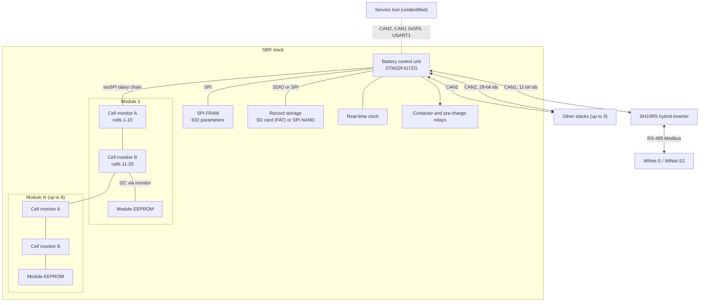

# SBR battery architecture

An SBR stack is a column of identical battery modules with one **battery control unit** (BCU)
on top. The BCU measures every cell, runs the whole battery-management logic (state of charge,
balancing, protections, current limits, contactors) and reports to the inverter over CAN. The
inverter is a client of the BCU: it copies the BCU's limits through to its power stage and
republishes the BCU's data as Modbus registers, but it has no battery logic of its own.

This page describes the BCU firmware version `SBRBCU-S_22011.01.30` as used in an SBR192
(six modules). The other SBR models (SBR096 to SBR256) use the same control unit with a
different module count.

## Block diagram

## The control unit

| Item | Value |
|---|---|
| Microcontroller | STM32F417ZG, 1 MB flash, 25 MHz crystal, 168 MHz core |
| Firmware | `SBRBCU-S_22011.01.30`, one image above a 16 KB boot loader |
| Kernel | a pre-emptive real-time kernel with a handful of fixed-period tasks (below) |
| Parameter store | SPI FRAM (FM25W256). 632 parameters, each a 32-bit value stored together with its bitwise complement and checked on read. Each parameter has a default, a minimum and a maximum; writes outside the range are refused |
| Record storage | FAT32 on an SD card, or a GigaDevice SPI NAND flash on the board. A board-variant strap read at start-up selects one; both media hold the same four record kinds (run log, event log, fault log, fault-upload packets) |
| Real-time clock | separate RTC chip, set from the inverter's time frame (at most hourly) or from a service tool |
| Outputs | four relay drivers for the contactors and the pre-charge path, a self power-off line, an output that toggles every 200 ms (probably a status LED) |
| Inputs | contactor feedback, a three-bit board-variant code, analogue inputs for stack and link voltage and current |
| Buses | CAN1 (inverter and other stacks), CAN2 (service bus and stack-to-stack hand-over), SPI to the cell-monitor chain, USART1 (service Modbus, 115200 baud), USART3 (status Modbus, 115200 baud) |

The parameters cover every threshold, debounce time and mode switch in this documentation:
the protection set and clear levels, the balancing switches, the SOC cut-offs, the stack
address, the module count, the capacity values and the event counters. They are reachable over
the CAN2 service bus by index and through windows of the service map that the inverter
tunnels (see [registers-via-inverter.md](registers-via-inverter.md)).

## Modules

Each module is 20 LFP cells in series, 3.2 V nominal per cell, 64 V and 50 Ah per module. The
40 Ah cell variant exists as a configuration option (rated capacity 40.00 Ah instead of 50.00 Ah).

| Part | Description |
|---|---|
| Cell monitors | two Analog Devices LTC681x-family monitors per module, 10 cells and 2 thermistors each, so 20 cell voltages and 4 temperatures per module. The chips use the LTC6811/6813 command set but protect every register transfer with a 10-bit data PEC and a 6-bit command counter, which points to a second-generation part (ADBMS68xx class). Details: [cell-monitoring.md](cell-monitoring.md) |
| Chain | all monitors of the stack form one isoSPI daisy chain, module 1 nearest the BCU, up to 16 chips for 8 modules. The BCU counts the chips at start-up and sets the module count from the result |
| Module EEPROM | an I2C EEPROM hanging off the second monitor of each module. Every byte is stored twice, as the byte and its complement. It holds the 18-character module serial number (character 5 is the cell-type code, characters 6 to 11 the manufacturing date), the charge-current derating tables, and a statistics block (SOC model state, cycle counter). Module history therefore travels with the module |

Every per-cell and per-module value that later appears as a battery register originates in this
chain.

## Task structure

The firmware runs a small set of periodic tasks. In conceptual terms:

| Period | Work |
|---|---|
| 200 ms | measurement: one cell-voltage conversion and read-back on every cycle, a temperature conversion every fifth cycle (1 s), an open-wire test every thirtieth cycle (6 s), the RTC read |
| 50 ms | the core BMS task: aggregation of cell data into stack extremes (with module and cell locations), coulomb, energy and cycle counting, the protection engine, current limits, SOC, the balancing logic, parallel-stack management, and the protection and warning words |
| 200 ms | the operating state machine (contactor sequencing) and record logging |
| 20 ms | communications: CAN1 and CAN2 receive, the CAN1 transmit scheduler (which does its work once a second), the two UART Modbus slaves, firmware-update handling, the CAN2 telemetry broadcaster |
| 1 s | housekeeping: SD card, statistics write-back, SOC/SOH aggregation, bus re-open if a CAN controller is closed |

## Operating states

The operating state is reported in CAN frame `0x705` byte 0 and served by the inverter as
register 10740 (register numbers on this page are the 1-based numbers of Sungrow's Modbus
documentation).

| Value | State | Behaviour |
|---|---|---|
| 0 | Idle | power-up; enables the outputs and moves to Standby |
| 1 | Standby | limits 0, contactors open; checks pre-charge and faults, then moves to Running, Fault or Shutdown |
| 2 | Running | closes the contactors when permitted, runs the checks |
| 3 | Fault | limits 0, contactors open; back to Standby after 10 s without a level-3 fault, or to Shutdown when certain faults persist (3 s to 15 min depending on the fault) |
| 4 | Shutdown | contactors open; after 3 s the BCU releases its own power latch |
| 5 | Update | firmware update or a CAN2 service-bus record export in progress; contactors open, cell monitors not polled |
| 6 | Correction | calibration mode, selected by a service tool |
| 7 | Test | test mode, selected by a service tool; event logging stops |

## Contactors and pre-charge

The BCU drives four relay outputs, numbered 0 to 3 here.

| Sequence | Steps |
|---|---|
| Close (in Running) | relay 3 on, 50 ms, relay 0 on, 500 ms, relay 1 on, 500 ms, relay 2 off |
| Open | relay 0 off, 500 ms, relay 1 off, 50 ms, relay 3 off, then relay 2 off |

Which relay is the pre-charge relay is not identified. Pre-charge is accepted when the stack
voltage and the link (inverter-side) voltage agree within **5.0 V**, or within **25.0 V** in the
parallel-stack window, with the current within ±3 A. A pre-charge cycle in which current keeps
flowing (at least 0.80 A) while the voltage difference stays large sets a permanent lock-out in
FRAM: the stack then reports a fault on every start and powers itself down until a service tool
clears the parameter. See [protections-and-limits.md](protections-and-limits.md).

Register 10789 reports the contactor: 0 open, 1 contactor fault, 2 closed, 3 contactor fault
(two different fault sources). The closed state requires the feedback input to confirm.

## What the inverter does and does not do

| The BCU does | The inverter does |
|---|---|
| measures every cell and temperature | measures the battery voltage and current at its own terminals and sends them to the BCU (`0x100`) |
| computes module, stack and system SOC and SOH | republishes them (5633, 5634, 10744, 10745) |
| computes charge and discharge current limits per module, per stack and for the system | copies the system limits to its power stage and to 5635/5636; forces the charge limit to 0 at 100.0 % system SOC and the discharge limit to 0 at 0 % |
| balances cells | nothing; it has no balancing logic |
| raises protections and warnings, opens contactors | turns the protection and warning bits into its own fault codes (5448–5472) and flag words (13070–13079) |
| elects a master among up to four stacks and aggregates them | binds each stack's serial number to a Modbus slave address 200–204 and answers register reads from the latest CAN data |
| stores records | pulls them over the `0x1D0` tunnel when the dongle asks for a log export |
| receives firmware | checks the package signature, strips the trailer and relays the image over `0x1F0` |
| applies the SOC window | sends its min/max SOC settings (13059/13058) in `0x106` |

The inverter does not forward ordinary battery register reads to the BCU; it serves them from
RAM. Only the service window 19101–20000 is tunnelled to the BCU. See
[registers-via-inverter.md](registers-via-inverter.md) and [can-bus.md](can-bus.md).

## Related pages

- [can-bus.md](can-bus.md): every CAN identifier and frame layout.
- [cell-monitoring.md](cell-monitoring.md): the isoSPI chain and the module EEPROM.
- [balancing-and-soc.md](balancing-and-soc.md): balancing rules, SOC, SOH and counters.
- [protections-and-limits.md](protections-and-limits.md): alarm levels, words and limits.
- [parallel-stacks.md](parallel-stacks.md): several stacks on one inverter.
- [firmware-update.md](firmware-update.md): how an update reaches the BCU.
- [../sh10rs/battery-interface.md](../sh10rs/battery-interface.md): the inverter side of the link.
- [../../../guide/08-inside-the-battery.md](../../../guide/08-inside-the-battery.md): the narrative overview.
