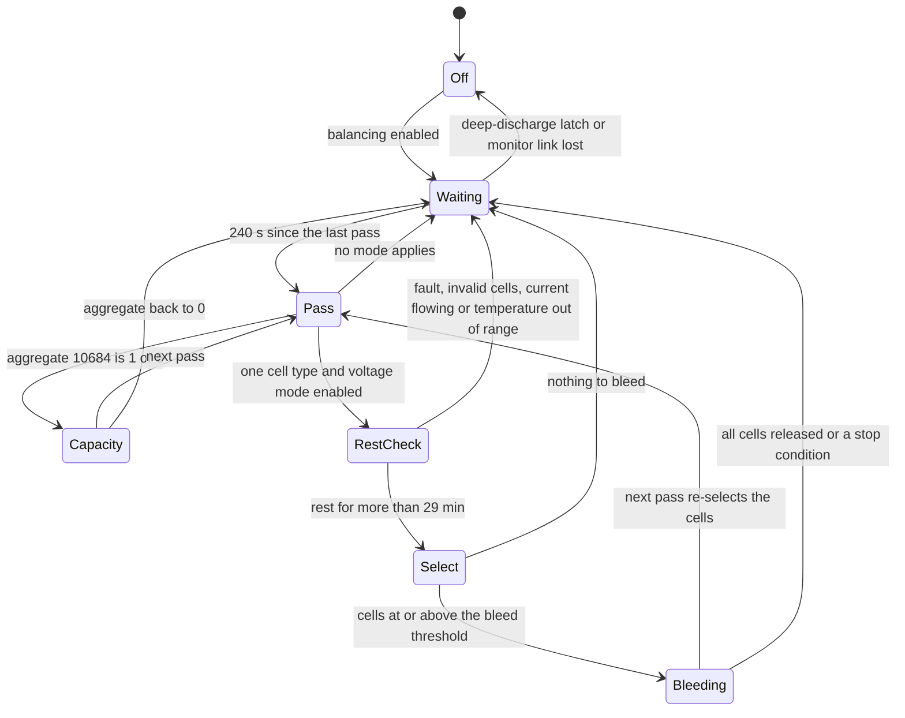

# SBR balancing, SOC, SOH and counters

This page describes how the battery control unit (BCU) of an SBR stack balances its cells and
how it computes state of charge (SOC), state of health (SOH), cycle and energy counters. All of
it runs in the BCU; the inverter only republishes the results. Register numbers are the 1-based
numbers of Sungrow's Modbus documentation, as served by the inverter for slaves 200–204.

## Balancing

Balancing is passive: the BCU switches a discharge resistor across each selected cell through
the PWM (discharge duty) registers of the cell monitors. **Register 10683** shows what the
balancing logic is doing:

| 10683 | Meaning |
|---|---|
| 0 | idle: no cell is being bled |
| 1 | capacity-mode balancing |
| 2 | voltage-mode balancing |

### When a pass runs

| Rule | Value |
|---|---|
| Enable | the balancing-enable parameter (default on). It also selects the reference cell for capacity mode: lowest cell (values 1 and 2) or highest cell (value 3); 0 turns balancing off |
| Pass interval | at most one balancing pass every **240 s** |
| Blocked by | the deep-discharge latch, a cell-monitor communication loss at level 3, a cell-sampling fault |
| Mode choice | **capacity mode** when the low-SOC rest calibration aggregate (10684) is 1 or 5; otherwise **voltage mode** when every module of the stack has the same cell-type code and voltage-mode balancing is enabled (a separate parameter, default on) |

A stack whose modules have different cell-type codes (for example after a module replacement
with a different cell supplier) therefore never balances in voltage mode; it balances only in the
rare capacity-mode windows. Byte 3 of CAN frame 0x719 reports the mismatch.

### Voltage mode

| Rule | Value |
|---|---|
| Start: health | no BMS fault, valid minimum and maximum cell voltages |
| Start: rest | stack current below **0.51 A**, continuously for **more than 29 minutes** |
| Stop: temperature spread | max − min module temperature ≥ **10 °C** |
| Stop: too hot | max temperature above **44.99 °C** |
| Stop: too cold | min temperature at or below **0 °C** |
| Cell selection, min cell ≥ 3.1001 V | bleed every cell at or above **min cell + 35.0 mV**; release a cell once it is below **min cell + 15.0 mV** |
| Cell selection, min cell < 3.1001 V | bleed every cell at or above **3.135 V**; release below **3.115 V** |
| Any bled cell | must be at or above **3.100 V** |
| Thermal guard | once a module's maximum temperature reaches **70 °C**, no new cells are added to that module's mask; cells already bleeding continue |

LFP cells sit well above 3.1 V at full charge, so near 100 % SOC the relative rule
(min + 35 mV, release at min + 15 mV) applies. The absolute pair (3.135 V / 3.115 V) applies only
when the lowest cell is below 3.1001 V.

### Capacity mode

Capacity mode works on charge instead of voltage. The BCU estimates each cell's surplus charge
against a reference cell (the lowest or the highest, as the balancing-enable parameter selects)
and bleeds cells whose surplus exceeds **3.00 % of capacity**. The estimate comes from the SOC
model, which is anchored by the low-SOC rest calibration, so capacity mode starts only when that
calibration has happened: aggregate 10684 = 1 (some modules calibrated) or 5 (all modules
calibrated). The aggregate falls back to 0 as soon as the current exceeds 0.5 A, so capacity
mode is rare and brief: it needs a long rest near empty.

### Writing the masks

The selected cells form a 24-bit discharge mask per module (20 bits used). The BCU writes the
masks to the monitors' PWM registers and reads them back; a mismatch or a PEC error counts as a
failed write. A cell must also pass a mode-specific charge check before it is bled. When a module
drops off the monitor chain, the masks of that module and every module behind it are cleared.

Outside the automatic logic, three service paths can set balancing directly: the tool map on
USART1 and CAN 0x5F0 (write 0x2B6F: one cell, or 0 to stop all), and a CAN2 balancing-control
group. None of them is reachable from the inverter or the dongle.

### State machine

10683 is 2 in the Bleeding state, 1 in the Capacity state and 0 everywhere else.

### What it looks like from outside

On a hybrid site the typical day looks like this:

| Time | Event | 10683 |
|---|---|---|
| T | the stack reaches 100 %; the inverter's charge limit goes to 0 (5635 is forced to 0 at 100.0 % system SOC) | 0 |
| T to about T + 35 min | the charge current tapers off and PV covers the house load; once the stack current is below 0.51 A the 30-minute rest timer runs | 0 |
| about T + 35 to T + 40 min | the next balancing pass (within 240 s) finds cells more than 35 mV above the lowest | 0 → 2 |
| then 30–70 min | the high cells bleed until each is within 15 mV of the lowest | 2 |
| end | no cell selected | 2 → 0 |

So balancing begins about **40 minutes after reaching 100 %** and lasts **30–70 minutes** on a
six-module stack. **Any charge or discharge current above 0.51 A restarts the 30-minute rest
timer**, so a cloud that makes the inverter discharge, or a load that the PV does not cover,
postpones balancing; on days when the stack never rests near full, voltage-mode balancing does
not run at all. Hot (above 44.99 °C) or freezing stacks, and stacks with a temperature spread of
10 °C or more, do not balance.

## State of charge

### Module SOC

Each module has its own SOC model: coulomb counting, an open-circuit-voltage (OCV) calibration
at rest from an OCV-versus-temperature table, and capacity tracking. Module SOC is held in
0.001 % and served in 0.01 % as 10675–10682 (modules 1–8; 0xFFFF for absent modules). The model
state is saved in the module's EEPROM, so a module keeps its history when it moves to another
stack.

### Stack SOC

The stack SOC is blended from the lowest (min) and highest (max) module SOC, all in 0.01 %:

| Condition | Stack SOC |
|---|---|
| max ≥ 95.00 % | max |
| otherwise, min ≤ 6.00 % | min |
| otherwise | 600 + (min − 600) × 8900 / (8900 − (max − min)) |

The stack reads 100 % when its first module is full and 0 % when its first module is empty;
in between the formula stretches the lowest module's SOC so the two ends meet. Modules between
40.00 % and 50.00 % give 600 + 3400 × 8900 / 7900 = 4430, that is 44.30 %.

On CAN the BCU sends the stack SOC in 0.01 % and sends **100.00 % once the blended value reaches
99.01 %**. The inverter divides by 10, so **10744 is in 0.1 %**. When an internal flag is set the
reported SOC is floored at the inverter's minimum SOC + 1 %; what sets that flag is not
identified.

The master stack computes the **system SOC** across stacks with the same blend (highest stack
if ≥ 95.00 %, lowest if ≤ 6.00 %, else the formula), counting only the stacks in the best
operating state. That value is the inverter's 5633. See [parallel-stacks.md](parallel-stacks.md).

### Low-SOC rest calibration

After a long rest a module's SOC is recalibrated from its open-circuit voltage.

| Item | Value |
|---|---|
| Condition | at least **60 minutes** at rest, module voltage stable within **5 mV** |
| Low-end threshold | the low end of the OCV table, about **3.28 V** per cell at 25 °C |
| Reset | any current above **0.5 A** returns the module's state to 0 |

Per-module calibration state (readable through the service map's indirect read, code 0x1004, as
nibbles):

| State | Meaning |
|---|---|
| 0 | no rest calibration since the current last exceeded 0.5 A |
| 1 | only the module's lowest cells are at or below the threshold |
| 3 | the module's highest cell is at or below the threshold: the whole module is at the low end; this also sets the anchor for capacity learning |
| 6 | recalibrated above the low end |

States 2 and 4 are tested by the aggregation but never assigned. The aggregate, served as
**10684**, is:

| 10684 | Rule (first match) | Label |
|---|---|---|
| 5 | every module in state 3 | all modules calibrated |
| 1 | any module in state 1 or 3 | some modules calibrated |
| 2 | any module in state 2 or 4 (cannot happen) | reserved |
| 0 | otherwise | inactive |

Values 1 and 5 start capacity-mode balancing.

### Calibration at the top and between stacks

- A module that is full forces the stack charge limit to 0; the stack SOC follows the highest
  module from 95.00 % and reports 100.00 % from 99.01 %.
- Each stack announces its SOC-calibration events (types 1–4) and its blended SOC to the other
  stacks in frame 0x400. The master picks a target SOC from a calibrated running stack, or the
  midpoint when two running stacks drift more than 5.00 % apart for 60 s, and every running
  stack whose own calibration event type is 0 (or any running stack when the target is 100.00 %)
  writes that SOC into all its modules. Which physical condition produces each event type
  is not identified. Details in [parallel-stacks.md](parallel-stacks.md).
- **Inverter one-off write to 19759.** The SH10RS sends a single Modbus write through the
  service-map tunnel, function 0x10 to 19759, 2 registers, u32 value **100000**, when all of
  these hold: the Sungrow battery protocol is active, the module count in the master's identity
  frame 0x007 is **7**, the system SOC is not 100.0 %, the battery voltage is at least
  **502.0 V** and the battery is charging at 0.3 A or more. The BCU treats 19759 as a dedicated
  action: it sets every module's SOC to the written value in 0.001 % (100000 = 100.000 %). A
  per-stack flag stops it repeating until the condition drops. 502.0 V over 140 cells is
  3.586 V per cell, so it is probably a full-charge calibration for seven-module stacks (SBR224);
  with a six-module master the condition never holds.

## State of health

Stack SOH is the **lowest module SOH**. The BCU sends it in 0.01 %; the inverter divides by 100,
so **10745 is in whole percent**. The system SOH (inverter register 5634, 0.1 %) is the lowest
over the counted stacks. Each module's learned capacity is its nominal capacity × its SOH, and
the cycle counter counts against that learned capacity.

## Counters

| Quantity | How it is counted | Served as |
|---|---|---|
| Lifetime charge / discharge Ah | every 50 ms, \|I\| × dt is added to a charge or discharge accumulator (A·ms) | 10691/10692 charge, 10688/10689 discharge, u32, Ah |
| Discharge/charge ratio | discharge Ah / charge Ah × 10000; a ratio of 1.0007 or more is sent as **9990** (an out-of-range marker, not 99.90 %) | 10687, 0.01 % |
| Lifetime energy | V × \|I\| × dt into a charge or discharge accumulator (W·s), sent in Wh | 10746/10747 charge, 10748/10749 discharge, u32, 0.1 kWh |
| Cycles | each module counts its own throughput (charge + discharge) in its EEPROM: every learned capacity / 50 of throughput adds one count, so a full cycle (2 × capacity) is 100 counts. The stack counter is overwritten on every pass with **module 1's counter**. CAN carries cycles × 10 | 10685/10686, u32, 0.1 cycle |
| Internal resistance | a model of cell count and cycles, not a measurement: cells × (40.00 + 0.005 × cycles) in 0.1 mΩ | 10690, 0.1 mΩ |
| Deep-discharge count | entries of the cell under-voltage protection into level 2 (min cell ≤ 2.50 V); a drop back from level 3 to level 2 also counts | 10693 |
| Cold-alarm hours | time with an under-temperature alarm at level ≥ 2, and the part of it spent charging above 0.5 A | 10695, 10694, h |

Counting against the learned capacity makes the cycle count run slightly ahead of the Ah totals:
a stack whose module 1 has learned 98 % of nominal shows about 2 % more cycles than
(charge Ah + discharge Ah) / (2 × 50 Ah). The stack values are saved to FRAM every 30 passes of
the aggregation; the module values are kept in the module EEPROMs.

The inverter adds its own totals: 5670/5671 (total battery discharge, from the master's system
frame), 13041/13042 (total battery charge; 5673 carries only the low 16 bits of the same value),
5669 and 5672 (daily energy). See [registers-via-inverter.md](registers-via-inverter.md).

## SOC window from the inverter

The inverter sends its minimum SOC (13059, default 5.0 %) and maximum SOC (13058, default
100.0 %) in frame 0x106. The BCU accepts a minimum up to 50.0 % and a maximum of 50.0–100.0 %
and stores both. Its own two SOC thresholds act on top:

| Threshold | Default | Effect |
|---|---|---|
| Discharge cut-off SOC (19939) | 5.00 % | below it the BCU sets "discharging not allowed" (10666 bit 1) |
| Emergency-charging SOC (19941) | 3.00 % | at or below it the BCU sets "discharging not allowed" and "forced-charge request" (10666 bits 1 and 2) |

A stack running with a low cell (1.8 V ≤ min cell < 2.70 V, or an under-voltage alarm) also sets
bits 1 and 2 until the minimum cell reaches 3.0 V or the maximum cell exceeds 3.65 V.
