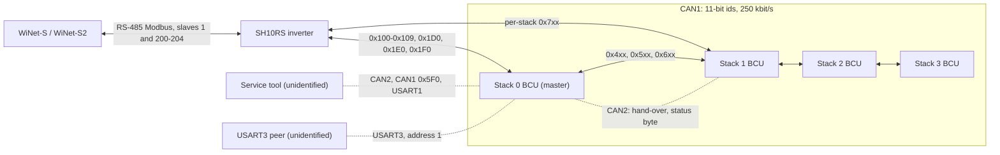

# SBR CAN interfaces and frame map

The battery control unit (BCU) has two CAN controllers. **CAN1** joins the inverter and the
other stacks with 11-bit identifiers; everything the inverter knows about the battery travels
on it. **CAN2** is a J1939-style service bus with 29-bit identifiers that neither the inverter
nor the dongle uses. The BCU also has two serial Modbus ports (USART1 and USART3) and four
Modbus-over-CAN tunnels on CAN1 (0x1D0, 0x1E0, 0x1F0, 0x5F0).

Register numbers on this page are the 1-based numbers of Sungrow's Modbus documentation, except
where a table says **wire**: the BCU's own maps compare 0-based wire addresses, and those are
given as the BCU sees them.

## Bus topology

All stacks and the inverter share one physical CAN1 bus. The inverter firmware calls its end of
this bus CAN2; the BCU calls its end CAN1. Both names refer to the same wires.

## CAN1 link layer

| Item | Value |
|---|---|
| Bit rate | 250 kbit/s. The BCU uses prescaler 12 with 14 time quanta per bit at a 42 MHz bus clock; the inverter's Sungrow detection slot uses prescaler 24 with 7 time quanta at its 42 MHz bus clock |
| Identifiers | standard 11-bit, DLC 8 |
| Byte order | little-endian for every multi-byte field |
| Identifier fields | bits 10–8 = message class, bits 7–5 = stack address n (0–3), bits 4–0 = sub-index k |
| BCU receive filter | classes 1, 3, 4, 5, 6 and 7. A BCU never receives class 0, so stacks do not see each other's system frames |
| Inverter receive filter | all frames; it ignores 0x400–0x6FF |

### Identifier map

| Ids | Direction | Content |
|---|---|---|
| 0x000–0x01F | master BCU → inverter | **system frames**: the per-stack layout, aggregated over all stacks by the master ([parallel-stacks.md](parallel-stacks.md)) |
| 0x100–0x109 | inverter → BCUs | measurements, time, handshake, SOC window, maintenance requests |
| 0x1D0 | inverter ↔ BCU | Modbus-RTU tunnel for the **record export** (window 16000–17448) |
| 0x1E0 | inverter ↔ BCU | Modbus-RTU tunnel to the **service map** (window 19101–20000) |
| 0x1F0 | inverter ↔ master BCU | Modbus-RTU tunnel for the **firmware update** ([firmware-update.md](firmware-update.md)) |
| 0x400 + 0x20n, +1, +2 | BCU → BCUs | SOC-calibration sharing, two alarm levels, trickle-charge state |
| 0x500 + 0x20n | BCU → BCUs | address and master heartbeat, 1 Hz |
| 0x501–0x506, 0x512 (+ 0x20n) | BCU → BCUs | copies of the per-stack frames 0x701–0x706 and 0x700 |
| 0x5F0 | tool ↔ BCU | Modbus-RTU **tool tunnel** (same map as USART1) |
| 0x600 + r | BCU → BCUs | address claim during an election (r = random byte) |
| 0x700 + 0x20n + k | BCU → inverter and peers | **per-stack data**, k = 0x00–0x1F |

Stack n's data frames are 0x700–0x71F for n = 0, 0x720–0x73F for n = 1, and so on up to
0x760–0x77F. The inverter has room for five records (n = 0–4) but the election hands out only
addresses 0–3.

The Modbus tunnels cut a normal RTU frame (slave, function, data, CRC-16 low byte first) into
consecutive 8-byte CAN frames with no header; the last frame carries the remainder. The reply
comes back on the same identifier. The BCU's slave address on these tunnels is its stack
address + 1; on 0x1F0 the inverter always uses slave 1, which only the stack at address 0
answers.

## Inverter → battery frames

| Id | Bytes | Content |
|---|---|---|
| 0x100 | d0d1 u16 | battery voltage measured by the inverter, 0.1 V (inverter register 5630) |
| | d2d3 s16 | battery current measured by the inverter, 0.1 A (5631) |
| | d4d5 s16 | inverter internal temperature, 0.1 °C |
| | d6 | inverter mode 0–3; a 3 takes effect only after three consecutive frames |
| 0x101 | u32 | Unix time; sets the BCU clock. Sent at most once an hour |
| 0x102 | d6 bit 2, d7 | handshake flags. d7 = 1 puts the BCU in **inverter mode 3** (full telemetry); any other value selects mode 2 |
| 0x103 | d0 chunk, d1–d7 | inverter serial number, two chunks (ignored by the BCU) |
| 0x104 | d0 chunk, d1–d7 | "SUNGROW" (ignored by the BCU) |
| 0x105 | d0 chunk, d1–d7 | inverter identity string (ignored by the BCU) |
| 0x106 | d0d1, d2d3 | **SOC window**: min SOC (13059) and max SOC (13058), 0.1 %. Accepted when min ≤ 50.0 %, 50.0 % ≤ max ≤ 100.0 % and min ≤ max |
| | d4d5, d6 | maintenance procedure target SOC, request bits and hold time (inverter registers 33060–33063; see [../sh10rs/battery-interface.md](../sh10rs/battery-interface.md)) |
| 0x108 | d0 bit 1 | an inverter flag; this BCU version stores it and does not use it |
| 0x109 | d0 | 0x55 selects the coordinated shutdown paths between stacks; anything else is stored as 0xAA |

In the running state the inverter sends one frame every 250 ms in a fixed pattern of eleven
slots: 0x100 three times, 0x106, 0x108 and 0x109 twice each, and 0x101 when an hour has passed.

### Handshake

The inverter tries one battery protocol every 3 s. In the Sungrow slot it switches to
250 kbit/s and sends 0x101, 0x102 (d7 = 0), 0x103 ×2, 0x104 ×2, 0x105 ×2 and 0x106, one frame per
250 ms. In inverter mode 2 the master BCU answers each second with its identity frames 0x007,
0x008, 0x009, 0x00A, 0x00B, 0x00D and 0x00E. When 0x007–0x00B have all arrived and 0x00A
carries "SUNGROW", the inverter locks the Sungrow protocol, sends a last 0x102 with d7 = 1, and
the BCUs switch to inverter mode 3.

### Supervision

| Side | Rule |
|---|---|
| Inverter, per stack | a stack that sends nothing for 20 s is dropped: its record is cleared and its Modbus slave stops answering |
| Inverter, link | 20 s without a system frame (0x000–0x005, 0x012) raises a battery-communication fault and restarts detection |
| BCU | once an inverter mode has been received, 60 s without any inverter frame (0x100–0x109, 0x1D0 or 0x1E0) raises the inverter-communication-lost protection (id 42) at level 3. While it is active the BCU drops its master role and stops all 1 s transmissions; only the 10 s identity group continues. Full transmission resumes about 10 s after traffic returns |

## Per-stack frames 0x700 + 0x20n + k

The BCU sends these once a second when the inverter has set mode 3. Without mode 3 it sends
them only after 60 s of inverter silence. Frames 0x707–0x70B, 0x70D and 0x70E additionally go
out every 10 s. The module serial numbers (0x71F) go out as a burst about every 61 s. Words
w0–w3 are the four u16 words of the payload; bytes are b0–b7.

| k | Id (n = 0) | Content | Served as |
|---|---|---|---|
| 0x00 | 0x700 | u32 **protection word**, u32 **warning word** ([protections-and-limits.md](protections-and-limits.md)) | 10667–10674, fault list 5448–5472 |
| 0x01 | 0x701 | w0 charge voltage limit (cells × 3.80 V), w1 discharge voltage limit (cells × 2.00 V), both 0.1 V; w2 charge current limit, w3 discharge current limit, both 0.1 A | not served per stack |
| 0x02 | 0x702 | w0 SOC 0.01 % (10000 once the blended SOC reaches 99.01 %), w1 SOH 0.01 %, w2 remaining energy Wh, w3 rated energy Wh (19200 for an SBR192) | 10744, 10745 |
| 0x03 | 0x703 | u32 lifetime charge energy Wh, u32 lifetime discharge energy Wh | 10746–10749 |
| 0x04 | 0x704 | w0 stack voltage 0.1 V; w1 current 0.1 A, **positive = discharge**; w2 link-side voltage 0.1 V; w3 stack temperature 0.1 °C (0x7FFF invalid) | 10741–10743 |
| 0x05 | 0x705 | b0 operating state; b1 request flags; b2 master flag; b3b4 model code 0x20E6 + (modules − 2) (0x20EA = SBR192); b5b6 a second stack voltage 0.1 V used for parallel matching; b7 parallel-mismatch marker (own address + 1 while set) | 10740, 10666, 10710 |
| 0x06 | 0x706 | w0 max cell temperature, w1 min cell temperature (0.1 °C); w2 max cell voltage, w3 min cell voltage (mV) | not served |
| 0x07 | 0x707 | u32 version word 0x01000030; u16 nominal energy Wh; b6 module count; b7 stack address | 10721–10735, 10665 |
| 0x08 | 0x708 | stack serial number: b0 chunk 0–3, b1–b7 seven characters | 10711–10720, slave binding |
| 0x09 | 0x709 | u32 production date of the BCU as a time value | not served |
| 0x0A | 0x70A | "SUNGROW", chunked as 0x708 | not served per stack |
| 0x0B | 0x70B | "SBRXXX", chunked as 0x708 | not served per stack |
| 0x0D | 0x70D | constant `0F 00 00 00 0F 00 00 00`, the BMS capability word | 10699 |
| 0x0E | 0x70E | constant `07 00 0F 00 00 00 00 00`, the app's self-description masks | 10705, 10701 |
| 0x0F | 0x70F | multiplexed statistics, 8 frames a second (below) | 10675–10698 |
| 0x12 | (0x012) | maintenance-procedure report; sent only as the system frame 0x012 while a procedure runs | inverter 10752–10756 |
| 0x13 | 0x713 | w0 min-temperature location, w1 **min temperature**, w2 max-temperature location, w3 **max temperature** (0.1 °C) | 10761–10764 |
| 0x14 | 0x714 | w0 max-cell location, w1 **max cell voltage**, w2 min-cell location, w3 **min cell voltage** (0.1 mV) | 10757–10760 |
| 0x15–0x18 | 0x715–0x718 | per module pair m, m+1: w0 module min cell, w1 module max cell, w2/w3 the same for m+1 (0.1 mV; min = 0xFFFF without a valid cell) | 10765–10780 |
| 0x19 | 0x719 | b0 contactor status (0 open, 1 fault, 2 closed, 3 fault); b1 faulted-module bitmap (bit m−1 = module m); b2 record-storage health byte; b3 = 1 when the modules' cell types differ | 10789, 10790 |
| 0x1A | 0x71A | per-module cell-type byte (module serial character 5; 1 if the EEPROM read failed) | 10781–10788 |
| 0x1B–0x1E | 0x71B–0x71E | per-module u32 manufacturing date code, two modules per frame | 10791–10806 |
| 0x1F | 0x71F | module serial numbers: b0 module 1–8, b1 chunk, b2–b7 up to six characters | 10822–10893 |

k = 0x0C, 0x10 and 0x11 are not sent. Locations are module in the high byte, cell (or
temperature sensor) in the low byte: 0x0310 is module 3, cell 16.

### 0x70F multiplexed statistics

Word w0 is the mux index; bytes b2–b7 carry the data. One frame of each index goes out every
second.

| Mux | b2–b3 | b4–b5 | b6–b7 |
|---|---|---|---|
| 0 | rated capacity, 0.01 Ah (5000, or 4000 for the 40 Ah variant) → 10698 | max discharge power W = modules × 64 V × module-limited discharge current (whole amps) → 10697 | rated power W = modules × 64 V × 30 A → 10696 |
| 1 | hours under an under-temperature alarm at level ≥ 2 → 10695 | hours charging (> 0.5 A) under that alarm → 10694 | deep-discharge count → 10693 |
| 2 | u32 (b2–b5) lifetime charge Ah → 10691 | | internal resistance model, 0.1 mΩ → 10690 |
| 3 | u32 (b2–b5) lifetime discharge Ah → 10688 | | discharge Ah / charge Ah × 10000 (9990 when the ratio is ≥ 1.0007) → 10687 |
| 4 | u32 (b2–b5) **cycle count × 10** → 10685 | | b6 low-SOC rest calibration aggregate → 10684; b7 **balancing state** (0 idle, 1 capacity mode, 2 voltage mode) → 10683 |
| 5 | module 1 SOC, 0.01 % | module 2 SOC | module 3 SOC |
| 6 | module 4 SOC | module 5 SOC | module 6 SOC |
| 7 | module 7 SOC | module 8 SOC | 0 |

The internal resistance is a model, not a measurement: **cells × (40.00 + 0.005 × cycles)** in
0.1 mΩ, where cycles is the whole-cycle count. An SBR192 (120 cells) at 700 cycles reports
120 × 43.50 = 5220, that is 522.0 mΩ. Nothing in the BCU or the inverter uses the value.

## System frames 0x000–0x01F

Only the master sends them, with the per-stack layout and the master's aggregation rules
([parallel-stacks.md](parallel-stacks.md)). In inverter mode 3 the master sends 0x000–0x006,
0x013–0x01E and, during a maintenance procedure, 0x012. 0x00F and 0x01F are never sent as
system frames. The identity frames 0x007–0x00B, 0x00D and 0x00E go out only in mode 2, so the
inverter refreshes its copies of them (battery version, system nominal energy, module count)
only during a handshake.

| Id | Inverter use |
|---|---|
| 0x000 | system protection and warning words → inverter flag words 13070–13079 |
| 0x001 | system charge/discharge voltage limits (not served) and current limits (d4d5/10 → 5635, d6d7/10 → 5636) |
| 0x002 | system SOC (d0d1/10 → 5633) and SOH (→ 5634) |
| 0x003 | system lifetime charge and discharge energy (→ 13041/13042, 5670/5671) |
| 0x004 | system voltage, current and temperature |
| 0x005 | system operating state and request flags, battery model code |
| 0x007 | battery version, system nominal energy (→ 13039), module count |
| 0x012 | maintenance report (→ inverter 10752–10756) |

## Inter-stack frames

Classes 4, 5 and 6 carry the election, the 1 Hz heartbeat, the peer status and the copies of
the per-stack frames that the master needs for its aggregation. They are described in
[parallel-stacks.md](parallel-stacks.md). The inverter ignores all of them.

## The 0x1E0 service-map tunnel

The inverter forwards Modbus requests for registers 19101–20000, addressed to slave 200–204 (or
to the inverter's own address, which reaches the stack in slot 0), as RTU frames on 0x1E0. It
rewrites the slave byte to the BCU's own address. The BCU's map, its quirks and its contents are
in [registers-via-inverter.md](registers-via-inverter.md#the-service-map-19101-to-20000). Every 0x1E0
frame also counts as inverter contact for the 60 s communication-loss timer.

## The 0x1D0 record export

0x1D0 is a Modbus-RTU tunnel to a small register window, **16000–17448** (wire 15999–17447),
through which the inverter pulls stored records out of the BCU when the dongle requests a
battery log export. It is not a firmware channel.

| Register (wire) | Access | Meaning |
|---|---|---|
| 16005 (16004) | write | command: 0x00A1 = scan the record storage. Scans are at least 5 s apart |
| 16006 (16005) | write | record type: 0x0100 run log, 0x0200 fault log, 0x0300 event log, 0x0501 fault upload |
| 16000–16404 | read | placeholder, every register reads 0x0202 |
| 16405/16406 | read, u32 | scan state: 0 none since boot, 1 scanning, 2 ready, 4 nothing found or 512 KiB or more |
| 16407/16408 | read, u32 | record count |
| 16417/16418 | read, u32 | record length in bytes, rounded up to whole chunks |
| 16419/16420 | read, u32 | total size |
| 16421 | read | chunk size: 50 bytes (10 for the event log) |
| 16422/16423 | read, u32 | chunks per record |
| 16078–16080 (16077–16079) | write via function 0x17 | chunk command 0x00A2, chunk number, record number; the read part returns status 0x00AA, chunk number, byte offset, length and the chunk data |

Function codes 3, 4, 0x10 and 0x17 are accepted; a failed write returns the echo with bit 7 set
in the function code and no exception code. Records must be fetched in ascending order. Each
record has a 12-byte header (magic 0x5AA5, payload length, time in seconds since 2000-01-01,
kind 1–4) and a payload whose layout is not decoded. The scan covers one time window, set by
two cells of the service map (19105 and 19107, BCD YYMMDDHH); when those are unset the scan
covers the current day from 00:00. While a session runs the inverter puts its CAN device into
byte-stream mode, drops all battery broadcast frames and freezes every battery value it serves;
the BCU suspends its own logging. The dongle side is in
[../../protocols/diagnostics-and-log-export.md](../../protocols/diagnostics-and-log-export.md).

## CAN2: the J1939-style service bus

| Item | Value |
|---|---|
| Bit rate | 250 kbit/s, the same timing as CAN1 |
| Identifiers | 29-bit `0x18 PF DA SA`, little-endian payloads |
| BCU address | 0xA1 + stack address; the master uses source address 0x9B during the firmware hand-over, for example start frame `0x1850A29B` to the stack at address 1 |
| Users | other BCUs (firmware hand-over, a once-a-second peer status byte to DA 0xF4) and an unidentified service tool. The inverter and the dongle are not on this bus |
| Authentication | none. A tool must use a source address outside 0xA1–0xB4 |

| PF | Function |
|---|---|
| 0xEA | request one of the 8-byte data groups 0x01–0x45 (an internal data dictionary); reply `0x18 <group> <tool> <BCU>` |
| 0xEC | read or write any of the 632 parameters by index; reads stream two parameters per tick |
| 0xE8 | acknowledge (b0 = 0 done, 1 refused; b6–b7 the group) |
| 0x01–0x45 (other PFs) | grouped writes: pack set-up and module count, threshold groups, **0x20 control and reset** (close or open the contactor outputs, reset the BCU), **0x21 real-time clock**, operating-mode requests (Correction, Test), cell balancing control, telemetry enable |
| 0x50–0x53 | firmware or parameter-table image transfer into the BCU; used by the master to pass a firmware image to its peers ([firmware-update.md](firmware-update.md)) |
| 0x60–0x63 | export of the run, event, error and fault-record logs, the stored table image, or a module EEPROM image, in 1785-byte blocks with CRC-16 and resend commands |
| 0x2F, 0x30 | CAN1/CAN2 loop-back self-test, completes only on a test fixture that bridges the two buses |

Unprompted, every BCU broadcasts about **40 kinds** of periodic 8-byte frames on CAN2: stack
values to DA 0xFA (voltage, current, SOC, SOH every 50 ms; alarm levels every 300 ms; limits,
extremes and state every second; counters every 3–5 s), one module per second to DA 0xF3, and
bulk cell-voltage and temperature arrays to DA 0xFB–0xFF every 2 s. Every write that has a
handler is logged as an event record, accepted or not. Which connector carries CAN2 on the
battery housing is not identified; the firmware hand-over implies that it joins the BCUs of a
multi-stack system.

## The 0x5F0 tool tunnel and the USART1 map

CAN id 0x5F0 carries Modbus-RTU requests and replies in 8-byte chunks, with slave address =
stack address + 1. It serves exactly the register space of the BCU's USART1 port (115200 baud),
with two differences: the 0x5F0 path does not check the request CRC, and it also accepts
function 0x17, which nothing answers. Single-register writes (function 6) are not accepted. There
is no authentication, and no Sungrow device that ships with the battery sends on 0x5F0; the
intended peer (a service or production tool) is unknown. The first request into the service
space starts the CAN loop-back self-test sender, which from then on puts two extra 29-bit test
frames on the buses with every later 0x5F0 frame.

| Address (wire) | Access | Content |
|---|---|---|
| 0x4EE0–0x4EE8 | read (3, 4) | monitor block: stack SOC 0.01 %, an unidentified value, stack voltage, current (0.1 A with a 3000.0 A offset), constants 3200 and 6080, discharge current limit, charge current limit (0.1 A), a flag word 0–3 |
| 0x4EE9 | write | command byte (start/stop request). A read of it returns the value left over from 0x4EE8 |
| group << 8, 0x0100–0x2A00 | read, write | 8-byte data groups (big-endian on this channel): module count and SOC, the protection thresholds, the clock, the FRAM identity records, control and reset at 0x2000. Writes are acknowledged even when a value is refused |
| 0x3000–0x3C00 | read, write | production-test groups: output test, CAN loop-back result |
| 0x5000, 0x5014, 0x5070, 0x50E0, 0x5150, 0x51C0, 0x5230, 0x52A0, 0x5310, 0x5380 | read, write | **module-EEPROM windows** of the selected module (offsets 0x000, 0x028, 0x140, 0x280, 0x3C0, 0x500, 0x640, 0x780, 0x8C0, 0xA00); byte count from the request; writes are not checked |
| 11000–11236 (0x2AF8–0x2BE4) | read | variable-length cell-voltage (mV) and temperature read-outs for the selected modules |
| 0x2B6F | write | balance one cell: high byte module, low byte cell; 0 stops all balancing |
| 0x2B70 | write | module I/O-line test on or off |
| 0xFF00 | read, write | pass-through: the group address is taken from the quantity field, so every group of the CAN2 dictionary is reachable, including groups the range check would exclude |

## USART3: the status slave

USART3 is a half-duplex RS-485 Modbus-RTU slave at **115200 baud, 8N1, fixed address 1**. It
answers functions 3 and 4 identically and function 0x10; anything else is ignored. Who is wired
to this port (an indicator board, a factory tester or an external controller) is not known, and
no connector for it has been identified.

| Register (wire) | Meaning |
|---|---|
| 0x1000 | operating state (0–7); reads 3 while the permanent fault lock-out is set |
| 0x1001 | stack SOC rescaled into the inverter's SOC window, whole percent (0–100) |
| 0x1002 | id of the most recent protection event, shown only while the state is Fault, else 0 |
| 0x1003 | condensed status: 0 shutting down, 1 running, 2 update/correction/test, 3 alarm, 4 fault, 5 starting or standby |
| 0x1004 | 1 while Running, else 0 |
| 0x1005 | current direction: 0 idle (\|I\| ≤ 0.50 A), 1 discharging, 2 charging |
| 0x2000 | write: 1 or 2 = one-shot start request; the BCU relays it to the other stacks in its heartbeat and logs it as an event |

A request that arrives within one 20 ms poll of the previous one is lost, so a master should
leave about 40 ms between requests.
