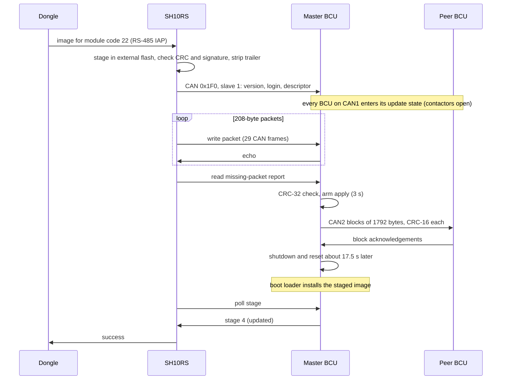

# SBR firmware update

The battery control unit (BCU) is updated through the inverter. The dongle never talks to the
battery: it hands the image to the SH10RS, the SH10RS checks the package signature and relays the
image over CAN to the master stack, and the master stack passes it to the other stacks over its
CAN2 bus. This page follows the image from the inverter onwards. The dongle-to-inverter part is in
[../../firmware-update/device-firmware-relay.md](../../firmware-update/device-firmware-relay.md)
and the inverter's own side in [../sh10rs/firmware-update.md](../sh10rs/firmware-update.md).

Register numbers on this page are the 1-based numbers of Sungrow's Modbus documentation.

## The chain

## In the inverter

| Step | Behaviour |
|---|---|
| Accept | the package names module `SBRBCU-S_22011.01.30`, module code **22**. The inverter accepts it only while its battery protocol is the Sungrow one |
| Stage | the whole image is stored in the inverter's external flash before anything is sent on |
| CRC | the inverter recomputes the image CRC and compares it with the declared value; a mismatch fails the job with error bit 0x200 |
| Signature | the image ends with a 432-byte `SungrowSecureBoot` trailer: a CRC-32 over the trailer's version, length and signature fields, then an RSA-3072 PKCS#1 v1.5 signature over the SHA-256 of the image. The inverter checks the trailer CRC always, and the signature while its enforcement switch (36332) is on (off after power-up on the SH10RS, on on the SG5.0RS); a failed signature fails the job with error bit 0x4000 |
| Strip | the inverter shortens the image by the trailer and recomputes the CRC for the relay. **The BCU never sees the trailer** |
| Relay | the inverter sets its battery CAN device to stream mode with transmit id **0x1F0**, stops its periodic battery frames, and blocks its 0x1E0 tunnel for the duration |

The WiNet-S2 checks before it starts a battery update that the inverter is not running and the PV
power is below 500 W, and otherwise refuses ("BAT cant update"). The WiNet-S has no such check.

## On CAN: the 0x1F0 mailbox

The relay uses the same register protocol as the dongle-to-inverter update (Modbus RTU functions
3 and 16 on a mailbox at 20000–20175), carried as a byte stream on CAN id 0x1F0 in 8-byte frames.
The slave address is always **1**, which only the BCU at stack address 0 answers. A request is at
most 255 bytes; a 208-byte data packet is 225 bytes, that is 29 CAN frames.

| Register | Access | Meaning |
|---|---|---|
| 20000/20001 | read | mailbox protocol version, bytes `01 00 02 00` |
| 20002 | read | progress: 0, or 100 after a successful update |
| 20003 | read | module count (1 for the BCU) |
| 20004 | read | capability: 0x0004; bit 0 clear means the payload is sent unencrypted |
| 20005 | read | **stage**: 1 idle or closed, 2 open and receiving, 3 failed, 4 just updated |
| 20006/20007 | read | **error word** (below) |
| 20010 | write | 0xAA opens a session, 0x55 closes it; must be the first register of the write |
| 20011–20014 | write | login token, a fixed 8-byte value; a wrong token sets stage 3 and error bit 0x02 |
| 20015 | read, write | session idle timeout in minutes (1–30; 0 or above 30 gives 5) |
| 20016 | read | post-update code: 1 no update since boot, 3 failed, 4 updated |
| 20019 | read, write | hold flag: 0 lets the BCU apply the image as soon as it is complete |
| 20022–20036 | read, write | module descriptor string (30 bytes). Rejected on some hardware variants unless the build number is high enough (stage 3, error 0x200000) |
| 20037 | read, write | tag word |
| 20039/20040 | read, write | image CRC (u32, low word first) |
| 20041/20042 | read, write | image length in bytes |
| 20043 | read, write | packet size (208) |
| 20044 | read, write | packet count; writing it clears the received-packet bitmap |
| 20045 | read | highest packet received so far (used to resume) |
| 20045–20167 | write | **data packet**: packet number, byte offset (u32, low word first), length, then the payload in plain bytes |
| 20171 | read | first missing packet (0 if none) |
| 20172/20173 | read | its byte offset |
| 20174 | read | its size (the last packet rounded up to 16 bytes) |
| 20175 | read | packets still missing |

### Relay sequence

| Step | Inverter sends | Advances on |
|---|---|---|
| 1 | read 20000, 2 registers | `01 00 02 00`; anything else fails with error bit 0x08 |
| 2 | write 20010–20018: open (0xAA), token, timeout | echo |
| 3 | write 20019–20021: hold flag 0 | echo |
| 4 | read 20022, 24 registers (descriptor and highest packet) | if the stored descriptor and CRC match and a packet is already held: **resume**, skip step 5 |
| 5 | write 20022–20044: descriptor, tag, CRC, length, packet size, packet count | echo |
| 6 | read 20004, 4 registers | then go to the data phase |
| 7 | write each packet at 20045 | echo |
| 8 | read 20171, 5 registers | resend the reported packet, until none is missing |
| 9 | read 20004 repeatedly | stage 2: keep polling; 4: success; 3: failure, with the BCU's error bits added |

The inverter sends at most one frame per 20 ms, resends after about 100 ms without a reply, and
gives up after 6000 resends (about 10 minutes) with error bit 0x400. The close command (0x55) is
prepared but never sent. A descriptor that the BCU rejects is not noticed by the inverter; the
relay then ends only through the retry limit.

## In the battery

### Every stack stops

The first complete 0x1F0 request with slave address 1 is accepted by **every BCU on CAN1**, not
only the master, and puts each of them into the **Update state**: the contactors and outputs
open, the cell monitors are no longer polled, and all periodic CAN transmissions stop. A battery
update therefore takes the whole battery system offline. Periodic transmissions resume with the
next inverter frame (0x100–0x109). The Update state itself ends at that frame only within the
BCU's first 60 s of uptime; otherwise it lasts until **600 s** pass without a 0x1F0 frame, when
the BCU clears the session, shuts down and resets.

### Staging and checking

| Step | Behaviour |
|---|---|
| Erase | on the first data packet the BCU erases a fixed staging region of its internal flash (sectors 9–11, 384 KiB), with interrupts off. The reply to that packet comes about 3 s late; the inverter's resends during the erase cost one extra resend |
| Program | each packet is programmed at its offset in the staging region; a bitmap of received packets is kept in FRAM, so an interrupted transfer resumes after a reboot |
| Duplicates | a packet already held, or a packet number out of range, is acknowledged and ignored |
| Check | when every packet is in, the BCU computes a **CRC-32/MPEG-2** (polynomial 0x04C11DB7, initial 0xFFFFFFFF, no reflection, 32-bit little-endian words) with its hardware CRC unit and compares it with the declared CRC. This is not the zlib CRC-32 printed in the package descriptor. A mismatch sets stage 3, error bit 0x200 |
| No signature | the BCU checks only this CRC. It holds no signature code, and the image it receives carries no trailer |

### Apply

| Step | Behaviour |
|---|---|
| Arm | with a good CRC and hold flag 0, a 3 s countdown starts and a staging flag is set in FRAM |
| Hand-over | the master passes the staged image to every other stack that is online (below) |
| Reset | about **17.5 s** after the last peer (25.5 s when coordinated shutdown is selected) the master sends five shutdown heartbeats, opens its outputs in order and resets |
| Install | the boot loader copies the staged image into place; the application only sees the result, a FRAM tag that reports "updated" or "failed" at the next start-up. Whether the boot loader checks the CRC is not known |
| Report | the master starts with stage 4 and post-update code 4. If a peer hand-over failed it reports stage 3 instead |

### Hand-over to the other stacks (CAN2)

| PF | Direction | Content |
|---|---|---|
| 0x50 start | master (source 0x9B) → peer (0xA1 + n) | image length, mode (0 = firmware), image CRC |
| 0x51 data | master → peer | sequence number and 7 image bytes; a block is 1792 bytes (256 frames), with a 2 ms pause every fifth frame |
| 0x52 block end | master → peer | block number, block length, CRC-16, last-block flag |
| 0x53 reply | peer → master | 0 next block; 1–7 a list of missing frames; 0x11 end of the list; 0x22 block CRC wrong; 0xFF last block stored |

The peers are handled one at a time. A peer silent for 10 s is marked failed. A peer accepts the
transfer only with its contactors open (or under coordinated shutdown), checks each block's
frame count and CRC-16, programs it into its own staging region, and after the last block records
the image CRC and length for its boot loader.

After the hand-over the master's five shutdown heartbeats should make the peers shut down and
restart with it. A peer that misses them stays in its Update state, contactors open, until its
600 s idle limit, so a second stack can be offline for up to about ten minutes.

A CAN2 start frame with mode 1 instead loads a parameter-table image (stored separately and read
into the parameter tables). The master always sends mode 0; mode 1 is a service-tool function.

## Status and errors

| Error bit | Raised by | Meaning |
|---|---|---|
| 0x02 | BCU | wrong login token |
| 0x04 | BCU | session idle timeout |
| 0x08 | inverter | unexpected mailbox version reply |
| 0x200 | inverter or BCU | image CRC wrong |
| 0x400 | inverter | relay retry limit reached |
| 0x4000 | inverter | signature missing or invalid |
| 0x200000 | BCU | descriptor rejected (outside the 16 bits the inverter reads) |

The dongle maps these into its update-status reporting; see
[../../firmware-update/update-channels.md](../../firmware-update/update-channels.md).

## Timing

| Phase | Duration |
|---|---|
| Inverter receive from the dongle | depends on the dongle link |
| Erase in the BCU | about 3 s |
| Relay of a 315 KB image (1517 packets) | roughly one to two minutes |
| Peer hand-over | per peer, depends on CAN2 load |
| Master reset and install | about 17.5 s plus the boot loader's copy and the start-up |
| Peers back online | with the master's shutdown, or at the latest after their 600 s idle limit |
