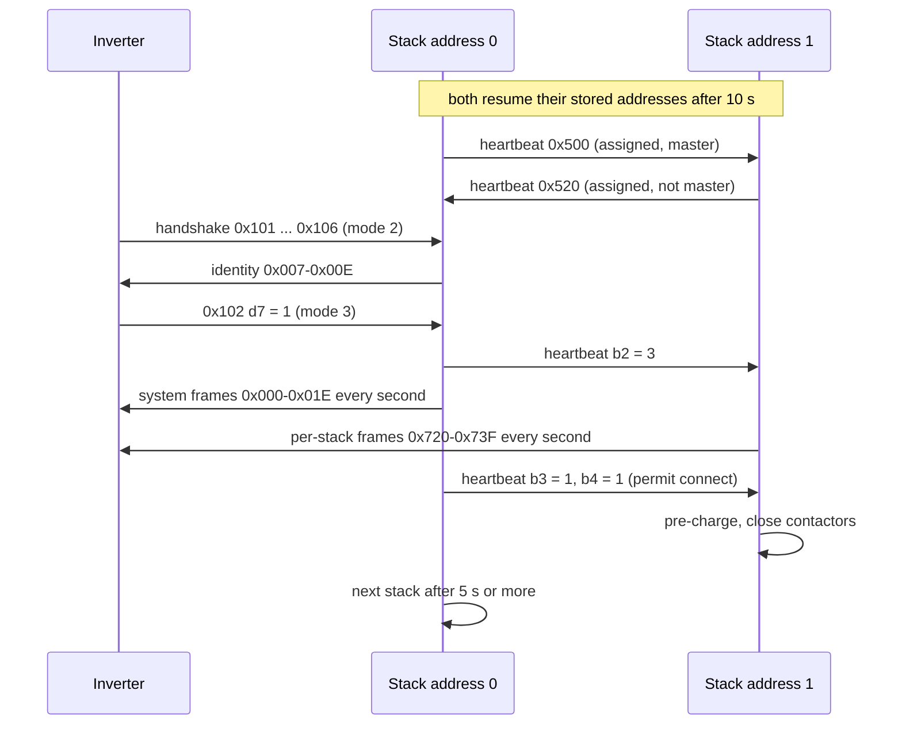

# SBR parallel stacks

Up to four SBR stacks can share one inverter. Their battery control units (BCUs) sit on the same
CAN1 bus as the inverter, elect a **master**, exchange a 1 Hz heartbeat and status frames, and
the master sends the inverter one aggregated **system** view while each stack still sends its
own per-stack frames. The master also decides which stack may close its contactors, one at a
time. A hybrid site with two SBR192 stacks runs exactly this traffic. Register numbers on this
page are the 1-based numbers of Sungrow's Modbus documentation.

## Addresses and the master

Every BCU has a **stack address** n = 0–3, stored in FRAM. It appears in CAN identifiers
(bits 7–5), in frame 0x707 byte 7, and as the BCU's Modbus slave address n + 1 on its tunnels.

| Situation | Behaviour |
|---|---|
| Start-up | for the first 10 s a BCU sends nothing. Then it **resumes its stored address**, marks itself assigned and not master, and joins the running stage. It does not claim at boot |
| Taking the master role | when no peer reports master and the BCU's address is lower than every assigned peer's |
| Giving it up | when a peer master has a lower address |
| Alone | a BCU that hears no peer is assigned and master |
| Duplicate address | both holders clear their address and run an election |
| Peer expiry | a peer that is silent for about 6 s drops out of the election table |

The master is therefore usually, but not always, the lowest address. Two new BCUs that both
carry the factory address 0 both start as master, hear each other, find the duplicate and
re-elect.

### Election

An unassigned BCU sends an **address claim** once a second on identifier `0x600 | r` with a
zero payload. r is the low 8 bits of a hardware random number in 400–699 (so the byte wraps:
400–511 become 0x90–0xFF, 512–699 become 0x00–0xBB); 0xFF is replaced by 0xFE because it marks
"unknown".

| Case | Result |
|---|---|
| no peer at all | address 0, master |
| no assigned peer, own claim lowest | address 0, master |
| no assigned peer, own claim higher | address 1 (the lower claimant will take 0) |
| assigned peers exist, own claim lowest among claimants | lowest address 0–3 not used by an assigned peer, not master |
| own claim higher than another claimant's, with assigned peers | wait |
| equal claims | both re-roll and retry |

Each new address is saved to FRAM and the CAN2 acceptance filters are reprogrammed.

## Inter-stack frames on CAN1

All are 8-byte standard frames sent once a second by every BCU that holds an address.

### Heartbeat 0x500 + 0x20n

| Byte | Meaning | Receiver action |
|---|---|---|
| b0 | 1 = sender holds an address | election |
| b1 | 1 = sender is master | gates b2, b5 and the shutdown variant of b7 |
| b2 | inverter mode as the sender knows it (1 link lost, 2 default, 3 full telemetry) | taken from the master |
| b3 | target stack address of the command in b4, 0xFF = none | the addressed stack applies b4 |
| b4 | command: 0 none, 1 **permit connect**, 2 request disconnect | one-shot, no acknowledgement |
| b5 | "DC link energised": the master sets it when any stack is Running, or when its own stack and link voltages differ by less than 30.0 V | taken from the master; it decides whether the 5.0 V voltage-match test applies to a close |
| b6 | one-shot start request (from the USART3 status port), cleared once sent | the receivers' state machines act on it |
| b7 | system SOC in whole percent (0–100); 0xAA = shutdown broadcast | copied |

The **shutdown variant** (b7 = 0xAA) is sent five times, 20 ms apart, by the master after it has
handed a firmware image to its peers or when coordinated shutdown is selected. A receiver that
sees it from the master shuts down.

### Peer status

| Id | Content |
|---|---|
| 0x400 + 0x20n | **SOC-calibration sharing**, sent once at least two stacks are online: b0 the stack's calibration event type (0–4), b1–b2 its blended SOC (0.01 %), b3 master flag, b4 target-SOC valid, b5–b6 target SOC (0.01 %) |
| 0x401 + 0x20n | b0 level of the negative-voltage (reverse-polarity) fault; b1 the **parallel-mismatch warning** (a closed stack that takes no current although the inverter asks for it for two 30-minute periods, or a stack/link voltage difference above 19.0 V per module for 15 s) |
| 0x402 + 0x20n | master only: b0 low-SOC trickle charge active, b1 cold connect lock, b2 0xAA = the master is powering the group down (0x55 otherwise) |
| 0x501–0x506, 0x512 (+ 0x20n) | copies of the per-stack frames 0x701–0x706 and 0x700: limits, SOC/SOH, energies, voltages, current, temperature, state, request flags and the alarm words |

A BCU ignores its peers' 0x700–0x706 frames and stores the 0x5xx copies instead, because those go
out every second whatever the inverter mode. From 0x707 it stores nominal energy, module count
and address; from 0x719 the contactor status.

**SOC alignment.** The master picks a target SOC from the running stacks: the first closed stack
whose calibration event type is 1, otherwise the last one with type 2–4, otherwise, when the
running stacks' SOCs differ by more than 5.00 % for 60 consecutive seconds, their midpoint.
Every running stack whose own event type is 0 (or whenever the target is 100.00 %) writes the
target into all its modules each second while it holds. The per-stack SOC on slaves 200/201 can
therefore step to a common value. Which physical conditions produce event types 1–4 is not
identified.

**Liveness.** 10 s without a frame from a peer removes it from the aggregation; 180 s clears
its online flag, which also removes it from the firmware hand-over list.

## Master aggregation (system frames 0x000–0x01F)

Once a second the master builds a system block with the same layout as a per-stack block and
sends it on 0x000–0x01F. Which stacks count: if any stack is Running, only Running stacks; else
if any is in Standby, only Standby stacks; else every stack that reports a state. The same rule
gives the system operating state (2, 1, 5, or 3 when nothing runs).

| Field | Rule |
|---|---|
| protection / warning word | OR over the counted stacks; while Running, only if **every** running stack has a non-zero word, so one healthy running stack masks the others. Bit 19 is added for a peer's negative-voltage fault (protection) or mismatch warning (warning) |
| charge voltage limit | minimum |
| discharge voltage limit | maximum |
| charge / discharge current limit | N × smallest stack limit with floors and caps ([protections-and-limits.md](protections-and-limits.md#system-limits-master)) |
| SOC | highest stack SOC if ≥ 95.00 %, lowest if ≤ 6.00 %, otherwise 600 + (lo − 600) × 8900 / (lo + 8900 − hi) |
| SOH | minimum |
| remaining / rated energy | sum over the counted stacks |
| lifetime charge / discharge energy | sum over all stacks |
| stack voltage | maximum |
| current | sum of the running stacks' currents; 0 unless Running |
| link voltage | mean over the running stacks, minimum otherwise |
| temperature | mean |
| min / max cell temperature and voltage | min / max over the counted stacks |
| request flags | the master's system flags: SOC cut-offs, trickle-charge and join-charge requests |
| identity (0x007, 0x008) | master's version word, nominal energy from the master's own module count, the master's serial number |

The inverter's battery registers on slave 1 (5633 SOC, 5634 SOH, 5635/5636 limits, 13070–13079
flags, 5670/5671 and 13041/13042 energy totals) are this aggregation, not per-stack data.

## Connecting stacks one at a time

The master runs the connect logic once a second and lets **one stack at a time** close.

| Step | Rule |
|---|---|
| Hold-off | no decision during the first 10 s (60 s in some cases) after start-up |
| Prerequisite | the inverter's run command (frame 0x100 byte 6, or a start request) must be present, otherwise nothing connects |
| Spacing | at most one decision every 5 s |
| No stack running | the lowest-voltage healthy stack above 30.0 V gets "permit connect" |
| A stack running, current below 2.1 A | the first open stack (in voltage order) within **5.0 V** of the link voltage connects; a stack also needs its SOC at least 1 % below the inverter's maximum SOC, or to sit above the link voltage after 1 h of idle current |
| Charging at 2.1 A or more | an open stack at or below the link voltage connects if the current is small enough (at most N_running × 6.0 A + 0.6 A); a higher stack waits |
| Discharging at 2.1 A or more | the mirror rule: a stack at or above the link voltage connects |
| Join-charge request | when a waiting stack is higher in voltage than every closed stack, the master raises the system "discharging not allowed" and "forced-charge request" flags so that the inverter charges the closed stacks up to it; four passes of discharge current clear it |

"Permit connect" reaches the target in heartbeat bytes b3/b4. The target's Standby state then
closes once pre-charge and the voltage window (5.0 V, or 25.0 V in the parallel window) and the
±3 A current check pass. While a connect is in progress the system current limit is capped at
N × 6.0 A.

**Rotation.** An optional disconnect/rotation mode (off by default) opens a running stack whose
maximum cell stays above 3.650 V for 5 s at low current, or a stack whose SOC is near the
inverter's upper limit while the SOC spread is at least 1.00 %, at most three times. While active
it caps the system charge limit at N × 3.0 A. It cannot be enabled together with SOC-calibration
sharing.

**Low-SOC trickle charge.** When the system SOC is at or below the emergency-charging SOC
(3.00 %), the minimum cell temperature is between −9.9 °C and 0.0 °C and the minimum cell is at or
below 3.200 V, all for 60 s, the master starts a trickle episode: it requests a forced charge and
floors the system charge limit at N × 1.0 A (N × 2.0 A later). If the inverter delivers no current
for an hour the master powers the whole group down (0x402 b2 = 0xAA). After 24 h at or below
0 °C the master raises the SOC below which discharge is not allowed to at least 30.00 %.

## Firmware propagation

The inverter relays a firmware image only to the master (CAN 0x1F0, Modbus slave 1). After the
master has checked and armed the image it forwards it over **CAN2**, one peer at a time, in
1792-byte blocks with a CRC-16 each, then resets. Details and timing in
[firmware-update.md](firmware-update.md). A multi-stack installation therefore needs CAN2 wired
between its BCUs. On CAN2 each BCU also sends one status byte per second to destination 0xF4.

## What the inverter sees

| Item | Behaviour |
|---|---|
| Per-stack data | one block of up to 32 frame ids per stack (0x700 + 0x20n), plus the master's system block |
| Slave binding | when a stack's serial-number frame arrives, the inverter looks the serial up in a 5-slot registry. A new serial takes the first free slot k and the registry is saved. **Slave 200 + k** is that stack. The binding follows first-seen order, not the stack address or the master role, and survives reboots |
| Slave numbers | 200–204 (five slots, although at most four stacks elect addresses) |
| Silence | 20 s without a frame from a stack marks it offline (10740 = 0x7FFF, nominal energy 0) and unbinds its slave, which then stops answering. Register 10709 (stack online) therefore never reads 0 over RS-485 |
| Reset | disabling the battery or changing the battery protocol clears every stack record and unbinds all slaves |
| Inverter silence | if the inverter stops talking for 60 s, every BCU drops its master flag and stops its 1 s transmissions; on resume the former master normally takes the role back without a dual-master period |

The dongle only sees the result: one Modbus slave per stack, served by the inverter. See
[registers-via-inverter.md](registers-via-inverter.md).

## Sequence: two stacks start

## Not yet known

- Which housing connector carries CAN2 between stacks.
- How the SH10RS reacts to the master's system forced-charge request (join-charge and trickle).
- The physical triggers of the SOC-calibration event types 1–4.
