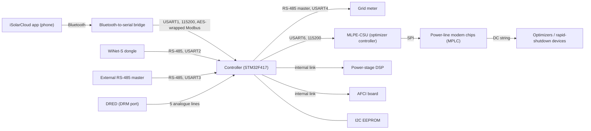

# SG5.0RS controller architecture

The SG5.0RS is built like the SH10RS: an STM32F417 controller (the "ARM") runs the communication ports and the
Modbus register map, and passes power-stage work to a DSP. The general design is on
[../sh10rs/architecture.md](../sh10rs/architecture.md). This page covers what the SG5.0RS controller (package P051,
controller image `SUNSTONE-S_01011.01.50`) does differently: its ports, its register windows, an address gate with a
relay mode, an encrypted serial link used by the phone app over Bluetooth, the link to the optimizer controller, its
handling of DRM inputs, and the firmware images in its package.

Register numbers are 1-based, as in Sungrow's Modbus documentation; the address in the frame is one less.

## 1. Block diagram

## 2. Serial ports

The controller has five UARTs in use. Four of them are Modbus slave ports; the fifth (USART4) is a master port for the
meter.

| UART | Role | Line | Function codes served | Address rule |
|---|---|---|---|---|
| USART1 | Slave. Encrypted link for the phone app over a Bluetooth-to-serial bridge (section 7). Logic-level, no RS-485 driver; pins PA9 / PA10 | 115200 baud, set at boot | 3, 4, 6, 0x10, 0x65 | **Any** slave address is accepted and echoed |
| USART2 | Slave. Probably the dongle port. Downstream side of the relay (section 5) | from the saved serial settings, default 9600 8N1 | 3, 4, 6, 0x10, 0x60, 0x65 | Own address; broadcast writes executed but not answered |
| USART3 | Slave. Second RS-485 port for an external master. Origin of the relay (section 5) | from the saved serial settings, default 9600 8N1 | 3, 4, 6, 0x10, 0x60, 0x65 | Own address |
| USART4 | Master. The meter port: the inverter polls its own grid meter ([meters](../meters.md)) | 9600 8N1 | — | — |
| USART6 | Slave and master. Link to the MLPE-CSU optimizer controller (section 8) | 115200 baud, set at boot | 4 (register reads); 3, 0x10, 0x17 taken as replies to the controller's own requests; 6 ignored | Own address |

Differences from the SH10RS, whose second RS-485 port also carries a parallel (master-slave) link, an EV-charger
master and an RS-485 battery master: the SG5.0RS has none of these. It also has no function `0x17` and no function
`0x20` on the dongle-facing ports, and no charger or Energy Bridge on its meter port.

Every port shares one main loop that sleeps 5 ms per pass (1 ms system tick), so a port is served at most once every
5 ms plus the work of the other ports. Requests and multi-register writes are limited to 125 registers; a longer
request is dropped without a reply (the limit is lifted only while a firmware-update session is open).

## 3. Register windows

As on the SH10RS, each request is routed by its **start** register to the handler of one window; the register count
is not checked against the window end. A register a handler does not know reads 0xFFFF. The SG5.0RS window set:

| Registers | Fn 3 | Fn 4 | Fn 6 | Fn 0x10 | Contents |
|---|---|---|---|---|---|
| 2500–3117 | – | yes | – | yes | Identity block: device code 2515, model 2516, protocol code 2534, tag 2578, version strings from 2582 |
| 4800–4899 | yes | yes | – | yes | Device search and address assignment |
| 4950–5199 | yes | yes | yes | yes | Public-map run data and the 5000-series switches (start/stop 5006) |
| 5200–6999 and 7045–13811 | – | yes | – | – | Private 5xxx map, the layout the dongle polls for protocol type 3 |
| 7000–7037 | **no reply** | all 0xFFFF | echo | echo | Public-map string-current block; a function 3 read gets no answer at all |
| 9800–9850 | yes | yes | yes | yes | Same kind of window as the SH10RS AFCI mirror; contents not decoded |
| 16000–17500 | DSP | DSP | DSP | DSP | Forwarded to the power-stage DSP (section 6) |
| 20000–20175 | yes | – | – | yes | Firmware-update mailbox ([../sh10rs/firmware-update.md](../sh10rs/firmware-update.md)) |
| 21000–21018 | – | yes | – | yes | Baud-rate switch |
| 29500–29900 | DSP | DSP | DSP | DSP | Forwarded to the DSP |
| 30000–35999 | yes | view | yes | yes | Holding parameters; function 4 serves a view of the holding map |
| 36000–36449 | yes | yes | yes | yes | Further parameter and state block; contents not decoded |

Windows the SH10RS has and the SG5.0RS does not:

| SH10RS window | Purpose there |
|---|---|
| 4096–4300 | Device-information strings (Energy Bridge record) |
| 13000–13370 | Hybrid control and state (EMS mode, SOC, export limit) |
| 19101–20000 | Tunnel to the battery control unit over CAN |
| 21201–21999 | Re-framed requests to an EV charger |
| 36702–38999 | Third DSP-forward window |
| 40001–50001 | SunSpec-style map |

A start register in any of these is unmapped on the SG5.0RS.

## 4. Replies and errors

| Situation | Reply |
|---|---|
| Function 3 or 4, start in no window | Exception 02 (own address, broadcast, or any address on USART1) |
| Function 6 or 0x10, start in no window | Exception 02. The SH10RS sends no reply in this case |
| Unknown function code | No reply |
| Write refused by a window's value check | Exception code from the check (02 range, 04 value) |
| Baud-window write refused | No reply |
| Function 3 at 7000–7037 | No reply |
| Request over 125 registers | Dropped, no reply |
| Broadcast write | Executed; answered only on USART1 |

Write replies are the usual echo (function 6: address and value; function 0x10: address and count).

## 5. Address gate and RS-485 relay

Before any window test the four dispatchers run an address gate. It classes a request as "not for this inverter"
when:

- the slave address is 0 (broadcast) and the start register is in 1–1001 or 29000–29500, or
- the slave address is not 0 and differs from the inverter's own address.

What happens next depends on the installer setting **"Transparent transmission via backup RS485 port"** at holding
register 32565 (170 = enable, 85 = prohibited, default prohibited):

| Setting | Request classed "not for this inverter" |
|---|---|
| 85 (default) | The request still enters the windows; each handler then applies its own address test, so it is ignored as on any slave |
| 170, request on USART1 | Served (USART1 is exempt from the gate) |
| 170, request on USART2, USART3 or USART6 | No direct reply. The port enters a relay state for up to 2000 main-loop passes (at least 10 s) |

Only the USART3 receive path carries the relay out: it rebuilds the request and sends it out of **USART2**, the dongle
port, then waits for the next frame on USART2 that parses as a response, rebuilds it and returns it on USART3. A
request that sets the relay state on USART2 or USART6 is not forwarded anywhere. With the setting on, a master on
USART3 can therefore reach other slave addresses on the dongle's bus, which then has two masters. The inverter keeps
the last relay origin; after one USART3 relay, later relayed replies go to USART3 whatever their origin.

## 6. DSP forwarding

Requests that start in 16000–17500 or 29500–29900 are re-framed with slave address 1 and sent to the power-stage DSP;
the DSP's reply is relayed back. While a forward is pending, the other slave ports are not read. The pending state is
held for 2000 main-loop passes after the last forward, answered or not, which is **at least 10 s** (the SH10RS holds
300 passes, at least 1.5 s). A single read in these windows from the dongle port or a Modbus-TCP pass-through client
therefore blocks the inverter's other ports for ten seconds or more. The SH10RS's "infinite hold" write at 37004 cannot
be reached from an SG5.0RS forward window.

## 7. Encrypted serial link on USART1 (phone app over Bluetooth)

USART1 is a point-to-point logic-level UART on PA9 / PA10. It runs a Modbus slave that only answers frames wrapped in
AES-128-ECB. The peer is the iSolarCloud phone app over a Bluetooth-to-serial bridge; the dongle never uses this port.
GPIO PA12 (input with pull-up) is the bridge's link-status line: the status LED blinks every 200 ms only while PA12 is
high and USART1 has carried traffic within the last 6 s.

### 7.1 Frame format

All multi-byte fields are big-endian. Requests and replies use the same wrapper.

| Offset | Size | Field | Meaning |
|---|---|---|---|
| 0 | 1 | Marker | `0x01` |
| 1 | 2 | N | Length of the clear Modbus RTU frame, CRC included |
| 3 | 1 | P | Number of `0xFF` pad bytes (0–15) added to reach a multiple of 16 |
| 4 | N + P | Ciphertext | AES-128-ECB of the clear frame plus padding; independent 16-byte blocks |

The clear text is an ordinary Modbus RTU frame with its CRC-16 (low byte first). The inverter checks only that N + P is
a non-zero multiple of 16 and that all bytes have arrived; the inner CRC decides whether the frame is valid. A wrong key
therefore yields a CRC failure and no reply. The wrapper has no session, nonce, sequence number or authentication.

### 7.2 Plain requests

Exactly two unwrapped requests are accepted, with any slave address, and answered unwrapped:

| Request | Returns |
|---|---|
| Function 4, register 2792, 8 registers | The 16-byte session key, XOR-masked with a fixed 16-byte constant that the app also holds |
| Function 4, register 4990, 11 registers | Serial number and device-type code |

The two are recognised by function and start register only; the register count is not checked.

Every other plain frame is dropped. Registers 2792–2799 are also readable with function 4 on the other ports, so a
generic dump of that range from the dongle's bus exposes the masked key.

### 7.3 Key lifecycle

| Event | Effect |
|---|---|
| PA12 goes high (debounced, at least 10 ms) | A new key is generated and stored in the I2C EEPROM (with a mirror copy); the masked copy at 2792 is updated |
| PA12 goes low | The key is kept |
| Boot | The stored key is loaded; because PA12 idles high, a new key replaces it 10–60 ms after the timers start |

The key has little entropy and its masked form is readable in clear, so the wrapper hides traffic from a casual
listener but gives no protection against anyone who can read register 2792. The app treats an all-`0x00` or all-`0xFF`
key as "no encryption" and then sends plain frames, which this port ignores.

### 7.4 What USART1 does differently

| Behaviour | USART1 | Other slave ports |
|---|---|---|
| Slave address | Any value, echoed in the reply | Own address only |
| Read of 4815 | Returns the inverter's own slave address | Not served |
| Address gate and relay (section 5) | Exempt | Applied |
| Communication-loss watchdog (section 10) | A write does not reload it | A write reloads it |
| Log export (YMODEM) | An export started on USART1 runs as raw YMODEM without the wrapper; an export started on another port locks USART1 out until it ends | — |

### 7.5 Limits and defects

| Behaviour | Effect |
|---|---|
| A request is read in one 255-byte chunk | An encrypted request carries at most 240 bytes of clear frame plus padding; a firmware-update data packet fits only with a packet size of 208 bytes or less |
| Clear reply of 241–255 bytes | Sent as the bare 4-byte header: function 3 or 4 reads of 118–125 registers return nothing usable; 117 registers or fewer are safe |
| Bytes after the first encrypted frame in one read | Lost |
| A malformed header that starts with `0x01` (for example a plain request to slave address 1) | Never drained; the port is wedged until a reboot or until 1536 more bytes overrun the receive ring |
| Partial encrypted frame | Waits with no timeout; leftovers of an interrupted session corrupt the first request of the next one |

This wrapper is not the encryption of firmware-update payloads, which uses a different key on the dongle port
([../../firmware-update/device-firmware-relay.md](../../firmware-update/device-firmware-relay.md)).

## 8. Optimizer (MLPE) link on USART6

USART6 (115200 baud) connects the controller to the **MLPE-CSU**, the controller of the optimizer network. Three kinds
of traffic share it.

### 8.1 Relay of the dongle's private function codes

A frame that arrives on USART2 with a valid CRC and a function code in `0x70`–`0x7E` or `0xF0`–`0xFE` is copied
unchanged, slave address and CRC included, into a four-slot queue. A task empties the queue every 50 ms and writes one
frame per pass to USART6 (at most 20 frames/s). A private-code frame that comes back on USART6 is queued to the port the
last request came from. After one private frame, frames with a bad CRC are relayed too until a normal valid frame
arrives, so multi-part transfers survive. The relay is suspended while a firmware-update session is open. The
inverter never reports a relay failure; the dongle simply sees its own 2000 ms timeout.

On the SG5.0RS the dongle-port path ignores the relay's result, so every private frame is also shown to the local
parser. The parser rejects it and counts a bad frame; five in a row during an armed 115200-baud trial put the port
back to its saved rate. Only the WiNet-S2 sends these codes ([optimizers and MLPE](../optimizers-and-mlpe.md)).

### 8.2 Modbus traffic with the CSU

USART6 is also a slave port: the CSU can read inverter registers through it with function 4. Function 3 and 0x10
frames on this port are taken as replies to the controller's own firmware-transfer requests, and function 0x17 frames
as replies to its module poll.
The controller is in turn a master towards the CSU: it relays MLPE firmware images to the CSU at address 1 and polls the
module with its own function `0x17` requests (read start 14200–14349).

### 8.3 Raw copy to the dongle port

Holding register **32600** switches on a raw copy: with value 170 every burst received on USART6, of any kind, is
written unchanged to the dongle port (USART2), before any CRC or function-code check. 85 switches it off; any other
value gets exception 04. The setting lives in RAM only and is 85 after every boot. No dongle writes it; it looks like a
service tap.

### 8.4 Dormant power-line-modem dialects

The controller also contains a driver for a power-line modem wired straight to USART6, using two frame dialects that
start with the bytes `16 02` (seven-byte header, XOR checks) and `16 16` (CRC-16/XMODEM trailer), plus a text-command
"node" (`Slave: …` commands such as setting a PAN id). In P051 this code never transmits: bursts that start with these
bytes are copied into a buffer without a length check, but nothing acts on them, the node never answers and nothing is
sent. In the shipped design the modems sit behind the CSU on its SPI bus instead
([optimizers and MLPE](../optimizers-and-mlpe.md)). The SH10RS has none of this code. Holding register 32538 reads the
PAN id from this dormant configuration.

## 9. Meter port

USART4 is the meter port, with the inverter as master. The SG5.0RS recognises fewer meter families than the SH10RS
(no `0x20D5` or `0x150x` codes), applies the CT ratio to the currents, probes every 10 s, polls one family every 100 ms
and the others every 200 ms, and reports the detected meter type at input register 7853. It has no Energy Bridge mode,
no charger sharing and no meter-calibration session. Details are on the [meters page](../meters.md).

## 10. Communication-loss watchdog

Holding register 30447 ("Communication anomaly detection", 170 enable / 85 prohibited) arms a watchdog whose delay is
holding register 30448 ("Communication anomaly trigger delay", 3–20 min). Any write from USART2, USART3 or USART6
reloads it; a write from USART1 does not. When it runs out the inverter logs an event, and a second event after a
further delay if configured. Both registers read 0xFFFF unless an internal identification condition holds, which is
not known.

## 11. DRM inputs

The controller senses the AS/NZS 4777 demand-response lines itself, on five ADC3 channels (PF3, PF5, PC0–PC2). Each
sample is scaled to a 3.3 V full scale and quantised to one of four levels; the level pattern decodes to DRM0–DRM8 the
same way as on the SH10RS ([../sh10rs/grid-codes-and-drm.md](../sh10rs/grid-codes-and-drm.md)). Sample 0 selects the
group: level 1 for DRM1–DRM4, level 2 for DRM5–DRM8.

| Item | SG5.0RS behaviour |
|---|---|
| Enable | Holding register 30113 = 170 (85 = disabled). The register answers exception 04, for reads and writes, unless the grid country is Australia (6) or New Zealand (99) |
| Evaluation | Every main-loop pass (about 5 ms); acts only when the state changes, no debounce |
| DRM0 | Raises an event |
| DRM1–DRM4 | No action (a string inverter has no consumption to limit) |
| DRM5 / DRM6 / DRM7 / DRM8 | Generation limit 0 % / 50 % / 75 % / 100 % of rating |
| No recognised command | Event cleared, state 255 |
| State register | Input 5503, served directly: 1–9 = DRM0–DRM8; 255 = disabled, unsupported country, or enabled with no recognised command (the three cannot be told apart) |
| Limit reason | Input 5506, copied from the DSP (512 = DRM5–DRM8) |
| Failed read or all-low inputs | Decodes as DRM0, so enabling DRM without a DRED connected probably stops the inverter |

The SH10RS, by contrast, also limits consumption for DRM1–DRM3, sets a power factor for DRM3 and DRM7, reports 254 for
"enabled, no command", and shows its state to the dongle only while a mode is asserted.

## 12. Firmware images in package P051

The iSolarCloud package `SUNSTONE-S_B000.V001.P051` holds one image per processor. Each ends in Sungrow's secure-boot
trailer, and the dongle hands each to the controller, which installs its own image and relays the others.

| Image | Runs on | Notes |
|---|---|---|
| `SUNSTONE-S_01011.01.50` | Controller (STM32F417) | The image described on these pages |
| DSP image | Power-stage DSP | Relayed by the controller |
| AFCI image | Arc-fault board | Relayed by the controller |
| `MLPE-CSU_38011.01.69` | MLPE-CSU (STM32F417) | Relayed over USART6; module code 38 |
| `MLPE-MPLC_39011.30.23` | Power-line modem chips behind the CSU | 8051 code, loaded by the CSU over SPI; module code 39 |

The relay path is on [../../firmware-update/device-firmware-relay.md](../../firmware-update/device-firmware-relay.md).

## Not yet known

- Which UART is wired to which terminal (USART2 is probably the dongle port).
- The contents of the 9800–9850, 36000–36449 and private-map windows, register by register, and how holding-register
  writes are validated.
- Whether a read that crosses a window end answers 0xFFFF on every handler.
- The upper bound of the DSP-forward hold time (the lower bound is 10 s).
- The exact part behind USART1 and PA12 (a Bluetooth module is the evident peer).
- What the power stage does with the DRM limit while the active-power-limit function is disabled; the controller only
  substitutes the DRM limit into its power-stage frame while that function is enabled.
