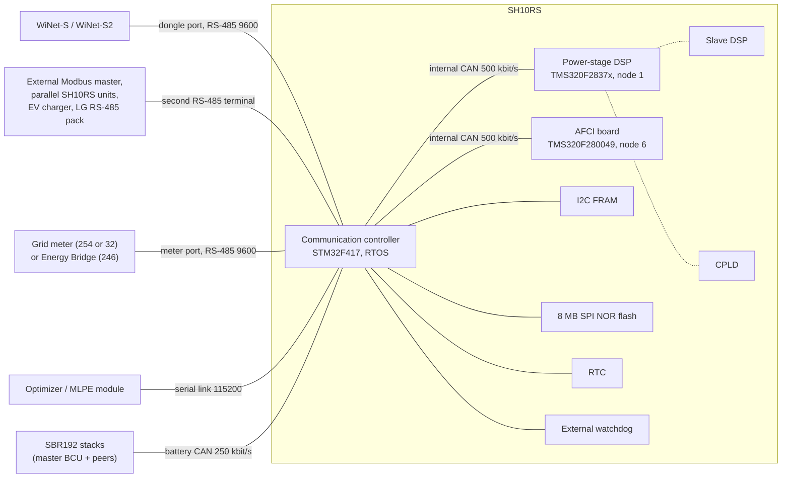

# SH10RS internal architecture

The SH10RS hybrid inverter is not one processor. A communication controller handles every
external port, a separate power-stage DSP runs the converter, and an arc-fault (AFCI) board sits
beside it. The dongle only ever talks to the communication controller; everything it reads from
the power stage or the battery has been collected, converted and cached by that controller first.
This page describes the parts, the buses between them, the ports on the outside and the storage
on the board.

Register numbers on this page are 1-based, as in Sungrow's published Modbus documentation.

## Block diagram

The dotted links inside the power stage are not visible from outside the DSP; see
[the power stage](#the-power-stage-dsp-node-1).

## Communication controller

| Item | Value |
|---|---|
| MCU | STM32F417 (Cortex-M4F), 168 MHz core from a 16 MHz crystal; APB1 42 MHz, APB2 84 MHz |
| Software | Pre-emptive RTOS with a 1 ms tick; drivers for the UARTs, two CAN controllers, FRAM, SPI flash, RTC, ADC, watchdog and LED PWM |
| Main loop | Sleeps 5 ms per pass, then serves one request on each Modbus slave port, the CAN receive streams and the forward countdowns |
| 10 ms timer | Drives the power-stage poll, the meter poll (every tenth call, 100 ms) and the parallel-link poll |
| 250 ms timer | Drives the battery task (detection, handshake, periodic CAN frames, timeouts) |
| Firmware | Package P069 carries the controller image, the DSP image and the AFCI image; the controller relays the other two (see [firmware-update.md](firmware-update.md)) |

The controller holds the inverter's whole Modbus register model in RAM. Values that originate in
the power stage, the meter or the battery are copied into it by the polling described below, so a
dongle read never waits for another bus (except in the forwarded windows listed in
[register-windows.md](register-windows.md)).

## The internal CAN bus

The controller's first CAN controller connects it to the power stage and the AFCI board.

| Item | Value |
|---|---|
| Bit rate | 500 kbit/s (42 MHz / 12, 7 time quanta) |
| Identifiers | 29-bit extended. The identifier equals the first byte of the payload, the destination Modbus address |
| Payload | Ordinary Modbus RTU frames including the CRC-16, cut into consecutive 8-byte CAN frames; the last frame is shorter |
| Largest frame | 512 bytes; a firmware data packet (225 bytes) is 29 CAN frames |
| Nodes | Controller (the only master), power-stage DSP at address 1, AFCI board at address 6 |
| Receive filter | None; every frame is accepted and its data bytes appended to a 512-byte ring |
| Function codes | 3, 4, 6, 16 and 0x17 (read and write in one frame) |
| Exceptions | The controller accepts DSP exception replies (0x86, 0x90, 0x97) on the wire but never acts on them |

The same bus carries three kinds of traffic: the controller's own cyclic poll (below), requests
the controller forwards on behalf of a Modbus master ([register-windows.md](register-windows.md)),
and firmware relays ([firmware-update.md](firmware-update.md)).

## The power stage (DSP, node 1)

The power stage is run by a TI TMS320F2837x-class DSP (the image is built for the TMS320F28374).
It measures everything electrical (PV strings, grid, battery port, temperatures, energy counters)
and acts on the commands the controller sends it.

The design also has a slave DSP ("SDSP") and a CPLD. The controller never addresses them: the
master DSP at address 1 stands in for all three. Firmware for each is selected only by the
module string in the update descriptor (module code 3 master DSP, 4 slave DSP, 8 CPLD). The master
DSP reports the version of each part in a block of four 15-register version slots, which the
controller reads at start-up and serves to the dongle among the version strings at 2582
(120 registers, one 30-character string per slot). On the SH10RS the CPLD slot is not read and
stays empty. How the master DSP reaches the slave DSP and the CPLD is not visible from outside;
SPI is the likely carrier.

### Cyclic poll of the DSP

Without any request from the dongle, the controller runs a fixed schedule on the internal bus in
50 ms steps:

| Slot | Every | Frame | Content |
|---|---|---|---|
| Fast poll | 100 ms | Function 0x17: read 2 registers, write 48 | Reads the total active power. Writes the control block: the grid-meter power the inverter uses, EMS mode, forced charge/discharge command and power, and installer settings |
| Rotation step | 100 ms | Function 4 or 0x17 | One block per step; the write half pushes another group of controller data down |
| Queued command | between slots | Function 6 or 16 | Run/stop, parameter blocks after a setting changes, clock |

The rotation visits six to eight steps, so each measurement block is refreshed every 0.6 to
0.8 s:

| Step | Read from the DSP | Written to the DSP in the same frame |
|---|---|---|
| Identity | identity and status (54 registers) | nothing |
| Main | main measurements (102 registers): MPPT voltages and currents, grid values, active and reactive power, battery voltage, current and power | ARM-side settings |
| Second block (once or twice) | values in a frequency-like range, 32-bit fault and status words, a resynchronisation request flag | clock, detected battery protocol, parallel-link settings |
| Temperatures | temperatures and 32-bit energy counters | parallel-link data or a single zero word |
| Status | a status block (79 registers), including the mode bits the battery task uses | the battery data received from the BCU: system voltage, current, temperature, SOC, SOH, charge and discharge voltage limits, current limits, status and protection words |
| AFCI | (visit to node 6, below) | |
| Optional | a 4-register block, only when a configuration byte allows it | 39 registers |

The DSP therefore never asks for anything: meter power reaches it every 100 ms, battery limits
and state once per rotation, the clock once per rotation and as a full time block every 300 s of
polling time.

A reply is accepted only if it matches the shape of the latest request (function code, and byte
count for reads). Requests are 50 ms apart and each new request replaces the previous one, so the DSP must answer within
about 50 ms; a late reply is dropped and that step is sent again 100 ms later.

### What the dongle sees of it

| Effect | Detail |
|---|---|
| Refresh | Values that come from the DSP change at most once per rotation, every 0.6 to 0.8 s. Polling faster returns the same numbers |
| Rolling means | Four power values are replaced by a 60-sample mean, one sample per rotation, before they are served: active power, grid power from the meter, DC power and battery power. This applies in EMS modes 0 (self-consumption) and 8; it is skipped in forced, external-EMS and VPP modes |
| Lag | The averaged registers (active power 5031 and 13034, export power 13010, load power 13008, DC power 5017, battery power 13022 and 5214) follow a step by about 5 % at once, 50 % after 16 to 22 s and 100 % after 34 to 46 s: roughly a 40 s mean |
| Not averaged | MPPT voltages and currents (5011–5016), battery voltage and current (5630, 5631), grid voltage, current and frequency, the meter registers (5601 onwards) and energy counters. For responsive grid power use the meter block |
| Pauses | The whole cycle stops, and values freeze without any error, while a request is being forwarded to the DSP, during an I-V curve scan, a battery record export, an LG battery update or a firmware relay |
| Loss | If a request stays unanswered for about 180 s, the controller zeroes the published measurements, reports state Standby (0x1400) and re-downloads every DSP parameter block in a 31-step resynchronisation. The DSP can request the same resynchronisation itself, for example after it restarted |
| Run/stop | Start and Stop (13000) become a run command the controller writes to the DSP (0xCF start, 0xCE stop). Several sources can hold a stop request at once; firmware updates are one of them |

## The AFCI board (node 6)

The arc-fault detection board runs a TMS320F280049. Once per rotation (about every 0.7 s) the
controller visits it with one of: a read of its status block (every fourth visit), a write of a
settings block, or a write of the clock. After a resynchronisation it first reads the board's
identity (a 30-character version string) and its full parameter block, then writes the
parameters back. The values read are served unchanged in the AFCI window 9800–9850; the AFCI
version string appears among the version slots at 2582. A flag in the DSP's status words
(probably the arc-fault flag) makes the controller stop the inverter and report a fault.

## External ports

| Port | Peripheral | Line | Role of the inverter | Peers |
|---|---|---|---|---|
| Dongle port | probably the second USART | RS-485, 9600 8N1 at power-on | Modbus slave | WiNet-S or WiNet-S2 |
| Second RS-485 terminal | third USART | RS-485, 9600 (other rates per job) | slave or master, by job | external Modbus master, parallel SH10RS units, EV charger, LG RS-485 pack, YMODEM export reader |
| Meter port | fourth USART | RS-485, 9600 8N1 | master | grid meter at 254 (most families) or 32, Energy Bridge at 246, optionally the EV charger |
| Optimizer link | sixth USART | 115200 | master and slave | optimizer / MLPE module (SP600 class) |
| Battery bus | second CAN controller | 250 kbit/s, 11-bit identifiers | master of the conversation | SBR192 stacks |

Which physical terminal each UART reaches is not known; the dongle port is the one that carries the
dongle-only features listed below.

### Dongle port

The Modbus slave engine on this port accepts function codes 3, 4, 6, 16, 0x17, 0x20, 0x60 and
0x65 and routes each request by its start address
([register-windows.md](register-windows.md)). Points that matter to a master:

| Item | Behaviour |
|---|---|
| End of frame | Line idle for max(3, 44000 / baud) ms: 4 ms at 9600 |
| Throughput | One request per 5 ms pass; the reply starts about 4 to 10 ms after the request ends |
| Back-to-back frames | Bytes after the first valid frame in a burst are discarded, so a second request sent without waiting is lost |
| Size limit | More than 125 registers: dropped without a reply (except in the firmware-update mailbox) |
| Baud | Starts at 9600 after every restart. A temporary switch to a higher rate is negotiated through 21000–21018 and falls back after five bad frames ([../../protocols/rs485-master.md](../../protocols/rs485-master.md)) |
| Port-only features | The private function codes 0x70–0x7E and 0xF0–0xFE are relayed to the optimizer link, the address-0xA5 raw relay to the DSP (when enabled at 36099) and answers from the EV charger are written here |
| Supervision | When "Communication interruption" (31453, delay 31454) is enabled, silence on this port for the set time marks the link lost; 33509 values 0xA2 and 0xA3 move the supervision to the second terminal |

### Second RS-485 terminal

This port runs the same slave engine and register map as the dongle port, but the inverter
switches it between several jobs:

| Job | Inverter is | Selected by |
|---|---|---|
| Modbus slave for an external master | slave | default |
| Parallel ("master-slave") link of up to ten SH10RS units (the app offers five) | host polls one unit per 100 ms, in turn, with function 0x17 (read 8200–8215, write 8200–8216); a broadcast writes a power-limit percentage to 8290 | 33500 (enable), 33501 (role and link address), 33502 (number of units) |
| EV charger | master; also bridges the dongle's reads of 21201–21999 to the charger | 33539 = 0xA1 (this port); 0xA2 selects the meter port |
| LG RS-485 battery | master; probes addresses 15 and 14 at 9600, 19200 and 115200 baud in 450 ms slots | automatic while no battery protocol is known |
| YMODEM export of logs and records | raw byte stream | a file code written to 32000 on this port |

In the parallel-link host role the port parses only responses, so an external master is not
served. While a charger is online here, the slave engine is bypassed. Setting 33538 to 0xA1 stops
all of the inverter's own master traffic on this port (no battery probe, no charger) and fixes it
at 9600; its name in Sungrow's tools is unknown; it probably reserves the port for an outside master.

### Meter port

The inverter polls its own grid meter here every 100 ms. It first identifies the meter with a
rotation of probe frames (one every 2 s or 10 s), derives a meter family code, and then uses that
family's request set. 32-bit meter values are high word first on this port, unlike the
inverter's own registers. The results are served at 5601 onwards; the detected family code is at
13136. If the meter stops answering for 13 requests the type is forgotten; the last values are
held for 30 s and then invalidated with a meter-communication fault.

An Energy Bridge at 246 is recognised by its reply to a probe and switches the port into bridge
mode, in which its identity and values are polled instead and its record is served in the
4096–4300 window. A charger can share the port (33539 = 0xA2), with meter and charger requests
interleaved through one queue. See [../meters.md](../meters.md) and
[../ev-charger-and-energy-bridge.md](../ev-charger-and-energy-bridge.md).

### Optimizer link

A 115200 serial link to an optimizer or MLPE communication module. The inverter polls the module
with function 0x17 and relays module firmware over it. It is also a third Modbus slave port, so
the module can read inverter registers. Frames with the private function codes 0x70–0x7E and
0xF0–0xFE that arrive on the dongle port are copied unchanged (any address) into a four-slot
queue and sent here, at most one every 50 ms; the module's answers go back the same way. The
relay is closed while a firmware-update session is open. See
[../optimizers-and-mlpe.md](../optimizers-and-mlpe.md).

### Battery bus

The second CAN controller carries the battery conversation: 11-bit identifiers, little-endian
payloads, 250 kbit/s for Sungrow batteries (detection also tries 500 kbit/s for third-party
packs). The same controller carries two Modbus tunnels to the battery control unit and the battery
firmware relay. Details are in [battery-interface.md](battery-interface.md).

## On-board storage and supervision

| Part | Bus | Holds |
|---|---|---|
| FRAM, about 32 KB | I2C, 200 kHz | Communication settings (slave address, RS-485 line settings), the registry that binds battery stacks to slaves 200–204, firmware-update progress and the received-packet bitmap (so an interrupted transfer resumes), parameter blocks (each with a CRC-8; some mirrored), small record rings. Most writes are queued to one storage task |
| SPI NOR flash, 8 MB | SPI, about 21 MHz | The firmware staging window (992 KB starting at the 7 MB mark), run-record and history rings, fault and event records, and the battery record store fetched from the BCU. Records leave the inverter only through the YMODEM export |
| Real-time clock | I2C | Epson RX-8025-family chip, BCD time registers, 24-hour mode. Set from the time the dongle sends; read at boot |
| External watchdog | one GPIO | Pulsed every 500 ms by a supervisor task, alongside the MCU's independent watchdog (about 8 s). The supervisor watches the main loop and the storage task; a stalled main loop or storage process is restarted, and three misses in a row end in a deliberate system reset |
| Status LEDs | timer PWM, two channels | off, on, blink and "breathing" patterns |

The board has no display and no keypad.

## Not yet known

- Which physical terminal each UART reaches.
- The link between the master DSP, the slave DSP and the CPLD.
- The exact DSP reply latency and the meaning of most of the settings the controller pushes to
  the DSP.
- Part numbers of the watchdog supervisor and the exact FRAM and flash parts.
