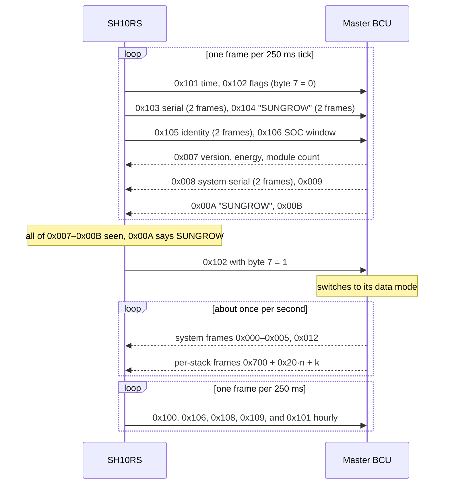

# SH10RS battery interface

The SH10RS talks to its batteries itself; the dongle never sees the battery bus. For Sungrow
SBR batteries the link is CAN: the inverter sends its measurements, time and SOC window, the
battery control unit (BCU) at the top of each stack sends its state, limits and per-module data,
and the inverter turns that into the register map it serves on Modbus slaves 200–204. Two Modbus
tunnels over the same bus reach the BCU's own service map and its record store. This page
describes the link from the inverter's side; the battery's side is in
[../sbr192/can-bus.md](../sbr192/can-bus.md) and the register meanings in
[../sbr192/registers-via-inverter.md](../sbr192/registers-via-inverter.md).

Register numbers on this page are 1-based, as in Sungrow's published Modbus documentation. CAN
identifiers are given for stack 0 where they repeat per stack.

## The bus

| Item | Value |
|---|---|
| Controller | The inverter's second CAN controller (the first one is the internal DSP bus) |
| Bit rate | 250 kbit/s for Sungrow batteries (42 MHz / 24, 7 time quanta). The BCU uses 42 MHz / 12 with 14 time quanta, the same rate |
| Identifiers | 11-bit standard. Some third-party battery protocols use 29-bit identifiers |
| Payload | DLC always 8; multi-byte fields little-endian |
| Receive filter | None: every frame is accepted into a 32-slot ring |
| Nodes | The inverter, and one BCU per stack. One BCU is the master of a parallel group and alone sends the system frames 0x000–0x01F; every BCU sends its own per-stack frames |
| Other traffic | BCU-to-BCU frames in 0x400–0x6FF, which the inverter ignores; the tunnels 0x1E0, 0x1D0 and the firmware relay 0x1F0 |

## Detecting the battery

The inverter starts out not knowing what battery is attached. Its battery task (every 250 ms)
cycles through detection slots of about 3 s each, switching the bit rate as it goes, until one
protocol answers:

| Slot | Bit rate | What the inverter sends | Locks onto |
|---|---|---|---|
| 0 | 500 kbit/s | 29-bit inquiry 0x4200 (Pylontech-HV style) | 29-bit replies 0x7310, 0x7311, 0x7320, 0x7321 |
| 1 | 250 kbit/s | the Sungrow handshake (below) | Sungrow SBR, or BYD if 0x00A says "BYD" |
| 2 | 500 kbit/s | a second handshake (0x191, 0x151 "SUNGROW", 0x91) | BYD-style (0x250, 0x290, 0x2D0, 0x3D0 all seen) or WTS (0x2D0 "WTS", 0x3D0 "Energy Core1.0" / "Power Core1.0") |
| 3 | 500 kbit/s | 29-bit LG inquiry 0x02007F00 | LG over CAN, when 0x12017F00 or 0x12027F00 answers |

Four effective slots make a 12 s cycle. LG packs on RS-485 are found separately on the second
RS-485 terminal (addresses 15 and 14, probed at 9600, 19200 and 115200 baud; two LG pack variants
are known). Only the Sungrow protocol fills the per-stack records and the slave 200–204 map; the
other protocols feed the same system-level limits and measurements. After a battery firmware
update the inverter restarts the current slot at once instead of waiting for its link timeout.

The SOC window defaults (maximum 100.0 %, minimum 5.0 % for Sungrow) are applied only when the
detected protocol changes, so a user-set window survives restarts.

## The Sungrow handshake

The handshake is one-sided: the BCU checks neither the inverter serial nor the vendor string. It
uses 0x101 to set its clock and 0x102 byte 7 to choose its mode (0: send the identity frames
0x007–0x00B, 0x00D and 0x00E; 1: send the data frames). A BCU that has never received 0x102 sends nothing useful,
so the inverter sees the identity frames only after its own 0x102.

## Frames the inverter sends (0x100–0x109)

In the running state the inverter sends at most one frame per 250 ms, in a repeating pattern of
11 ticks: 0x100 three times, 0x106, 0x108 and 0x109 twice each, and 0x101 in one of the two
remaining ticks only if an hour has passed since the last one.

| Id | Bytes | Content |
|---|---|---|
| 0x100 | 0–1 | battery voltage measured by the inverter (as 5630) |
| | 2–3 | battery current measured by the inverter, signed (as 5631) |
| | 4–5 | inverter internal temperature (as 5008) |
| | 6 | inverter mode 0–3, derived from the power stage's battery-link state bits (set from the battery-voltage window, the BMS flags and the running state) |
| 0x101 | 0–3 | local time, seconds (u32) |
| 0x102 | 0–7 | handshake flags; byte 7 = 1 selects the BCU's data mode |
| 0x103 | 0–7 | inverter serial number, two frames (byte 0 = 0/1, then 7 characters) |
| 0x104 | 0–7 | vendor string "SUNGROW", two frames |
| 0x105 | 0–7 | inverter identity string, two frames |
| 0x106 | 0–1 | minimum SOC, 0.1 % (default 50) |
| | 2–3 | maximum SOC, 0.1 % (default 1000) |
| | 4–5 | maintenance target SOC (33062) |
| | 6 | bit 0 and bit 1: maintenance requests (33060, 33061); bits 2–7: hold time in hours (33063) |
| 0x108 | 0 | bit 1: one installer flag; the BCU stores it but does not act on it |
| 0x109 | 0 | the power stage's operating flag: 0xAA while grid-tied, 0x55 while the inverter runs islanded (off-grid or backup supply); 0x55 selects the BCUs' off-grid handling; bytes 1–4 a 32-bit inverter value |

While a tunnel or firmware relay holds the bus in stream mode these frames are not sent.

The maintenance requests start one of two BCU procedures from the inverter's holding registers:
33061 = 0xAA a discharge to 0 % then charge to the target (probably an SOC calibration), 33060 =
0xAA bring the SOC to the target and hold it for the set hours. Only one can be on at a time. The
BCU reports progress in frame 0x012, which the inverter serves on its own address at 10752–10756
(done flag, results of the two procedures, time estimate, hold time left). Writing 0x55 ends a
procedure.

## Frames the inverter receives

### System frames (master BCU, 0x000–0x01F)

| Id | Used | Content and destination |
|---|---|---|
| 0x000 | yes | protection word (u32) and warning word (u32); folded into the inverter's battery flag words 13070–13079 |
| 0x001 | yes | charge and discharge voltage limits; maximum charge and discharge current, 0.1 A → served as A at 5635 and 5636 |
| 0x002 | yes | system SOC (0.01 % → 0.1 %) and SOH; the SOC feeds the DSP and 13023 |
| 0x003 | yes | total charge and discharge energy (u32 each) |
| 0x004 | yes | system voltage, current and temperature |
| 0x005 | yes | operating state and request flags (also passed to the DSP); battery model code |
| 0x007–0x00B | identity mode only | BCU firmware version, nominal energy (13039), module count; system serial; "SUNGROW" |
| 0x012 | yes, while a maintenance procedure runs | procedure states, results and times (10752–10756) |
| 0x006, 0x00D, 0x00E, 0x013–0x01E | no | extremes and identity data the inverter takes from the per-stack frames instead |

Only 0x000–0x005 and 0x012 reset the inverter's link timer. Because 0x007–0x00B are sent only in
the BCU's identity mode, the battery version, nominal energy and module count on the inverter's
own address are refreshed only when a handshake happens.

### Per-stack frames (0x700 + 0x20·n + k)

Each BCU sends 32 identifiers, k = 0x00–0x1F, offset by 0x20 per stack index n. The inverter keeps
five stack records and accepts 0x700–0x79F (n = 0–4).

| k | Used | Content |
|---|---|---|
| 0x00 | yes | protection and warning words; also turned into the stack's fault list (5448–5472) |
| 0x01 | no | stack current and voltage limits (reach the inverter only through system frame 0x001) |
| 0x02 | yes | SOC and SOH |
| 0x03 | yes | total charge and discharge energy |
| 0x04 | yes | voltage, current, temperature |
| 0x05 | yes | operating status, request flags, stack model code |
| 0x06, 0x09–0x0C, 0x10–0x12 | no | sent but not used (0x10–0x12 are never sent) |
| 0x07 | yes | BCU firmware version, stack nominal energy (every 10 s) |
| 0x08 | yes | stack serial number in two frames; the second frame registers the stack |
| 0x0D, 0x0E | yes | BCU constants (every 10 s) |
| 0x0F | yes | **multiplexed**: bytes 0–1 a sub-frame index 0–7, then up to three 16-bit or one 32-bit and one 16-bit value; eight sub-frames per second |
| 0x13, 0x14 | yes | temperature and cell-voltage extremes with their locations |
| 0x15–0x18 | yes | per-module minimum and maximum cell voltage, two modules per frame |
| 0x19 | yes | DC contactor state, faulted-module bitmap |
| 0x1A | yes | per-module cell-type code, one byte per module |
| 0x1B–0x1E | yes | per-module date codes, two 32-bit values per frame |
| 0x1F | yes | module serial numbers: byte 0 module 1–8, byte 1 part 1–3, bytes 2–7 six characters; three frames per module about once a minute |

The sub-frames of 0x0F:

| Index | Bytes 2–3 | Bytes 4–5 | Bytes 6–7 |
|---|---|---|---|
| 0 | rated capacity (10698) | maximum discharge power (10697) | rated power (10696) |
| 1 | hours under low-temperature alarm (10695) | hours charging under that alarm (10694) | BCU counter sum (10693) |
| 2 | lifetime charge Ah, u32 over bytes 2–5 (10691–10692) | | cycle-derived value (10690) |
| 3 | lifetime discharge Ah, u32 (10688–10689) | | discharge/charge Ah ratio (10687) |
| 4 | cycle count × 10, u32 (10685–10686) | | byte 6 SOC-calibration state (10684), byte 7 balancing state (10683) |
| 5 | module 1 SOC (10675) | module 2 SOC (10676) | module 3 SOC (10677) |
| 6 | module 4 SOC (10678) | module 5 SOC (10679) | module 6 SOC (10680) |
| 7 | module 7 SOC (10681) | module 8 SOC (10682) | – |

## Building the battery register map

For each bound stack the inverter answers function 4 reads of 5200–12001 on slave 200 + k from
that stack's record. It never forwards these reads.

| Registers | Content | Source frame |
|---|---|---|
| 10601–10664 | 0xFFFF (not served) | – |
| 10665 | stack nominal energy, 0.01 kWh | k = 0x07 |
| 10666 | request flags (charge prohibited, discharge prohibited, forced charge) | 0x05 |
| 10667–10674 | protection and warning words as hex text, one byte per register | 0x00 |
| 10675–10698 | module SOCs, balancing and calibration state, cycle count, lifetime Ah, ratings | 0x0F sub-frames |
| 10699–10701, 10705 | BCU constants | 0x0D, 0x0E |
| 10702–10704, 10706–10708 | 0 | – |
| 10709 | stack online flag | set by 0x08 |
| 10710 | stack model code | 0x05 |
| 10711–10720 | stack serial number (20-byte string) | 0x08 |
| 10721–10735 | BCU version string | 0x07 |
| 10736–10739 | battery-device protocol id and version (inverter constants) | – |
| 10740–10749 | status, voltage, current, temperature, SOC, SOH, total charge and discharge energy | 0x02–0x05 |
| 10750, 10751 | the inverter's own Modbus address and model class (inverter values) | – |
| 10752–10756 | 0xFFFF on battery slaves | – |
| 10757–10764 | cell-voltage and temperature extremes and locations | 0x13, 0x14 |
| 10765–10780 | per-module maximum and minimum cell voltage | 0x15–0x18 |
| 10781–10788 | per-module cell-type code | 0x1A |
| 10789, 10790 | DC contactor state, faulted-module bitmap | 0x19 |
| 10791–10806 | per-module date codes, u32 | 0x1B–0x1E |
| 10807–10820 | 0xFFFF | – |
| 10821 | 0 | – |
| 10822–10893 | module serial numbers, 18 characters each | 0x1F |
| 10894 onwards | 0xFFFF | – |
| 5448–5472 | per-stack fault list (count, flags, up to ten code/class pairs) | 0x00 |

So the served data lies in 10665–10806 and 10822–10893. Each 16-bit register is big-endian;
32-bit values are two registers, low word first. The 32-bit fields at 10699 and 10791–10806 must
be read aligned: a read starting on their second register returns no data for it, although the
byte count still claims it. Function 3 reads and any writes of this window to a battery slave get
no reply.

### Battery values on the inverter's own address

| Register | Content |
|---|---|
| 5630, 5631 (13020, 13021) | battery voltage and current **measured by the inverter's power stage**, not the BCU's |
| 5633 (13023) | battery level, taken from the BCU's system SOC (0xFFFF without a battery) |
| 5635, 5636 | BCU maximum charge and discharge current, A; forced to 0 at 100 % and 0 % SOC |
| 5639 | battery capacity: sum of the stacks' nominal energy |
| 5670–5671 | total battery discharge, u32 |
| 13041–13042 | total battery charge, u32. 5673 carries only the low 16 bits of the same value and 5674 is never filled, so read 13041 |
| 13039 | system nominal energy, 0.1 kWh |
| 13070–13079 | battery-derived fault and warning flag words |
| 10451–10455 | the slave addresses of the bound stacks (200 + k, or 0xFFFF) |

## Stacks, slots and supervision

| Event | Inverter behaviour |
|---|---|
| New stack | On the second serial-number frame the serial is looked up in a five-slot registry in FRAM. A known serial keeps its slot; a new one takes the first free slot and the registry is saved. Slave 200 + k is that slot |
| Stack goes quiet | A per-stack counter, reset by frames 0x00, 0x02–0x05, 0x07, 0x08, 0x0D, 0x0E and 0x0F, reaches 80 ticks of 250 ms (about 20 s): the stack is marked offline, its capacity is cleared and its slot is unbound, so slave 200 + k stops answering until the stack registers again |
| Master quiet | No parsed system frame for 80 ticks: the inverter resets its battery state, raises a battery-communication fault and returns to detection; recovery takes up to one 12 s detection cycle plus the handshake |
| BCU restarts | It comes back without a mode, sends no system frames, and is found again by the path above (about 20 s plus detection) |
| Battery disabled or protocol changed | Full reset of the battery state and all slots |

On the BCU side, once an inverter has been seen, 60 s without any inverter frame raises the BCU's
"inverter communication lost" alarm, during which it sends only its 10-second group.

## Service-map tunnel (CAN 0x1E0)

Requests to 19101–20000 on slave 200–204 (or on the inverter's own address, which reaches slot 0)
are not served from RAM. The inverter rewrites the slave byte to the BCU's own Modbus address
(its CAN index + 1), puts its CAN controller into stream mode, and sends the Modbus RTU frame as
8-byte chunks on 0x1E0. The BCU answers on 0x1E0; the inverter restores the original slave address
and passes the reply to the requesting port. Only one tunnelled request can be in flight. The
tunnel is closed while a battery firmware update is in progress, and needs a detected Sungrow
battery.

| Item | Behaviour |
|---|---|
| Layout | One 32-bit value per even address from 19101, low word first (BCU parameter i at 19201 + 2i) |
| Functions | 3 and 4 read, 16 write. Function 6 is ignored by the BCU and times out |
| Size | At most 42 registers per read; odd counts or odd start offsets return a byte count of 0 |
| Writes | Always echoed as successful, even when the BCU rejects the value as out of range |
| Unknown addresses | Read as the previous value in the same reply (0 if first) |
| Timeout | At least 1.5 s inside the inverter, then silence; the inverter never sends an exception here |
| Side effect | While the bus is in stream mode, every other battery frame is discarded (lost, not delayed); harmless within the 20 s timeouts |

The dongle uses three registers of this map:

| Register | Meaning | Use |
|---|---|---|
| 19939 | discharge cut-off SOC (u32, 0.01 %) | cyclic read by the dongle, every stack |
| 19941 | emergency-charging SOC | battery "initial parameter" page |
| 19943 | idle-mode trigger SOC | battery "initial parameter" page |

The inverter also uses the tunnel on its own initiative for a one-off write of 100000 to **19759**
(two registers, low word first) on every bound stack. On the BCU this sets every module's SOC
estimate to 100.000 % (unit 0.001 %). The inverter sends it only when the master BCU reports seven
modules, the battery voltage is at least 502.0 V, the battery is charging at 0.3 A or more and the
system SOC is not yet 100 %; a per-stack flag prevents repeats until the condition clears. With six
modules (an SBR192 stack) the condition is never met.

## Record-export tunnel (CAN 0x1D0)

The BCU's stored records are reached through a second Modbus RTU tunnel on 0x1D0, a window of
16000–17448 on the BCU. The inverter fetches the record store over it into its own SPI flash
(erasing a 256 KB area per fetch), and from there a master pulls the records as YMODEM files over
RS-485 ([../../protocols/diagnostics-and-log-export.md](../../protocols/diagnostics-and-log-export.md)).
The inverter's cyclic DSP poll pauses while an export runs. The 0x1D0 tunnel carries no firmware.

## Not yet known

- The model of the LG packs on RS-485 and the format of their update.
- The meaning of the BCU fields behind 10690, 10693, 10699, 10701 and 10705.
