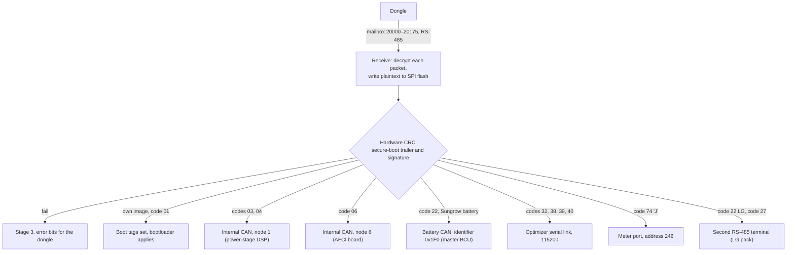

# SH10RS as firmware-update relay

The SH10RS firmware package holds images for several processors, and an SBR192 battery, an
optimizer module or an Energy Bridge may need updating too. The dongle never talks to any of them
directly. It sends every image to the inverter's communication controller through one register
mailbox; the controller stages the image, checks it, and then becomes the update master itself
for whichever module the image is for, over whichever bus reaches that module. This page
describes the controller's side. The dongle's side of the first hop is in
[../../firmware-update/device-firmware-relay.md](../../firmware-update/device-firmware-relay.md),
the package format in [../../firmware-update/sgu-container.md](../../firmware-update/sgu-container.md),
and the battery's side of the last hop in [../sbr192/firmware-update.md](../sbr192/firmware-update.md).

Register numbers on this page are 1-based, as in Sungrow's published Modbus documentation.

## Overview

The **module code** is the two characters after the first underscore of the module string in the
image descriptor (for example `SBRBCU-S_22011.01.30` gives 22). It alone decides the route.

## Receiving the image

| Step | Behaviour |
|---|---|
| Session | The dongle opens a session in the mailbox (20000–20175) and writes the descriptor: module string, tag, image CRC, length, packet size and count |
| Name check | The text before the first `.` of the module string must equal the prefix of one of the controller's name slots: its own image, the master and slave DSP, the AFCI board, the meter-port 'J' device, the battery, and four more. No match gives error 0x20; a descriptor tag word of 0xA5A5 skips the check. With tag 0x55 an image that is not newer than the running one gives error 0x40 |
| Packets | Each packet arrives encrypted; the controller decrypts it with the key shared by all units and writes the plaintext into the staging window of its SPI flash (992 KB starting at the 7 MB mark) at the packet's offset |
| Erase | The first accepted data packet of a session erases the whole staging window (64 KB, 32 KB and 4 KB steps) |
| Resume | A received-packet bitmap and the descriptor are kept in FRAM, one bit per packet, so an interrupted transfer continues where it stopped |
| During the session | The private optimizer relay is closed and the battery task runs at a reduced rate |

## Checks before anything is applied

After the last packet the controller checks the staged image once per second of housekeeping:

| Check | Detail | Failure |
|---|---|---|
| CRC | The STM32 hardware CRC unit (CRC-32/MPEG-2 over 32-bit little-endian words) over the staged image, compared with the CRC the dongle declared | stage 3, error bit 0x200 |
| Trailer | The image ends in a 432-byte `SungrowSecureBoot` trailer. Its own checksum (a zlib CRC-32 over the version, signature-length and signature fields) must match | stage 3, error bit 0x4000, always |
| Signature | SHA-256 over the image before the trailer, verified as an RSA-3072 PKCS#1 v1.5 signature against the public key held in the controller | stage 3, error bit 0x4000, but only while enforcement is on |

Enforcement is a switch at holding register **36332** (0xAA on, 0x55 off; other values get
exception 04). It is not saved across a restart. On the SH10RS it powers on **off**, so a missing or
bad signature is accepted after every restart unless something turns it on; the SG5.0RS powers on
with it on. Neither dongle writes it.

The trailer is then cut off: every downstream module receives the image without it, and the
controller recomputes the CRC over the shortened image for the relay. An image whose name matches
the controller's own goes to its bootloader through boot tags instead of being relayed.

## Routing by module code

| Code | Module | Bus | Target address | Inverter stopped |
|---|---|---|---|---|
| 01 | communication controller (own image) | – | – | – |
| 03 | master DSP | internal CAN, 500 kbit/s | 1 | yes |
| 04 | slave DSP (through the master DSP) | internal CAN | 1 | yes |
| 05, 08 | "PVD" and CPLD | internal CAN | 1 | yes, but normally refused first: the SH10RS has no name slot for them (error 0x20) |
| 06 | AFCI board | internal CAN | 6 | no |
| 22 | SBR battery control unit, when a Sungrow battery is detected | battery CAN, identifier 0x1F0 | 1 (the master BCU) | yes |
| 22 | LG pack (B variant), when an LG RS-485 battery is detected | second RS-485 terminal, 115200 | LG pack | no |
| 27 | LG pack (D variant) | second RS-485 terminal, 9600 | LG pack | no |
| 32, 38, 39, 40 | optimizer and MLPE modules | optimizer serial link, 115200 | module | yes |
| 74 ('J') | Energy Bridge | meter port, 9600 | 246 | no |

"Inverter stopped": when the dongle opens a session for one of these codes, the controller adds a
firmware-update stop request to its run/stop arbiter, which writes the stop command (0xCE) to the
DSP. When the session ends, and no other stop request remains, the start command (0xCF) goes out.
A user Start (13000) clears all higher-numbered stop requests including the update's, so a Start
during a DSP update restarts the power stage while the image is still being transferred.

## The relay protocol

For the internal CAN modules and the battery the controller replays the same mailbox protocol the
dongle used, as master, with plaintext 208-byte packets and the same fixed login token. One request
is sent at most every 20 ms, and only after the previous reply (or a timeout) has arrived.

| Step | Request (function, registers on the target) | Advances when |
|---|---|---|
| Version | read 20000–20001 | the reply is `01 00 02 00` (protocol V2); otherwise error 0x08 |
| Open | write 20010–20018: open code 0xAA, login token, inactivity timeout, zeros | echo |
| Parameters | write 20019–20021: hold flag 0 (the target applies the image by itself once complete), 0, the target's address | echo |
| Read back | read 20022–20045: stored module string, descriptor and highest packet received | matching string and CRC with a non-zero highest packet: resume; otherwise write the descriptor |
| Clear | write 20045, 108 zero registers (master DSP only, when the read-back did not match) | echo |
| Descriptor | write 20022–20044: module string, tag 0xAA, CRC, length, packet size, packet count | echo |
| Status | read 20004–20007: capability, stage, error word | after the descriptor: go to data at once |
| Data | write from 20045: packet number, byte offset (u32, low word first), length, data | echo; next packet |
| Lost report | read 20171–20175: first missing packet, its offset and size, number still missing | nothing missing: poll status; otherwise resend that packet |
| Status poll | read 20004–20007 | stage 2 (busy): keep polling; stage 4: success; stage 3: failure |

The close request (0x55 to 20010) is prepared but never sent: the relay simply goes idle when it
finishes. The relay never sends a reset or "apply" command either; the target applies the image
on its own.

| Item | Internal CAN modules | Battery (0x1F0) |
|---|---|---|
| Reply timeout | 2 s, then the same request again | 100 ms |
| Give-up | after 20 timeouts in a row (about 40 s): error 0x400 | after 6000 (about 10 minutes): error 0x400 |
| Counter reset | every accepted write | every accepted write |

On success the controller's own mailbox stage becomes 7 ("sub-module finished"); on failure it
becomes 3 and the target's error bits are added to the controller's error word, where the dongle
reads them.

| Error bit | Meaning |
|---|---|
| 0x02 | wrong login token (dongle session) |
| 0x04 | session inactivity timeout |
| 0x08 | the target's mailbox did not report protocol V2 |
| 0x20 | module name matches no slot |
| 0x40 | image is not newer than the running one (tag 0x55) |
| 0x200 | CRC check failed (in the controller or reported by the battery) |
| 0x400 | target stopped answering |
| 0x4000 | secure-boot trailer or signature check failed |

## DSP and AFCI board

The internal CAN relay is the controller's normal Modbus traffic to node 1 or node 6; while it
runs, the controller's cyclic DSP poll is suspended, so measurement registers freeze. Slave DSP
images go to node 1 like master DSP images; only the module string tells the master DSP what the
image is for. After a DSP update the controller does not re-read the version block, so the
version strings at 2582 keep showing the old versions until the next restart or a DSP link loss.

Inside the power stage: the master DSP accepts its own image through the same update window,
stores it in the inverter's serial flash, and when the inverter is not running writes a boot marker
into its own flash and resets itself through the watchdog; a boot loader below the application
(not part of any package) then programs the new image. During the wait it holds the inverter
stopped with the normal stop command. A slave-DSP image is replayed by the master DSP, acting as
the update master over its SPI link to the slave, with the same request sequence the controller
uses on the CAN side; the master DSP reports the stage of that relay back through the update
window. The master DSP image also contains an AES implementation, but nothing calls it; the
images are not decrypted in the DSP. The master DSP has no path to a CPLD, so a code-08 image
could not be applied even if the controller accepted it.

## Battery control unit

| Item | Behaviour |
|---|---|
| Precondition | A Sungrow battery is detected; the WiNet-S2 additionally refuses to start codes 22 and 27 unless the inverter is not running and PV power is below 500 W |
| Bus set-up | The controller switches its battery CAN controller to stream mode with identifier 0x1F0 and stops its own battery frames 0x100–0x109. The service-map tunnel (0x1E0) is closed for the whole job |
| Effect on the batteries | Every complete 0x1F0 request with address 1 puts **every BCU on the bus** into its update state: contactors open and periodic transmissions stop. Only the master BCU answers. The batteries are therefore offline for the whole update |
| On the BCU | The master stages the image in its own flash, checks it with the same hardware CRC, hands it to the other stacks over the BCU-to-BCU bus, shuts down safely and restarts about 17.5 s after the last hand-over. It reports stage 4 when it comes back; a failed hand-over is reported as stage 3 |
| Duration | Roughly 40 to 50 ms per 208-byte packet (29 CAN frames plus the reply and pacing), one to two minutes for a battery image, plus the hand-over and restart |
| Afterwards | The controller resumes its battery frames and restarts the battery handshake at once. Every BCU resets itself 10 minutes after its last update frame if its update flags are still set, so a peer stack whose flags the resumed frames do not clear stays in its update state, contactors open, for about 10 minutes after the master reports success (derived from the firmware, not observed) |

## Optimizer and MLPE modules

Codes 32, 38, 39 and 40 go out on the 115200 optimizer link, where the controller is master. The
inverter is stopped for these sessions. The dongle-to-optimizer private relay on the same link is
closed for the whole session, so the two update masters cannot interleave on it. See
[../optimizers-and-mlpe.md](../optimizers-and-mlpe.md).

## Energy Bridge ('J')

Code 74 (the character 'J') is relayed to address 246 on the meter port, the Energy Bridge. The
name check uses the firmware-version string the bridge reported when the inverter identified it,
so a 'J' image is accepted only while a bridge is known (and neither the parallel link nor
whole-home backup is on). The inverter keeps running. The relay is not the mailbox protocol above
but a small register set on the bridge, all Modbus RTU to address 246:

| Step | Frame | Content |
|---|---|---|
| Descriptor | function 16, 17 registers from 0x10CF | command 0x00AA, the module string (20 bytes), CRC-32 and length (u32 each, low word first), packet size 1024, packet count |
| Status | function 3, 3 registers from 0x10CC | the bridge's state (2 = ready for data, 5 = done, 4 = failed) and a 32-bit result word, polled at most once per second |
| Data | function 16 from 0x10E0 | packet number, byte length, then up to 1024 image bytes; the offset follows from the packet number. The byte-count field of a full packet overflows to 0x04, so the bridge has to go by the register count |
| Abort | function 16, 0x10CF = 0x0055 | sent after three consecutive timeouts |

The image goes out plaintext without its trailer. Its CRC-32 is the standard (zlib) CRC-32, not
the STM32 hardware CRC used for the other modules. A bridge that answers state 4 (failed) ends the
job with stage 7 and error bit 0x400 rather than stage 3.

Whenever a bridge has been identified, the inverter also announces every update session to it: a
function 6 write of 0x1006 = 0x00AA when a session starts, and 0x0055 when a CAN or optimizer relay
ends. See [../ev-charger-and-energy-bridge.md](../ev-charger-and-energy-bridge.md).

## LG battery packs

LG packs are updated over the second RS-485 terminal by a separate step machine (115200 baud for
the B variant, 9600 for the D variant), in the slot where the controller otherwise polls the DSP.
The frames are Modbus-style with a CRC-16 (function 16 writes to register 0x01F5 for the B variant
and 0x02EF for the D variant). Each step waits for a reply and retries a few times; the result is written straight into the
controller's mailbox stage (4 success, 3 failure). The internal CAN relay is not switched off for
these codes, so the controller also offers the LG image to the DSP address; the dongle sees the
result of whichever finishes last.

## Not yet known

- How the AFCI board activates a new image.
- The meaning of the LG pack update frames, and what the Energy Bridge does with the 0x1006 notice.
