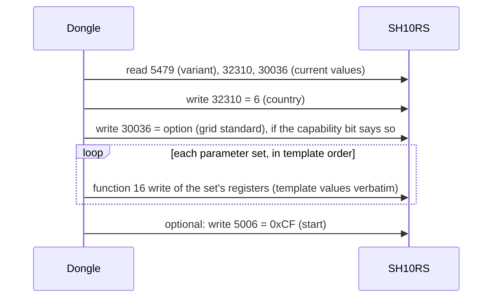
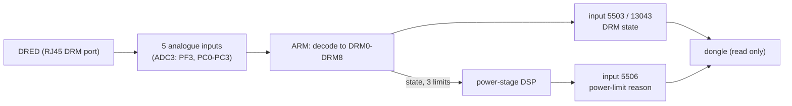

# SH10RS grid codes and demand response (DRM)

This page covers two related subjects:

- how the SH10RS is set up for a country and grid standard, and what a grid-profile write
  actually changes;
- the AS/NZS 4777 demand-response input (DRM0–DRM8), the one control path into the inverter
  that bypasses both the dongle and the cloud.

The behaviour described is that of ARM firmware `SUNSTONE-H_01011.02.69` (package P069). The
SG5.0RS differences are summarised at the end.

> **Numbering.** Register numbers are 1-based, as in Sungrow's documents; the PDU address is one
> less. Settings are holding registers (function code 3 to read, 6 or 16 to write). States and
> reasons (5479, 5503, 5504, 5506, 5521, 13043) are input registers (function code 4).

## Settings families

The dongle and the iSolarCloud app hold grid profiles and installer settings as **per-region
settings templates**. There are four template families. Which one applies to an inverter
depends on two values: the inverter type in holding 30644, and the protocol type derived from
the protocol code and tag (see [README](README.md#identity)). The device type plays no part.

| Inverter type (30644) | Protocol type | Family |
|---|---|---|
| 0 | 1 | `str_pv` |
| 0 | 5 | `res_es` |
| 1 | 1 | `res_new_pv` |
| 0 | 4 | none (no settings offered) |
| any | 2 or 3 | **`unit`** |

The SH10RS does not serve 30644 (0xFFFF, treated as type 0) and is protocol type 3. It
therefore uses the **`unit`** family, exactly like the SG5.0RS. For protocol types 2 and 3 the
key registers are:

| Role | Register | SH10RS value |
|---|---|---|
| Country | 32310 | 6 (Australia) |
| Grid-code companion | 32311 | 0 |
| Grid standard ("power company" code) | 30036 | 13 (AS/NZS 4777.2:2020 Australia A) |
| Grid type | 30037 | 0xFFFF (unused; no profile writes it) |
| Power switch, for the start after setup | 5006 | 0xCF (running) |
| PV / ES variant selector (input) | 5479 | 3 (ES variant) |

The country code is Sungrow's own numbering, with 150 entries. Examples: 1 = Germany,
6 = Australia, 99 = New Zealand. The dongle's Modbus-TCP view repeats the country at input 5377
and the grid standard at input 5475.

## Grid profiles for Australia

The Australian template offers four grid standards for the `unit` family:

| Option (30036) | Standard | Variants by input 5479 | Size |
|---|---|---|---|
| 12 | AS/NZS 4777.2:2015 | one | 19 parameter sets |
| 13 | AS/NZS 4777.2:2020 Australia A | 1–2 → PV, 3–6 → ES | PV: 39 sets / 111 registers; ES: 41 sets / 121 registers |
| 14 | AS/NZS 4777.2:2020 Australia B | as option 13 | as option 13 |
| 15 | AS/NZS 4777.2:2020 Australia C | as option 13 | as option 13 |

A "set" is one block of consecutive registers in the template. The SH10RS reads 3 at input
5479, so the 2020 options use the **ES** variant on it. The SG5.0RS reads 1 and gets the PV
variant. The other families carry only the 2015 standard in this template, with 14–20 sets.

### What a profile apply does

- Values are written exactly as the template stores them, with no range checks by the dongle.
- 32-bit settings are written low word first.
- Words stored as all-ones are skipped.
- The country and grid-standard registers always come first.
- Whether writing the country register on its own reloads the inverter's default protection
  values is not confirmed.

### Parameter groups a 2020 profile sets

Values shown are those of AS/NZS 4777.2:2020 Australia A, as read on a hybrid site.

| Group | Registers | Content (Australia A) |
|---|---|---|
| Protection level | 32313 | 1 = level 2 (two trip stages) |
| Recovery thresholds | 32318–32321 | OV 253.0 V, UV 205.0 V, OF 50.15 Hz, UF 47.50 Hz |
| Level-1 trip thresholds | 32322–32325 | UV 180.0 V, OV 265.0 V, UF 47.00 Hz, OF 52.00 Hz |
| Level-2 trip thresholds | 32326–32329 | UV 70.0 V, OV 275.0 V, UF 47.00 Hz, OF 52.00 Hz (levels 3–5 at 32330–32341 hold copies of the level-1 values) |
| Trip times | 32362–32377 (u32 pairs) | UV1 10.50 s, OV1 1.50 s, UF1 1.50 s, OF1 0.10 s, UV2 1.50 s, OV2 0.10 s, UF2 1.50 s, OF2 0.10 s |
| 10-minute average overvoltage | 30295–30297 | on, trip 258.0 V, revert 256.0 V |
| Over-frequency derating (frequency-watt) | 31400–31417 | on, 50.25 / 50.75 / 52.00 Hz → 200 / 100 / 0 %, recovery 50.15 Hz, curve B, recovery rate 16 %/min |
| Under-frequency uprating | 31420–31438 | on, 49.75 / 49.00 / 48.00 Hz → 0 / 100 / 200 %, recovery 49.85 Hz |
| Power ramps | 31196–31202 | soft start after fault on, 360 s; ramp control on, 16 %/min down and up |
| Volt-Watt | 31230–31239 | on, 253 / 260 / 260 / 260 V → 100 / 20 / 20 / 20 %, 1.0 s |
| Volt-VAr (Q(U)) | 31605, 31615, 31700–31713, 31865–31872 | mode 164 = Q(U); curve 207 / 220 / 240 / 258 V → −44 / 0 / 0 / +60 %; enter 80 %, exit 10 % |
| Charge-side under-voltage response (probably ES variant only) | 33006–33015 | on, 215 / 207 / 207 / 207 V → 0 / 80 / 80 / 80 %, 1.0 s |
| Low / high voltage ride-through | 30798–30815, 30997–31012 | LVRT zero-power mode on, 180.0 V / 70.0 V, 10 000 / 1000 ms; HVRT zero-power mode on, 260.0 V, 1000 ms |
| Reconnection conditions | 32535–32552 | grid check on, 47.50–50.15 Hz, 89.1–110.0 %, 60 s, rising gradient 16 %/min |
| Anti-islanding | 30360 | active islanding detection on |

Recovery thresholds sit inside the level-1 trip thresholds, and level-2 thresholds sit outside
level 1. The dongle's web UI refuses a value that breaks that order. Examples: OV recovery (32318)
must be above UV recovery (32319) and below the level-1 OV trip (32323). The level-2 OV trip
(32327) must be at or above the level-1 OV trip. The inverter runs its own checker on
30000–36000, whose rules are not documented.

## Installer settings catalogue

Besides whole profiles, the dongle's web UI lets an installer edit single settings. The four
templates together define **312 editable settings**:

| Family | Settings |
|---|---|
| `str_pv` | 71 |
| `res_es` | 69 |
| `res_new_pv` | 50 |
| `unit` | **122** (the SH10RS and SG5.0RS) |

Across the catalogue:

- 252 settings are numbers, 37 switches and 23 lists.
- about 269 are u16, 25 s16 and 19 u32 (two registers, low word first).
- 107 are at the basic access level and 205 at an advanced level.

Each setting carries a range in display units and, for 126 of them, a relation to other
settings ("must be below the level-1 trip"). The `unit` family's settings are spread over the
inverter's parameter pages: Operation, Protection, Power regulation, Protection (other) and
Energy management. Many of them are listed on [control-and-ems.md](control-and-ems.md).

## Demand-response modes (DRM)

AS/NZS 4777.2 lets a network operator command an inverter through a demand-response enabling
device (DRED) wired to the inverter's DRM port. The SH10RS senses the DRED itself. The dongle
only observes the result.

### Enabling

| Register | Meaning | Values | Notes |
|---|---|---|---|
| 30113 | DRM enable | 170 (0xAA) enable, 85 (0x55) disable | shown as "DRM" on the Power regulation web-UI page; 85 on a typical hybrid site |
| 30112 | ripple-control enable | 170 / 85 | exclusive with DRM: enabling one forces the other to 85 |

The SH10RS runs DRM only when **all** of these hold:

- the DRM enable is 170;
- the country (32310) is Australia (6), New Zealand (99) or one of codes 100–105;
- the EMS mode is not 8 (MicroGrid). In mode 8 the DRM function is off and a write to 30113
  answers exception 04.

Otherwise the state is forced to 255 and all limits return to 100 %.

The other template families (`res_es`, `res_new_pv`) write a "DRM" value at 31276. On the
SH10RS that register is not served (it reads 0xFFFF), so it is not the DRM enable on this model.
The two families also use opposite codings there.

### Decoding the DRED lines

Each input is scaled to 10 mV steps (3.3 V full scale) and quantised:

| Level | Input voltage |
|---|---|
| 0 | below 1.0 V, or in a dead band (1.65–1.80 V, 2.30–3.00 V) |
| 1 | about 1.0–1.65 V |
| 2 | about 1.8–2.3 V |
| 3 | above 3.0 V |

Input 0 selects the group: level 1 = DRM1–DRM4, level 2 = DRM5–DRM8, level 3 = DRM0. One of
inputs 1–4 then marks the mode within the group. Any other pattern is "no recognised command".

| State (5503) | Mode | Pattern |
|---|---|---|
| 1 | DRM0 | input 0 at level 3 |
| 2–5 | DRM1–DRM4 | input 0 at level 1; input 1, 2, 3 or 4 at level 1 |
| 6–9 | DRM5–DRM8 | input 0 at level 2; input 1, 2, 3 or 4 at level 3 |
| 254 | enabled, no recognised command | SH10RS only |
| 255 | DRM disabled (or not permitted in this country) | |

If all five inputs are low, or the analogue read fails, the pattern decodes as **DRM0**. As a
result, enabling DRM with no DRED (or no shorting plug) connected probably stops the inverter.

### What each mode does on the SH10RS

The state is re-evaluated about every 5 ms, on every pass of the main loop, with no debounce.
The ARM keeps three values and pushes them, with the state, to the power-stage DSP once per
poll rotation (every 0.6 to 0.8 s):

- a consumption (charge and import) limit;
- a generation limit;
- a power-factor setpoint.

| Mode | Consumption limit | Generation limit | Power factor | Other |
|---|---|---|---|---|
| DRM0 | unchanged | unchanged | unchanged | raises the disconnect (stop) event |
| DRM1: no consumption | 0 % | 100 % | 1.000 | clears the stop event |
| DRM2: consumption ≤ 50 % | 50 % | 100 % | 1.000 | |
| DRM3: consumption ≤ 75 %, source reactive power | 75 % | 100 % | −0.800 | |
| DRM4: increase consumption | 100 % | 100 % | unchanged | |
| DRM5: no generation | 100 % | 0 % | 1.000 | |
| DRM6: generation ≤ 50 % | 100 % | 50 % | 1.000 | |
| DRM7: generation ≤ 75 %, sink reactive power | 100 % | 75 % | +0.800 | |
| DRM8: increase generation | 100 % | 100 % | unchanged | |
| no command (254) | 100 % | 100 % | unchanged | |
| disabled (255) | 100 % | 100 % | 1.000 | |

DRM4, DRM8 and "no command" leave the power factor alone. After DRM3 or DRM7 the ±0.800 value
therefore stays in place until a DRM1, 2, 5 or 6 command arrives or DRM is disabled. The DSP
applies the limits and reports the result in input 5506:

- 1024 = limited by DRM1–DRM4;
- 512 = limited by DRM5–DRM8.

### What the dongle sees

- The SH10RS sets capability bit 5521.2 only while the state is 1–9 (DRM0–DRM8 asserted).
- The dongle polls 5503 only while that bit is set. When DRM is disabled, or enabled with no
  command, it therefore shows no DRM state at all. A direct read of 5503 returns 255 or 254.
- The dongle's Modbus-TCP view reads 0 at 5503 and 13043 while the row is not polled. 0 is not
  a DRM code.
- The dongle never writes anything on this path.

### Ripple control (unused)

The SH10RS also has a second demand-response mode, German-style ripple control:

- it is enabled at 30112 and permitted only with country 1 (Germany);
- it uses four steps, 100 / 60 / 30 / 0 %;
- its state register is input 5504 (also 13137).

The same decoder serves both modes, and it never produces the ripple-control states. In this
firmware the ripple state stays at 255 and its limit at 100 %, so the mode does nothing.
Power-limit reason 257 ("ripple control") is therefore not expected on the SH10RS.

## SG5.0RS differences

| | SH10RS | SG5.0RS |
|---|---|---|
| Settings family | `unit`, ES variant (5479 = 3) | `unit`, PV variant (5479 = 1) |
| DRM countries | 6, 99, 100–105 | 6, 99. 30113 itself answers exception 04 (read and write) for any other country |
| Modes acted on | all: DRM0, consumption limits DRM1–3, generation limits DRM5–7, power factor DRM3/DRM7 | DRM0 and DRM5–DRM8 (generation 0 / 50 / 75 / 100 %); DRM1–4 do nothing |
| Generation limit | always passed to the DSP | applied only while the active-power-limit function is enabled |
| "No command" state | 254 | 255, the same as disabled or unsupported country |
| State evaluation | every loop pass | only on a change |
| 5503 visibility | gated by capability bit 5521.2 | always served |
| Ripple control | present but inert | absent |

## Not yet known

- Whether writing the country register reloads the inverter's protection defaults.
- The pin-to-RJ45 mapping of the five DRM inputs and the voltage an unplugged DRED presents.
- What the DSP does with the power-factor setpoint outside DRM3/DRM7.
- What power-limit reason 2049 (an SH10RS-only code, raised with alarm 997) means exactly.
- Which countries codes 100–105 are (probably Australian or New Zealand sub-variants).
