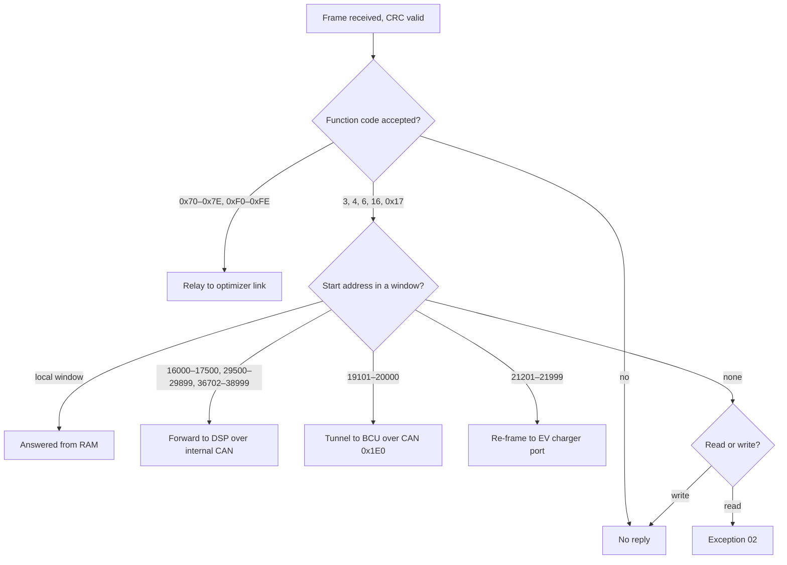

# SH10RS register windows and request routing

The SH10RS does not have one flat register file. Its communication controller routes every
Modbus request by the **start address** of the request to a handler for one address window.
Most windows are answered from the controller's RAM; a few are forwarded to the power-stage DSP,
tunnelled to the battery control unit, or re-framed to the EV charger. This page lists the
windows, what each function code reaches, and the side effects a master has to know about.

Register numbers on this page are 1-based, as in Sungrow's published Modbus documentation (the
address on the wire is one lower). The dongle port and the second RS-485 terminal use the same
dispatchers, so every window answers the same on both. The register contents are in
[registers.md](registers.md) and the generated
[../../appendix/register-tables/rs485-inverters.md](../../appendix/register-tables/rs485-inverters.md).

## Before routing: what the port accepts

| Rule | Behaviour |
|---|---|
| Function codes | 3, 4, 6, 16, 0x17, 0x20, 0x60, 0x65. Any other code is dropped without a reply (no exception 01) |
| Private codes | 0x70–0x7E and 0xF0–0xFE with a valid CRC arriving on the dongle port are not Modbus requests: they are relayed unchanged to the optimizer link ([architecture.md](architecture.md#optimizer-link)) |
| Register count | At most 125 for reads and multi-register writes; a larger request is dropped silently. Requests starting in the firmware-update mailbox (20000–20175) may be longer |
| Byte count | For function 16 (and the write half of 0x17) it must equal twice the count |
| CRC | CRC-16/MODBUS, low byte first. A bad frame is skipped one byte at a time until a valid frame start is found |
| Addresses | The inverter's own address (1 by default, settable at 30460), broadcast 0, the battery slaves 200–204 and the raw-relay address 0xA5. Everything else is ignored |
| Broadcast | Writes are executed and never answered. A broadcast read to an unmapped start gets exception 02 |

The encapsulation and batch functions 0x20 and 0x60 and the change stream 0x65 are described in
[../../protocols/modbus-function-codes.md](../../protocols/modbus-function-codes.md).

## Routing rules

1. **Start address only.** The controller tests the start address against each window in a
   fixed order and the first match wins. The register count is not checked against the window
   end: a read that starts inside a window and runs past its end is answered entirely by that
   window's handler.
2. **Unknown registers inside a window** read 0xFFFF. A read that starts below a window and runs
   into it is answered by the lower window.
3. **Each window applies its own slave-address rule.** Most windows answer only the
   inverter's own address; the exceptions are listed below.
4. **Writes are echoed.** Function 6 echoes address and value as sent; function 16 echoes start
   and count. In a multi-register write, registers before a refused one stay written.

## Windows answered by the controller

A dash means that function code does not reach the window; the request is treated as unmapped
(see [Replies and errors](#replies-and-errors)).

| Window | Fn 3 | Fn 4 | Fn 6 | Fn 16 | Content |
|---|---|---|---|---|---|
| 2500–3117 | – | yes | – | yes | Identity: device type code 2515, model string, serial number, version strings, protocol code |
| 4096–4300 | – | yes | – | – | Device-info strings and codes: the Energy Bridge's identity and values as polled on the meter port; the device code reads 0 when no bridge has answered |
| 4800–4899 | 4815 only | yes | yes | yes | Device search and address assignment. Fn 3 at 4815 returns one register, the slave address; any other fn 3 read here is silent. A broadcast fn 4 read is answered in a time slot, not at once ([../../protocols/device-discovery.md](../../protocols/device-discovery.md)) |
| 4950–5199 | yes | yes | yes | yes | Run data (fn 4) and the 5000-series switches and setpoints (fn 3, 6, 16) |
| 5200–12001 | – | yes | – | – | Private input map. For slaves 200–204 the same window is the battery register map, served from battery CAN data ([battery-interface.md](battery-interface.md)) |
| 6100–6899 | – | yes | – | – | More run data. Tested before 5200–12001, so it wins for these starts |
| 9800–9850 | yes | yes | yes | yes | AFCI mirror: values read from the arc-fault board by the controller's own poll. Fn 3 and fn 4 return different fields; the handlers keep answering past 9850 up to 9893 |
| 13000–13370 | yes | yes | yes | yes | Hybrid control and state: start/stop, EMS mode, forced charge/discharge, SOC limits, export limit. Writes are value-checked; on a device type outside the hybrid family they get exception 05 |
| 20000–20175 | yes | – | – | yes | Firmware-update mailbox ([../../firmware-update/device-firmware-relay.md](../../firmware-update/device-firmware-relay.md)). Reads answer the own address only; requests may exceed 125 registers |
| 21000–21018 | – | yes | – | yes | Temporary baud-rate switch. A refused write gets no reply |
| 30000–36000 | yes | subset | yes | yes | Holding parameters. Fn 3 is the full reader; fn 4 serves a small subset. Writes go through a value checker (exception 04 on a bad value). Writes and the fn 4 view also accept slaves 200–204 |
| 36000–36701 | yes | yes | yes | yes | Further parameters and state (including the DSP pass-through enable 36099 and the signature-enforcement switch 36332). Fn 16 additionally accepts starts 55000–55005 |
| 40001–50001 | yes | stub | yes | yes | SunSpec-style block: 40003 = 1 (model id), 40004 = 66 (length), then inverter data. The fn 4 handler is a stub: it announces 2 × count data bytes but sends none, so the master sees a short or corrupt frame |

Overlaps settled by the test order: 36000 belongs to the holding window, not to 36000–36701;
20000 belongs to the firmware-update mailbox for fn 3 and fn 16 and to the BCU tunnel for fn 4
and fn 6.

Function 3 does not serve the identity block, the private input map, 6100–6899 or the baud
switch; a fn 3 read there gets exception 02.

### Function 0x17

Function 0x17 (read/write multiple) normally runs its write half through the function 16
dispatcher and then its read half through the function 3 dispatcher; a failing write is reported
as 0x97 with the write's exception code. Two read-start ranges have their own handlers:

| Read start | Purpose |
|---|---|
| 8200–8300 | Parallel ("master-slave") link between SH10RS units: the host's poll of each unit's state block 8200–8215 and command block 8200–8216, plus a broadcast write of 8290 ([architecture.md](architecture.md#second-rs-485-terminal)) |
| 29500–29550 | A second multi-unit link, enabled by 36110 (0 off; 1, 2, 3 on with a role). While it is on, the parallel link is switched off and the inverter stops polling its own meter. As responder it serves four registers (29500–29503) |

The dongles never send function 0x17.

## Windows forwarded to the DSP

| Window | Functions | Notes |
|---|---|---|
| 16000–17500 | 3, 4, 6, 16 | |
| 29500–29899 | 3, 4, 6, 16 | Fn 0x17 starting at 29500–29550 is answered locally (above) |
| 36702–38999 | 3, 4, 6, 16 | The forward test covers 36450–38999, but 36450–36701 is claimed first by the local 36000–36701 window. No DSP register is known to answer in this window |

The controller rewrites the slave byte to 1, sends the request to the DSP over the internal CAN
bus and relays the DSP's reply to the port the request came from. The reply carries the
inverter's own address, whatever address the request used. The dongles never poll these
windows; they are reached only by pass-through traffic (cloud register reads and writes, a
Modbus TCP client on the dongle).

A forward is expensive:

| Effect | Detail |
|---|---|
| Port hold | The forward takes the controller's port arbiter for 300 main-loop passes, at least 1.5 s, counted from the **last** forwarded request and not shortened when the DSP answers. Meanwhile the other Modbus slave ports (the second RS-485 terminal and the optimizer link) are not read at all, so their masters see timeouts. The requesting port keeps working. The meter port is not affected |
| Stale data | The controller's own DSP poll is suspended for the same time, so measurement registers read through the requesting port return their last values without any error |
| DSP busy | If the controller's own DSP request is still outstanding, the forward is queued. If that request never completes, the queued forward is discarded when the hold expires and the requester gets no reply |
| Exceptions | DSP exception replies are not relayed; the requester sees a timeout |
| Fn 0x17 | Split into a function 16 write and a function 0x17 read. The DSP's 0x17 reply is never relayed; the requester may instead receive the DSP's function 16 echo, or nothing. If the DSP link is busy the write half is silently lost |
| Fn 0x20 | The inner reply comes back plain, not wrapped, and the next reply from the BCU tunnel is wrapped in 0x20 although its request was not |

> **Warning.** A function 16 write of 0xAA to **37004** switches on a persistent mode in which
> every later function 16 forward holds the port arbiter indefinitely, so the other slave ports and
> the DSP poll stay stopped. It lasts until a write of any other value to 37004 from the same port,
> or a restart. Do not write 37004.

A related path that is not a window: while 36099 holds 0xAA (0x55 off), a frame addressed to 0xA5
on the dongle port with function 3, 4 or 16 is written to the DSP unchanged and the DSP's answer
is returned unchanged. It is off unless something writes 36099.

## Window tunnelled to the battery control unit

| Item | Value |
|---|---|
| Window | 19101–20000 (a function 3 or 16 request starting at 20000 goes to the firmware-update mailbox; functions 4 and 6 reach the tunnel up to 20000) |
| Functions | 3, 4, 6, 16 accepted; the BCU answers 3, 4 and 16 only, so function 6 times out |
| Addresses | Slaves 200–204, or the inverter's own address (which reaches the stack bound to slot 0). Broadcast and other addresses get no reply |
| Conditions | A Sungrow battery is detected and no battery firmware update is in progress |
| Transport | The request is rewritten for the stack's BCU and sent as Modbus RTU over battery CAN identifier 0x1E0; the reply is restored to the original slave address |
| Timeout | At least 1.5 s inside the inverter; then nothing is sent. The inverter never returns an exception for this window |

The map behind it (one 32-bit value per even address, low word first) and the registers the
dongle uses are described in [battery-interface.md](battery-interface.md#service-map-tunnel-can-0x1e0).

## Window re-framed to the EV charger

Any request (function 3, 4, 6 or 16) whose start is in **21201–21999** is turned into a job for
the EV-charger port, whatever its unit id. The first byte of the request is remembered as the
charger's address. The charger port is chosen by 33539 (0xA1 the second RS-485 terminal, 0xA2 the
meter port, 0x55 none). The charger's raw reply is written to the **dongle port**, even if the
request came in elsewhere. With no charger online the job times out and the requester sees no
reply. So the dongle's charger poll at address 248 is answered by the inverter acting as a bridge,
not by a device on the dongle's own bus
([../ev-charger-and-energy-bridge.md](../ev-charger-and-energy-bridge.md)).

## Replies and errors

| Situation | Reply |
|---|---|
| Fn 3 or 4, start in no window, own address or broadcast | Exception 02 |
| Fn 3 or 4, start in no window, any other address (including 200–204) | None |
| Fn 6 or 16, start in no window | **None** (no exception) |
| Value refused by a write checker | Exception 04; exception 05 for the hybrid control window on a non-hybrid device type |
| Write to the baud-switch window refused | None |
| Unknown register inside a served window | 0xFFFF |
| Read of more than 125 registers | None |
| Unsupported function code | None |
| Fn 4 into 40001–50001 | Malformed short frame |
| Request on a port held by a DSP forward | None |
| BCU tunnel without an answer, or slave 200–204 with no bound stack | None |

No exception 01, 03 or 06 exists in the dispatch layer, so most faults look like a timeout to the
master.

## Battery slaves 200–204

The inverter answers five extra slave addresses, one per battery stack, from data it receives
over the battery CAN bus. The battery stacks themselves have no RS-485 port.

| Item | Behaviour |
|---|---|
| Binding | Slave 200 + k is bound to the stack serial number recorded in slot k of a five-slot registry in FRAM. A new stack takes the first free slot, so the order is first-seen, not the stack's CAN address, and survives restarts |
| Discovery | The inverter publishes the addresses at 10451–10455 (200 + k for a bound slot, 0xFFFF otherwise); 10456–10458 read 0xFFFF |
| Windows | Function 4 reads of 5200–12001 return the battery map; the BCU tunnel 19101–20000 and the holding window 30000–36000 also accept these addresses |
| Not served | Function 3 reads and function 6/16 writes of 5200–12001 to a battery slave get no reply |
| Drop | A stack that sends no frame for 80 ticks of the 250 ms battery task (about 20 s) is marked offline and its slot is unbound: the slave stops answering until the stack registers again. The "stack online" register can therefore never be read as 0 |
| Change stream | Function 0x65 is accepted only for the inverter's own address, never for 200–204 |

## Guidance for a master

- Keep every request inside one window that handles its function code; never let a planned read
  start in one window and continue into another handler's range.
- Wait for each reply (or its timeout) before sending the next request.
- Avoid fn 4 at 40001–50001 and the DSP-forward windows; each forward stalls the inverter's other
  ports for at least 1.5 s.
- Do not write 37004 or 36099.
- Use function 16 followed by function 3 instead of function 0x17.

## Not yet known

- The upper bound of the DSP-forward hold; only the 1.5 s lower bound is fixed.
- What, if anything, the DSP serves in 36702–38999, and what the registers in the other two
  forward windows mean.
- Which device sends the requester side of the 29500–29503 link.
