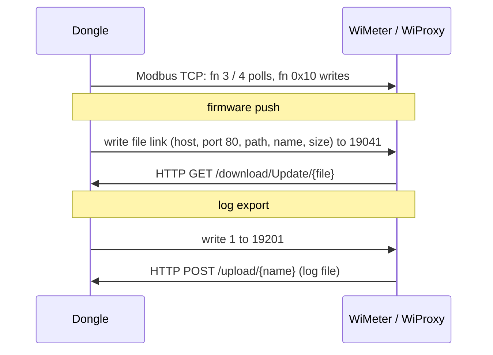

# WiMeter and WiProxy

No WiMeter or WiProxy was connected; this page describes how the dongle firmware treats these two accessories.

The **WiMeter** and **WiProxy** are Sungrow Wi-Fi accessories that a dongle manages as devices of its own:

| Accessory | Product (device) code | Dongle device type | Cloud device type | Network |
|---|---|---|---|---|
| WiMeter | 1819 (`0x71B`) | 34 (Sungrow logger family) | 46 | Joins the dongle's own hotspot; the dongle is its gateway at 11.11.11.1 |
| WiProxy | 1820 (`0x71C`) | 34 | 46 | Wired to the router and runs its own hotspot; the dongle joins that hotspot as a Wi-Fi station |

Register numbers are 1-based, as in Sungrow's Modbus documentation; the address in the frame is one less.

## 1. The link: Modbus TCP

The control link is **Modbus TCP with the dongle as TCP client**. The add path opens a Modbus-TCP client slot for the
device (15 slots exist); requests go through the same builder and port task as RS-485 requests, with the CRC dropped
and a standard MBAP header added (transaction id from a global counter, protocol id 0). The TCP port is whatever the
add request carries; the dongle has no default. HTTP is used only to move files, and in both directions the dongle is
the HTTP **server**:

## 2. Adding an accessory

Both accessories are added through the add-device web call, either `POST /device/add` (HTTPS, login token required)
or `POST /device/addWiMeter`, which is the same handler **without** the token check. The web add forces a WiProxy onto
network port 14 (Wi-Fi station) and a WiMeter onto network port 15.

| Field | Meaning |
|---|---|
| `dev_type` | Device class name (34) |
| `port_name` | Port; network ports 12–15 |
| `dev_code` | 1819 or 1820 |
| `dev_model` | Model name |
| `protocol` | `MODBUS-TCP` |
| `ip`, `port` | The accessory's address |
| `start_addr`, `dev_count` | Modbus unit address and count |
| `network_mode` | 1 = network-config (re-pairing), 0 = ordinary add |
| `wimeter_sn` | Accessory serial number, up to 20 characters |

The device manager accepts the add when the dongle is in network-config mode and `network_mode` is 1, or when both are
0 and no device with that code and serial number exists; otherwise it answers return code 52. An add for a code that
already exists updates that device's IP and serial number. The dongle's web UI never sends `network_mode` or
`wimeter_sn`; the accessory itself is the probable caller of `/device/addWiMeter`, re-registering its address without a
login.

Where `/device/addWiMeter` lives:

| Dongle | Route served by |
|---|---|
| WiNet-S2 | A plain HTTP server on port 80 that starts **only if a WiMeter is in the saved device list at boot**. A WiProxy does not start it. Pairing a first WiMeter opens port 80 only at the next reboot |
| WiNet-S | The single HTTPS server on port 443, always |

## 3. Joining a WiProxy hotspot (network-config mode)

Holding the dongle's button for more than 5 s starts network-config mode. On the **WiNet-S** the mode then:

1. turns the dongle's own hotspot on (its 30-minute SSID-hide timer restarted);
2. scans for access points whose SSID starts with `SG-` and whose security is WPA/WPA2 mixed, sorted by signal
   strength (up to 30);
3. joins the candidate using the default WiProxy Wi-Fi password built into the dongle firmware, after saving the old
   station settings;
4. waits for an add request carrying `network_mode` 1 for a WiProxy; success keeps the new settings, a refusal or a
   30 s wait moves to the next candidate;
5. after 5 minutes without a WiProxy, restores the saved station settings. A reboot during the session restores them
   too.

The scan also runs on its own when no station SSID is saved. Any `SG-` hotspot with that security mode is tried, with no
check of vendor or serial number.

On the **WiNet-S2** the mode only sets a flag, turns the hotspot on and makes the status LED blink green; there is no
scan, no join and no timeout, and a single click ends it. The WiProxy hotspot join is therefore WiNet-S only.

While network-config mode runs or an accessory exists, a double click no longer switches the hotspot off, and the cloud
cannot write the hotspot-enable parameter.

## 4. Polling

The dongle polls both accessories through its generic table-driven Modbus driver (the same one that serves meters),
with one compiled table each:

| Accessory | Rows | Period | Register table |
|---|---|---|---|
| WiMeter (1819) | 12 | 60 s | [../appendix/register-tables/wimeter.md](../appendix/register-tables/wimeter.md) |
| WiProxy (1820) | 12 | 60 s | [../appendix/register-tables/wiproxy.md](../appendix/register-tables/wiproxy.md) |

Values are decoded low word first. The reply timeout is 2000 ms and a device goes offline after 20 lost replies, as
for meters ([meters](meters.md#14-polling-and-timing)); a separate watchdog for this class is longer than for meters.
The dongle also pushes its clock to both accessories.

## 5. Firmware push

A firmware push to an accessory is started from the cloud (commands 10308 / 10376) or from the local web upgrade flow,
which first matches the uploaded file name against each accessory's version string. The upgrade file is staged on the
dongle, and the push is a register protocol shaped like the inverter's firmware-update block, moved to 19000:

| Step | Function | Register | Count | Payload | Next |
|---|---|---|---|---|---|
| Query status | 4 | 19002 | 4 | — | Status 0 or 16 allows the upgrade; otherwise result 2, code `0x800` |
| Login | 0x10 | 19010 | 6 | 170, an 8-byte login token, 480 | — |
| Set target | 0x10 | 19016 | 17 | unit address, target version (file name without `.sgu`, 30 bytes), 85 | — |
| Query status | 4 | 19002 | 4 | — | Status 1 = ready; otherwise log in again, at most 5 times (one counter shared by all devices), then result 2, code `0x4000` |
| Send file link | 0x10 | 19041 | 90 | table below | — |
| Progress poll | 4 | 19002 | 4 | — | Repeated about every 5 s until status 16 |
| Logout | 0x10 | 19010 | 1 | 85 | Job ends |

The login token is a fixed constant shared with the inverter firmware-update login and is sent in clear. The trailing
480 matches the dongle's 480 s job limit.

File-link payload (180 bytes):

| Offset | Size | Field | Value |
|---|---|---|---|
| 0 | 30 | Host | WiMeter: `http://11.11.11.1`; WiProxy: `http://` + the dongle's own station IP |
| 30 | 2 | Port | 80 |
| 32 | 16 | User name | empty |
| 48 | 32 | Password | zero |
| 80 | 64 | Path | `/download/Update/` |
| 144 | 32 | File name | including `.sgu` |
| 176 | 4 | File size | bytes |

The accessory then fetches `http://<host>:80/download/Update/<file>`. Progress shown to the cloud: status 2 / 3 / 4 →
30 / 40 / 50 %, then a creep of 2 % per poll to 90 %, and 100 % when the result word is 1.

| Rule | Value |
|---|---|
| Request timeout | 2000 ms |
| Resend | a step unanswered for 10 s is re-sent, at most 5 times; then result 2, code `0x2000` |
| Overall limit | 480 s in the poll step; then result 2, code `0x1000` |

Only the WiNet-S2 can complete a push, and only when its port-80 server is running (a WiMeter saved at boot). The
WiNet-S has no server for `/download/Update/` on any port, so its push cannot finish. The staged file is removed once every
job has ended; a new file check clears the state of every running job, and the `0x800` and `0x4000` failures never
mark the job ended, so after those failures the file is not removed.

## 6. Log export

Cloud command 10329 with one device, one file and function code 160 starts a log export:

1. Read register 19201 (function 3). The value is never actually checked, so the start is always sent.
2. Write 1 to register 19201 (function 0x10, one register).
3. The accessory POSTs its log to `/upload/<name>` on the dongle. The body is raw bytes, at most 8 192 000, stored as a
   single fixed log file whatever the name.

Progress comes from the upload's byte counters, not from the register: received / total × 100. Three consecutive
status polls (at least 3 s apart) without new bytes end the job with error 51. The stored file is served back through
the dongle's log-download route.

| Dongle | `/upload/*` served by |
|---|---|
| WiNet-S2 | The conditional port-80 server (WiMeter saved at boot) |
| WiNet-S | The HTTPS server on 443, always |

## 7. Behaviour of the port-80 server (WiNet-S2)

| Item | Behaviour |
|---|---|
| Handlers | `POST /device/addWiMeter`, `POST /upload/*`, `GET /*` (static web files, and `/download/Update*` from the staging area) |
| Authentication | None on any of the three |
| Upload replies | 200 `File uploaded successfully`; 400 for a body over 8000 KB; 500 for name or storage errors |
| Failed upload | Deletes the file named in the URI from the web-UI filesystem rather than the partial log, so a cut-off `POST /upload/index.html` removes that web-UI file |
| Concurrent uploads | A second upload deletes the first without checking that it finished |
| `addWiMeter` with an unknown `dev_type` | Two replies on the same request |

The dongle advertises an HTTP service on port 80 over mDNS even when this server is not running.

## Not yet known

- The TCP port a real WiMeter or WiProxy registers.
- The device-side meaning of the firmware-push status values 1–4 and 16, and what the accessory does between the
  export start flag and its upload.
- How the accessory chooses the name in its upload URI.
- Whether a WiProxy accepts the dongle's default password and sends the add request described in section 3.
