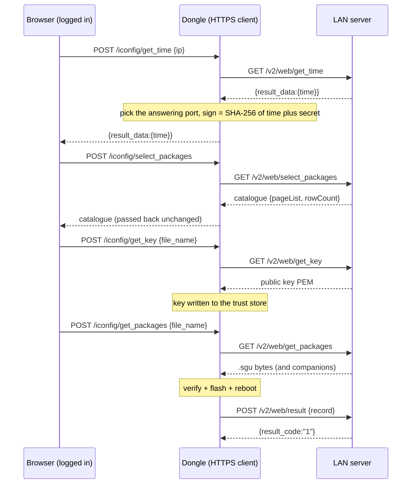

# How a dongle update is delivered

A WiNet dongle can receive its own firmware over three channels. All three deliver the same
`.sgu` container ([sgu-container.md](sgu-container.md)) and all three converge on one install
core: the same verification, the same write-and-reboot, on both the WiNet-S and the
WiNet-S2.

| Channel | Who starts it | Transport | Section |
|---|---|---|---|
| LAN pull | a browser logged in to the dongle | the dongle is an HTTPS client to a LAN server | [1](#1-the-lan-pull-channel) |
| Cloud push | iSolarCloud | the dongle downloads over HTTPS, FTP or SFTP | [2](#2-the-cloud-push-channel) |
| Local upload | a browser logged in to the dongle | the dongle receives the file in the request body | [3](#3-the-local-upload-channel) |

## 1. The LAN pull channel

In this channel the dongle does not receive a file; it **fetches** one. A browser logged in
to the dongle drives a control plane of `POST /iconfig/*` routes; each control request makes
the dongle perform one action as an **HTTPS client** toward a server whose IP address the
operator typed in (typically an installer's laptop). The dongle never listens for this; it
always initiates.

**Finding the server.** Only the first call loops over a fixed list of candidate TCP ports
and remembers the one that answered: **20001, 20101, 20201, 20301, 20401, 20501, 20601,
20701, 20801, 20901**, tried in that order. All later calls reuse that port.

**The five server requests** (`https://<ip>:<port>/v2/web/...`):

| Request | Method | Purpose |
|---|---|---|
| `get_time` | GET | read the server clock; used to compute the per-request `sign` and to select the port |
| `select_packages` | GET | fetch the catalogue of packages the server offers (body passed back to the browser unchanged) |
| `get_key` | GET | download the update public key straight into the dongle's trust store |
| `get_packages` | GET | download the `.sgu` package (and its companions) into the staging directory |
| `result` | POST | report start and outcome, one record per POST |

**No server authentication.** The dongle accepts any TLS certificate the server presents —
no CA, no hostname check, nothing pinned. The only per-request credential is a `sign` field
(a SHA-256 over the server's time and a baked-in secret) that the **dongle computes for the
server to check**; it protects the server from rogue clients, not the dongle from a rogue
server. A server that answers on the typed IP can therefore install any firmware it signs
with its own key, because `get_key` delivers the very key the package is then checked
against. Triggering still requires a valid web session on the dongle.

**`get_key` is decisive.** It first removes the existing trust directory, writes the new key
version label, then downloads the server's key into the trust store. The package's detached
signature is subsequently checked against that downloaded key
([sgu-container.md](sgu-container.md)).

**The `result` reply gotcha.** The dongle parses the `result` reply's `result_code` as a
string. The field **must** be a JSON string (`"1"`), never a JSON number (`1`): on a JSON
number the dongle reads a null pointer and crashes on the upgrade-start path, before it
flashes anything.

The catalogue each package entry needs is small: a numeric `file_id`, the `.sgu`
`file_name`, an optional `license_name` (the key file — if present the browser calls
`get_key` first), plus display fields. The server must package the update as a `.zip`.

## 2. The cloud push channel

iSolarCloud drives updates with two commands on the dongle's `upgrade` topic family. Both
are gated by a remote-control permission bit that is set by default.

**Command 10308 — a push job.** The cloud names a server, a device list and up to eight
files. The dongle hands the download to a background worker, which fetches one file at a
time into its `Update` staging directory:

- If the server address contains `https`, the download is HTTPS (URL = address + path +
  name). HTTPS downloads are run with **no certificate or hostname check**.
- Otherwise the address is an FTP or SFTP host, and the port decides: port 21 is FTP, any
  other port is SFTP. SFTP host keys are not pinned.

The downloader checks nothing about the content — not size, not hash, not an HTTP status
code, so an error page can be saved as the file. Every content check happens afterwards, at
install time ([the install core](#the-common-install-core)). When the first target in the
job is the dongle itself (device code 247), a `.pem` shipped in the same file list becomes
the verification key and is copied into the trust store before the check.

**Command 10376 — a package list.** Once a day (when auto-upgrade is enabled) the dongle
publishes its own query listing every connected device's model, serial and module versions;
the cloud answers with 10376, carrying package **URLs** for later. 10376 only stores those
URLs — the files are fetched later, when the local web UI asks for them.

The dongle reports 10308 progress to the cloud on `rsp/upgrade/<SN>` with per-device,
per-file `upgradeStatus` codes (see [status codes](#cloud-upgradestatus-codes)).

## 3. The local upload channel

The browser uploads a package it already holds, member by member. There is **no multipart
form upload**; each file is the raw body of its own request.

1. `POST /device/upgradeSeq` announces the number of files and a batch sequence id.
2. For each file, `POST /system/upgradeCheck/<name>` with the file as the raw request body.
   The file name is the URL tail. A name containing `.sgu` is treated as the package; any
   other name is treated as the detached signature. The full verification runs when the last
   announced file arrives, and the reply then carries the version details.
3. `POST /system/upgradeStart` flashes and reboots.

This upload route verifies the package against the **fixed** on-device trust store (it does
not substitute a package-supplied key the way the pull and cloud channels do).

## The common install core

All three channels converge here once a package and its signature are staged:

1. **Parse** the `.sgu`: read the header, walk the typed body parts.
2. **Verify**: MD5 integrity, the embedded-key self-check (if a trailer is present), the
   version floor, and the detached-signature check against the trust-store key
   ([sgu-container.md](sgu-container.md)).
3. **Write the slots**: the type-2 application image to the inactive OTA application slot,
   the type-3 image to the web-UI filesystem partition.
4. **Mark pending** and **reboot** into the newly written slot.
5. **Validate after reboot**: the new image must confirm itself within a short validation
   window (roughly 30 s) or the bootloader rolls back to the previous slot. The dongle then
   reports the outcome from a comparison of the running version against the package version.

## What differs between the WiNet-S and the WiNet-S2

The install core is the same codebase on both dongles. Only two things differ in substance:

- **The signature rule.** The WiNet-S2 refuses an unsigned package at or above its version
  floor (result code 4104); the WiNet-S never requires a trailer. See
  [the S2 signature rule](sgu-container.md#the-winet-s2-signature-rule).
- **The bootloader cannot be replaced over the air on either dongle**, and this matters most
  on the S2. An update writes only the application slot and the web-UI filesystem — never the
  second-stage bootloader or the partition table — so the bootloader's image validation is
  fixed for the life of the device. On the WiNet-S2 the bootloader sits at the very start of
  flash, ahead of the partition table, outside every partition, so it has no inactive copy
  and no rollback; and the S2's USB download pins are wired to its status LEDs, so there is no
  USB recovery. A bad bootloader write would be unrecoverable without opening the case and
  using the UART, which is why the update path never touches it.

Everything else — addresses and the baked-in version strings — differs only in detail.

## Self-update result codes

These are the codes the dongle reports for updating **itself**:

| Code | Meaning |
|---|---|
| 4104 | upgrade check error — on the WiNet-S2, an unsigned package at or above the version floor (missing signature trailer) |
| 4105 | system upgrade error — after reboot the running version is not the expected one (a new image that failed and was rolled back, or any other version mismatch) |

The full web-UI result table, including the upload-path codes (filesystem, signature and
public-key errors), is in [../appendix/error-codes.md](../appendix/error-codes.md).

## Cloud `upgradeStatus` codes

Reported per device and per file in a 10308 progress message. The value is a four-hex-digit
code: `1xxx` = success, `2xxx` = failure, `3xxx` = in progress.

| Code | Meaning |
|---|---|
| 3000 | waiting (written for every device × file when the job is accepted) |
| 3008 | file downloading |
| 3009 | file downloaded; stays set while the device is being programmed |
| 1004 | file installed on this device |
| 2003 | install failed (device programming failed, package check failed, start failed, or wrong file type) |
| 2011 | package rejected (the device's own check failed, or a self-upgrade reboot left the wrong version running) |
| 2103 | download failed |
| 2110 | download timed out |
| 2112 | target device offline |
| 2116 | a combined `.sgz` file was offered for the dongle itself |

### `exceptCode` module bytes

When a device's programming reports an exception, the progress message may carry an
`exceptCode` array derived from per-module state bytes. The candidate meanings of those
bytes (from the web UI's module-error map) are:

| Byte | Meaning |
|---|---|
| 100 | device timeout |
| 101 | IAP v2 not supported |
| 102 | not upgrading |
| 103 | status-query timeout |
| 104 | missing packets |
| 105 | single packet abnormal |
| 106 | all packets abnormal |
| 107 | DSP number inconsistent |

The device-side programming that produces these outcomes is described in
[device-firmware-relay.md](device-firmware-relay.md).
