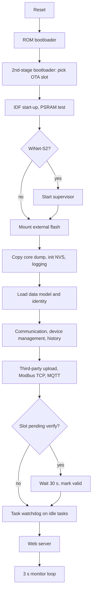

# Boot and runtime

This page describes how the dongle firmware starts and how it runs once it is up: the boot chain,
the order in which the application brings up its parts, the network interfaces, the 3 s monitor
loop, the watchdogs, the threading model and the open-source components the firmware is built from.
The [WiNet-S](winet-s.md) and [WiNet-S2](winet-s2.md) behave the same except where noted.

## Boot chain

| Stage | WiNet-S | WiNet-S2 |
|---|---|---|
| ROM bootloader | ESP32 ROM; GPIO0 low at reset enters serial download | ESP32-S3 ROM; same |
| Second-stage bootloader | ESP-IDF bootloader at `0x1000` | ESP-IDF v4.4.1 bootloader at `0x0` |
| Slot choice | from `otadata`, with app rollback | same |
| Application start-up | ESP-IDF 5.x-era start code: heap including PSRAM, event loop, network interface layer, TCP/IP thread | same, plus a boot memory test of the 8 MB PSRAM |

The bootloader prints its log (chip revision, flash mode, partition table, chosen slot) on UART0 at
115200 baud. The partition table is in [flash-layout.md](flash-layout.md).

On the WiNet-S2 nothing kicks the external supervisor between reset and the application's first
action, so the bootloader and the PSRAM test have to finish inside the supervisor's timeout. The
firmware runs PSRAM at 80 MHz, which keeps the memory test short.

## Application start-up order

The application's main function runs these steps in order, then turns into the monitor loop. Each
"start" step creates one or more long-running tasks.

1. **Supervisor start** (WiNet-S2 only): enable low, ten 100 ms kicks, enable high, then the 500 ms
   kick timer ([winet-s2.md](winet-s2.md#external-supervisor)).
2. **External flash mount**: initialise the SPI NOR, register it as `usrdataout`, mount it and the
   internal `oemdata` as LittleFS. Bus or chip-ID failures abort; a failed mount formats the volume.
3. **Core dump capture**: copy a crash dump left in the `coredump` partition to
   `/usrdataout/log/rundata/coredump.bin` and erase the partition.
4. **Chip watchdog set-up** (WiNet-S only): configure the ESP32 main timer-group watchdog.
5. **NVS**: initialise, erasing and retrying if the partition is full or from a newer format.
6. **Logging**: open the application log file and start the task that drains the log queue to it.
7. **Data model**: load the device list and every device's configuration file from the external
   flash, including the dongle's own identity file. At this point the console log level is set to
   "none" unless a maintenance window is open.
8. **Application tasks**: start the communication, device-management, history, third-party upload
   ([../protocols/third-party-upload.md](../protocols/third-party-upload.md)), Modbus TCP
   ([../protocols/modbus-tcp.md](../protocols/modbus-tcp.md)) and MQTT
   ([../protocols/cloud-mqtt.md](../protocols/cloud-mqtt.md)) tasks.
9. **OTA slot validation**: if the running slot is still "pending verify" (first boot after an
   update), wait 30 s, then mark it valid and cancel the rollback. Then run the post-update state
   machine (resume, web-UI update, or report a failed self-check).
10. **Idle-task watch**: subscribe the idle task of each core to the task watchdog.
11. **Cleanup**: remove stale update downloads.
12. **Web server**: load users and certificates, start the HTTPS server and WebSocket
    ([../protocols/web-api.md](../protocols/web-api.md)). The HTTPS server does not start without its
    certificate and key on the external flash.
13. **Monitor loop**: from here the main function never returns.

Because validation waits a fixed 30 s after the protocol tasks start, an update that crashes or is
reset by the supervisor in its first half-minute is rolled back to the previous slot by the
bootloader. Validation does not depend on network or cloud connectivity.

## Network interfaces

### Wi-Fi

Wi-Fi runs in **access point plus station** mode by default. The access point is the dongle's
hotspot, `SG-<serial>` at 11.11.11.1/24 ([leds-and-button.md](leds-and-button.md#wi-fi-hotspot)); the
station joins the user's router. Both use 20 MHz channels (HT20) and Wi-Fi power saving is turned
off. A master Wi-Fi switch in the configuration can turn off both Wi-Fi interfaces. Credentials arrive
through the web UI, the iSolarCloud app over the hotspot, or SmartConfig
([../protocols/setup-and-provisioning.md](../protocols/setup-and-provisioning.md)).

### Ethernet

Ethernet is initialised at every boot, in parallel with Wi-Fi, whether or not a cable is plugged in;
there is no setting that disables it. It uses DHCP by default, and a static address can be set and
applied without a restart. The hardware is an EMAC with a DP83848 PHY on the WiNet-S and a W5500 on
the WiNet-S2. With both interfaces up, Ethernet has the higher route priority (100 versus 50 for the
Wi-Fi station, 10 for the hotspot) and carries the default route.

The TCP/IP stack keeps a separate pair of DNS servers per interface (station, Ethernet, hotspot), so
the DNS servers from one interface's DHCP lease do not overwrite another's. The Modbus TCP server
binds one socket per interface (station, Ethernet, hotspot), and the web server listens on all
addresses, so both answer on the station, Ethernet and hotspot addresses. On an Ethernet link loss
or a new Ethernet lease the dongle closes its Ethernet sockets and reopens its listeners.

During a firmware update the dongle stops the Ethernet driver around the install (the WiNet-S also
pauses Wi-Fi) and starts it again if the update fails; after a successful update it restarts
instead.

### Gateway ping (WiNet-S2)

The WiNet-S2 has a Wi-Fi-only recovery check. It acts only while the Wi-Fi station is joined to a
router, and only after a DNS lookup for a TCP server (normally the iSolarCloud broker) has gone
unanswered for 10 s. The dongle then pings the **Wi-Fi station's gateway**, not a cloud host and
not a DNS server: three ICMP echo requests with a 64-byte payload, 20 s apart, each waiting 1 s for
a reply, so one session lasts about 60 s. One reply is enough. If none of the three is answered,
the dongle logs the failure, stores a persistent marker and restarts 2 s later, about 72 s after
the failing lookup began. The restart does not switch the external supervisor off first. The marker
blocks further pings until a DNS lookup succeeds again, so the check restarts the dongle at most
once per DNS outage. A dongle on Ethernet only never pings. The echo requests leave with an IP TTL
of 0. The WiNet-S has no such check. See
[local services](../protocols/local-services.md#icmp-gateway-ping-watchdog-winet-s2-only).

### mDNS

The dongle advertises an `_http._tcp` service named `WiNet-WebServer` with TXT records describing the
board, the inverter, the Ethernet address and connected batteries
([../protocols/local-services.md](../protocols/local-services.md)).

## The monitor loop

After start-up the main function runs a loop every **3 s**:

| Every pass | Action |
|---|---|
| Memory | read free and total internal RAM and PSRAM; log a warning when either is 85 % or more used |
| Clock | read the real-time clock and check it is plausible (year 1971 to 2069) |
| Low-memory reset | if the clock is valid, the time is exactly on the hour at **00:00, 01:00, 02:00, 03:00 or 04:00**, and free internal RAM or free PSRAM has fallen below 3 KiB (3072 bytes), log the reason and restart |
| Chip watchdog | feed the ESP32 main watchdog (WiNet-S) |
| CPU load | sample per-task run time and compute the load of each core and in total; log it every 20th pass when enabled |
| Storage | log a warning if a LittleFS volume is 90 % full |
| Heartbeat | log a "running" line every 600 passes (30 min) |

The low-memory restart is confined to the small hours, so a dongle that is slowly running out of
memory restarts at night rather than in the middle of a production day. The 3 KiB limit and the
85 % warning level are the same on both boards. The reset reason is logged at the start of
every boot.

## Watchdogs

| Watchdog | WiNet-S | WiNet-S2 |
|---|---|---|
| ESP32 main timer-group watchdog | yes, fed from the monitor loop | not used by the application |
| ESP-IDF task watchdog | idle tasks of both cores only | idle tasks of both cores only |
| External supervisor IC | none | yes, 500 ms kick from a high-priority timer |
| Low-memory restart | on the hour, 00:00–04:00 | on the hour, 00:00–04:00 |
| Gateway ping restart | none | Wi-Fi only: after a 10 s DNS timeout and three unanswered pings, at most once per DNS outage |

The long-running application tasks are not subscribed to the task watchdog. A task that blocks
forever does not by itself reset the dongle, unless it starves an idle task or (on the WiNet-S) the
monitor loop.

## Threading model

- Both chips are **dual-core** and run FreeRTOS in **SMP** mode with a 1000 Hz tick. Every
  application task is created without core affinity, so the scheduler places it on either core.
- The application runs as about a dozen tasks that exchange fixed-size messages through queues.
- Allocation is **PSRAM-heavy**: the firmware's general allocator asks for PSRAM, and the message
  queues alone take about 1.2 MB of PSRAM on the WiNet-S2. On the WiNet-S2 most task stacks are in
  PSRAM as well; a few tasks keep their stacks in internal RAM. On the WiNet-S all task stacks are in internal RAM.
- The clock is set by the selected time source: iSolarCloud by default, or SNTP, the web UI or
  Modbus TCP when selected.

## Logging

The application log goes to `/usrdataout/log/rundata/err.log` on the external flash, through a queue
of 200 lines of up to 128 bytes. The file is rotated to `err.log_1` when it exceeds 512 KiB, so at
most two generations exist. The application never writes this log to UART0. The console carries
only boot messages, early log lines and panic dumps, because the application sets the global log
level to "none" once the data model is loaded. Log export is described in
[../protocols/diagnostics-and-log-export.md](../protocols/diagnostics-and-log-export.md).

## Open-source components

The firmware is ESP-IDF plus open-source libraries plus Sungrow's own application code.

| Component | Version | Role |
|---|---|---|
| ESP-IDF | 5.x-era application build; the WiNet-S2 bootloader is a v4.4.1 build | SDK, drivers, Wi-Fi, Ethernet, OTA, NVS, core dump, HTTP server |
| FreeRTOS | ESP-IDF's SMP port | scheduler |
| mbedTLS | as shipped with ESP-IDF | TLS for the cloud link, the HTTPS server and Modbus TCP over TLS |
| lwIP | as shipped with ESP-IDF, extended with per-interface DNS servers | TCP/IP stack, DHCP client and server, SNTP |
| libcurl | 8.11.1 | HTTP, HTTPS, FTP and SFTP downloads and uploads |
| libssh2 | 1.11.0 | SSH transport for SFTP |
| LittleFS (with the ESP-IDF VFS glue) | accepts on-disk version 2.0 only | filesystems on `oemdata` and the external flash |
| mDNS (Espressif) | 1.14.0 | local service advertisement |
| cJSON | 1.7.18 | JSON for the cloud, the web API and the configuration |
| YMODEM | generic implementation | inverter log and I-V file export over RS-485 ([../protocols/diagnostics-and-log-export.md](../protocols/diagnostics-and-log-export.md)) |

The **MQTT client is not a library**: it is Sungrow's own implementation running directly over
mbedTLS sockets. There is no Espressif MQTT component, no wolfSSL and no protobuf; the binary framing
used on some links is custom. Cloud payloads are compressed in zlib format (RFC 1950)
([../protocols/cloud-envelope.md](../protocols/cloud-envelope.md)).

