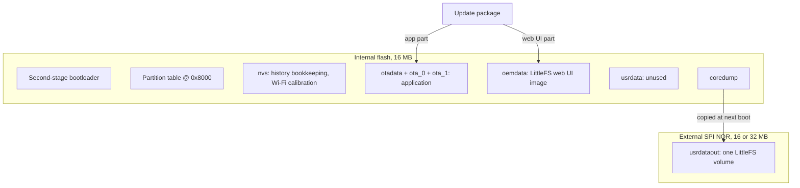

# Flash layout

Each dongle has two flash devices: the 16 MB internal flash of the ESP32 / ESP32-S3, which holds the
bootloader, the partition table, two application slots and the web UI, and a separate external SPI
NOR (16 MB on the [WiNet-S](winet-s.md), 32 MB on the [WiNet-S2](winet-s2.md)) that holds
everything that makes a dongle *this* dongle: serial number, configuration, certificates, keys,
logs and history.

## Internal flash

### Fixed offsets

| Item | WiNet-S | WiNet-S2 |
|---|---|---|
| Second-stage bootloader | `0x1000` (ESP32 ROM fixed) | `0x0` (ESP32-S3 ROM fixed) |
| Partition table | `0x8000`, up to `0xC00` bytes, with an MD5 entry | same |
| Flash size in the application header | 16 MB, DIO, 80 MHz | same |

Neither the update packages nor any other delivery path writes the bootloader or the partition
table; only the application slot and the web UI partition are rewritten in the field.

### Partition table

Both boards use the same table except for the sizes of `oemdata` and `usrdata`. Every partition
has its flags clear (no read-only, no encryption).

| Label | Type | Subtype | Offset | WiNet-S size | WiNet-S2 size | Use |
|---|---|---|---|---|---|---|
| `nvs` | data | nvs | `0x9000` | `0x100000` (1 MB) | same | ESP-IDF key/value store |
| `otadata` | data | ota | `0x109000` | `0x2000` (8 KB) | same | which OTA slot boots, and its state |
| `phy_init` | data | phy | `0x10b000` | `0x1000` (4 KB) | same | present but not read by the application |
| `ota_0` | app | ota_0 | `0x110000` | `0x380000` (3.5 MB) | same | application slot A |
| `ota_1` | app | ota_1 | `0x490000` | `0x380000` (3.5 MB) | same | application slot B |
| `oemdata` | data | fat (`0x81`) | `0x810000` | `0x400000` (4 MB) | `0x500000` (5 MB) | LittleFS volume with the web UI |
| `usrdata` | data | fat (`0x81`) | `0xc10000` (S) / `0xd10000` (S2) | `0x2f0000` (3008 KB) | `0x1f0000` (1984 KB) | not mounted, not used |
| `coredump` | data | coredump | `0xf00000` | `0x100000` (1 MB) | same | crash dump written by the panic handler |

The `coredump` partition ends exactly at 16 MB on both boards. There is no factory application
slot; the dongle always boots one of the two OTA slots. The P046 and P032 application images are about
3.03 MB (WiNet-S) and 3.23 MB (WiNet-S2), so each fits a 3.5 MB slot with some room to spare.

Subtype `0x81` is ESP-IDF's standard `fat` subtype, used here as a label only: both `oemdata` and
the external `usrdataout` contain LittleFS, not FAT.

### Application slots and rollback

The update process writes the new application into the slot that is not running, erasing the
whole slot first, and then switches `otadata` to it. The bootloader has app rollback enabled: a
freshly installed slot starts in the "pending verify" state, and if the dongle resets before the
application marks it valid, the bootloader returns to the previous slot. The application marks the
slot valid 30 s after the network and protocol tasks have started, with no further condition
([boot-and-runtime.md](boot-and-runtime.md)). Anti-rollback (a secure version counter) is not
used. Update packages and their signature checks are in
[../firmware-update/sgu-container.md](../firmware-update/sgu-container.md).

### `oemdata`: the web UI

`oemdata` is mounted as LittleFS at `/oemdata`. It holds the web UI (the HTML page, its scripts and
its language files). An update package carries the web UI as a separate part: a complete LittleFS
image of exactly 3 MB (`0x300` blocks of 4096 bytes, on-disk version 2.0). The dongle erases the
whole partition and writes the image to it from offset 0. The image is smaller than the partition
(4 MB or 5 MB); this works because the LittleFS mount takes the block count from the partition and
does not compare it with the superblock.

The same partition can also hold an update public key placed there by the manufacturer, which the
dongle copies to the external flash when its own copy is missing.

### `nvs`

NVS holds no identity, credentials, keys or serial number. Its contents are:

| Namespace | Contents |
|---|---|
| `his_store` | history bookkeeping: the record length per device, used to detect when a device's history format changes (the old history files are then deleted) |
| `his_soe_offset` | bookkeeping for the fault-event ring file (maximum count 400, current count, index) |
| `esp_optr_log` | rotation counter for the operator-action log files |
| ESP-IDF internal | Wi-Fi driver configuration and RF calibration |

At boot the dongle initialises NVS and, if the partition is full or was written by a newer NVS
format, erases it and starts again. Any other NVS error at that point aborts the boot. Erasing NVS
only costs history bookkeeping and calibration, which are rebuilt.

### `coredump`

When the firmware panics, the ESP-IDF panic handler writes a core dump (ELF format with a 24-byte
header and a CRC32) to this partition. Early in the next boot, after the external flash is mounted,
the dongle copies the dump to `/usrdataout/log/rundata/coredump.bin`, replacing any earlier copy, and
erases the partition. The partition is erased even if the copy fails, so a failed copy loses the
dump. The file can be downloaded through the web UI's log export
([../protocols/diagnostics-and-log-export.md](../protocols/diagnostics-and-log-export.md)).

## External flash

### Registration and mount

At boot the dongle initialises the external NOR on its own SPI host, reads its JEDEC ID and
registers the **whole chip** as one data partition named `usrdataout` (offset 0, size = chip size,
subtype `0x81`). It then mounts it as LittleFS at `/usrdataout`, together with the internal
`oemdata`.

| Parameter | Value |
|---|---|
| Filesystem | LittleFS, on-disk version 2.0 |
| Block size | 4096 bytes |
| Block count | `0x1000` on the WiNet-S (16 MB), `0x2000` on the WiNet-S2 (32 MB) |
| Read / program size | 128 bytes |
| Maximum name length | 255 |
| Mount option | format if the mount fails |

LittleFS spreads blocks across the whole chip for wear levelling, so both halves of the WiNet-S2's
32 MB chip hold data. The firmware's LittleFS accepts only on-disk version 2.0; a volume rewritten
by a newer LittleFS that upgrades the on-disk version to 2.1 fails to mount.

**A failed mount wipes the dongle.** Because the mount is configured to format on failure, a volume
that does not mount (corruption, or an unsupported on-disk version) is erased and recreated empty.
That destroys the serial number, the cloud configuration, the certificates and the keys; the dongle
then runs unprovisioned. The bus and chip-ID steps before the mount are fatal instead (the firmware
aborts and reboots), so a dead or missing chip causes a reboot loop rather than a wipe.

The main loop checks the usage of both LittleFS volumes and logs a warning when one is 90 % full; it
does not clean anything up.

### Directory layout

Names are as they appear on the volume, including the original spellings (`histroy`, `factroy`,
`secondcofig`).

| Path under `/usrdataout` | Contents | Removed by factory reset |
|---|---|---|
| `log/sigdata/` | one configuration record file per known device; the dongle's own file is the identity file | yes, then restored |
| `logbak/sigdata/` | backup copy of the record files, refreshed after changes | yes |
| `log/factory/dev_file_factory` | factory copy of the identity file | no |
| `logbak/factory/dev_file_factory` | backup of the factory copy | no |
| `log/factroy/` | factory action log | yes |
| `log/rundata/` | application log `err.log` (rotated to `err.log_1` at 512 KiB), `coredump.bin`, other run-time files | yes |
| `log/hisdata/`, `log/hissoe/` | history data and the fault-event ring file | yes |
| `log/port/` | captured port frames for diagnostics | yes |
| `log/xml/`, `log/meteo/`, `log/iec104/`, `log/invlog/` | further per-feature log and data files (weather station, IEC 104, inverter logs) | yes |
| `log/` (templates) | per-region settings templates for the installer pages | no |
| `histroy/` | history record files, one set per device | no |
| `certs/https/` | the HTTPS server certificate and key | yes |
| `certs/ModbusTcp/` | the certificate and key for Modbus TCP over TLS, created on first use | yes |
| `certs/` (CA bundle) | optional CA bundle for outgoing HTTPS and FTP | yes |
| `tlsca/` | the CA certificate used to verify the iSolarCloud MQTT broker | no |
| `pubkey/` | the public key that verifies update packages, and its version | no |
| `mqtt/secondcofig/`, `mqtt/monitorcofig/` | secondary and monitoring MQTT configuration | yes |
| `feedPower/` | feed-in power settings | yes |
| `download/` | operator-action logs and files staged for download | `download/rundata` only |
| `get_packages/`, `log/ud_temp/`, `Update/` | update staging | stale `get_packages` removed at every boot |
| `Topology/` | system topology data | no |

### The identity file

The dongle's own record file in `log/sigdata/` is its identity and configuration store. It is named
`dev_file_247_1813_2` on the WiNet-S and `dev_file_247_1824_2` on the WiNet-S2 (device address 247,
the product type, and a device code). It holds the serial number, the cloud server settings, the
network settings and the local user data.

The file is a plain sequence of records, each **(id, length, data)** with a 16-bit little-endian id
and a 16-bit little-endian length, with no header, magic or checksum. A missing record means the
compiled-in default applies.

At boot the dongle takes the first of these four files that is at least 10 bytes long and uses it
as the live identity file:

1. `log/sigdata/dev_file_247_<type>_2`
2. `logbak/sigdata/dev_file_247_<type>_2`
3. `log/factory/dev_file_factory`
4. `logbak/factory/dev_file_factory`

A `dev_file_247_*_2` whose product type belongs to the other model is deleted at boot.

The factory copy contains only the values written while the dongle was in factory mode on the
production line (in practice the serial number and the factory settings). Values changed later, such
as Wi-Fi credentials or a cloud server switch, live only in the live file and its backup.

### Factory reset

A factory reset (button held for more than 30 s, see [leds-and-button.md](leds-and-button.md)):

1. deletes, recursively, the log, record, certificate and settings directories marked "yes" in the
   table above;
2. recreates `log/sigdata/` and copies `log/factory/dev_file_factory` into it as the live identity
   file.

The result is a dongle with its serial number and factory settings, the default cloud server and
broker settings, no Wi-Fi credentials and no local users. History files, the update public key, the
broker CA and the settings templates survive.

## Not yet known

- Whether the firmware's LittleFS grows the 3 MB web UI image to fill the larger `oemdata`
  partition when it mounts it.
- What the factory copy contains on production units beyond the serial number.
