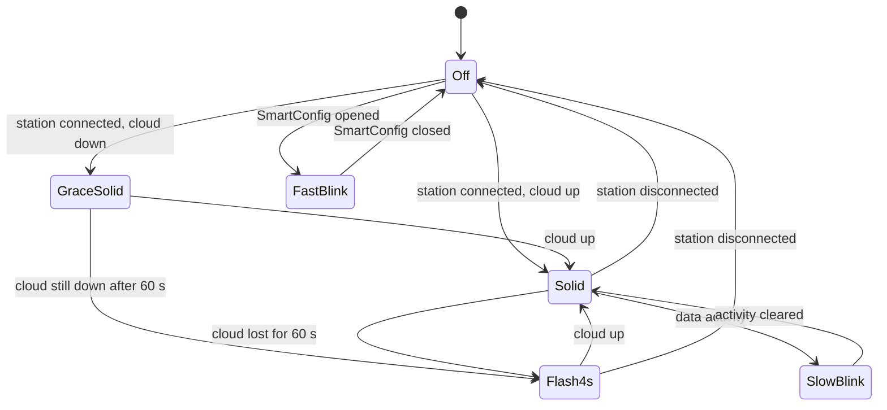

# LEDs, button and hotspot

Both dongles have three LEDs (red, blue, green) and one push button, driven by the same logic on
the [WiNet-S](winet-s.md) and the [WiNet-S2](winet-s2.md). This page lists every LED pattern, every
button gesture, and the Wi-Fi hotspot that several of the gestures control.

## Pins

| Signal | WiNet-S | WiNet-S2 | Notes |
|---|---|---|---|
| Red LED | GPIO4 | GPIO19 | probably active-low |
| Blue LED | GPIO32 | GPIO38 | probably active-low |
| Green LED | GPIO33 | GPIO20 | probably active-low |
| Button | GPIO36 (external pull-up) | GPIO4 (internal pull-up) | pressed = low |

## Timing

A 50 ms periodic timer drives both the button and the LEDs:

| Item | Period |
|---|---|
| Button sampling | every 50 ms (one tick); no interrupt is used |
| LED update | every 100 ms (every second tick) |
| Normal LED decisions | once per second |
| Fast blink | 200 ms on, 200 ms off |

## LED patterns

### Blue: network and cloud

The blue LED follows the **Wi-Fi station** connection and the cloud link. It is evaluated only while
network-config mode is off.

| State | Blue LED |
|---|---|
| SmartConfig is listening | fast blink, 200 ms on / 200 ms off |
| Station not connected to the router | off |
| Station connected, data activity flag set | slow blink, 1 s on / 1 s off |
| Station connected, cloud link up | solid on |
| Station connected, cloud link down for less than 60 s | solid on |
| Station connected, cloud link down for 60 s or more | one 1 s flash every 4 s (3 s off, 1 s on) |

The data activity flag is reported every 5.2 s by the communication layer and is probably set by
traffic on a TCP link over the Wi-Fi interface. Because the LED looks only at the Wi-Fi station, a
dongle connected by Ethernet alone keeps the blue LED off even when its cloud link is up.

### Green: heartbeat

| State | Green LED |
|---|---|
| No active faults on the dongle | heartbeat: toggles once per second (1 s on, 1 s off) |
| Active faults on the dongle | off |
| Network-config mode | fast blink, 200 ms on / 200 ms off |

### Red: fault

| State | Red LED |
|---|---|
| The dongle itself (device address 247) has one or more active fault entries | on |
| No active faults | off |

Faults of the inverter or battery do not light the red LED; only the dongle's own fault list does.
Green and red are complementary in normal operation: green blinks when red is off, and green is off
when red is on.

### Self-test

The firmware has an LED self-test that forces all three LEDs on and then off for a few seconds each,
suspending the normal patterns while it runs. It is probably part of the factory I/O check (see the
3 s hold below).

## Button

### How presses are counted

- Each 50 ms tick that reads the button as pressed adds to a hold counter.
- A press shorter than 1 s counts as a **click**. Clicks are collected and dispatched together
  **1 s after the last release**, so "two clicks" means two short presses less than 1 s apart.
- A press longer than 1 s is a **hold** and is never counted as a click.
- Hold actions are honoured only if the button was idle for at least 3 s before the press.

### Gestures

| Gesture | Action |
|---|---|
| 1 click | **Open SmartConfig** (Espressif ESP-Touch) for 600 s. Leaves network-config mode if it was on. While SmartConfig listens, Wi-Fi switches to station only, so the hotspot is down; when SmartConfig ends (success or timeout) the hotspot comes back, visible, with a fresh 30-minute timer. If SmartConfig is already open, a click only restarts its 600 s counter |
| 2 clicks | **Turn the hotspot off, persistently** (the setting survives reboots). Ignored while a WiMeter or WiProxy is paired, and while network-config mode is on |
| 3 or more clicks | **Turn the hotspot on, persistently.** Closes SmartConfig if it is open. If the hotspot is already on, it is made visible again and its 30-minute timer restarts. This gesture never turns the hotspot off |
| Hold more than 3 s | sets an internal I/O-check flag (factory test); no user-visible effect |
| Hold more than 5 s | **Network-config mode.** Also turns the hotspot on if it was off. On the WiNet-S this mode scans for nearby `SG-` hotspots and joins one, which is how the dongle pairs with a WiProxy ([../devices/wimeter-and-wiproxy.md](../devices/wimeter-and-wiproxy.md)). Green fast-blinks while the mode is active |
| Hold more than 30 s | **Factory reset** ([flash-layout.md](flash-layout.md#factory-reset)) |

The factory reset needs a **30 s** hold (600 ticks of 50 ms). The dongle's own log line for this
action says "more than 5s", but a 5 s hold enters network-config mode, not a reset.

A wired Ethernet lease (not a 169.254.x.x link-local address) also closes a SmartConfig session that
was opened automatically at boot.

## Wi-Fi hotspot

The hotspot is the access-point half of the dongle's access-point-plus-station Wi-Fi mode. The
iSolarCloud app (in its local "near" mode), a laptop or a WiMeter join it and reach the same web
server, REST API and Modbus TCP server as on the LAN.

| Item | Value |
|---|---|
| SSID | `SG-<serial>` (the dongle's serial number, e.g. `SG-A2xxxxxxxxx`) |
| Address | 11.11.11.1, netmask 255.255.255.0 (11.11.11.1/24), gateway 11.11.11.1 |
| DHCP | ESP-IDF default server on the hotspot interface; clients get 11.11.11.x leases |
| Security | **open**, no password |
| Maximum clients | 2 |
| Channel | not fixed; follows the station's channel once it has joined a router |
| Bandwidth | 20 MHz (HT20) |
| Default | enabled; the enable setting is persistent |

### Open by design

The configuration has a hotspot password field, and the web UI shows and accepts a password, but the
authentication mode is forced to "open" every time the hotspot is configured and no interface can
change it. At every boot the stored SSID is rewritten to `SG-<serial>` and the stored password to a
fixed value derived from the serial number. A password typed into the web UI is therefore stored and
displayed, but never used, and an SSID change lasts only until the next reboot.

### The 30-minute timer

After every boot, and after every activation by button or cloud, the hotspot broadcasts its SSID for
**30 minutes**. When the timer expires the dongle **hides the SSID**: the access point stays up and
open, and a client that knows the name can still join, but it no longer appears in a network scan.

| Event | Timer |
|---|---|
| Boot, button activation (3+ clicks), cloud activation | SSID visible, 30 minutes |
| A client is connected | countdown paused and reset to 5 minutes |
| Last client leaves | the remaining 5 minutes run, then the SSID is hidden |
| Reboot | hidden flag cleared, SSID visible again |

### What turns it on or off

| Trigger | Effect | Persistent |
|---|---|---|
| Boot | hotspot on if enabled, SSID visible for 30 minutes | — |
| 1 click | down while SmartConfig listens, then back | no |
| 2 clicks | off | yes |
| 3 or more clicks | on, SSID visible, timer restarted | yes |
| Hold more than 5 s | on (network-config mode) | yes |
| Cloud command for the hotspot setting | on (visible, timer restarted) or off | yes |
| Master Wi-Fi switch off | no Wi-Fi at all, hotspot included | yes |

### Services on the hotspot

| Service | Address |
|---|---|
| HTTPS web UI, REST API and WebSocket | `https://11.11.11.1` (port 443) |
| Modbus TCP | 11.11.11.1, port 502 (each server port is bound per interface, hotspot included) |
| WiMeter link | the WiMeter joins the hotspot and is reached on 11.11.11.0/24 |

The cloud uplink never uses the hotspot; it leaves over the Wi-Fi station or Ethernet. See
[../protocols/local-services.md](../protocols/local-services.md) and
[../protocols/setup-and-provisioning.md](../protocols/setup-and-provisioning.md).

## Not yet known

- LED polarity (active-low is likely on both boards).
- What starts the LED self-test, and whether the 3 s I/O-check flag has any effect outside the
  factory.
- Whether a hidden hotspot still answers directed probe requests for its SSID.
- The exact DHCP pool and DNS option the hotspot offers.
