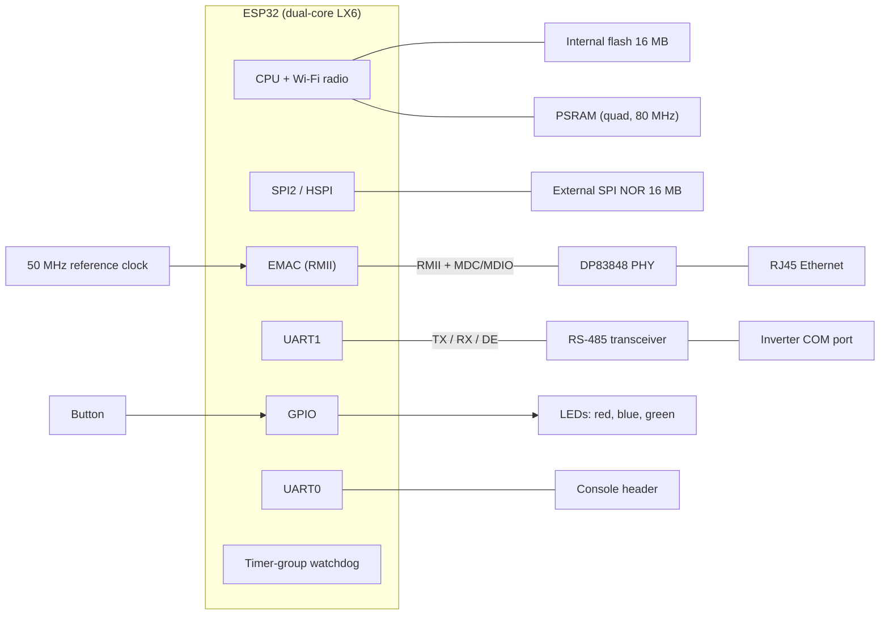

# WiNet-S hardware

The WiNet-S is Sungrow's first-generation ESP32 communication dongle. Its firmware identifies it as
product **V200** (firmware strings `WINET-SV200.001.00.Pnnn`; this page describes the board as driven
by P046), project name `WiNet-S`, cloud product type `0x715` (1813). It plugs into the inverter's
COM port and links the inverter's RS-485 bus to Wi-Fi, wired Ethernet and iSolarCloud.

For the second-generation board see [winet-s2.md](winet-s2.md); the differences are summarised in
[winet-s-vs-s2.md](winet-s-vs-s2.md). What the firmware does with this hardware is covered in
[boot-and-runtime.md](boot-and-runtime.md), [flash-layout.md](flash-layout.md) and
[leds-and-button.md](leds-and-button.md).

## Summary

| Item | Value |
|---|---|
| SoC | Espressif ESP32 (ESP32-D0WD, revision v1.1), dual-core Xtensa LX6 |
| Internal flash | 16 MB, DIO mode, 80 MHz |
| PSRAM | present, quad SPI, clocked at 80 MHz together with the flash; size not known |
| External flash | 16 MB SPI NOR on its own SPI host, holds all runtime state |
| Ethernet | ESP32 internal EMAC in RMII mode, TI DP83848 PHY at SMI address 1 |
| RS-485 | UART1 with a driver-enable line, 9600 baud 8N1 |
| User interface | three LEDs (red, blue, green), one push button |
| Console | UART0 at 115200 baud, ROM serial download available |
| Watchdog | the ESP32's own timer-group watchdog only; no external supervisor |
| Radios used | Wi-Fi only (access point plus station). No Bluetooth, no cellular modem |
| Secure Boot / flash encryption | not enabled |

## Block diagram

## Pinout

All GPIO assignments the firmware uses. Pins marked *strap* are sampled by the ESP32 at reset; see
[Strapping-pin cautions](#strapping-pin-cautions).

| GPIO | Function | Direction | Notes |
|---|---|---|---|
| 0 | RMII reference clock (50 MHz) | in | *strap* (boot mode). Supplied externally; the ESP32 does not generate it |
| 1 | UART0 TX (console) | out | IO-MUX default, never reassigned |
| 2 | External flash MOSI | out | *strap* |
| 3 | UART0 RX (console) | in | IO-MUX default |
| 4 | Red LED | out | probably active-low |
| 5 | DP83848 reset | out | *strap*; pulsed by the Ethernet driver at start-up |
| 6–11 | internal flash bus | — | standard ESP32 flash pins, not usable |
| 12 | RS-485 driver enable (UART1 RTS) | out | *strap* (MTDI, flash voltage) |
| 13 | RS-485 TX (UART1) | out | |
| 14 | External flash SCLK | out | |
| 15 | External flash CS | out | *strap* (MTDO) |
| 18 | MDIO | in/out | PHY management data |
| 19 | RMII TXD0 | out | fixed by the silicon |
| 21 | RMII TX_EN | out | fixed |
| 22 | RMII TXD1 | out | fixed |
| 23 | MDC | out | PHY management clock |
| 25 | RMII RXD0 | in | fixed |
| 26 | RMII RXD1 | in | fixed |
| 27 | RMII CRS_DV | in | fixed |
| 32 | Blue LED | out | probably active-low |
| 33 | Green LED | out | probably active-low |
| 34 | External flash MISO | in | input-only pin |
| 35 | RS-485 RX (UART1) | in | input-only pin |
| 36 | Push button | in | input-only, no internal pull; the board must provide an external pull-up (not yet confirmed on the PCB). Pressed = low |

GPIO16 and GPIO17 are not used by the application; on ESP32 boards with quad PSRAM they normally
carry the PSRAM chip select and clock, which is probably the case here.

## RS-485

| Item | Value |
|---|---|
| Peripheral | UART1 (the only UART the application opens) |
| TX / RX / DE | GPIO13 / GPIO35 / GPIO12 |
| Direction control | DE is driven by the UART's RTS line in RS-485 half-duplex mode |
| Line settings | 9600 baud 8N1 |

The dongle is the bus master. The polling scheme, inter-frame gaps and device discovery are in
[../protocols/rs485-master.md](../protocols/rs485-master.md) and
[../protocols/device-discovery.md](../protocols/device-discovery.md).

## External flash

| Item | Value |
|---|---|
| Host | HSPI (SPI2), DMA channel 1 |
| MOSI / MISO / SCLK / CS | GPIO2 / GPIO34 / GPIO14 / GPIO15 |
| WP / HD | not connected |
| Read mode | Fast Read (single-line data), so the NOR status register is never written |
| Clock | 40 MHz |
| Size | 16 MB |

The whole chip is one LittleFS volume mounted at `/usrdataout`. It holds the dongle's identity
(serial number), configuration, certificates, logs and history; the internal flash holds only the
application and the web UI. Details and the on-disk layout are in [flash-layout.md](flash-layout.md).

A failure to bring up the SPI bus or to read the chip's JEDEC ID stops the firmware during boot
(abort and reboot), so a board with a dead external flash reboot-loops instead of running without
storage.

## Ethernet

The wired port uses the ESP32's internal Ethernet MAC in RMII mode with a TI **DP83848** PHY.

| Item | Value |
|---|---|
| PHY | DP83848, SMI address 1 (fixed by the firmware) |
| MDC / MDIO | GPIO23 / GPIO18 |
| Reference clock | 50 MHz into GPIO0 (clock input mode; the ESP32 does not generate it) |
| PHY reset | GPIO5, pulsed by the driver at start-up; the PHY stays in reset without it |
| Reset / auto-negotiation timeouts | 100 ms / 4000 ms |
| Link check period | 2000 ms |
| MAC address | the ESP32's eFuse Ethernet MAC; there is no override |
| DHCP hostname | `espressif` (the firmware never sets a hostname) |

RMII data pins are fixed by the ESP32 silicon:

| Signal | GPIO |
|---|---|
| TXD0 / TXD1 / TX_EN | 19 / 22 / 21 |
| RXD0 / RXD1 / CRS_DV | 25 / 26 / 27 |
| REF_CLK (input) | 0 |

The interface is brought up once at every boot, independently of Wi-Fi; there is no switch that
disables it. DHCP is the default; a static address, netmask, gateway and primary DNS can be stored
from the web UI and are applied at once, without a restart. The secondary DNS field is stored but
never applied. Ethernet has a higher route priority than Wi-Fi station mode, so it is the default
route when both are up. If any driver step fails (MAC, PHY, driver install, start), the firmware
aborts and reboots; nothing retries. The interface also gets an IPv6 link-local address and, if
offered, a global address. Configuration routes are in
[../protocols/web-api.md](../protocols/web-api.md).

During a firmware update the dongle stops the Ethernet driver and restarts it if the update fails.

## LEDs and button

| Item | GPIO |
|---|---|
| Red LED | 4 |
| Blue LED | 32 |
| Green LED | 33 |
| Button | 36 (input-only, no internal pull; needs an external pull-up, not yet confirmed on the PCB; pressed = low) |

All three LED outputs are set high at start-up, which is the off state if they are active-low (the
likely polarity). The button is polled every 50 ms; there is no interrupt. The patterns and gestures
are in [leds-and-button.md](leds-and-button.md).

## Console (UART0)

| Item | Value |
|---|---|
| Pins | TX GPIO1, RX GPIO3 (IO-MUX defaults) |
| Settings | 115200 baud 8N1, no flow control |
| Receive path | none in the application; only the ESP32 ROM serial bootloader reads UART0 |
| Pad location | not documented |

On UART0 the dongle prints the ROM boot messages, the second-stage bootloader's log, application
log lines up to the point where the data model is loaded, and panic dumps. After that the
application sets the global log level to "none" and the console goes quiet, unless a time-limited
R&D maintenance window is open (see
[../protocols/diagnostics-and-log-export.md](../protocols/diagnostics-and-log-export.md)). The
application's own log goes to a file on the external flash, never to UART0.

Pulling GPIO0 low while resetting the chip enters the ESP32 ROM serial bootloader, which supports
reading and writing both flashes with standard Espressif tooling. Secure Boot and flash encryption
are not enabled, so the flash contents read back in plain text and an unsigned application image
boots. The second-stage bootloader sits at flash offset `0x1000` and has app rollback enabled.

## Strapping-pin cautions

The ESP32 samples GPIO0, GPIO2, GPIO5, GPIO12 and GPIO15 at reset. This board uses all five for
other functions:

| GPIO | Strap function | Use on the WiNet-S | Caution |
|---|---|---|---|
| 12 (MTDI) | selects the internal flash voltage (low = 3.3 V) | RS-485 DE | Must be low at reset. A pull-up on this line selects 1.8 V flash and the board does not boot. Never add one |
| 0 | boot mode (low = ROM download) | RMII 50 MHz clock input | Whatever drives the clock must leave GPIO0 high (or released) at reset, or the chip enters download mode |
| 2 | must be low or floating for download mode | external flash MOSI | Works as wired; do not add a pull-up |
| 15 (MTDO) | low silences ROM boot messages; also SDIO timing | external flash CS | Usually idles high, so ROM messages print |
| 5 | SDIO slave timing | PHY reset | Harmless on this board |

GPIO34–39 are input-only on the ESP32 and have no internal pulls, which is why the button on GPIO36
needs an external pull-up on the board (not yet confirmed on the PCB), and why GPIO34 and GPIO35 are used as receive lines.

## Watchdog

The WiNet-S has **no external supervisor chip**. The only watchdogs are on the ESP32:

- the main timer-group watchdog (MWDT0), set up early in boot and fed directly from the
  application's 3 s monitor loop;
- the ESP-IDF task watchdog, with only the two idle tasks subscribed.

A hang of the monitor loop or of an idle task resets the chip. Long-running application tasks are
not individually watched.

## What is not on the board

- **Bluetooth**: the ESP32 radio supports Bluetooth Classic and BLE, but the firmware never starts a
  Bluetooth controller and contains no Bluetooth stack. Setup and service are over Wi-Fi and
  Ethernet only. Bluetooth shares the Wi-Fi antenna, so there is no separate antenna to look for.
- **Cellular modem**: none. The firmware contains configuration fields and web routes for a 4G APN,
  but no modem is fitted and nothing drives one.
- **USB**: the classic ESP32 has no USB peripheral; access is through UART0 only.

## Not yet known

- The PSRAM size.
- The part number of the external SPI NOR.
- LED polarity (active-low is likely).
- The location of the UART0, GPIO0 and EN pads on the PCB.
