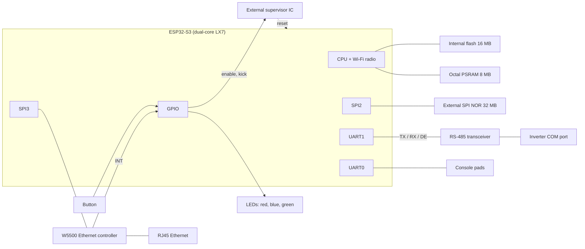
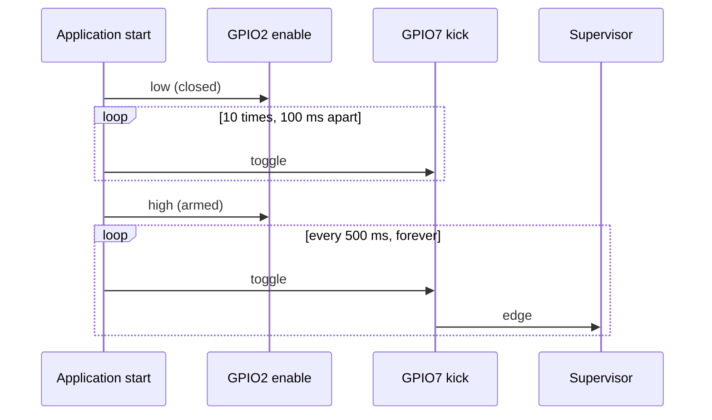

# WiNet-S2 hardware

The WiNet-S2 is Sungrow's second-generation communication dongle, built on the ESP32-S3. Its firmware
identifies it as product **SV300** (firmware strings `WINET-SV300.001.03.Pnnn`; this page describes
the board as driven by P032), project name `WiNet-S2`, cloud product type `0x720` (1824). It does
the same job as the [WiNet-S](winet-s.md): RS-485 master towards the inverter, Wi-Fi and wired
Ethernet towards the LAN, and the iSolarCloud uplink.

The differences between the two boards are summarised in [winet-s-vs-s2.md](winet-s-vs-s2.md).
Firmware behaviour on top of this hardware is in [boot-and-runtime.md](boot-and-runtime.md),
[flash-layout.md](flash-layout.md) and [leds-and-button.md](leds-and-button.md).

## Summary

| Item | Value |
|---|---|
| SoC | Espressif ESP32-S3, revision v0.2, dual-core Xtensa LX7 |
| Internal flash | 16 MB GigaDevice (JEDEC ID `0xC84018`), DIO mode, 80 MHz |
| PSRAM | 8 MB, octal, clocked at 80 MHz (an N16R8-class part: 16 MB flash, 8 MB octal PSRAM) |
| External flash | 32 MB SPI NOR (JEDEC ID `0xC84019`, GigaDevice GD25Q256 class) |
| Ethernet | WIZnet W5500 SPI Ethernet controller on its own SPI host |
| RS-485 | UART1 with a driver-enable line, 9600 baud 8N1 |
| User interface | three LEDs (red, blue, green), one push button |
| Console | UART0 at 115200 baud (default pins) |
| Watchdog | external supervisor IC on two GPIOs, plus the ESP-IDF task watchdog |
| USB | not usable: the USB D-/D+ pins drive two of the LEDs |
| Radios used | Wi-Fi only (access point plus station). No Bluetooth, no cellular modem |
| Secure Boot / flash encryption | not enabled |

## Block diagram

## Pinout

All GPIO assignments the firmware uses.

| GPIO | Function | Direction | Notes |
|---|---|---|---|
| 2 | Supervisor enable | out | probably low = supervisor off ("closed"), high = armed |
| 4 | Push button | in | internal pull-up enabled, pressed = low |
| 5 | W5500 reset | out | probably; pulsed low for 100 µs when the Ethernet driver starts |
| 6 | W5500 interrupt | in | the driver is interrupt-driven, no polling |
| 7 | Supervisor kick | out | toggled every 500 ms |
| 8 | RS-485 driver enable (UART1 RTS) | out | |
| 10 | External flash CS | out | |
| 11 | External flash MOSI | out | |
| 12 | External flash SCLK | out | |
| 13 | External flash MISO | in | |
| 17 | RS-485 RX (UART1) | in | |
| 18 | RS-485 TX (UART1) | out | idles high |
| 19 | Red LED | out | USB D- pin; probably active-low |
| 20 | Green LED | out | USB D+ pin; probably active-low |
| 38 | Blue LED | out | probably active-low |
| 39 | W5500 SCLK | out | |
| 40 | W5500 MOSI | out | |
| 41 | W5500 MISO | in | |
| 42 | W5500 CS | out | |
| 43 | UART0 TX (console) | out | IO-MUX default, never reassigned |
| 44 | UART0 RX (console) | in | IO-MUX default |

The ESP32-S3 strapping pins are GPIO0, GPIO3, GPIO45 and GPIO46. None of them is used by the
application, so the board's strap levels are independent of the peripherals. On ESP32-S3 parts with
octal PSRAM, GPIO35–37 are taken by the PSRAM bus, and GPIO26–32 normally connect the flash.

## RS-485

| Item | Value |
|---|---|
| Peripheral | UART1 (the only UART the application opens) |
| TX / RX / DE | GPIO18 / GPIO17 / GPIO8 |
| Direction control | DE driven by the UART's RTS line in RS-485 half-duplex mode |
| Line settings | 9600 baud 8N1 |

Polling and framing are described in [../protocols/rs485-master.md](../protocols/rs485-master.md).

## External flash

| Item | Value |
|---|---|
| Host | SPI2, DMA channel chosen automatically |
| MOSI / MISO / SCLK / CS | GPIO11 / GPIO13 / GPIO12 / GPIO10 |
| WP / HD | not connected |
| Read mode | DIO (dual I/O, not quad), so the NOR status register is never written |
| Clock | 40 MHz |
| Size | 32 MB, the whole chip registered and formatted as one LittleFS volume |

The volume, mounted at `/usrdataout`, holds identity, configuration, certificates, logs and history
([flash-layout.md](flash-layout.md)). As on the WiNet-S, a failure to initialise the SPI bus or read
the chip ID aborts the boot.

## Ethernet (W5500)

| Item | Value |
|---|---|
| Controller | WIZnet W5500 (integrated MAC and PHY) |
| Bus | SPI3, SPI mode 0, 36 MHz, transaction queue of 20 |
| SCLK / MOSI / MISO / CS | GPIO39 / GPIO40 / GPIO41 / GPIO42 |
| Interrupt | GPIO6 |
| Reset | GPIO5 (low for 100 µs at driver start); the chip is also soft-reset over SPI |
| Reset / auto-negotiation timeouts | 100 ms / 4000 ms |
| Link check period | 2000 ms |
| MAC address | a configured MAC if one has been stored (6 bytes, settable over Modbus TCP); otherwise a locally administered address derived from the chip's base MAC |

Bring-up runs once at every boot, in parallel with Wi-Fi, with no enable switch. DHCP is the
default, and a static address can be set from the web UI and applied without a restart, exactly as
on the WiNet-S. The firmware wraps the driver steps in fatal checks, so a W5500 that is missing or
does not answer the chip-ID check makes the firmware abort and reboot at every boot. On a link
loss or a new lease the dongle closes its sockets on the wired interface and reopens its listeners.

## LEDs and button

| Item | GPIO |
|---|---|
| Red LED | 19 |
| Green LED | 20 |
| Blue LED | 38 |
| Button | 4 (input, pull-up, pressed = low) |

GPIO19 and GPIO20 are the ESP32-S3's USB D- and D+ pins. Because they drive LEDs, the chip's
built-in USB-Serial-JTAG port cannot reach a host. The firmware still compiles in a secondary
console on USB-Serial-JTAG, but it has nowhere to go. The button is polled every 50 ms. Patterns and
gestures are in [leds-and-button.md](leds-and-button.md).

## External supervisor

The WiNet-S2 has a watchdog IC outside the ESP32-S3 that resets the board when its kick input stops
toggling. The part number and its timeout are not known; the timeout is a few seconds at most.

| Line | GPIO | Mode | Meaning |
|---|---|---|---|
| Enable | 2 | input/output, no pulls | probably low = supervisor closed (not enforcing), high = armed |
| Kick | 7 | input/output, no pulls | every level change is a kick |

### Start sequence

The supervisor start is the very first thing the application does, before mounting the external
flash:

1. Configure GPIO2 and GPIO7 as input/output.
2. Drive GPIO2 (enable) low.
3. Ten times: wait 100 ms, then write the kick level and invert it. The first write is high, so the
   kick line goes 1, 0, 1, 0 … and ends low. The whole phase takes about 1 s.
4. Drive GPIO2 high (armed).
5. Start a periodic 500 ms timer that toggles GPIO7. The first periodic edge is rising; one full
   kick period is 1 s.

The kick timer runs in the high-priority timer service, independently of the application tasks, so
a stalled application task does not stop the kicks; a halted scheduler or a crash does.

### Where the firmware switches the supervisor off

| Situation | Behaviour |
|---|---|
| Restart at the end of a firmware update | wait 3 s, drive enable low, wait 50 ms, restart |
| Brownout interrupt | drive enable low, then the normal brownout reset |
| Any other restart (low-memory restart, gateway-ping restart, panic, task watchdog) | enable stays high; the supervisor stays armed |

A chip reset releases both pins. From then until the next image runs its start sequence the
supervisor sees only the board's own pull networks, and in that state it is armed, so the time
from reset to the first kick (bootloader, PSRAM test, early start-up) has to stay inside its
timeout. Driving enable low before a restart probably restarts the supervisor's timing, giving the
next boot a full start-up window. A reset by the supervisor clears the chip's RTC memory, so
afterwards it cannot be told apart from a power-on reset.

If the kick timer cannot be created or started the firmware only logs it; with nothing kicking, the
supervisor then resets the board.

## Console (UART0)

| Item | Value |
|---|---|
| Pins | TX GPIO43, RX GPIO44 (IO-MUX defaults; the firmware never sets UART0 pins) |
| Settings | 115200 baud 8N1, no flow control |
| Receive path | none in the application; only the ROM serial bootloader reads UART0 |
| Pad location | unknown |

The console carries the ROM messages, the bootloader log and application log lines until the data
model is loaded, after which the application silences logging (as on the WiNet-S). Holding GPIO0 low
at reset enters the ESP32-S3 ROM serial bootloader on UART0. The USB route to the ROM bootloader is
blocked by the LEDs on GPIO19/20.

## Boot chain

| Item | Value |
|---|---|
| Second-stage bootloader | at flash offset `0x0`, an ESP-IDF v4.4.1 build |
| Application | ESP-IDF 5.x-era build, two OTA slots |
| App rollback | enabled in the bootloader; the application marks a new slot valid after 30 s of uptime |
| Secure Boot / flash encryption | off; the flash reads back in plain text and an unsigned image boots |

The partition table is in [flash-layout.md](flash-layout.md).

## What is not on the board

- **Bluetooth**: the ESP32-S3 has BLE, but the firmware never starts a controller and contains no
  Bluetooth stack.
- **Cellular modem**: none, although the firmware has 4G APN settings in its configuration.
- **Usable USB**: the D-/D+ pins drive LEDs.

## Not yet known

- The supervisor IC, its timeout, and exactly what it does while enable is low.
- Whether GPIO5 is wired to the W5500 reset pin (the board works either way, because the chip is
  also soft-reset over SPI).
- LED polarity (active-low is likely).
- The location of the UART0, GPIO0 and EN pads on the PCB.
