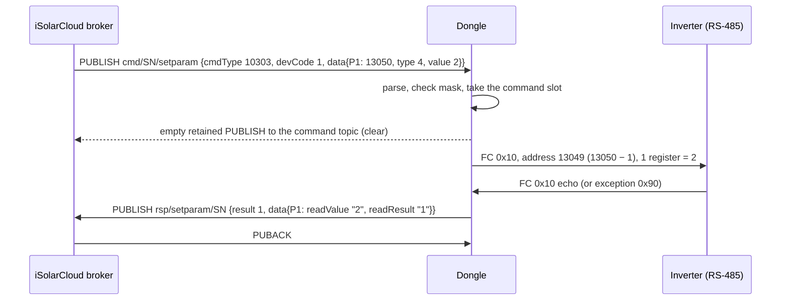

# Cloud commands (cmdType catalogue)

iSolarCloud controls a WiNet dongle with MQTT commands on the same session the dongle uses for
telemetry. Each command is a JSON envelope whose `businessData[0].cmdType` string picks the
handler. The handler either answers from dongle state, sends Modbus requests to a device on
RS-485, writes a dongle-local setting (a "logger point"), or starts a longer job such as a file
download or a log export. This page lists every command the dongle understands, with request
fields, reply shape and result codes. Topic grammar, the envelope and compression are in
[cloud-mqtt.md](cloud-mqtt.md) and [cloud-envelope.md](cloud-envelope.md); what the dongle
publishes on its own is in [cloud-messages.md](cloud-messages.md).

> Modbus addresses on this page are the 1-based numbers of Sungrow's published Modbus
> documentation. The frame on the wire carries the address minus one.

## Summary

| cmdType | Purpose | Topic family (`cmd/<SN>/…`) | Mask bit | Reply | WiNet-S |
|---|---|---|---|---|---|
| 10325 | read device parameters | getparam | 2 | `rsp/getparam`, after the Modbus read | yes |
| 10303 | write device parameters (devCode 247: logger points) | setparam | 2 | `rsp/setparam`, after the write | yes |
| 10384 | set a logger point (dongle setting) | setparam | 2 | `rsp/setparam`, mostly after the setting is applied | yes |
| 10324 | set time zone | settimezone | always | `rsp/settimezone` | yes |
| 10307 | set clock (broadcast) | `cmd/<timezoneId>/enum_0_0_0` | always | none | yes |
| 10310 | attribute dump of one device | propertydata | 1 | `rsp/propertydata` | yes |
| 10383 | optimizer / rapid-shutdown search | setparam | none (never gated) | write ack on `rsp/setparam`, progress on `rsp/getparam` | no |
| 10451 | SP600 optimizer parameter set | parammultiset | 2 | `rsp/parammultiset` | no |
| 10453 | SP600 optimizer parameter read | parammultiget | 2 | `rsp/parammultiget` | no |
| 10421 | live data on/off (10 s stream) | second | 3 | `rsp/second`, immediate | yes |
| 10375 | monitor data on/off (per-device interval) | generalcmd | 1 | immediate | yes |
| 10369 | FCAS fast collection | fcas | 1 | `rsp/fcas`, immediate | yes |
| 10306, 10326 | I-V curve scan | iv | 7 | none; status and file later on `rsp/iv` | 10306 only |
| 10329 | log export (SFTP upload) | logexport | 6 | progress and final on `rsp/logexport` | yes |
| 10452 | optimizer topology file (FTP/SFTP download) | structurefileset | 4 | `rsp/structurefileset`, after the job | no |
| 10308 | push firmware job | upgrade | 5 | progress on `rsp/upgrade` | yes |
| 10376 | firmware package list (answer to the dongle's own query) | upgrade | 5 | none from the handler | yes |

The WiNet-S2 (SV300 P032) table has 18 entries. The WiNet-S (V200 P046) table has 13: it lacks
10326, 10383, 10451, 10452 and 10453. The diagnostics commands are described in depth in
[diagnostics-and-log-export.md](diagnostics-and-log-export.md); the upgrade commands in
[../firmware-update/update-channels.md](../firmware-update/update-channels.md).

How the app reaches these commands: every remote setting, read-back, upgrade and log action in the
iSolarCloud app is a cloud *task* whose `command_type` is the dongle's cmdType (10303 set,
10325 read-back, 10451/10453 optimizer settings, 10383 wire-break detection and MLPE auto-search).
Opening **Live data** leads to 10421. A plant time-zone change leads to 10324. A fault-record or
module-log request leads to 10329. A firmware upgrade task leads to 10308 or 10376. Moving the
dongle to another server (10384 point 10457) has no app action; the cloud does it on its own.
I-V scans appear to start from the web portal.

## Dispatch rules

1. The topic must contain `isolarcloud/devicedata/cmd/`. Payloads over 4096 bytes (raw or after
   inflating) are dropped. A failed inflate is only logged.
2. `businessData` must be an array; element 0 is the command. `messageId`, `packgeCount`,
   `packgeId` and `publicData` are ignored, and multi-part commands are never reassembled.
3. De-duplication, depth one: when `batchId` is present, the printed `businessData` is compared
   with the previous command. An identical command is ignored: no handler, no reply.
4. `cmdType` must be a JSON string. The dongle walks its table and runs the first entry whose code
   is a **substring** of `cmdType`. The topic family plays no part in routing; it only decides the
   subscription and the reply topic.
5. Remote-control mask: the first group whose cmdType list matches decides; the command runs only
   if that group's bit is set. 10383 is in no group and always runs. Defaults: WiNet-S2 0x4FF,
   WiNet-S 0x4EF (bit 4, the topology group, off). A group whose bit is clear is also unsubscribed
   within about 6 s.
6. After any dispatch (matched, unmatched or refused) the dongle publishes a zero-length retained
   message, QoS 1, to the incoming command topic, clearing the retained command on the broker.
   Parse errors and duplicates skip this step.

Replies go to `isolarcloud/devicedata/rsp/<incoming family>/<own SN>/enum_<e>_<k>_<c>` with the
dongle's own encryption, key and compression flags, QoS 1, retain 0; a reply whose PUBACK does not
arrive is not resent. Broadcast commands on `cmd/<timezoneId>/enum_0_0_0` have no reply topic.

**One command at a time.** Read, write and logger-point commands share a single command slot. While
one waits for its reply, every further slot-based command is dropped with no reply (and its
retained copy is still cleared, so it is lost). The slot expires after 300 s (10 s for 10384); a
reply that arrives later is discarded. Several malformed requests hold the slot until it expires
(listed under each command). Live data, monitor data and the I-V scan use their own state.



## Common reply header

| Field | Type | Meaning |
|---|---|---|
| `batchId` | string | echoed from the request (at most 40 characters, else the request is rejected) |
| `cmdType` | string | echoed (at most 6 characters) |
| `dataTime` | string | local time `YYYYMMDDhhmmss` |
| `result` | number | 1 = processed (even when every point failed); 0 = target device offline (10325, SP600). Some commands use other codes or a string, noted per command |

`businessData` in every reply is a one-element array. Logger-level replies carry no `devCode`,
`devType` or message text.

## Parameters and time

### Addressing, function codes and word order

`modbusAddress` is a decimal **string** holding the 1-based register number; the frame carries
`modbusAddress − 1`. Address 0 is refused. Adjacent points are merged into one request (1–125
registers for reads, 1–123 for writes). The dongle never retransmits a Modbus frame; timeout and
send delay come from the device's poll settings.

| Command | `mode` | `readOnly` | Function code on the wire |
|---|---|---|---|
| 10325 | 1 | any | 0x77 (Sungrow private read, used for optimizer registers) |
| 10325 | absent or ≠ 1 | ≠ 0 | 0x04 (input registers) |
| 10325 | absent or ≠ 1 | 0 | 0x03 (holding registers) |
| 10325 with `timePeriod` | — | — | 0x17 (read/write multiple), battery-heating variant |
| 10303 / 10383 | 1 | ignored | 0x76 (Sungrow private write) |
| 10303 / 10383 | absent or ≠ 1 | ignored | 0x10, even for one register |

The WiNet-S parses `mode` but ignores it: reads are always 0x03/0x04 and writes always 0x10. The
private codes 0x76/0x77 use the same PDU layout as 0x10/0x03; see
[modbus-function-codes.md](modbus-function-codes.md).

Word order follows the device's byte-order setting, which defaults to **low word first** for
inverters and batteries: 16-bit values are correct, 32-bit values have the first register as the
low word, and 64-bit values (four registers) come out byte-reversed in both directions.

| `dataType` (string) | Meaning | Registers read | Registers written | Value text |
|---|---|---|---|---|
| "1" | int8 | 1 | 0, no reply | `%d` of the low byte |
| "2" | uint8 | 1 | 0, no reply | `%u` |
| "3" | int16 | 1 | 1 | `%d` |
| "4" | uint16 | 1 | 1 | `%u` |
| "5" | int32 | 2 | 2 | `%ld` |
| "6" | uint32 | 2 | 2 (decimal or `0x…` accepted) | `%lu` |
| "7" | int64 | 4 | 4, written as zeros | byte-reversed |
| "8" | uint64 | 4 | 4, low 32 bits only | byte-reversed, printed signed |
| "9" | float32 | 1 | 2, zeros | empty |
| "10", "13" | 8-byte types | 1 | 4, zeros | empty |
| "11", "12" | other / string | 1 | 0, no reply | "12": one character only |

`dataType` must be a JSON string; a numeric value makes the point fail to parse and the command
gets no reply. Only types "3" to "6" are safe for writes. The WiNet-S handles types 1–6 only.

### Per-point result codes

| `readResult` (string) | 10325 / 10303 / 10383 |
|---|---|
| "1" | success |
| "4" | no reply, CRC error, timeout, or device not ready (reads) |
| "0" | Modbus exception reply, or write refused because the device is offline or busy |
| "2" | write parked behind another request and expired |

For 10384 `readResult` is a **number**: 1 applied, 0 the setting was refused, 5 invalid value or
local failure. SP600 replies carry the raw status as a number.

### 10325 read parameters

```json
{"businessData":[{"batchId":"<id>","cmdType":"10325","devCode":1,"readOnly":0,
  "data":{"P1":{"modbusAddress":"13050","dataType":"4"}}}]}
```

| Field | Type | Required | Meaning |
|---|---|---|---|
| `devCode` | number | no | target device, default 247; must be online |
| `mode` | number | no | 1 = function 0x77 |
| `readOnly` | number | **yes** | ≠ 0 → function 0x04, 0 → 0x03; missing means no reply |
| `timePeriod` | any | no | presence switches to the battery-heating variant |
| `data.<key>` | object | yes | key at most 11 characters, echoed in the reply |
| `.modbusAddress`, `.dataType` | string | yes | as above |

Reply: the header plus `mode` and `readOnly` (numbers) and per key
`{"modbusAddress":"…","readValue":"…","readResult":"…"}` (all strings). With the device offline:
`result:0` and no `data`. No reply when `data`, `readOnly`, a point's address or type is missing,
when a key is too long or the slot is busy; `modbusAddress` "0" also holds the slot for 300 s.

**Battery-heating variant** (WiNet-S2 only). With `timePeriod` present, a point with `attribute` "1"
plus `dataValue` is a write, any other point a read. Reads and writes go out together as one
function 0x17 request; the write points must be consecutive registers and each is taken as one
16-bit value. Both a read part and a write part are required, otherwise nothing is sent and the
slot is held for 300 s. The reply assigns write status to the first points in JSON order, so the
request must list its write points first.

### 10303 write parameters

Same request as 10325 without `readOnly`, plus `.dataValue` (decimal string) per point.
`devCode` 247 routes the request to the logger-point handler (as 10384, but with a 300 s slot).
There is no online check, no allow-list and no range check: any register the device accepts is
written. Reply: the 10325 shape with `cmdType` "10303", `readOnly` 0 and `readValue` = the value as
encoded. Any point with type "1", "2", "11" or "12" makes the whole request disappear (no reply,
slot held 300 s). Inverter-side behaviour of writes is in
[writes-and-meter-sync.md](writes-and-meter-sync.md).

### 10384 logger parameter set

```json
{"businessData":[{"batchId":"<id>","cmdType":"10384","devCode":247,
  "data":{"4":{"dataType":"4","dataValue":"5"}}}]}
```

`devCode` must be 247 (otherwise no reply, slot held 10 s). Only the first child of `data` is
used; its key is the point id. `dataType` sets the stored length; type "12" stores the string.
Reply: `data:{"<point>":{"readValue":"<dataValue echoed>","readResult":<number>,"sslFlag":<number>}}`.
Points answered immediately (10455, 17075, 64731) have no `sslFlag` and echo the parsed number.
An unknown point gets no reply and holds the slot for 10 s; points that wait for the setting to be
applied also get no reply if it never is.

| Point | Action | Value | Reply |
|---|---|---|---|
| 1, 10335 | start device search ([device-discovery.md](device-discovery.md)) | any | after the search starts |
| 2 | replace a device's serial | type "12", `"<addr>;<x>;<newSN>"`, new serial ≤ 20 characters | after it is applied |
| 4 | run-data upload period, minutes (0 → 5) | type "4" | after it is applied |
| 10339 | hotspot (AP) enable | 0 / 1 | after it is applied |
| 10423 | probably the live-data timeout, seconds (default 86400) | type "6" | after it is applied |
| 10455 | reboot | 1 (anything else → 5) | immediate; the reboot follows the PUBACK |
| **10457** | server switch | type "12", `"host;port;key"` (16-character key), `sslFlag` "1" = TLS | after the switch is accepted |
| 10482, 64729 | a "low enable" switch, meaning not yet known | 0 / 1 | after it is applied |
| 10483 | system time source | only 3 accepted; anything else → no reply | after it is applied |
| **17075** | remote-maintenance switch | 0 close / 1 open; > 1 → 5 | immediate |
| **17076** | cloud id | | after it is applied |
| 38775, 38777, 38779 | per-device-type poll interval / timeout / retry count (WiNet-S2 only) | `"<devType>;<value>"` | after it is applied |
| 64731 | reset the local passwords to factory defaults | 1 (else 5) | immediate |
| 64869, 64877 | two link delays, defaults 1 and 60, meaning not yet known | | after it is applied |
| 64881 | Modbus TCP server on port 502 enable ([modbus-tcp.md](modbus-tcp.md)) | 0 / 1 | after it is applied |
| 99783 | download the feed-in power schedule | type "12", an `https` URL ≤ 129 bytes | after the download |
| 99785 | close the feed-in power limit | 85 (else 5) | immediate |

**Server switch (10457).** The dongle stores the new endpoint, waits about 10 s, reconnects to it,
and commits it once the MQTT session is up. If it does not connect within about 10 minutes it
rolls back to the previous server (unless the remote-control mask has been changed from
its default). A change of the TLS flag alone, with host, port and key unchanged, is ignored. The
reply echoes the whole `dataValue` including the key. At the first CONNACK on the new broker
the dongle publishes `devinfo` with the new endpoint (38338) and the old one (38337); the `devinfo`
sent at confirm reports the new endpoint in both ([cloud-mqtt.md](cloud-mqtt.md#server-switch)).

**Remote-maintenance switch (17075).** Opening it records the time; the dongle's web side closes it
again 24 h later. It is the same switch as the local `/user/rdSwitch` route
([remote-access.md](remote-access.md)). It is gated only by mask bit 2.

### 10324 set time zone

| Field | Type | Meaning |
|---|---|---|
| `timezoneId` | number | time-zone index; also selects the broadcast topic `cmd/<timezoneId>/enum_0_0_0` |
| `timezone` | string | exactly 9 characters starting with `UTC`, for example `"UTC+10:00"` |

The dongle stores both and forwards the offset in half-hours (any non-zero minutes count as one
half-hour) to the **first** EV charger it knows, as a write of register 21312. On success it
replies `[{batchId, cmdType:"10324", dataTime, result:1}]` and subscribes the new broadcast topic;
the old one is not unsubscribed. The zone is changed before the header is checked, so a request
without `batchId` still changes it but gets no reply. A malformed `timezone` gets no reply.

### 10307 set time

Arrives on the per-time-zone broadcast topic (uncompressed, always subscribed). `dataTime`
`"YYYYMMDDhhmmss"` is taken as **local time** without range checks and written to the clock.
After queueing the change the dongle unsubscribes the broadcast topic until its 4-hourly re-subscription or the next CONNACK.
No command slot and no reply.

### 10310 attribute call

`{"batchId":"<id>","devCodeArr":[1,2]}`. For the **first** online device in the list the dongle
publishes one attribute element (the same format as its unsolicited attribute push,
[cloud-messages.md](cloud-messages.md)) with the request's `batchId`, on the reply topic of the
incoming family. Missing fields give no reply.

## Optimizers

These exist on the WiNet-S2 only. The description comes from how the dongle firmware treats
optimizer devices; see [../devices/optimizers-and-mlpe.md](../devices/optimizers-and-mlpe.md).

### 10383 optimizer / rapid-shutdown search

Parsed and written like 10303, but never blocked by the mask. The app sends it for "wire-break
detection" and MLPE auto-search: register 14510 (search) or 14518 (disconnect detection), value
170 to start, 85 to stop, with `mode` 1 (function 0x76). If a search is already running the dongle
writes nothing, replies `readValue` "170" / `readResult` "1" at once and sends one progress
message with `failCode` "5632". Progress messages go to `rsp/getparam`:

```json
{"businessData":[{"batchId":"<id>","cmdType":"10383","dataTime":"…","mode":1,"readOnly":0,"result":1,
  "data":{"22673":{"modbusAddress":"14590","readValue":"<result>,<progress>","readResult":"1","failCode":"5632"}}}]}
```

Key "22673" / address "14590" belong to the search, "64895" / "14574" to disconnect detection.
The job ends with progress 100. While an inverter is in optimizer mode it accepts only the stop
write.

### 10451 / 10453 SP600 set / read

```json
{"businessData":[{"batchId":"<id>","cmdType":"10451","devCode":1,
  "childs":[{"devType":10,"devCode":1,"childs":[{"devType":41,"devCode":3,
    "data":{"<key>":{"modbusAddress":"<reg>","dataType":"4","dataValue":"1"}}}]}]}]}
```

The outer `devCode` is the inverter (247 is refused with no reply, slot held); `childs[0]` is the
string (devType 10), its `childs[0]` the optimizer (devType 41). 10453 omits `dataValue`. Value
encoding: types 1/2 one byte, 3/4 one register, 5/6 two registers low word first. A 10451 whose
`data` has exactly the keys 64873, 63869 and 64875 is an optimizer replacement record (probably old
serial, new serial, and a number). The read sends only the first point even when several are
listed. Reply, with `devCode` and `devType` as strings and the raw status as `readResult`:

```json
{"businessData":[{"batchId":"…","cmdType":"10451","dataTime":"…","devCode":"1","devType":"255","result":1,
  "childs":[{"devCode":"1","devType":"10","childs":[{"devCode":"3","devType":"41",
    "data":{"<key>":{"modbusAddress":"<reg>","readValue":"<int>","readResult":0}}}]}]}]}
```

## Diagnostics

Each is described in detail in [diagnostics-and-log-export.md](diagnostics-and-log-export.md).

| cmdType | Request essentials | Reply and result codes |
|---|---|---|
| 10421 live data | `devCodeArr` (numbers), `devSwitch` 1 open / 0 close / other close all, `data:{"<devCode>":[pointId,…]}` ≤ 400 ids per device | immediate `{result, devSwitch, devCodeArr:["1",…]}`; result 1 ok, 0 `data` missing, 3 > 400 ids, 4 no free device entry |
| 10375 monitor data | as 10421 plus `upFrequency` (s, required), point ids as strings | immediate `{result, devSwitch, upFrequency}`; same codes |
| 10369 FCAS | `dataTime` (echoed), `devSwitch`, `durations` (s), `uploadCycle` (s), `saveCycle` (ms), `devCodeArr` ≤ 17, `data` ≤ 70 ids per device | immediate `{dataTime, devSwitch, result, devCodeArr:[first device]}`; 1 ok, 2 busy / offline / unknown point / registration failed, 3 > 70 points |
| 10306 / 10326 I-V scan | `devCodeArr` ≤ 17; optional `data:{"<devCode>":[{bunch, block:[…]}]}` makes it an optimizer scan | none for the command; later `scanStatus` (two digits per device) and the file as hex on `rsp/iv` |
| 10329 log export | `devCodeArr[0]`: `devCode` (string; 247 = dongle logs), `flag` ("0" cancel), `funcCode` list, `cycleNum`, SFTP `fileAddress`, `port`, `username`, `password`, `fileDirectory` | progress replies with `exportResult` per file; `exportStatus` 0 ok, errors 36–41, 43–45, 48, 49, 51–53 (dongle-log files: 0 ok / 1 failed) |
| 10452 topology file | `devCodeArr[0]`: `devCode` (string), `fileAddress`, `port` (string), `username`, `password`, `fileDirectory` (path to the file) | after the job: `result` "1" (string), per device `result` 1 written / 0 failed |

## File downloads triggered by commands

Besides firmware jobs (10308), two commands make the dongle fetch a file from a server named in the command. Both run in the
dongle's single download worker, the same one that fetches firmware.

### Optimizer topology file over FTP or SFTP (10452)

WiNet-S2 only. The dongle splits `fileDirectory` at its last `/` into a remote directory and a file
name, then downloads that one file. The protocol is chosen by the port: **21 means plain FTP, any
other port means SFTP**. The transfer has a 30 s connect timeout, up to 10 attempts that resume a
partial file, and no overall timeout; an SFTP host key is never checked and plain FTP sends the
login in clear. The file is JSON: a top-level `devCode` string naming the target inverter and nested
`childs` (strings, then optimizers with `devCode` and `sn`). The inverter is chosen by the file's
`devCode`, not the request's, which is only echoed. The dongle writes the topology to the inverter
with function code 0x75, up to 11 optimizers per frame, up to 5 resends per frame, then deletes the
file and replies:

```json
{"businessData":[{"batchId":"<id>","cmdType":"10452","dataTime":"20261024153500",
  "result":"1","devCodeArr":[{"devCode":1,"devType":14,"result":1}]}]}
```

No reply at all when a request field is missing or of the wrong JSON type, when the download worker
is busy, or when a download stalls (nothing times it out).

### Feed-in power schedule over HTTPS (10384 point 99783)

`dataValue` is a URL that must contain `https` and be at most 129 bytes. The file name is the last
path component of the URL, and the dongle only reads a file called
`time_sharing_distribution_net_doc.json`, so the URL must end in exactly that name. The download
has a 30 s connect timeout, a 330 s transfer timeout, follows redirects, does **not** check the
certificate or host name, and does not check the HTTP status. It is retried back to back up to 50
times on the WiNet-S2 and 5 times on the WiNet-S. The previous file is deleted before the first
attempt. On success the dongle parses the schedule and pushes today's feed-in limit state to the
first online inverter of device type 1 or 21 (registers 31221 and 31222), plus the communication-loss fail-safe pair 30105/30106 that the file also carries; a hybrid inverter
(device type 35) is never targeted ([writes-and-meter-sync.md](writes-and-meter-sync.md)). The reply is `readResult` 1 on
success and 5 on a failed download or a bad URL; because the 10384 slot lives only 10 s, a slower
download is never answered. Point 99785 with value 85 closes the limit (writes 0x55 to 30105 and 31221) and deletes the stored schedule.

## Upgrades

| cmdType | Request | Behaviour |
|---|---|---|
| 10308 push job | `type`, `dataFlag` (for example `"offgrid_upgrade"`), `devCode` (**array**), `data:{fileAddress, port, username, password, fileDirectory:[{"1":"…sgu"},…]}` (up to 8 files) | downloads the packages by HTTPS (when `fileAddress` contains `https`), FTP (port 21) or SFTP (any other port) and relays them to the targets; progress replies `{result:"1", devCodeArr:[{devCode, devType, upgradeResult:[{upgradeId, upgradeProgress, upgradeStatus, exceptCode}]}]}` |
| 10376 package list | `data:{result_code:"1", result_data:{transaction_id, upgrade_info:[…]}}` with per-package strategy, file type, package URL and size, and a per-serial record | answer to the dongle's own package query; the dongle picks its own package by a prefix match of the file name against its running version string (newer-or-not is decided at install) and later reports the outcome with `updateUpgradeRecordState` on `rsp/apidata` |

Both are described in [../firmware-update/update-channels.md](../firmware-update/update-channels.md);
the relay to inverters and batteries is in
[../firmware-update/device-firmware-relay.md](../firmware-update/device-firmware-relay.md).

## Error behaviour

| Situation | What the cloud sees |
|---|---|
| parse error, wrong JSON type, field too long | nothing; the retained command is not cleared |
| duplicate of the previous command | nothing |
| group disabled by the mask, or unknown cmdType | nothing; the retained command is cleared |
| command slot busy | nothing; the command is lost |
| target device offline | 10325 `result:0`; 10303 `readResult` "0" per point |
| Modbus exception / timeout | `readResult` "0" / "4" |
| request held until the slot expires (10384 bad devCode or unknown point; 10325 address 0; SP600 devCode 247; write with type 1, 2, 11 or 12) | nothing, and every other slot command is blocked for 10 s or 300 s |
