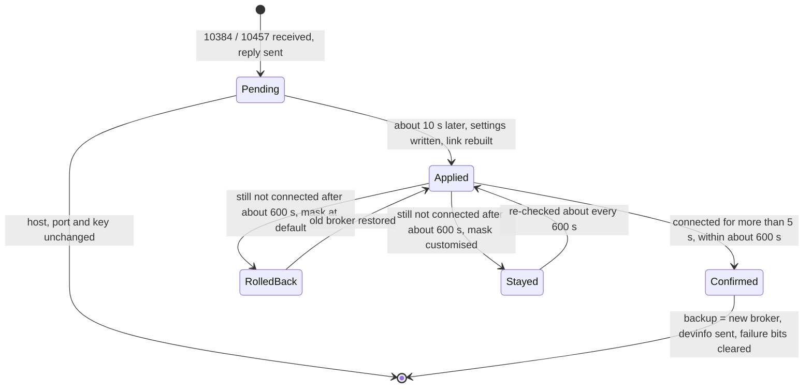
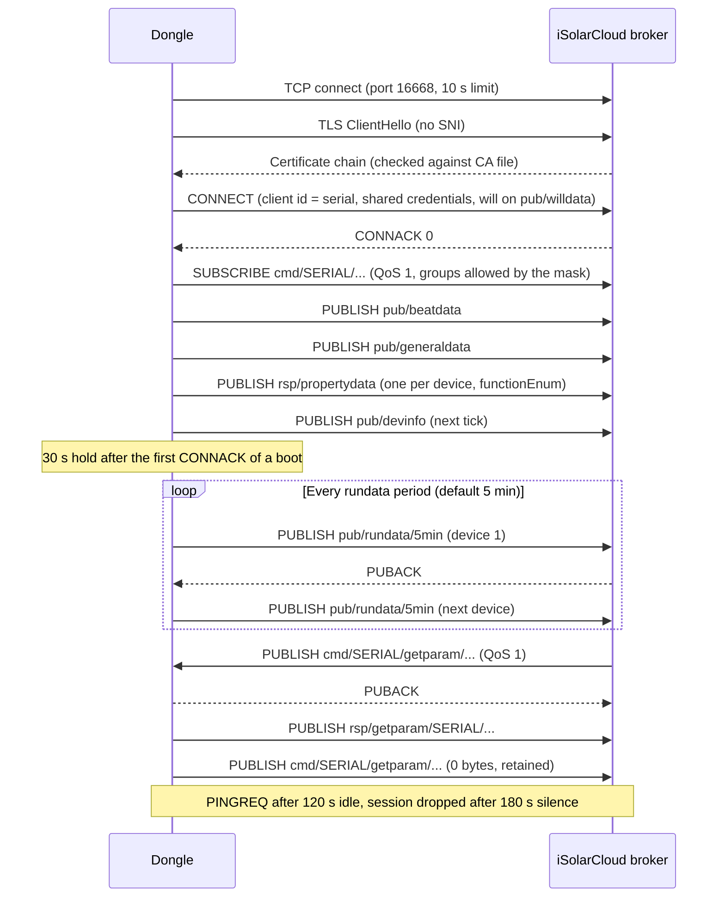

# iSolarCloud MQTT link

The WiNet-S and WiNet-S2 hold one long-lived MQTT session with an iSolarCloud broker. It carries
everything the dongle uploads ([cloud-messages.md](cloud-messages.md)) and every command the cloud
sends ([cloud-commands.md](cloud-commands.md)). This page covers the transport, the identity, the
session rules and the topic tree. The JSON payload framing is in
[cloud-envelope.md](cloud-envelope.md). For an overview, see
[the cloud chapter of the guide](../../guide/04-talking-to-the-cloud.md).

Both generations use the same protocol: the same topics, CONNECT options, credentials, TLS rules
and envelope. Where they differ, the table in [WiNet-S vs WiNet-S2](#winet-s-vs-winet-s2) says so.

> Modbus register numbers on this page are 1-based, as in Sungrow's published Modbus documents
> (the address on the wire is one less).

## Endpoint and region

### Default broker

| Item | Value |
|---|---|
| Host | `iot.isolarcloud.com` |
| Port | 16668 |
| Transport | TLS over TCP |
| Protocol | MQTT 3.1.1 |

The broker host, port, transport flag and a 16-character broker key are persistent logger settings.
They hold the defaults above until something overwrites them. The dongle never chooses a broker by
itself. The settings change in only three ways:

1. A **server-switch command** from the cloud ([below](#server-switch)). This is the normal way a unit
   reaches its regional broker. For example, an Australian unit runs on `auiot.isolarcloud.com:16668`.
2. A **local write** of the broker settings through the dongle's web or Modbus configuration.
3. The **factory identity file** on the external flash, which can hold non-default values from the
   start.

The transport flag takes these values:

| Value | Transport |
|---|---|
| 0 | Plain TCP |
| 2 | TLS (default) |
| anything else | The dongle never connects |

When the link is created normally, port 19999 forces plain TCP. The server-switch path does not
apply that rule.

### Regional hosts

The firmware knows these broker hosts. It uses the host name to choose the matching HTTPS gateway
for its other cloud calls.

| Broker host(s) | Region | HTTPS gateway |
|---|---|---|
| `iot.isolarcloud.com`, `iotv6.isolarcloud.com` | Global (default) | `https://auto.isolarcloud.com` |
| `auiot.isolarcloud.com`, `auiotv6.isolarcloud.com` | Australia | `https://augateway.isolarcloud.com` |
| `iot.isolarcloud.eu`, `iotv6.isolarcloud.eu` | Europe | `https://gateway.isolarcloud.eu` |
| `iot.isolarcloud.com.hk`, `iotv6.isolarcloud.com.hk` | International (Hong Kong) | `https://gateway.isolarcloud.com.hk` |
| `iot.isolarcloud.com.cn`, `iotv6.isolarcloud.com.cn` | China | `https://gateway.isolarcloud.com.cn` |
| `newbaseiot.isolarcloud.com`, `newbaseiotv6.isolarcloud.com` | China (base platform) | `https://base.isolarcloud.com:8770` |
| `iot.isolarcloud.in` | India | `https://gateway.isolarcloud.in` |
| `newtestiot.isolarcloud.com`, `testiotv6.isolarcloud.com.cn` | Test | `https://testgateway.isolarcloud…` |

### Region id ("net location")

The region id is a separate number from the broker settings. It never changes the broker.

**Request.** The dongle sends one unauthenticated HTTPS request:

- `POST https://auto.isolarcloud.com/v1/commonService/getGatewayDNSApi`
- Body: a JSON object holding only a shared application key, which is the same on every dongle.
- Headers: a fixed `sys_code` header.
- Certificate checks are turned off for this request.
- The body carries nothing that identifies the unit, so the server can only locate the dongle by its
  public IP address.

**Reply.** The dongle needs `result_msg` to start with `success`, and it reads `result_data.cloudId`
as a decimal string. It keeps the value persistently. Known values:

| cloudId | Region |
|---|---|
| 1 | China |
| 2 | International (Hong Kong) |
| 3 | Europe |
| 7 | Australia |
| 9 | India |

**When the request is sent.** All three conditions must hold: the MQTT session is up, the cloud
master switch is on, and the stored region id is still 0. Within those conditions, the dongle sends
it:

- on every CONNACK;
- about every 303 s;
- after a failure, in bursts of up to three retries about 11 s apart.

Once a non-zero id is stored, the request is never sent again. The cloud can also write the value
with a logger-parameter command ([cloud-commands.md](cloud-commands.md)).

**Faults in the reply handling:**

- A reply whose `cloudId` or `result_msg` is not a JSON string reboots the dongle, because the dongle
  reads a null pointer.
- A request that never gets a reply leaves the request marked as in flight until the next reboot.

### The EU rule

About once a second, the dongle checks the broker host against the region id. Unless the cloud
switch (register 8021, 0x55) is off, it applies this rule:

| Condition | Effect |
|---|---|
| The broker host contains `.eu` | Nothing |
| The host is `iot.isolarcloud.com`, `app.isolarcloud.com` or `iotv6.isolarcloud.com` and the region id is 3 | Nothing |
| Anything else | The [remote-control mask](#remote-control-mask) is reset to its factory default, and the cloud link is re-enabled if it was off |

Only units on the European cloud can keep customised remote-control settings. Every other unit,
including a global-host unit whose region id is still 0, is put back to the factory default mask within
about a second.

## Server switch

The cloud moves a dongle to another broker with a logger-parameter command:

| Field | Value |
|---|---|
| cmdType | 10384 |
| devCode | 247 |
| Point | 10457 |
| `dataValue` | `"<host>;<port>;<key>"` |
| `sslFlag` | optional |

**Request parsing:**

- `dataValue` is split on `;`.
- The port is read with a plain decimal conversion and is not range-checked.
- The 16-character key is stored next to the host. Only an unused binary framing reads it (see
  [cloud-envelope.md](cloud-envelope.md#inbound-command-rules)).
- `sslFlag` sets the transport. If it is absent, the new broker gets plain TCP. A value of `"1"` is
  stored as 2 (TLS).
- A host of 66 bytes or more is not rejected. It becomes an empty host, and the switch then fails and
  rolls back.

**Reply.** The dongle replies at once, before it switches. The reply carries `readResult` 1 and
echoes the request value, key included. `sslFlag` is returned as a number.



**How the switch runs:**

- If host, port and key all equal the current values, nothing happens. A change to the transport flag
  alone is also ignored.
- About 10 s after the command, the dongle writes the new settings, closes the cloud link and
  reconnects.
- **Confirm:** once the session has been up for more than 5 s, and within about 600 s, the dongle:
  - copies the new settings into its backup broker settings;
  - clears the [link-failure bits](#link-failure-reason-bits);
  - flags a `devinfo` upload.
- **Rollback:** if the session is still down after about 600 s, the dongle restores the backup broker.
- **Stay:** if the remote-control mask differs from its default at that point, the dongle stays on the
  new broker instead and checks again every 600 s.
- A reboot between apply and confirm leaves the unit on the new broker with nothing committed and no
  rollback pending.

A switch produces two `devinfo` messages ([cloud-messages.md](cloud-messages.md#pubdevinfo)):

| When | Current broker (38338) | Backup broker (38337) |
|---|---|---|
| First CONNACK on the new broker | New | Old |
| Confirm | New | New |

The confirm message never reports the broker the unit came from.

A **local broker change** does not go through this process. A web or Modbus write of host, port or
key copies the new values straight into the backup settings and reconnects. No rollback is possible,
and no confirm message is sent.

## Transport

### Connection attempts

The network stack checks the cloud link once a second, starting 7 s after boot, and rebuilds it if it
is missing. There is **no exponential backoff**. The timeouts of each step are the only thing that
paces retries.

| Step | Limit |
|---|---|
| DNS | Asynchronous lookup, polled for up to 10 s. A literal IP address skips DNS. The dongle does not retry through other DNS servers. |
| TCP connect | 10 s, on the active interface (Wi-Fi station or Ethernet) |
| TLS handshake | About 10 s (2000 polls of 5 ms) |
| TLS read timeout | 20 s |
| CONNACK | About 100 s after CONNECT |

### TLS

| Item | Behaviour |
|---|---|
| Trust store | A single CA file on the external-flash filesystem, `/usrdataout/tlsca/cafile`. There is no built-in bundle. If the file fails to parse, the attempt is aborted. |
| Chain | Verified. Any verification failure aborts the attempt. |
| Server name | No SNI is sent. The certificate's host name is not checked against the broker host. |
| Client certificate | None |

See [flash-layout.md](../hardware/flash-layout.md) for the filesystem.

### Link-failure reason bits

The dongle keeps a persistent 64-bit failure mask for the cloud link. Each failure sets bit `n` for
its reason:

| Bit | Reason |
|---|---|
| 1 | DNS gave no result within 10 s |
| 2 | DNS finished, but the address is empty or `0.0.0.0` |
| 3 | No host |
| 5, 6 | Network interface not found |
| 7 | Socket creation failed |
| 8 | Binding to the interface failed |
| 9 | Switching the socket to non-blocking failed |
| 10 | TCP connect failed or timed out |
| 11 | TLS context allocation failed |
| 12 | TLS setup or CA load failed |
| 15 | Handshake error |
| 16 | Handshake timeout |
| 17 | Certificate verification failed |

Behaviour of the mask:

- A refused CONNACK or an MQTT-level drop sets no bit.
- The mask accumulates across reboots. Only a server-switch confirm clears it.
- Only the WiNet-S reports it to the cloud, as 16 hex characters in `devinfo` point 38781. The
  WiNet-S2 always sends zeros there.

## Identity

| Item | Value |
|---|---|
| MQTT client id | The dongle's serial number (up to 20 characters, written at the factory) |
| Username, password | Compiled into the firmware, stored encrypted in the image and decrypted at start-up. They are **identical on every WiNet-S and WiNet-S2**. |
| Provisioning | None. There is no bootstrap, activation or key exchange before the first CONNECT. |
| Plant binding | Done on the cloud side by serial number. The installer or owner registers the serial with a plant. |

The serial is the only thing that tells one dongle from another on this link. It appears as the
client id, in every topic, in every `messageId` and in `publicData.productSN`.

## MQTT session

### CONNECT

| Field | Value |
|---|---|
| Protocol | `MQTT`, level 4 (3.1.1) |
| Connect flags | `0xEE`: username, password, will retain, will QoS 1, will flag, clean session |
| Keepalive | 120 s |
| Client id | Serial number |
| Will topic | `isolarcloud/devicedata/pub/willdata/<serial>/enum_<e>_<k>_<c>` |
| Will payload | An envelope whose `businessData` is `[{"devCode":247,"devType":22,"beat":0}]`. It is compressed when the compress flag is set, and its length must stay under 256 bytes. |
| Will QoS / retain | 1 / 1 |

### Timers

| Timer | Value |
|---|---|
| CONNACK wait | About 100 s (counted in 5 s steps). On timeout the session is closed. |
| Outgoing idle | PINGREQ after 120 s without transmitting |
| Incoming idle | The session is closed after 180 s (1.5 × keepalive) without receiving anything |
| PUBACK / SUBACK wait | 20 to 25 s. On expiry the request is abandoned; whether it is resent is not known. |

A CONNACK with a non-zero return code is not acted on at once. The session is torn down by the
CONNACK timeout.

### On every CONNACK

The dongle does the following in order on every CONNACK. The silence window and the post-connect
hold do not delay any of these steps.

1. Subscribes to every topic the remote-control mask allows.
2. Publishes `beatdata` for every device.
3. Publishes `generaldata` for the first online device that has general points.
4. Publishes `rsp/propertydata` for every online device, logger included, with
   `batchId` `"999999999999999"`. This carries the `functionEnum` capability bitmap.
5. Publishes optimizer attributes (WiNet-S2 only).
6. On every CONNACK after the first of a boot, also:
   - publishes `devstatusdata` for all devices;
   - publishes the logger's `devpointdata`;
   - replays offline faults.
7. Flags `devinfo`, which goes out on the next 1 s tick:
   - WiNet-S: on every CONNACK.
   - WiNet-S2: on reconnects. After the first connect of a boot, the first-connect burst flags it
     instead.

**After the first CONNACK of a boot**, the dongle also:

1. waits 30 s;
2. sends a first `rundata/5min` round with the current time as `dataTime`;
3. sends `devinfo` (WiNet-S2);
4. sends `propertydata` for every device again 180 s later.

The periodic cadence after that is in [cloud-messages.md](cloud-messages.md).

### Clock and quiet hours

While the clock is invalid (year outside 1971 to 2069), every scheduled publish is suppressed. The
connection and the CONNACK handling do not wait for the clock, but the messages they trigger fail to
build without a valid time. A will built while the clock is invalid has no `publicData` header.

A configurable silence window (enable, start hour, end hour, local time, wrapping past midnight;
start = end means all day) suppresses the scheduled publishes in the same way. The session,
keepalive, inbound commands and the CONNACK burst carry on during the window.



## Topics

### Grammar

```
isolarcloud/devicedata/pub/<family>/<serial>/enum_<e>_<k>_<c>    dongle → cloud: data, will
isolarcloud/devicedata/rsp/<family>/<serial>/enum_<e>_<k>_<c>    dongle → cloud: replies, propertydata
isolarcloud/devicedata/cmd/<serial>/<family>/enum_<e>_<k>_<c>    cloud → dongle: commands
isolarcloud/devicedata/cmd/<timezoneId>/enum_0_0_0               cloud → every dongle in one time zone
```

- In `cmd` topics the serial comes **before** the family. In `pub` and `rsp` topics it comes after.
- `<family>` can contain a slash, for example `rundata/5min`, `faultdata/history` or `fcas/second`.
- `<timezoneId>` is a number the cloud assigns with the set-time-zone command (default 8).

The suffix `enum_<e>_<k>_<c>` carries three persistent flags, each printed as a decimal number:

| Flag | Meaning | Default | Effect |
|---|---|---|---|
| `e` | Encrypt | 0 | None. It is carried in the topic and never applied. |
| `k` | Key number | 0 | None |
| `c` | Compress | 1 | When non-zero, every outbound payload is zlib-compressed |

A production unit therefore publishes on topics ending `enum_0_0_1`.

### Families

| Direction | Families |
|---|---|
| `pub` | `rundata/5min`, `rundata/history`, `rundata/second`, `beatdata`, `willdata` (will only), `devinfo`, `devstatusdata`, `generaldata`, `devpointdata`, `faultmergedata`, `faultdata`, `faultdata/history`, `fcas/second` |
| `rsp` | The family of the command being answered, plus unsolicited `propertydata` |
| `cmd` | `settimezone`, `propertydata`, `setparam`, `getparam`, `parammultiset`, `parammultiget`, `second`, `generalcmd`, `fcas`, `apidata`, `upgrade`, `logexport`, `iv`, `structurefileset` |

### QoS and retain

| Message | QoS | Retain |
|---|---|---|
| Every `pub` and `rsp` publish | 1 | 0 |
| The will | 1 | 1 |
| Retained-command clear | 1 | 1 |

The retained-command clear is a 0-byte publish to the incoming `cmd` topic. The dongle sends it after
handling each command, whether the command was matched, unmatched or refused. It does not send it for
a duplicate command or one that failed to parse.

Incoming QoS 1 and 2 messages are acknowledged before they are processed.

### Subscriptions

All subscriptions are QoS 1 and use the dongle's own `enum` suffix.

- **Always subscribed:** `cmd/<serial>/settimezone/…` and the time-zone broadcast
  `cmd/<timezoneId>/enum_0_0_0`.
- **Gated:** every other `cmd` family belongs to a group. A group is subscribed only while both the
  cloud-to-device bit and the group's own bit are set in the remote-control mask. A group that becomes
  disallowed is unsubscribed.
- **Re-arm:** while connected, the dongle re-runs the subscription pass about every 6 s. It
  re-subscribes anything not yet acknowledged and drops newly disallowed groups. A mask change takes
  effect within about 6 s, without a reconnect.
- **Time-zone broadcast:** re-subscribed every 4 h and after each set-time-zone command. After a
  broadcast set-time command is accepted (the clock write is queued, whether or not it later
  succeeds), the dongle unsubscribes the broadcast topic until the next 4 h
  refresh or CONNACK.

### Remote-control mask

The mask is a persistent bitmask. It controls both the subscriptions above and the dispatch of each
incoming command. Defaults: `0x4FF` on the WiNet-S2, `0x4EF` on the WiNet-S (no Layout group).

| Bit | Web label | Gates |
|---|---|---|
| 0 | Communication master switch | The whole cloud link. Turning it off disconnects. |
| 1 | Cloud-to-device | Master for every command group below, plus `propertydata`, `generalcmd`, `fcas` and `apidata` |
| 2 | Settings | `setparam`, `getparam`, `parammultiset`, `parammultiget` (read and write device parameters, logger settings) |
| 3 | Live data | `second` (live-data requests) |
| 4 | Layout | `structurefileset` (optimizer layout; WiNet-S2 only) |
| 5 | Firmware update | `upgrade` |
| 6 | Log export | `logexport` |
| 7 | IV scan | `iv` |
| 8, 9 | Remote upper computer, cell diagnosis | Nothing on MQTT. Not supported. |
| 10 | Third-party cloud | The third-party upload switch ([third-party-upload.md](third-party-upload.md)) |

Set-time-zone, the broadcast set-time and one optimizer command are never gated.

Ways to switch the cloud on and off:

- **Local web page.** The page writes the mask. Bit 0 also drives a separate MQTT-enable setting:
  turning it off closes the link at once.
- **Modbus register.** A Modbus write of `0x55` (off) or `0xAA` (on) to register 8021 on unit 247 sets
  the low eight mask bits and the link enable together (see [modbus-tcp.md](modbus-tcp.md)).
- **Cloud.** No cloud command writes the mask. The cloud only sees it as a logger attribute.

## WiNet-S vs WiNet-S2

| Item | WiNet-S2 (SV300) | WiNet-S (V200) |
|---|---|---|
| Topics, CONNECT, credentials, TLS, envelope | Same | Same |
| `productType` / `productName` | `1824` / `WiNet-S2` | `1813` / `WiNet-S` |
| Remote-control mask default | `0x4FF` | `0x4EF` |
| Commands in the dispatch table | 18 | 13 |
| `devinfo` | First connect, every reconnect, server-switch confirm | Every CONNACK, server-switch confirm |
| `devinfo` point 38781 | Always zeros | Hex of the link-failure mask |
| Optimizer attributes at CONNACK | Yes | No |
| Hold before the first `rundata` | 30 s | about 30 s (20 s, then a further 10 s) |
