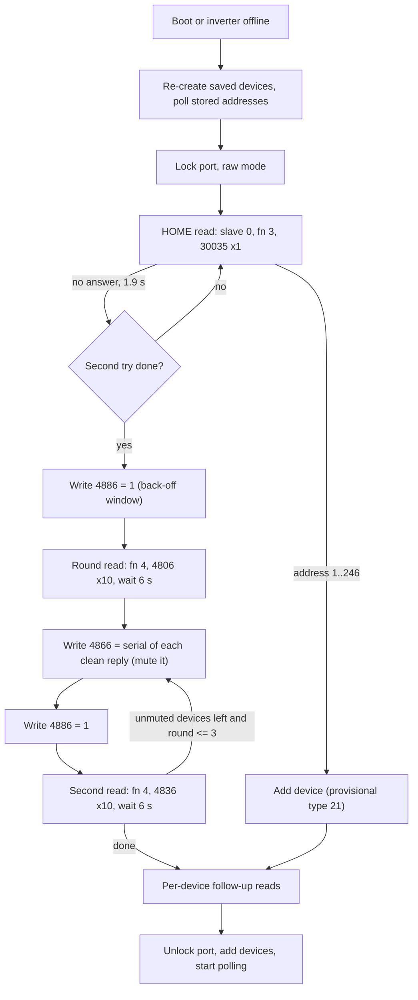

# RS-485 device discovery

How a WiNet-S or WiNet-S2 finds the inverter on its RS-485 port, how it classifies what it finds, and
when it changes the line speed. The normal poller that takes over afterwards is described on
[rs485-master.md](rs485-master.md).

> Register numbers are the 1-based numbers of Sungrow's published Modbus documentation. Hex frames
> show the wire address, which is one lower. All search frames go to slave 0 (broadcast) unless noted.

## Overview

Discovery has three stages, tried in order:

1. **Saved device.** At boot the dongle re-creates every device it has stored and starts polling it at
   its stored slave address. On a configured site this is how the inverter is found; no search frame is
   needed.
2. **HOME read.** A single broadcast read that asks "what is your slave address?".
3. **Search by port.** If the HOME read gets no answer twice, a broadcast arbitration round collects
   serial number, device code and address from every device on the bus.

The automatic search runs **once per boot** and again **every time an inverter goes offline** (ten
consecutive lost frames). It is skipped in factory mode. While it runs, the port is locked: every
device on it is paused and the port is switched to raw (pass-through) mode, so the poller sends
nothing. The whole search is capped at 6000 ticks of 100 ms (10 minutes).

EV chargers (address 248) and Energy Bridges (address 246) are not searched. The dongle adds them from
the lists the hybrid inverter publishes ([../devices/ev-charger-and-energy-bridge.md](../devices/ev-charger-and-energy-bridge.md)).
Battery stacks are not separate bus devices: the hybrid inverter serves them at addresses 200 to 204
([../devices/sbr192/registers-via-inverter.md](../devices/sbr192/registers-via-inverter.md)).

## Transport during the search

| Item | Value |
|---|---|
| Framing | Modbus RTU, CRC-16/Modbus appended low byte first |
| Port mode | raw pass-through; the normal master refuses these frames while it owns the port |
| Settle after a broadcast write | the port waits 100 ms after sending any frame that starts `00 10` |
| Reply acceptance | CRC check first; on failure the receiver scans the buffer for an address followed by a known function code and checks again |
| Search tick | 100 ms |

## HOME read

| Field | Value |
|---|---|
| Request | `00 03 75 52 00 01 3E 06`: slave 0, function 3, register 30035, 1 register |
| Expected reply | `00 03 02 <addr hi> <addr lo> CRC`: the device echoes slave 0 and returns its own address |
| Wait | 1.9 s per try, 2 tries; the second timeout starts the search by port |
| Accepted address | 1 to 246; anything else is ignored and the try times out |
| Result | device recorded with the provisional device type 21 (residential inverter), then classified by the follow-up reads |

Neither the SH10RS nor the SG5.0RS answers the HOME read on its dongle-facing port. Their
holding-register handlers answer only their own slave address (and the SG5.0RS additionally any
address on its encrypted service port), and neither has a value for register 30035. A dongle with no
saved device therefore always falls through to the search by port on these inverters.

## Search by port

### Frames

| Step | Function | Register | Count | Payload | Frame (hex) | Meaning |
|---|---|---|---|---|---|---|
| reset | 16 | 4886 | 1 | `00 01` | `00 10 13 15 00 01 02 00 01 4A 04` | clear each device's reply flag and set its reply back-off window N to 1 |
| round read | 4 | 4806 | 10 | | `00 04 12 C5 00 0A 64 99` | every device that is not muted answers with serial, device code and address |
| select | 16 | 4866 | 8 | 16-byte serial | `00 10 13 01 00 08 10 <serial> CRC` | the device with this serial mutes itself for the rest of the search |
| second read | 4 | 4836 | 10 | | `00 04 12 E3 00 0A 85 52` | answered only by devices that are still unmuted (those whose first reply collided) |

### Search reply

`00 04 14 <20 data bytes> CRC`, 25 bytes in total.

| Data bytes | Type | Meaning |
|---|---|---|
| 0 to 15 | ASCII, NUL padded | device serial number (for example `A2xxxxxxxxx`) |
| 16 to 17 | u16 big-endian | device code (SH10RS 0x0D1B, SG5.0RS 0x2606) |
| 18 to 19 | u16 big-endian | current slave address, 1 to 246 |

A reply with device code 0 or address 0 is rejected, a duplicate serial is ignored, and at most one
device is taken from each received chunk of bus data. The SH10RS sends only the low byte of its device
code in the second-read reply (0x001B); the follow-up identification read corrects it.

### Arbitration

The devices make the arbitration work by delaying their replies at random.

1. The reset write sets the back-off window to N = 1 on every device.
2. The round read makes every unmuted device set its reply flag and answer after
   `(random mod (N × 1000 + 1)) + 100` ms, so between 0.1 and 1.1 s. Replies of several devices
   rarely collide; the dongle keeps every reply that passes its CRC check.
3. The dongle sends one select write per device it read cleanly, which mutes that device.
4. After another reset write, the second read is answered only by devices still unmuted.
5. Steps 3 and 4 repeat for at most three rounds, then the dongle reads model data from each found
   device.

Without the reset write the window is the power-on default **N = 30**, so a device would answer a
round read anywhere between 0.1 and 30.1 s later. The SG5.0RS adds a further per-device offset to
this delay.

| Step | Wait |
|---|---|
| reset write | 0.4 s |
| round read | 6 s |
| select write | 0.3 s per device |
| second reset write | 0.4 s |
| second read | 6 s |
| follow-up reads | 0.9 s, or 1.9 s for the device-information block; 2 tries each, then the device is dropped |

The WiNet-S expects up to 8 devices after a failed HOME read, the WiNet-S2 up to 15.

### Inverter-side registers of the search window

Both inverters route 4800 to 4899 to a dedicated handler. The write column is the SH10RS behaviour;
the SG5.0RS uses the same registers.

| Register | Read (function 4) | Write (function 16) |
|---|---|---|
| 4800 to 4803 | words of a 64-bit unique chip id | |
| 4806 to 4813 | serial number (16 bytes) | |
| 4814 | device code | |
| 4815 | slave address (function 3 also answers here) | a value 1 to 246 sets the slave address |
| 4836 to 4843 | serial number | |
| 4844 | device code (SH10RS: low byte only) | |
| 4845 | slave address | |
| 4866 to 4873 | | target serial; when it matches, the device is muted for search reads |
| 4874 to 4881 | | serial for address assignment |
| 4882 | | new slave address, 1 to 246 (exception 04 otherwise); honoured with a matching serial in the same frame |
| 4885 | | 0xAA resets the slave address to 1 |
| 4886 | | clears the reply flag; 1 to 200 sets the back-off window N (RAM only) |
| other registers in the window | 0xFFFF | accepted, no effect |

Register 4887 (`00 AA`) has no handler on the SH10RS. A function-16 write outside the window gets
exception 02. When a write's reply flag is clear the device stays silent, so a broadcast assignment is
answered only by the device whose serial matches.

### Address assignment

The inverters support re-addressing by serial number (a serial and new address written to 4874 to
4882). **Neither dongle ever changes a device's slave address**: its only search writes are the
arbitration writes to 4886 and 4866.

## Classifying a found inverter

After an address is known, the dongle reads identity data with normal (non-broadcast) requests:

| Read | Register | Count | Purpose |
|---|---|---|---|
| function 4 | 2515 | 66 | identification block: device code, type, protocol tag, version. Decides the protocol type |
| function 3 or 4 | 5487 | 2 | feature words |
| function 3 or 4 | 2516 | 8 | model data |
| function 3 or 4 | 34209 | 16 | model string |
| function 3 or 4 | 2505 | 19 | device information block |

Two values then fix how the device is handled:

- **Device type**, derived from the device code. The SH10RS (0x0D1B) becomes device type 35
  (hybrid inverter); the SG5.0RS (0x2606) device type 21 (residential string inverter); other string
  inverters device type 1. The device type selects the polling logic, the web-UI pages and the cloud
  point table ([../devices/device-types-and-grid-profiles.md](../devices/device-types-and-grid-profiles.md)).
- **Protocol type**, from the identification block. Protocols 1, 2 and 4 are table-polled. The
  SH10RS and the SG5.0RS report protocol 3 (the "ZS" / "AA10" family), which is table-polled only at
  start-up and then switches to the function-0x65 change stream
  ([rs485-master.md](rs485-master.md#protocol-3-inverters-change-stream-instead-of-table-polling)).
  An inverter that answers the identification read with an exception is treated as protocol 1.
  The protocol type together with register 30644 also selects which family of installer parameter
  tables the web UI uses.

## Baud switch to 115200

The line normally stays at 9600 baud. Both inverters offer a temporary, self-reverting switch, which the
dongle uses for four jobs:

| Job | Trigger | Gated by the inverter's feature bit |
|---|---|---|
| periodic "adjust baud" | dongle timer, residential and string inverters (device types 1 and 21) only; never for the hybrid type 35 | yes: bit 4 of register 5489 |
| fast data collection for frequency-control services | cloud command 10369 | no |
| inverter log export | cloud command 10329 | no |
| firmware relay to the inverter | firmware-update job | no |

Register 5489 ("function word 2") is part of the inverter's feature words. Its bit 4 is a build-time constant that is clear on both the SH10RS and the SG5.0RS, so
the periodic negotiation never leaves 9600 on these units. The other three jobs are cloud-triggered
and switch regardless ([cloud-commands.md](cloud-commands.md),
[../firmware-update/device-firmware-relay.md](../firmware-update/device-firmware-relay.md)).

### Temporary window on the inverter

| Register | Access | Meaning |
|---|---|---|
| 21002 to 21003 | read | always 0x0000, 0x0100; meaning unknown |
| 21004 to 21005 | write, u32 low word first | requested baud rate (115200 = 0xC200, 0x0001). Any non-zero value is accepted, with no range check |
| 21006 to 21007 | write, u32 | confirmation; must equal the staged value |
| 21008 to 21017 | write | test registers, accepted only while a change is pending |
| 21018 | write | 0x0055 ends the test phase |

### Sequence

1. The dongle pauses the other devices on the port.
2. At 9600 it writes 115200 to 21004 and then the same value to 21006. The reply to the
   confirmation still goes out at 9600.
3. Right after the second reply the dongle switches its own UART to code 7 (115200). The inverter
   switches 1 to 2 s after the confirmation. The dongle waits about 5 s.
4. Two test writes: 0x000A to 21008, then 0x0055 to 21018. If both are answered, the switch succeeded.
5. On any failure the dongle restores its saved rate (code 3, 9600) and resumes the paused devices. The
   periodic negotiation then retries only at local midnight. Once a user saves the serial settings in
   the web UI, the periodic negotiation stays off until the next reboot.

The inverter keeps the new rate only in RAM and falls back to its original rate after **600 s with no
frames at all**, after **5 consecutive bad frames**, or at reboot. After a failed negotiation, the next
polling frames at 9600 look like garbage to an inverter still at 115200, and its 5-bad-frame rule
brings it back within a few frames. On the SH10RS the new rate is applied without recomputing the
end-of-request silence timer, which stays at the 9600 value of 4 ms.

After log export, firmware relay and fast collection the dongle writes the window again with the
saved rate (9600) and switches its own UART back. It restores the saved rate also when an inverter is
created, removed or goes offline.

The SH10RS accepts the temporary window only from its own model family (other device codes get
exception 04); the SG5.0RS has no such check.

### Persistent rate registers

| Register | Meaning |
|---|---|
| 30456 | baud code: 0xA1 = 9600, 0xA2 = 19200, 0xA3 = 38400, 0xA4 = 57600, 0xA5 = 115200 (others: exception 04) |
| 30457 | parity: 0x55 none, 0xA1 even, 0xA2 odd |
| 30458 | stop bits: 0xA1 = 1, 0xA2 = 2 |
| 30459 | 0xAA commits and applies the staged values |
| 30460 | a slave address 1 to 246 is stored and the baud code is reset to 9600 |

The dongle never writes these on its own. The phone app can write them through the dongle's
pass-through route; the WiNet-S2 then switches its own UART to match. The SG5.0RS applies the saved
rate again at boot, so a persistent change survives a reboot; the SH10RS always reopens its ports at
9600.

## Not yet known

- How the HOME read and the search behave with two or more inverters on one bus: the HOME reply parser
  expects exactly one frame.
- Whether the SH10RS still sends a delayed round-read reply when other requests arrive during its
  back-off delay.
- How a non-inverter device on the same port behaves after a successful switch to 115200.
