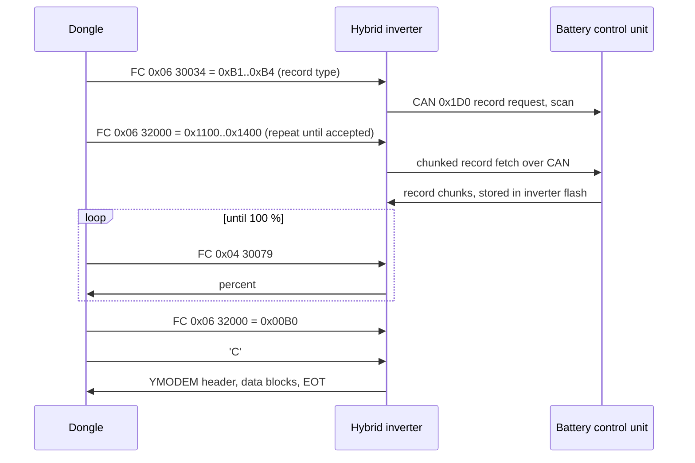

# Diagnostics and log export

Besides routine polling and telemetry, the dongle has a set of service features that a technician
uses through iSolarCloud or the local web UI: fast data streams while someone watches, the I-V
curve scan, log and fault-record export from inverters and batteries, upload of those files to a
cloud server, and a capture of raw RS-485 traffic. This page describes what each one does on the
bus and in the cloud. The command envelopes and summary fields are in
[cloud-commands.md](cloud-commands.md); RS-485 polling itself is in
[rs485-master.md](rs485-master.md).

> Modbus addresses on this page are the 1-based numbers of Sungrow's published Modbus
> documentation. The frame on the wire carries the address minus one.

| Feature | Trigger | Bus impact | Output |
|---|---|---|---|
| Live data | cloud 10421 (app "Live data") | none beyond normal polling | `pub/rundata/second` every 10 s |
| Monitor data | cloud 10375 | none known | `pub/generaldata` every `upFrequency` s |
| FCAS fast collection | cloud 10369 | bus raised to 115200 baud | `pub/fcas/second` |
| I-V curve scan | cloud 10306 / 10326 | COM port locked, polling stops; 9600 baud kept | hex file on `rsp/iv` |
| Device log export | cloud 10329; web log, wave-record and grid-record pages | COM port locked, bus raised to 115200 baud | files uploaded by SFTP (cloud) or downloaded (web) |
| Dongle log export | cloud 10329 with devCode 247 | none (or a frame capture) | files uploaded by SFTP |
| Frame-log capture | web `/message/*`; cloud 10329 codes 105 / 112 | none | `Logger_Frame_*.log` |

## Live data (10421) and monitor data (10375)

**Live data** is what the app's Live data screen opens. The cloud sends 10421 with a list of point
ids per device and `devSwitch` 1. The dongle stores up to 400 point ids for each of up to 15
devices and sets a persistent "live data on" switch, so the stream **survives a reboot**. There is
no expiry on the dongle: the stream runs until the cloud sends `devSwitch` 0 (close the listed
devices) or any other value (close everything).

While open, a 1 s timer checks the local clock. Whenever the local second is a multiple of 10, the
clock is valid and the cloud link is up, the dongle collects the listed points of every online
device and publishes one element per device on `pub/rundata/second`, in the same element format as
the 5-minute run data ([cloud-messages.md](cloud-messages.md)). The 5-minute run-data upload
waits while a live-data send is in progress. Inverters that report optimizers also send optimizer
data with the stream. The `data` object is looked up in the order of `devCodeArr`; a device whose
key appears earlier in `data` than the previous device's key is not found and stays silent while
the reply still says `result` 1.

**Monitor data** (10375) has the same request shape with point ids as strings plus a required
`upFrequency` in seconds. Each device gets its own interval: when `upFrequency` seconds have passed
since its last upload the dongle publishes

```json
{"businessData":[{"devCode":1,"devType":14,"dataTime":"20261024153100",
  "data":{"5001":"123","5002":"456"},"businessType":"upFrequency"}]}
```

on `pub/generaldata`. The list also survives a reboot. Opening and closing it notifies the
inverter manager inside the dongle; whether that changes the polling rate is not yet known.

## FCAS fast collection (10369)

FCAS is the Australian Frequency Control Ancillary Services market. The task records chosen points
at up to 5 Hz around a grid-frequency event that the inverter reports, with a 20 s pre-trigger
buffer, and streams them to the cloud.

| Field | Meaning |
|---|---|
| `devSwitch` | 1 start, 0 stop. A running or finished task must be stopped before it can be restarted |
| `durations` | seconds of capture after the trigger |
| `uploadCycle` | seconds between uploads while capturing |
| `saveCycle` | sample period in ms; the timer ticks every 200 ms, so 200 ms is the finest resolution. 0 is not rejected |
| `devCodeArr`, `data` | up to 17 devices, up to 70 point ids each; every device must be online and every point known |
| `dataTime` | echoed verbatim in the reply |

Sequence:

1. **Arm.** The dongle registers the points with its inverter manager and raises the RS-485 speed
   to 115200 baud through the temporary-baud window (below) if the bus runs slower. There is no
   capability check before the raise. Before the trigger it keeps a ring of `20000 / saveCycle`
   samples (20 s).
2. **Trigger.** The inverter manager watches the power-limitation-reason value it polls from the
   inverter. When it becomes 0x0801 (most likely the under-frequency response) the capture starts; when it leaves
   0x0801 the trigger clears.
3. **Capture.** Every `saveCycle` ms one sample of each point is taken from the latest polled
   values (so a sample is only as fresh as the polling of that register). Every `uploadCycle`
   seconds the queues are published. After `durations` seconds the capture ends and waits; when the
   trigger clears, the task re-arms and buffers again.
4. **Stop.** `devSwitch` 0, or the cloud link going down, ends the task and restores the saved
   baud rate. The task is RAM-only and does not restart after a reconnect or reboot.

Each upload is one message per device on `pub/fcas/second`, compressed when the dongle's
compression flag is on:

```json
{"messageId":"<SN>_<sendTime>_00001","packgeCount":"1","packgeId":"1",
 "publicData":{"productType":"1824","productName":"WiNet-S2","productSN":"<SN>","sendTime":"20261024153012"},
 "businessData":[{"devType":14,"devCode":1,
   "data":[{"dataTime":"20261024153001200","data":{"5008":49.87,"5031":4200}},
           {"dataTime":"20261024153001400","data":{"5008":49.86,"5031":4210}}]}]}
```

Values are JSON numbers already scaled. Sample times are synthetic (first sample from the clock,
then `saveCycle` ms steps) in local time with milliseconds. When the serialised `businessData`
exceeds 2560 bytes it is split into `packgeCount` parts, and each part's `businessData` is then a
**string** fragment of the array. `productName` is "WiNet-S" on the WiNet-S.

## I-V curve scan (10306 / 10326)

The dongle makes an inverter sweep its PV inputs and fetches the recorded curve. Only the cloud
can start it; the local web UI shows the port as "used for IV scanning" but has no I-V page. The two
cmdTypes are handled identically. A request with a `data` object is an optimizer (component) scan,
WiNet-S2 only; without it, a string scan. The command is accepted only when no scan is running and
is never acknowledged.

### Start and poll

The dongle locks the COM port (normal polling of every device on that bus stops), clears its
I-V store, and for each device checks that it is online (else code 35). It picks a register set
from the inverter's function word (input 5487–5488): bit 3 set selects the newer set. Both the
SH10RS and the SG5.0RS use it. Every frame has a 2000 ms timeout.

| Set | Start | Poll |
|---|---|---|
| older | FC 0x10, 30060 = 0x01A0 | FC 0x03, 30071, 5 registers |
| newer (function-word bit 3) | FC 0x10, 32000 = 0x01A0 | FC 0x03, 32005, 5 registers |
| optimizer scan | FC 0x76, 14561 (8 registers `[1, n, branches…]`) or 14560 (9 registers), branch word = string << 8 \| module | FC 0x77, 14584, 1 register: 0 scanning, 1 done, other = fail |

The poll block is a 32-bit state word (low word first), a 32-bit export result and a 16-bit fault
code (32005–32009). The dongle tests bit 15 (success), then bit 16 (scanning), then bit 18
(failed). Polling is back to back: a "scanning" reply triggers the next poll at once.

Inside the inverter the ARM controller does not measure anything itself: it commands the
power-stage DSP to sweep, polls it every 50 ms and copies the curve from the DSP into its flash.
While the scan runs, values the ARM normally refreshes from the DSP stop updating. The inverter
fails the scan with fault code 21 when it is still active after 60 s, and with the DSP's code (26
when the DSP gives none) when the DSP reports failure. It refuses a start (exception 4) while a scan
runs and after 1000 starts since power-up.

Per-device codes reported to the cloud: the inverter's fault code, 25 (optimizer scan failed), 31
(no answer for more than n × 50 s, or polling for more than 180 s), 32 (10 Modbus errors in a row),
33 (unknown state), 35 (offline or not found).

### Fetching the file

For each device that succeeded:

1. Trigger the export: FC 0x10, 31999 = 0 (optimizer scan: FC 0x76, 14569 = 1).
2. Select the file (string scan only): FC 0x10, 32000 = 0xA0 (`VI_ALL`). The older set writes 30060 instead, unless the
   text the inverter reports in register 2553 starts with "CS1".
3. Send a raw `'C'` and receive the file by YMODEM (below) **at the normal bus speed**; the I-V
   path never changes the baud rate.

The dongle stores the file as `<YYYYMMDDhhmmss>_<SN>_VI_ALL.txt` whatever the inverter calls it
(`VI_ALL.txt <YYMMDDhhmmss>` on the SH10RS, `VI_ALL_<YYMMDDhhmmss>.txt` on the SG5.0RS). Despite
the name the content is binary: 258-byte records (256 data bytes, 0x80, and a flag that is 1 on the
last record of each group), three records per group, one group per PV input, so 3 × 128 16-bit
values per input. Which physical quantity each of the three series holds is not yet known. The
inverter also has `VI_DSP.txt` (0xA1) and `VI_PVD.txt` (0xA2); the dongle requests only 0xA0.

### Results to the cloud

Status, one message per scan on `rsp/iv/<SN>/…`, without `dataTime`:

```json
{"businessData":[{"batchId":"<id>","cmdType":"10306","result":"1",
  "devCodeArr":[{"devCode":1,"devType":1,"scanStatus":"0035"},
                {"devCode":2,"devType":1,"scanStatus":"0035"}]}]}
```

`scanStatus` is two digits per device, concatenated in reply order, and every entry carries the
same string. Then one file message per successful device: `{"batchId":…,"cmdType":…,"devCode":1,
"devType":1,"data":"<lower-case hex of the file>"}`, split into 2560-byte parts. The file size is
held as 16 bits, so a file of 64 KiB or more is truncated. Each message is retried up to 3 times.

The overall timeout is n × 300 s for n devices; when it expires the dongle stops waiting without
telling the cloud or the inverter. Results that become ready more than 300 s after the command are
never published, which affects multi-device scans and slow transfers.

## The YMODEM transport

The I-V fetch and every log export use the same raw transfer. After the Modbus writes that select
a file, both ends treat the RS-485 line as a byte stream: no Modbus framing until the transfer ends.
The inverter is the sender.

| Item | Value |
|---|---|
| Start | dongle sends `'C'` (0x43); the inverter waits about 10 s for it |
| Header block | SOH (0x01), block 0x00, 0xFF, NUL-terminated file name, NUL-terminated decimal size, zero padding, CRC-16; 133 bytes |
| Data blocks | STX (0x02) with 1024 bytes while at least 1024 are buffered, then SOH with 128 bytes; short data padded with 0x1A; block numbers from 1, wrapping at 256 |
| CRC | CRC-16/XMODEM (polynomial 0x1021, initial 0) over the data area, big-endian |
| Acknowledge | ACK (0x06) after the header, each block and EOT. When function-word bit 9 is set the dongle sends `[0x06, n, ~n]` naming the block (neither SH10RS nor SG5.0RS sets it) |
| Errors | NAK (0x15) asks for a resend; the inverter resends at most 4 times, in the I-V fetch the dongle cancels (0x18) after 9 |
| End | one EOT (0x04) and its ACK; no empty trailing header block |
| Empty file | header with size 0, then EOT; reported as "no fault recording" (53) |

The inverter keeps its own result readable at 32007–32008 as `1 << code` (low word first): 2
finished, 5 file code not accepted, 6 empty, 7 read failure, 8 UART failure, 0x15 no `'C'`, 0x16
no ACK.

## Temporary baud raise

FCAS and log export run at 115200 baud. The dongle opens the inverter's temporary-baud window with
FC 0x10 on the inverter's slave address, then changes its own UART:

| Register | Registers | Value | Meaning |
|---|---|---|---|
| 21004 | 2 | baud rate, U32 low word first | temporary-baud request |
| 21006 | 2 | the same value | confirmation; the inverter switches 1–2 s later |
| 21008 | 1 | 0x000A | test write at the new speed, up to 20 tries |
| 21018 | 1 | 0x0055 | closes the change window |

The inverter returns to its saved speed after 600 s without traffic, after 5 bad frames, or on a
restart; the dongle also restores the saved rate explicitly when the job ends. Baud codes are 0–7
for 1200, 2400, 4800, 9600, 19200, 38400, 57600 and 115200 baud. The bus is not switched when it
already runs at 115200 baud. See [rs485-master.md](rs485-master.md).

## Log export from inverters and batteries

The cloud command 10329 with a device `devCode` and the local web pages for device logs, wave
records and grid records all feed one pipeline. The dongle locks the COM port, raises the bus to
115200 baud, fetches each requested file by YMODEM, restores the speed and releases the port.
Only one export runs at a time (a second gets 39).

### What can be exported

Each `funcCode` maps to an inverter file code; the dongle checks it against the device's support
bits (a capability word read from the inverter, or battery register 10699 for a battery) and some
inverter families are refused outright (38).

| funcCode | Inverter file | Kind |
|---|---|---|
| 16, 17 | `FaultRecord.txt` (17 SH10RS only) | plain |
| 32 | `EventRecord.txt` | plain |
| 48, 64 | `StandbyRecord.txt`, `TimeEvent.txt`; always empty on SH10RS and SG5.0RS | plain |
| 65–67, 80–94 | `RunRecord_begin_<N>.txt`, N = 1, 1000 … 17000 | plain |
| 96, 112, 128, 144 | day power, day / month / year PV energy | plain |
| 97–103 | `DspRecord_begin_<N>.txt` | plain |
| 113, 114 | `CFGRecord_begin_1.txt`, `UpdateRecord.txt` | plain |
| 116 | `DebugLog.txt`, raw 1 KiB flash blocks (SG5.0RS only) | plain |
| 224–235 | PV charge, export and consumption power / energy files (SH10RS only) | plain |
| 417, 448 | DSP fault wave, AFCI fault wave | recording |
| 432 | `GridWaveRecord.txt` (SH10RS only; needs function-word bit 19) | recording |
| 4352, 4608, 4864, 5120 | battery records (below) | recording |

The dongle's table also lists codes that neither the SH10RS nor the SG5.0RS accepts (115, 209–216, 5376), and a
group selected with function 0x76 whose inverter support is not known. The inverter also offers catalogue files (`KeyLogAttri.txt`,
`AllLogAttri.txt`) listing its files and sizes, which the dongle does not use.

### Bus sequence

| Step | Plain file | Recording file |
|---|---|---|
| 1 | raise to 115200 baud | raise to 115200 baud |
| 2 | FC 0x10, 31999 = 1 (binary records) | FC 0x06, 30034 = recording code (0xAA DSP wave, 0xA0 AFCI wave, 0xB1–0xB4 battery). Grid wave: FC 0x10, 32010–32011 = `[0xAA, cycleNum]` |
| 3 | FC 0x10, 32000 = file code | FC 0x06, 32000 = 0x01A1 (DSP / AFCI) or 0x1100–0x1400 (battery), repeated until the recording has a record |
| 4 | — | FC 0x04, 30079 until it reads 100 (%). More than 1201 s → 49 (41 for a battery); 0xFFFF → 40 (grid wave only) |
| 5 | — | FC 0x06, 32000 = 0x00B0: export the fetched store as `…_packet_01.txt`. Grid wave: 32000 = 0x01B0 |
| 6 | `'C'`, YMODEM, EOT | `'C'`, YMODEM, EOT |
| 7 | restore the baud rate | restore the baud rate |

Each Modbus step has a 2000 ms timeout and up to 100 retries. With 31999 = 0 the inverter formats
records as text lines (`YY-MM-DD hh:mm:ss,` then comma-separated fields); with 1 it sends packed
binary records, with a 6-byte prefix (remaining record count, low word first, and the record
length) every 1000 records. A `.txt` file can therefore hold binary data. Recording files start
with a 6-byte prefix (record count and record length). The dongle adds an 11-byte header (`ver`, a
4-byte fault-record code and a 4-byte version) to recording files before storing them.

### Battery records through the inverter



A battery has no RS-485 link of its own: the dongle addresses the request to the battery's parent
inverter. The inverter accepts these codes only when it runs the Sungrow battery protocol. The four
codes correspond to the battery's run, fault, event and fault-upload records (probably in that
order), stored as `BatRunRecord_…`, `BatFaultRecord_…`, `BatEventRecord_…` and
`BatFaultUpload_packet_01.txt`. The SBR192 control unit reports support for all four. The CAN side
is described in [../devices/sbr192/can-bus.md](../devices/sbr192/can-bus.md) and
[../devices/sh10rs/battery-interface.md](../devices/sh10rs/battery-interface.md).

WiMeter and WiProxy accessories use a different path: the dongle writes 1 to their register 19201
and the accessory then posts its file to the dongle over the LAN
([../devices/wimeter-and-wiproxy.md](../devices/wimeter-and-wiproxy.md)).

## Cloud log export (10329)

The command names the files and an SFTP server for the upload; see
[cloud-commands.md](cloud-commands.md) for the field list. Only `devCodeArr[0]` is parsed, and
`flag` "0" cancels a running export.

**Dongle logs (devCode 247).** funcCode 0 is the dongle's error log, 1 the rotated error log, 105
an RS-485 frame capture and 112 a network-link frame capture, each running for `cycleNum` seconds
(rounded down to whole minutes). Each file is uploaded as
`<batchId>_247_<funcCode>_<dongleSN>_<file>`, with one reply per file.

**Device logs.** Files are collected as above, stored in `/usrdataout/logexport` and renamed
`<batchId>_<devCode>_<name>`. When the device's files are complete they are uploaded **one at a
time**, each next file started when the previous result arrives.

| Upload property | Value |
|---|---|
| Protocol | SFTP only |
| URL | `sftp://<user>:<password>@<host>:<port><fileDirectory>/<name>`; user and password percent-encoded; IPv6 hosts in brackets on the WiNet-S2 only |
| Authentication | any SSH method the server offers |
| Host key | not checked: no known-hosts file or fingerprint is configured |
| Timeouts | 60 s connect; no transfer timeout, no low-speed limit, no retry |
| Interfaces | each network interface tried in turn, starting with the last one that worked |
| Remote directory | must already exist |
| Progress check | once a second; a file not finished after 180 checks fails with 52 |

Progress sent to the cloud is the collection progress × 0.9; the upload is the last 10 %.

```json
{"businessData":[{"batchId":"<id>","cmdType":"10329","result":"1",
  "devCodeArr":[{"devCode":"1","flag":"1","devType":14,
    "exportResult":[{"funcCode":16,"supportBit":16777215,"exportStatus":0,"exportProgress":45}]}]}]}
```

Device replies carry `devCode` as a string and no `dataTime`; dongle-log replies carry `dataTime`,
`devCode` 247 as a number and `devType` 22. Errors use `funcCode` 65535. A cancel is answered with
`cancelResult` 1.

| `exportStatus` | Meaning |
|---|---|
| 0 | ok |
| 36 / 37 | device offline / not found |
| 38 | funcCode or device type not supported |
| 39 | busy, or the COM port could not be locked |
| 40 / 41 / 49 | recording failed / battery recording timeout / recording timeout (about 20 min) |
| 43 / 44 / 45 | data overrun / EOT before the end / bad size field |
| 48 | file, memory or port failure |
| 51 | overall timeout |
| 52 | upload failed or timed out |
| 53 | no file, or no fault recording |

When the upload of a file cannot even be queued, or a file other than the last times out, the job
stalls with no final reply until a cancel, a new 10329 or a restart.

## Frame-log capture

An administrator can record raw bus traffic from the web UI (System menu, data-set export). The
same capture serves cloud funcCodes 105 and 112.

| Route | Purpose |
|---|---|
| `GET /message/getPort` | ports to choose from (`COM1`, `NET`), the last selection and `remain_time` in seconds |
| `POST /message/start` | `port_type` (0 RS-485, 1 network), `port` (1), `duration` in minutes (the UI allows 1–10) |
| `POST /message/terminate` | stop the capture |
| `POST /message/export` | stop and return `pathname`; the browser then posts `/download/log`, and the file is deleted after the download |

All four need an administrator session ([web-api.md](web-api.md)). One capture runs at a time;
starting a new one deletes the previous file. Files are
`Logger_Frame_COM1_<YYYYmmddHHMMSS>.log` and `Logger_Frame_WLAN_<YYYYmmddHHMMSS>.log`, one line per
frame:

```
2026-10-24 09:15:03 send data:01 04 13 8a 00 78 xx xx
2026-10-24 09:15:03 recv data:01 04 f0 ...
```

The WiNet-S adds milliseconds to the timestamp. The RS-485 capture holds every request and
response of the bus master. The network capture holds Modbus TCP client links to LAN devices
(meters, WiMeter, WiProxy) that connected over Wi-Fi; Ethernet links, the port 502 server, the
transparent RS-485 pipe and the cloud link are never captured. A capture stops writing at 5 MiB on
the WiNet-S2 (about 1.5 MiB for RS-485 and 1.4 MiB for the network capture on the WiNet-S) but stays open until its timer ends.

The timer counts 100 ms ticks in 16 bits, so a duration of 110 minutes or more (possible from a
direct request or a cloud `cycleNum` of 6600 s or more) never ends on its own. A start that fails
to open the file leaves the capture marked active, and every later start is refused until that
request's duration has passed or a stop is sent. A cloud `cycleNum` under 60 gives a capture of
about 100 ms.

## Not yet known

- Which physical quantities the three I-V series hold, and their scaling.
- What the cloud means by 10306 versus 10326.
- How much inverter output drops during an I-V sweep.
- Whether 0x0801 is the FCAS trigger on all Australian inverters, and whether the cloud sends 10369
  elsewhere.
- What opening monitor data (10375) changes in the inverter polling.
- Whether the cloud ever sends more than one `devCodeArr` entry to 10329.
