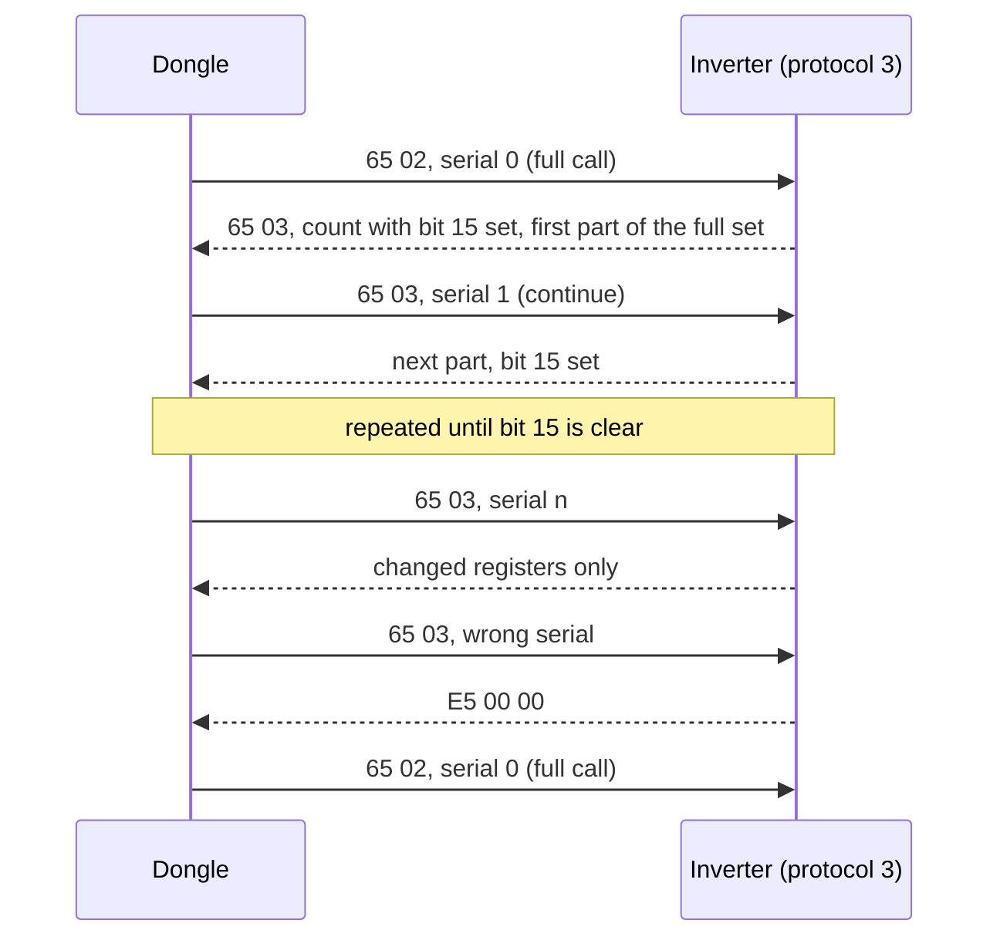

# Modbus function codes on the RS-485 bus

The RS-485 link between a dongle and its inverter is Modbus RTU, but it also carries several
Sungrow-private function codes. This page lists every code that appears, who sends it, who answers
it, and the frame layouts of the private ones. Polling is on [rs485-master.md](rs485-master.md);
how parameter writes choose a code is on [writes-and-meter-sync.md](writes-and-meter-sync.md).

> Register numbers are the 1-based numbers of Sungrow's published Modbus documentation. Frame fields
> named "wire start" carry that number minus 1. Multi-byte fields are big-endian except the CRC,
> which is CRC-16/Modbus sent low byte first.

## Summary

| Code | Name | Sent by | Answered by | Notes |
|---|---|---|---|---|
| 0x01, 0x02 | read coils / discrete inputs | supported by the dongle request builder | neither inverter (dropped, no reply) | |
| 0x03 | read holding registers | both dongles | both inverters | 1 to 125 registers |
| 0x04 | read input registers | both dongles | both inverters | 1 to 125 registers |
| 0x05 | write single coil | dongle builder (on request) | neither inverter | |
| 0x06 | write single register | both dongles | both inverters | |
| 0x0F | write multiple coils | supported by the dongle request builder | neither inverter | the dongles have no reply-length rule for it |
| 0x10 | write multiple registers | both dongles | both inverters | 1 to 123 registers from the dongle |
| 0x17 | read/write multiple registers | not sent by the dongles | SH10RS | [details](#0x17-readwrite-multiple-registers) |
| 0x20 | wrapped request | unknown | SH10RS only | [details](#0x20-wrapped-request) |
| 0x60 | dispatch list / batch write / batch read | both dongles, as a broadcast from Modbus-TCP unit 0 | both inverters | [details](#0x60-dispatch-list-and-batch-access) |
| 0x65 | change stream | both dongles, to protocol-3 inverters | SH10RS, SG5.0RS | [details](#0x65-change-stream) |
| 0x70, 0x73, 0x74 | optimizer block reads | WiNet-S2 only | inverter's optimizer module | [details](#0x70-to-0x7a-optimizer-network) |
| 0x71, 0x72 | optimizer parameter write / read | WiNet-S2 only | inverter's optimizer module | |
| 0x75 | optimizer topology apply | WiNet-S2 only | inverter's optimizer module | |
| 0x76 | private write multiple registers | WiNet-S2 | inverter (optimizer register window) | [details](#0x76-and-0x77-private-write-and-read) |
| 0x77 | private read registers | WiNet-S2 | inverter (optimizer register window) | |
| 0x79 | optimizer replace | WiNet-S2 only | inverter's optimizer module | |
| 0x7A | unknown | no sender | | reply length rule only |

### Reply lengths the dongle expects

The dongle ends a reply by length, never by line silence, so it needs a length rule per code. `b[n]` is
byte n of the reply (byte 0 = address) and `be16(a,b)` the big-endian value of bytes a and b.

| Reply function byte | Length including CRC | WiNet-S | WiNet-S2 |
|---|---|---|---|
| 0x01 to 0x04, 0x17, 0x77 | `b[2] + 5` | yes (not 0x77) | yes |
| 0x05, 0x06, 0x10 | 8 | yes | yes |
| 0x65 | `be16(3,4) + 7` | yes | yes |
| 0x70, 0x73, 0x74 | `be16(4,5) + 8` | no | yes |
| 0x72, 0x7A | `be16(6,7) + 10` | no | yes |
| 0x71, 0x76, 0x79 | 8 | no | yes |
| 0x75 | 6 | no | yes |
| 0x81 to 0x86, 0x90, 0x97 | 5 (standard exception) | yes | yes |
| 0xE5 | 6 | yes | yes |
| 0xF0 to 0xF3, 0xF9, 0xFA | 7 | no | yes |
| 0xF4, 0xF5 | 5 | no | yes |

A WiNet-S receives none of the optimizer codes. Any other code, 0x0F included, is discarded as a
length error.

## Standard codes 3, 4, 6 and 16

These carry all normal polling and parameter writes. The dongles cap reads at 125 registers (the
poller at 120) and multi-register writes at 123. Function 6 is used for single-register writes from
the web hex-write route and for forwarded Modbus-TCP function-6 writes; function 16 for the setup
pages, the cloud and every multi-register write.

Both inverters accept only a fixed set of function codes and drop every other code **silently**, with
no exception 01:

| Inverter | Accepted codes |
|---|---|
| SH10RS | 3, 4, 6, 0x10, 0x17, 0x20, 0x60, 0x65 |
| SG5.0RS | 3, 4, 6, 0x10, 0x60, 0x65 (0x17 passes the parser but has no handler) |

### Exception behaviour

| Condition | SH10RS | SG5.0RS |
|---|---|---|
| Unsupported function code | no reply | no reply |
| Read or write of more than 125 registers | no reply (the firmware-transfer window is exempt) | no reply (exempt while a firmware transfer is active) |
| Function 3 or 4 with a start address in no register window | exception 02, sent when the slave byte is the inverter's own address **or 0** | exception 02, same rule |
| Function 6 or 16 to an unmapped register | **no reply** | **exception 02** |
| Value out of range (clock fields, baud codes, slave address, search window) | exception 04 | exception 04 |
| Read of an unmapped register inside a battery window (slaves 200 to 204) | value 0xFFFF | no battery windows |
| Any request for a slave address the inverter does not serve | no reply | no reply (except on its encrypted service port) |

A broadcast read whose start lies outside every window therefore gets an exception reply, from every
inverter on the bus.

On the dongle side, an exception reply to a cyclic read is ignored without any effect
([rs485-master.md](rs485-master.md#round-based-polling)). For an on-demand read or write the dongle
keeps only the exception function byte (for example 0x83 or 0x90) and discards the exception code;
what each caller sees is on [writes-and-meter-sync.md](writes-and-meter-sync.md#replies-and-error-mapping).

## 0x65 change stream

The polling path for **protocol-3 inverters**, which includes the SH10RS and the SG5.0RS. Instead of
re-reading every register, the dongle asks for the registers that changed since they were last
reported. Both inverters register the function on their RS-485 slave ports (SH10RS USART2 and USART3;
SG5.0RS USART2 and USART3, plus its encrypted service port USART1) and share one stream context between
those ports, so only one master can use it at a time. The function answers only the inverter's own slave address, never a broadcast.

### Requests

| Field | Bytes | Full call | Continue |
|---|---|---|---|
| address | 1 | inverter address | inverter address |
| function | 1 | 0x65 | 0x65 |
| sub-code | 1 | 2 | 3 |
| length | 2 | 4 | 2 |
| serial | 2 | 0 | previous serial + 1, wrapping from 0xFFFF to 0 |
| reserved | 2 | 0 | (absent) |
| CRC | 2 | | |

A full call is 11 bytes (`01 65 02 00 04 00 00 00 00` + CRC for slave 1), a continue 9 bytes
(`01 65 03 00 02 00 01` + CRC for serial 1).

### Reply

| Field | Bytes | Meaning |
|---|---|---|
| address | 1 | echo |
| function | 1 | 0x65 |
| sub-code | 1 | always 3, also when answering a full call |
| length | 2 | frame length without CRC, minus 5 |
| serial | 2 | echo of the request serial |
| reserved | 2 | 0 |
| count | 2 | bits 0 to 14: number of segments; bit 15: more changed registers are pending |
| segments | repeated | `wire start (2 bytes), n (1 byte), n registers (2n bytes)` |
| CRC | 2 | |

A reply is at most 245 bytes before the CRC. When the changed set does not fit, bit 15 is set and the
rest goes out in later continue replies; no new change detection runs until that backlog is empty.
A segment covers consecutive registers and may bridge one unchanged register between two changed
ones (it then carries the last reported value). A 32-bit pair or a block is never split.

### Serial rules and errors

| Request | Inverter answer |
|---|---|
| full call (sub-code 2), any serial | full set; the serial is stored |
| continue whose serial differs from the stored one by exactly 1 (either direction, wrap included) | changed registers, possibly zero segments |
| continue with the same serial as the last one | **no reply** |
| continue with any other serial | error reply `addr E5 00 00` + CRC; stored serial unchanged |

The dongle answers an `E5` reply or any lost 0x65 frame by clearing its serial and sending a full call
next. It also sends a full call once an hour, and after every table walk. After a reboot the SH10RS
answers the first 0x65 request, even a continue, as a full call. The SG5.0RS starts with an empty context: a
first continue with serial 1 (or 0xFFFF) then returns every non-zero register, any other serial gets `E5`.

### Change detection

On every request, accepted or not, the inverter re-reads every tracked register through the same
internal path that serves function 4, so the stream never holds anything a function-4 read would not
return. Each tracked register has an entry in a fixed table: address, comparison type and deadband.

| Type | Compared as | A change is reported when |
|---|---|---|
| single register | unsigned 16-bit | the distance from the **last reported** value exceeds the deadband, or exactly one of the two values is 0 |
| 32-bit pair | signed 32-bit, low word first | same rule on the combined value |
| block | every word | any word differs |

Because the comparison is against the last reported value, a slow drift is reported once its total
distance exceeds the deadband, and the reported value then jumps by more than the deadband. A signed
16-bit register that crosses zero by a small amount is still reported (the unsigned difference is
large).

| Inverter | Tracked slots | Exact (deadband 0) | Other deadbands (raw units: slots) | Tracked ranges |
|---|---|---|---|---|
| SH10RS | 740 | 476 | 50: 104, 10: 82, 20: 40, 2: 34, 5: 3, 1: 1 | 5214–5387, 5448–5579, 5601–5642, 5659–5681, 5719–5829, 5920–6005, 6051–6099, 6950, 7816–7853, 7857, 7880–7889, 7893–7894, 8047–8048, 8150–8163, 8801–8845, 10451–10455, 10752–10756 |
| SG5.0RS | 667 | 414 | 1: 98, 10: 82, 20: 40, 2: 30, 50: 3 | 5214–5387, 5448–5579, 5601–5642, 5659–5681, 5720–5829, 5920–6005, 6051–6099, 6202–6203, 6950, 7816–7853, 7855–7856, 7924, 8152–8153, 8156–8160 |

The main difference is the 32-bit power values at 5214 to 5219 and 5232 to 5239: deadband 50 on the
SH10RS (so 50 W at 1 W per count), deadband 1 on the SG5.0RS. The dongle decodes only registers 5200
to 7999 from the stream; the tracked ranges above 8000 cost wire time and are discarded.

A full set takes 7 replies (22 segments, about 1640 bytes) on the SH10RS and 6 replies (19 segments,
about 1470 bytes) on the SG5.0RS, about 1.7 s of wire time at 9600 baud.

## 0x60 dispatch list and batch access

Function 0x60 is framed like function 16 with a **mode word** in place of the start address:
`address, 0x60, mode word (2), count (2), byte count (1), data, CRC`, with count 1 to 125 words and
byte count = 2 × count. Bits 0 and 1 of the mode word select the mode; the other bits are ignored.
The slave byte may be the inverter's own address or 0 (broadcast).

| Mode (`mode & 3`) | Function | Reply |
|---|---|---|
| 0 or 2 | dispatch list: per-inverter power commands | never |
| 1 | batch write of address/value pairs | yes, unless broadcast |
| 3 | batch read of addresses | yes, own address only |

**Dispatch list.** Payload word 0 is the record stride in words; records follow from word 1. Each
inverter applies the first record that carries its own slave id.

| Record byte | SH10RS (stride 3) | SG5.0RS (stride 2) |
|---|---|---|
| 0 | slave id | slave id |
| 1 | forced charge/discharge command 0xAA, 0xBB or 0xCC (other values ignored) | unused |
| 2 to 3 | active power limit ratio, 0.1 % (same cap as register 31205) | active power limit ratio (no cap and no lock check) |
| 4 to 5 | forced charge/discharge power | |

The values land in the same places as writes to 13051, 13052 and 31205; the ratio takes effect only
while the power-limit switch (31204) is on. A stride of 0 or a multiple of 256 makes the loop never
advance: on the SH10RS this stops the task that serves every slave port, the meter and the battery
link for about 15 s until the inverter's task monitor restarts it, and a broadcast does this to every
inverter on the bus.

**Batch write.** Payload words are pairs `wire address, value`. Each pair in the 30000 to 36000 window
(SG5.0RS: to 35999) goes through the normal holding-register write checks, one at a time; pairs
outside the window are skipped silently and count as success. Success reply:
`addr 60 <mode word> <count>` + CRC. If any write fails: `addr E0 <number of failures> <address>...`,
one address per failure and no exception code.

**Batch read.** Same pairs; only the address is used. Addresses 5200 to 12001 are read as input
registers (SG5.0RS: two narrower windows), 30000 to 36000 as holding registers, anything else or a
failed read returns 0xFFFF. The reply echoes the header and returns `address, value` pairs. With a
count of 125 the reply length overflows a byte and the inverter sends a 2-byte reply.

**On the dongles.** Neither dongle uses 0x60 in polling or parameter writes. A Modbus-TCP client that
sends function 0x60 to **unit 0** has it broadcast on RS-485 (and to the LAN Modbus-TCP client links),
with no reply to the client ([modbus-tcp.md](modbus-tcp.md)). The WiNet-S2 passes the client's mode
word through; the WiNet-S always sends mode 0. A function-0x60 request to any other unit produces no
RS-485 frame and ends in exception 4 after the server's timeout.

## 0x20 wrapped request

SH10RS only, on its two RS-485 slave ports (USART2 and USART3). The frame wraps an ordinary request without its own CRC:

| Field | Bytes | Value |
|---|---|---|
| outer address | 1 | the inverter's own address (broadcast is not served) |
| function | 1 | 0x20 |
| wrapper type | 1 | 0x01 (anything else: no reply) |
| inner request | variable | slave, function 3, 4, 6 or 16, then the normal fields, no CRC |
| CRC | 2 | over the whole outer frame |

The inner request goes through the normal handler and the reply comes back as
`addr 20 01 <inner reply>` + CRC, including inner exceptions. For a battery-controller register that
the inverter tunnels over CAN (19101 to 20000), the delayed answer is wrapped the same way when it
arrives. Errors in the outer part give no reply. Neither dongle sends this function and neither
accepts it on Modbus-TCP; the sender it was made for is unknown.

## 0x17 read/write multiple registers

Standard Modbus function 23. The SH10RS registers it on all its slave ports; the SG5.0RS parser lets it
through but has no handler. Both dongles know its reply length and exception form (0x97), but no
dongle builder produces it. Inside the inverters the same function code is used on the internal link
between the control processor and the power-stage DSP.

## 0x70 to 0x7A optimizer network

WiNet-S2 only. These frames are addressed to the **inverter's** slave address; the inverter passes
frames with these codes to its optimizer communication module and relays the answer. No optimizer
address appears on the RS-485 bus. Frame layouts and the polling sequence are on
[../devices/optimizers-and-mlpe.md](../devices/optimizers-and-mlpe.md).

| Code | Use |
|---|---|
| 0x74 | string list: number of strings, and per string its id and optimizer count |
| 0x70 | per-string run data, polled every pass once optimizers are present |
| 0x73 | per-string serial-number list, once an hour |
| 0x75 | apply a string and optimizer topology (11 optimizers per frame) |
| 0x71 / 0x72 | optimizer parameter write / read (cloud commands) |
| 0x79 | optimizer replace |
| 0x7A | reply length rule only; no sender |

Request for 0x70, 0x73, 0x74 (10 bytes): `addr, code, string id, 0, total packets, packet number, 0, 0,
CRC`. The reply is multi-packet: `addr, code, total packets, packet number, data length (2), data,
CRC`. The WiNet-S2 sends 0x70 and 0x73 up to 10 times in total on a timeout or bad reply; every other
code, apart from the 0x77 read at 14701, is sent once.

## 0x76 and 0x77 private write and read

Clones of function 16 and function 3 with a different function byte:

| Code | Request | Reply |
|---|---|---|
| 0x77 read | `addr 77 <wire start> <count> CRC` | `addr 77 <byte count> <data> CRC` |
| 0x76 write | `addr 76 <wire start> <count> <byte count> <data> CRC` | 8-byte echo of start and count |

They reach the inverter's optimizer register window (14503 to 14725). The WiNet-S2 uses them:

- **On request**, for the parameter paths that select the private codes: a cloud `getparam` or
  `setparam` with `mode` 1, a web raw read whose `param_type` is neither 0 nor 1, and a web
  `setParam` with `param_type` 2, which the web UI sends only on the optimizer pages
  ([writes-and-meter-sync.md](writes-and-meter-sync.md)).
- **Cyclically**, once input register 6002 reports optimizers: the optimizer rows of the poll table
  (14503 to 14701), plus a fixed read of 14573 × 22; 14574 × 3 and 14586 × 5 are polled while an
  optimizer disconnect detection or auto-search runs.
- **As commands**: 0x55 to 14510 or 14518 stops an optimizer search; 0xA000 to 14550 after a failed
  auto-search.

A function-0x77 read starting at 14701 (frame prefix `77 39 6C`) is the one non-optimizer frame the
WiNet-S2 sends up to 10 times in total. The WiNet-S has no builder for either code.

## Not yet known

- Who sends function 0x20, and which plant controllers send function 0x60 through a dongle.
- The value of the SH10RS ratio cap used by the 0x60 dispatch list (published as input register 5480).
- The field meanings inside the optimizer run-data and parameter records.
