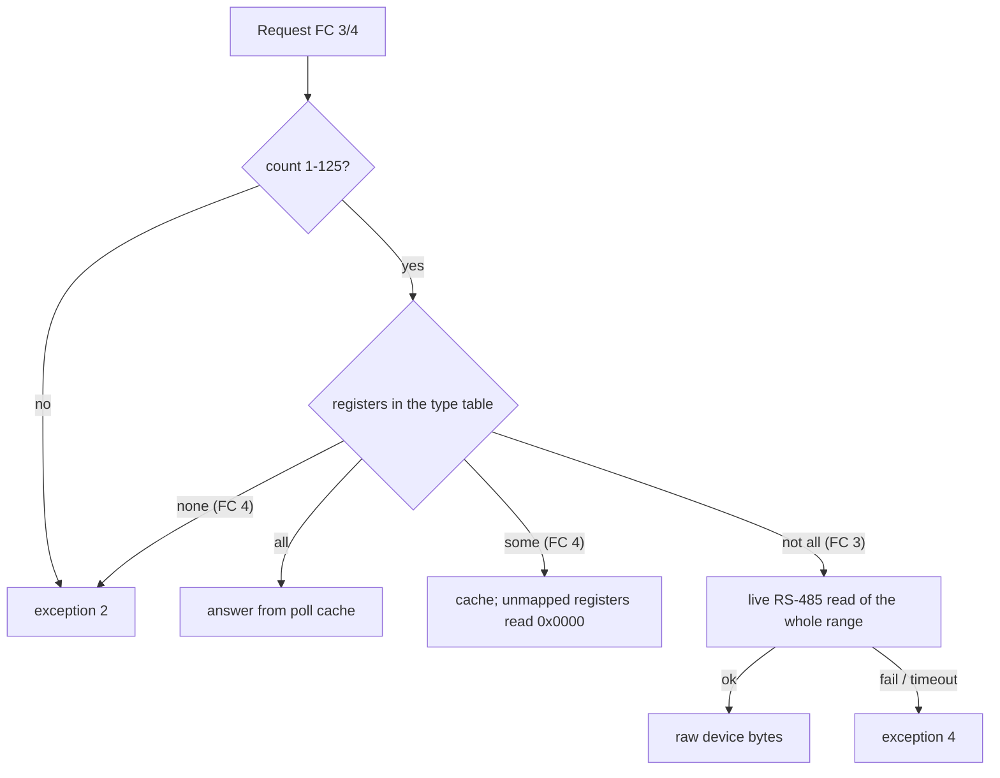

# Modbus TCP server

Both dongles run a Modbus-TCP slave towards the LAN. It answers for every device the dongle knows (inverters,
meters, batteries) and for the dongle itself, mostly from the dongle's poll cache rather than from the bus. The same
engine also serves the dongle's outbound Modbus-TCP client links and, in a special mode, the RS-485 port. This page
describes WiNet-S2 SV300 P032 and WiNet-S V200 P046; they behave the same unless marked.

Register addresses on this page are the 1-based numbers of Sungrow's published Modbus documentation. The address in a
Modbus frame (the "wire" address) is one less: a request for wire 4999 reads documented register 5000.

Per-device register maps are generated tables in the appendix:
[string inverter](../appendix/register-tables/modbus-tcp-string-inverter.md),
[hybrid inverter](../appendix/register-tables/modbus-tcp-hybrid-inverter.md),
[meter](../appendix/register-tables/modbus-tcp-meter.md) and
[battery](../appendix/register-tables/modbus-tcp-battery.md).

## Summary

- Up to **15 listeners** on ports **502–516**. Factory default: plain **502 on** and **TLS 516 on**, the other 13 off.
- TLS is possible only on 502 and 516, uses a server certificate shared by every dongle, and never asks for a client
  certificate.
- One source-IP **allow-list** (exact addresses, up to 5, empty = everyone) is the only access control. There is no
  Modbus-level authentication and no write check.
- **Unit id = the dongle's device id**, not the RS-485 address. Unit **247** is the dongle itself.
- Function codes **3, 4** (1–125 registers), **5, 6, 16** and the private **0x60**. Anything else gets no answer
  until an **exception 4 after about 9 s**.
- Reads come from the **poll cache**; read-holding requests that touch an unmapped address are forwarded **live** to
  the device.

## Listeners

| Link name | Port | Default | TLS possible |
|---|---|---|---|
| `mb_tcp_svr1` | 502 | on, plain | yes (switch "SSL encryption" in the web forwarding page) |
| `mb_tcp_svr2` … `mb_tcp_svr14` | 503 … 515 | off | no, always plain |
| `mb_tcp_svr15` | 516 | on, **TLS** | yes; the TLS flag is also published in the dongle's mDNS record ([Local services](local-services.md)) |

The listeners are switched from the web forwarding page (`/transmit/list`, `/transmit/update`, see
[Web API](web-api.md#http-routes)); toggling TLS closes and re-opens the listener. At boot the dongle sets 502
from the inverter's region code, but only while neither the user nor the setup wizard has touched the switch: region
codes 6, 99 and 114–117 enable it, any other region disables it. The other 14 listeners are not affected by the region.

The same configuration surface shows IEC 60870-5-104 servers on ports 2404–2418; the dongle never listens on them
([Regional and legacy features](regional-and-legacy-features.md)).

### Outbound client links

Besides the listeners the dongle can open up to **five** outbound Modbus-TCP connections (`mb_tcp_cli1` …
`mb_tcp_cli5`) to configured hosts. Requests that arrive on such a link are answered by the same engine as a
listener connection. A new listener connection is refused while the dongle's link table, which also holds these
client links, has 4 or more entries.

### Allow-list

| Item | Behaviour |
|---|---|
| Configuration | `/transmit/getWhiteList` / `setWhiteList` with `white_enable` and `white_ip1` … `white_ip5` |
| Scope | one list, applied to every Modbus-TCP listener together |
| Match | the peer's dotted-quad text compared byte for byte with each entry; **exact addresses only**, no masks or ranges. `0.0.0.0` entries are ignored |
| Empty or disabled | every peer allowed |
| Refused peer | the socket is closed right after `accept`, before any TLS bytes |
| Change at runtime | connected clients that are not on a new, non-empty list are disconnected |

### TLS on 502 and 516

| Item | Behaviour |
|---|---|
| Protocol | TLS 1.2 (no 1.3 suites in the build); ECDHE-RSA and static-RSA AES / ARIA suites |
| Client authentication | none; TLS only protects against passive eavesdropping |
| Certificate | a built-in server certificate whose issuer is not on the device, so clients must skip verification or pin it. If either file is missing the dongle rewrites the built-in default pair, which is **identical on every WiNet-S and WiNet-S2**; its private key is recoverable from the public firmware |
| Replacement | `POST /system/importCert` with `cert_type: 2` ([Web API](web-api.md#http-routes)). The files are re-read on every connection, so a new pair applies from the next connection |
| Handshake | runs inside the accept loop with 5 ms retries for up to about 5 s; a slow TLS client delays accepts on every other listener meanwhile |
| After the handshake | ordinary MBAP frames inside TLS records, with all the rules below |
| Fragility | a TLS record that is not complete when the socket becomes readable closes the connection |

## Connections and framing

| Item | Behaviour |
|---|---|
| Clients | at most **3** at once across all Modbus-TCP listeners, and only while the link table has fewer than 4 links. A refused client sees an immediate close |
| Idle close | a connection with no traffic is closed after about **67 s** |
| Reconnect | a closed link is freed only on a 2.1 s housekeeping pass; reconnecting immediately can be reset, about 1 s spacing works |
| Protocol id / transaction id | not checked / echoed |
| Several frames in one TCP segment | **only the last** is processed; the earlier ones get no answer |
| Frame split across segments | discarded |
| Pending requests | 25 request contexts in total, at most 5 per connection; extra requests are dropped without an answer |
| Reply size | at most 255 data bytes |

Clients should send one request, wait for its answer, then send the next.

## Function codes

| FC | Handling |
|---|---|
| 0x03 read holding | 1–125 registers; cache or live (see [Register space](#register-space)). More than 125 → exception 2 |
| 0x04 read input | 1–125 registers; cache only. Count 0 or more than 125 → exception 2 at once |
| 0x05 write coil | treated as a one-register write of the two value bytes (so 0xFF00 is written as a register value). The reply echoes no address |
| 0x06 write single | one-register write |
| 0x10 write multiple | byte count must equal 2 × count, otherwise no answer until the timeout |
| 0x60 (private) | write-multiple variant with an extra 16-bit word before the count, which the inverter uses as a mode word ([Modbus function codes](modbus-function-codes.md)). Parsed and handed to the device write path. For unit 0 it is broadcast on RS-485 as a complete 0x60 frame (the WiNet-S always with mode 0); for any other unit no frame is built. The client never gets a reply |
| 1, 2, 7, 0x0F, 0x11, 0x17, 0x2B, others | no immediate answer; the request context stays open and ends in **exception 4 after 5–10 s, typically about 9 s** |

Write replies are rebuilt from the request, not copied from the device. A write at wire address 0 is acknowledged
without its address field.

## Unit ids

| Unit | Meaning |
|---|---|
| 1 … n | a device by its **device id** in the dongle's device list. The web device list shows it as "Forwarding Modbus ID" (`logc_addr`). On a hybrid site (SH10RS with two SBR192 stacks) the inverter is unit 1 and the battery stacks are units 2 and 3, although the stacks answer the inverter on RS-485 addresses 200 and 201 |
| 247 (0xF7) | the dongle itself ([Logger registers](#logger-registers-on-unit-247)) |
| 0 | the virtual plant device: plant-level values are applied by the dongle, other writes and function 0x60 are broadcast on RS-485 with no reply to the client |
| unknown | **no reply at all**; the connection stays open |

**Unit swap option.** A dongle configuration parameter (default off) swaps unit 1 and unit 247: when it is on, a
request to unit 1 reaches the dongle itself and device ids start at 2. Replies are mapped back to unit 1, so a request
to unit 247 itself then times out.

A hybrid inverter's map also contains input registers **65000–65003**, which the dongle fills with the unit ids of
up to four batteries, so a client can find the battery units.

## Register space

The served address space is the standard Sungrow map, backed by the values the dongle polls over RS-485
([RS-485 master](rs485-master.md)). Each device type has a fixed table:

| Device type | Table | Appendix |
|---|---|---|
| 1 string inverter, 21 residential inverter (SG5.0RS) | 498 entries | [string inverter](../appendix/register-tables/modbus-tcp-string-inverter.md) |
| 35 residential hybrid inverter (SH10RS) | 279 entries | [hybrid inverter](../appendix/register-tables/modbus-tcp-hybrid-inverter.md) |
| 18 meter | 34 entries | [meter](../appendix/register-tables/modbus-tcp-meter.md) |
| 44 battery (SBR192 stack) | 34 input entries: 5448 (25 registers), 10628–10633, 10700–10751, 13065–13079, 19939 | [battery](../appendix/register-tables/modbus-tcp-battery.md) |

Other device types use their RS-485 poll table directly; a device with no poll table has no Modbus-TCP map at all.
A table entry matches on its exact start address and function code, so read-holding and read-input see different
entries. Some areas of the inverter map are filled by the dongle itself, not read from the inverter: the
device-information block from 2515 and the dongle's own package-version string.

| Resolved registers | FC 4 | FC 3 |
|---|---|---|
| all | cache | cache |
| some | cache, unmapped registers read 0x0000 | **live read** of the whole range |
| none | exception 2 | **live read** of the whole range |

- Cache answers return the value of the last poll cycle, not a fresh read. 32-bit values are sent **low word first**,
  matching the inverter's own register order.
- A live read uses the same on-demand path as `/device/getParam`; the inverter's own exception code is lost and
  any failure becomes exception 4. FC 3 with count 0 gets no answer until the timeout.
- Battery registers outside the type 44 table could be reached only with live FC 3 reads on the battery's unit (not yet confirmed).

### Writes

| Unit | Route |
|---|---|
| a device | forwarded unchanged to the device over RS-485 (FC 5/6/16) |
| 247 | the dongle's own registers (below); never reaches RS-485 |

There is **no allow-list, range check or authentication** on the write path: any client that passes the IP
allow-list can write any holding register of any device. Success returns the normal echo; any failure returns
exception 4. For how writes reach the inverter and interact with the meter loop see
[Writes and meter sync](writes-and-meter-sync.md).

## Logger registers on unit 247

> **Warning.** Any write to register **39098** on unit 247 (wire address 39097, 0x98B9), whatever the value,
> **factory-resets and reboots the dongle**: the client gets a normal write reply, export limitation is switched off
> on the first inverter, all user settings are wiped, the cloud link is closed and the dongle restarts 3 s later.
> Never write it on a dongle in use. On the WiNet-S another register (39303) makes the dongle **stream its system
> log in plain text** to any host and port the writer chooses.

Unit 247 exposes about 300 registers of the dongle's own configuration (308 on the WiNet-S2, 304 on the WiNet-S;
about 250 holding, 54 input). Holding registers are readable and writable with FC 3 / 16; input registers are
read-only. Most are plain configuration values stored as written. A few have special handling:

| Register | Registers | Effect of a write |
|---:|---:|---|
| 8021 | 1 | **cloud switch**: 0x00AA enables, 0x0055 disables the iSolarCloud MQTT link |
| 8022 | 1 | **local web login**: 0x0055 logs out every web session and refuses all logins (code 119); 0x00AA allows them. Not kept across a reboot |
| 39033 | 6 | **set clock**: year, month, day, hour, minute, second. Applied only when the time source (39099) is 4; the default source is 3. A read returns the current clock (read exactly these 6 registers) |
| 39043 | 10 | Wi-Fi test target host (text, up to 20 bytes) |
| 39053 | 1 | **Wi-Fi test**: 0x00AA closes SmartConfig, joins the test SSID and password, then pings the test host; results go to the dongle log. Blocks the Modbus task for 30 s or more |
| 39054 | 1 | **UART test**: 0x00AA sends an FC 4 read of register 5000 to slave 1 on RS-485 and logs pass or fail |
| 39070 | 15 | Wi-Fi test SSID (up to 32 bytes) |
| 39085 | 10 | Wi-Fi test password (up to 64 bytes) |
| 39095 | 3 | **set MAC** (6 bytes). WiNet-S2: becomes the Ethernet MAC at the next boot. WiNet-S: changes only the displayed MAC text |
| **39098** | 1 | **factory reset and reboot**, any value (see the warning) |
| 39100 | 1 | **factory mode**: 0x00AA creates a factory-mode marker, drops the cloud link and reboots about 5 s later; after that boot the dongle **does not poll RS-485** until the marker is removed (another value here, or a factory reset). Reads 0x00AA when set, 0x0055 otherwise |
| 39199 | 1 | LED self-test: 1 all LEDs on briefly, 0 all off |
| 39200 | 1 | button latch: set after a long press, cleared by a write |
| 39300 | 2 | debug read: prints any internal data point of any device to the dongle log; nothing comes back in Modbus |
| 39302 | 1 | **log level**: high byte module id, low byte level (both ≤ 0x40) |
| 39303 | 3 | **WiNet-S only: start the plain-text remote log stream** to an IPv4 address (2 registers) and port ([Diagnostics](diagnostics-and-log-export.md)) |
| 39307 | 1 | WiNet-S only: 0x00AA starts, 0x0055 stops a task-statistics printer in the log |

Other notable plain registers: **33106** (10 registers) the dongle serial number, 11–19 characters, which is the
dongle's cloud identity and also renames its hotspot; **39099** the time source; **39101** (32 registers) and
**39133** the cloud broker host and port; probably **39149** and **39165** the Wi-Fi station SSID and password;
**39039** a factory-mode flag. A write to any of them takes effect with no further check.

Special registers must be written with exactly their register count, and read alone with exactly their own length;
the special readers serve the whole request, so a longer or combined read fails with exception 2. A special write
also ends the request, so later registers in the same write are dropped.

Reachability: every enabled listener (502 by default, also TLS 516), the outbound client links and the RS-485 port
in RTU-slave mode. Anyone who passes the allow-list can reset, re-identify, lock out or re-point the dongle. See
[Security and privacy](../../guide/09-security-and-privacy.md).

## RTU-slave gateway mode

An installer can switch the dongle's only RS-485 port from Modbus **master** to Modbus-RTU **slave** ("Modbus RTU
forwarding", the RTU tab of the forwarding page, link `mb_rtu` with fields `trans_comid` and `trans_time`). An
external master (SCADA, EMS) can then query the same engine over RS-485: same function codes, unit ids, register
tables and unit-247 registers.

- It replaces polling: the dongle stops reading the inverters, refuses every live read or write (web, cloud,
  Modbus-TCP), and the cache is no longer refreshed. Only cached values and unit 247 can be served.
- A request is handed on only after about 500 ms of line silence; any other traffic within that window corrupts
  the frame, so it works only point-to-point with one slow master.
- A reply delay above 0 makes the dongle stop answering.
- After a reboot the port stays reserved but slave mode is normally not restarted; the slot has to be set to off and
  back on.

## Timing

| Item | Value |
|---|---|
| Request timeout (unknown FC, lost reply, bad FC 16 length) | 5–10 s depending on load, typically about 9 s, then exception 4 |
| RS-485 answer timeout on live reads and writes | 2 s for inverters, no retry |
| Idle connection close | about 67 s |
| TLS handshake limit | about 5 s |

## Errors

| Case | Answer |
|---|---|
| count above 125, FC 4 with nothing mapped, FC 4 count 0 | exception 2 at once |
| live read fails or times out, any write fails | exception 4 |
| unknown function code, malformed FC 16, FC 3 count 0 | exception 4 after the timeout |
| unknown unit | no reply |
| earlier frames of a multi-frame segment, split frames, more than 5 pending | no reply |
| special unit-247 reader fails | exception 2 |

## WiNet-S and WiNet-S2

| Item | WiNet-S2 | WiNet-S |
|---|---|---|
| Listeners, TLS, region rule, unit ids, register tables | same | same |
| Unit-247 special registers | 15 | 17 (adds the remote log stream 39303 and the statistics printer 39307) |
| Unit-247 table size | 308 | 304 |
| Effect of the MAC register | Ethernet MAC at next boot | display text only |

## Not yet known

- Whether batteries answer FC 4 reads in their table and live FC 3 reads on their own units.
- Which Sungrow client the default TLS listener on 516 is meant for.
- The exact purpose of function code 0x60 from the LAN side.
