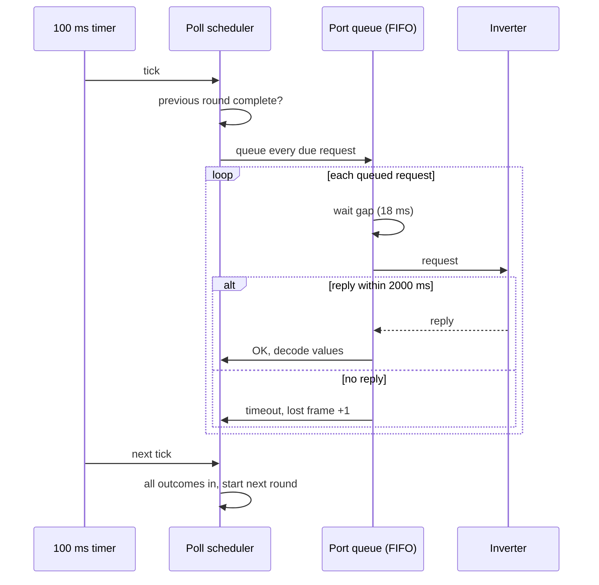

# RS-485 Modbus master

Both dongles are the only master on their RS-485 field bus. They poll the inverter, any battery stacks
the inverter serves, and meters or other Modbus devices attached directly to the bus. This page covers
the line, frame handling, the poll scheduler and how fresh the polled values really are. Device search
is on [device-discovery.md](device-discovery.md), the non-standard function codes on
[modbus-function-codes.md](modbus-function-codes.md), and writes on
[writes-and-meter-sync.md](writes-and-meter-sync.md).

> Register numbers on this page are the 1-based numbers of Sungrow's published Modbus documentation.
> The wire address in a frame is that number minus 1. Hex frame dumps show wire addresses.

## Line and transceiver

| Item | WiNet-S | WiNet-S2 |
|---|---|---|
| UART | one field-bus UART, opened once at boot | same |
| TX / RX / DE pins | GPIO 13 / GPIO 35 / GPIO 12 | GPIO 18 / GPIO 17 / GPIO 8 |
| Default line | 9600 baud, 8 data bits, no parity, 1 stop bit | same |
| Direction control | half-duplex RS-485 mode of the UART: DE is the UART's RTS output, driven by hardware | same |
| Longest frame accepted | 1029 bytes | same |
| Supported baud codes | 0 = 1200, 1 = 2400, 2 = 4800, 3 = 9600, 4 = 19200, 5 = 38400, 6 = 57600, 7 = 115200 (anything else = 9600) | same |

There is no software DE toggle and no turnaround delay in firmware. When transmission ends the UART
clears its receive FIFO before releasing DE, so any local echo is discarded. A runtime rate change
touches only baud, parity and stop bits; the data width stays at 8 bits. When and why the rate
changes is described in [device-discovery.md](device-discovery.md#baud-switch-to-115200).

At 9600 baud one character takes 1.042 ms. An 8-byte read request takes 8.3 ms on the wire; a reply of
n registers is 5 + 2n bytes, so a 120-register reply (245 bytes) takes about 255 ms.

## Frame assembly

The receive side is not a plain Modbus parser. One assembler handles Modbus RTU, the Sungrow private
function codes and DL/T 645 meter framing, with a separate assembler for YMODEM packets during
inverter log export ([diagnostics-and-log-export.md](diagnostics-and-log-export.md)).

- **End of frame is decided only by expected length.** After the first bytes arrive, the function code
  selects a length rule (for example `byte_count + 5` for function 3 and 4 replies, 8 for a function 6
  or 16 echo, 5 for an exception). The frame is complete when exactly that many bytes have arrived.
- **There is no inter-character timer.** The dongle does not use the Modbus t1.5 or t3.5 silence
  intervals at all. If more bytes arrive than the length rule expects, the frame never completes and
  the transaction ends by timeout. The inverters on the other side do use a silence timer to end a
  request: 4 ms on the SH10RS and 3 ms on the SG5.0RS at 9600 baud.
- **An unknown function code** in a reply wipes the buffer; the wait continues until the timeout.
- **CRC.** CRC-16/Modbus (initial value 0xFFFF, polynomial 0xA001, low byte first). It is checked
  after assembly, not during it. A frame with a bad CRC counts as a lost frame and is discarded.
- **Echo check.** The reply's address must equal the request's, and its function byte must equal the
  request's function or that code plus 0x80. A mismatch completes the request with an error. A late
  reply to an earlier request therefore ends the current transaction with an error instead of being
  skipped.
- **Which codes are accepted.** The WiNet-S accepts replies with function codes 1 to 6, 16, 0x17, 0x65
  and their exception forms. The WiNet-S2 additionally accepts the optimizer codes 0x70 to 0x77, 0x79 and
  0x7A and their exception forms (see [modbus-function-codes.md](modbus-function-codes.md)). Function 15 (0x0F)
  has no length rule on either dongle, so its reply would never be accepted.

DL/T 645 frames (0x68 start byte, optional 0xFE preamble) are recognised by the assembler, but no part
of the firmware builds a DL/T 645 request, so DL/T 645 meters cannot be used
([../devices/meters.md](../devices/meters.md)).

## Request handling

Each port has one FIFO request queue (plus a priority queue for on-demand reads
and writes, served first; see [writes-and-meter-sync.md](writes-and-meter-sync.md#queueing-and-gating)).
All devices on a port share the queue, so they are serialised by it; there is no other arbiter. For
each request the task:

1. Waits the device's frame gap.
2. Transmits the request.
3. Waits up to the device's response timeout, counted from the end of the transmit call (so it
   covers the request's wire time, the slave's latency and the reply).
4. Reports the outcome to the device layer: OK, send or reply error, or timeout.

| Parameter | Inverter | Battery stack, EV charger, Energy Bridge | Meter and other bus devices |
|---|---|---|---|
| Gap before each request | 18 ms | probably 18 ms | 1 ms |
| Response timeout | 2000 ms | 2000 ms | probably 2000 ms |
| Retransmissions | none | none | none |
| Consecutive lost frames to go offline | 10 | 10 | 20 |
| Word order of 32-bit values | low word first | low word first | low word first for the built-in meter tables; per template otherwise |

A Modbus request is sent exactly once. A timeout, a CRC error, a send error or an echo mismatch counts
one lost frame; any valid reply clears the count. Ten consecutive lost frames mark the device
offline: its link state is cleared, values marked "clear on offline" are blanked (the rest keep their
last value), and the device enters rescan. While a meter is offline the dongle probes it with one
request every 100 s.

The only frames the WiNet-S2 sends more than once are the optimizer frames 0x70 and 0x73 and one
function-0x77 read (register 14701): up to 10 transmissions in total. The WiNet-S re-sends nothing.

## Poll tables and the request list

Each device family has a fixed poll table. A row names a register, its length, the function code (3 or
4; 1 and 2 are possible), a poll class, a data type and an optional capability dependency. Register
maps are in [../appendix/register-tables/rs485-inverters.md](../appendix/register-tables/rs485-inverters.md).

When a device is created, its table is turned into a list of requests:

- Adjacent rows with the same function code are merged into one request, **even when their poll
  classes differ**. The request takes the poll class of its first row.
- A request is split before its span would exceed **120 registers** (the slave limit is 125).
- A row flag can end a request after that row. A row whose address is lower than the current request
  start begins a new request.
- At most **59 requests** per device.
- Function 16 rows are never polled cyclically. Function 0x77 rows are polled only by a WiNet-S2
  whose inverter reports optimizers ([../devices/optimizers-and-mlpe.md](../devices/optimizers-and-mlpe.md)).

| Table | Requests | Notes |
|---|---|---|
| Protocol 1 / 4 inverters | 18 | public register map |
| Protocol 2 inverters | 54 | one request at 30051 × 65 takes the 1 h class from its first row and absorbs a 60 s row |
| Protocol 3 inverters (SH10RS, SG5.0RS) | 53 | 2838 registers; 29 requests (2093 registers) poll every pass |
| SBR battery stack | 6 | served by the hybrid inverter at addresses 200 to 204 |

### Poll classes

The poll class is a period in 100 ms units.

| Class value | Period | Typical content |
|---|---|---|
| 1 | every pass | live measurements |
| 20 | 2 s | |
| 30 | 3 s | |
| 300 | 30 s | |
| 600 | 60 s | status and slow values |
| 12032 | about 20 min | inverter clock (5000 to 5005) |
| 36000 | 1 h | identity, versions, ratings, settings |

A request is due when the time since it was last queued is at least its class period. The effective
period is therefore never shorter than one pass. Meters ignore the class: every meter request is sent
on every pass.

### Capability gating

Protocol 2 and protocol 3 inverters describe their own feature set in a **capability bitmap**: the
60-register block at **5520 to 5579**, read like any other row. A table row can depend on one bit of
it, named as word w (1 to 60) and bit b (0 to 15):

- word w is register 5520 + w − 1, taken as a big-endian 16-bit value; bit 0 is the least significant;
- a row with w = 0 always passes; w above 60 or b above 15 always fails;
- when the bitmap has not been read, every bit counts as clear, so every dependent row is absent;
- a row that fails the check is cleared, not decoded.

Protocol 1 and 4 tables have no gating.

## Round-based polling

Polling runs in rounds, driven per device from a 100 ms timer.

1. A round can start only when the device is idle and every request of the previous round has been
   answered or has timed out. A parameter read or write in progress also holds the next round back.
2. The scheduler walks the request list and queues **every due request at once**. A request is also
   due, regardless of its class, while no complete round has finished yet, during the first **120 s**
   after the device starts, and while a forced refresh is pending.
3. The port queue sends them back to back, each preceded by its gap.
4. Every outcome (reply, exception or timeout) counts toward completing the round. When the last one
   is in, the next round starts on the next 100 ms tick. There is no fixed cycle period.
5. A watchdog of 40 s per device on the port restarts a round that never completes.

The first complete round also releases uploads to the cloud. A Modbus exception reply to a cyclic
request is ignored silently: no decode, no invalidation, no lost-frame count, and the request is tried
again at its normal period. (One special case: on protocol 1 and 4 tables an exception to a read that
starts at 8099 clears the two values that read carries.)

### Protocol-3 inverters: change stream instead of table polling

The SH10RS and the SG5.0RS are protocol-3 inverters. For them the table walk above runs only before
the first complete round, during the 120 s start-up window and on a forced refresh. In steady state each
round sends **one function-0x65 frame** instead, and the inverter answers with only the registers that
moved beyond a per-register deadband. The frame layouts are in
[modbus-function-codes.md](modbus-function-codes.md#0x65-change-stream).

| Situation | What the round sends |
|---|---|
| no complete round yet, forced refresh, or 120 s window open | table walk |
| first round after a table walk, hourly re-sync, after a lost 0x65 frame or an `E5` error reply | 0x65 full call (sub-code 2, serial 0) |
| otherwise | 0x65 continue (sub-code 3, serial = previous + 1) |

While a full set is still arriving (the "more pending" bit is set in the reply), the dongle holds a
lock on the port, and other protocol-3 devices on that port skip their rounds; it does not decode the
partly filled image. The dongle decodes only the stream cells for registers 5200 to 7999 (the WiNet-S image is
smaller, 1800 registers); cells outside that window are discarded. Rows outside it, including every
function-3 setting row, the 4950 to 5044 block and everything from 8000 up, are refreshed only by the
start-up and rescan table walks.

Battery stacks behind a protocol-3 inverter are polled one request per round, cycling through the six
stack requests, so each stack is refreshed about every 2.5 to 5 s.

## How fresh the values are

| Phase | Refresh |
|---|---|
| Start-up, rescan, forced refresh | A full SH10RS table pass is 53 requests: about 6.6 s on the wire plus 53 × 18 ms of gaps plus the inverter's turnaround, about 8.5 to 10 s. Each battery stack adds about 0.7 s. In total about **10 to 13 s per pass** |
| Steady state, protocol 3 | One 0x65 continue per round, about 0.4 to 0.8 s per round. A value reaches the dongle only when it has moved by more than its deadband from the last value reported (up to 50 raw units on the SH10RS, for example 50 W), or to or from 0. Values that stay inside their band are not refreshed |
| Steady state, protocols 1, 2, 4 | Every pass for class-1 rows; on protocol 2 a pass of about 30 requests (about 3300 registers) takes 5 to 10 s at 9600 baud; protocol 1 and 4 passes are shorter |
| Settings and rows outside 5200 to 7999 on protocol 3 | only at start-up, rescan and forced refresh |

The web API's live-data services and the Modbus-TCP server answer from the dongle's cached values;
only a function-3 read of an unmapped register is forwarded to the bus
([modbus-tcp.md](modbus-tcp.md)). Cloud run-data is sent from the same cache, every 5 minutes by
default ([cloud-messages.md](cloud-messages.md)). A client polling the web API every few seconds
therefore often sees identical values twice: either a slow start-up pass, or a deadbanded value that
did not move far enough. The inverter's own refresh sets a further floor; see
[../devices/sh10rs/architecture.md](../devices/sh10rs/architecture.md).

## Other users of the port

- **Device search** takes the port over completely while it runs (raw mode, normal poller paused;
  [device-discovery.md](device-discovery.md)).
- **Modbus RTU forwarding.** When an installer enables it in the web UI, normal polling stops and the
  dongle acts as an RTU slave gateway on the port instead ([local-services.md](local-services.md)).
- **Firmware relay and log export** switch the port temporarily to 115200 and use YMODEM or the
  firmware-transfer window ([../firmware-update/device-firmware-relay.md](../firmware-update/device-firmware-relay.md)).

## Clock synchronisation

The dongle has one clock authority at a time, chosen by a **time source** setting:

| Value | Source | Accepted writer |
|---|---|---|
| 0 | manual ("User define" in the web UI) | web clock form |
| 1, 7 | SNTP (1 in the Japanese dispatch variant) | NTP client |
| 3 | iSolarCloud (factory default) | cloud `settime` and `settimezone` commands |
| 4 | Modbus-TCP | logger unit 247, register 39033 to 39038 |

Every successful clock set ends the same way: the time is validated (years 1971 to 2069), set in the
configured zone, then pushed to the devices.

| Target | Frame | When |
|---|---|---|
| Inverters | **broadcast** (slave 0) function 16 of 6 registers at **5000 to 5005**: year, month, day, hour, minute, second | once after each clock set by cloud, web or Modbus-TCP (and after an NTP sync that follows a web edit of the NTP fields); then hourly while the web option "Inverter time synchronization" is on. That option is **off by default**, so with factory settings the inverters are set only after a cloud `settime` |
| WiMeter, WiProxy | function 16 of 6 registers at 19195 to the accessory's address | after each clock set and with every inverter broadcast ([../devices/wimeter-and-wiproxy.md](../devices/wimeter-and-wiproxy.md)) |
| Solar tracker | function 16 of 6 registers at 29013 | from the generic device timer |

The time written is local time in the zone configured on the dongle, given as `UTC+hh:mm` with **no
daylight saving**. Both the SH10RS and the SG5.0RS accept the broadcast, range-check the six values
(year 2000 to 2099, others by calendar; exception 04 when out of range), write their RTC chip and
read it back. The broadcast has no reply. The SH10RS passes its clock on to the SBR battery control
units ([../devices/sbr192/can-bus.md](../devices/sbr192/can-bus.md)).

In the other direction the dongle reads the inverter clock (5000 to 5005) and adopts it as its own
when its own clock is invalid and no network source has set it since boot.
