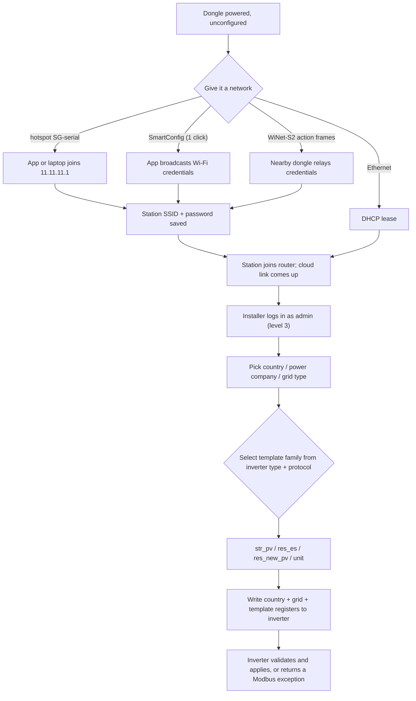

# Setup and provisioning

This page covers how a WiNet-S or WiNet-S2 dongle is first given its network
settings, how an installer authenticates, how installer parameter writes are
validated, and how the dongle picks the per-region settings template it uses to
configure an inverter's country and grid code.

"The dongle" means either model; differences are called out.

> Modbus addresses on this page use the 1-based numbering of Sungrow's published
> Modbus documentation (wire address = doc address − 1).

## Getting the dongle onto a network

The dongle runs Wi-Fi in access-point-plus-station mode: it hosts its own hotspot
*and* can join the customer's router at the same time. A WiNet-S2 also has a wired
Ethernet port; the WiNet-S has one too (through its internal MAC).

### Wi-Fi station credentials

The router SSID and password are two settings in the dongle's data model. They can
be written from the local web page, from the phone app over the hotspot, or by
SmartConfig (below). Credentials are stored in the data model only (the Wi-Fi
driver keeps its copy in RAM), the station uses DHCP (there is no static-IP path
for Wi-Fi), and the dongle reconnects on its own after a drop — fast retries a few
seconds apart, then slower retries about every 5 minutes — for ever, without
rebooting.

A "Clear Wi-Fi" action (WiNet-S2 only) wipes the stored SSID and password and
disconnects.

### SmartConfig (ESP-Touch v2)

SmartConfig lets the phone app hand an unconfigured dongle its Wi-Fi name and
password without the phone joining the hotspot: the app broadcasts the credentials
in a pattern of Wi-Fi frame lengths that the dongle hears in monitor mode.

- It opens on **one click** of the front button, or at boot when a persisted flag
  is set. Nothing in the firmware ever sets that flag, so a boot-time open only
  happens if it was written by production tooling.
- Opening switches Wi-Fi to station-only, so the dongle's own hotspot goes down
  while it listens.
- The dongle gates acceptance on a "reserved data" field the phone sends alongside
  the credentials: it accepts only when that field is exactly `SG-` (a wildcard) or
  begins with the dongle's own serial number. The app sends the bare serial number.
  This is the only check — anyone in radio range who knows the serial (it is
  printed on the unit) can push credentials while the window is open.
- After a successful join the dongle saves the SSID and password, switches the
  station on and brings the hotspot back.
- The window closes by itself after 10 minutes, or as soon as a wired interface
  obtains a real (non-link-local) DHCP lease when SmartConfig was opened at boot.

The over-the-air encryption uses a fixed vendor key that is not reproduced here;
the shipped app does not encrypt in any case.

### The hotspot `SG-<serial>`

The dongle's own access point is the local "near" mode: the phone app, a laptop or
a WiMeter joins it and reaches the same web API and Modbus-TCP server as on the LAN.

- SSID: `SG-<serial>`.
- Address: `11.11.11.1/24`, the dongle at `11.11.11.1`, clients getting `11.11.11.x`
  leases from the built-in DHCP server.
- Security: **open, no password.** A password field exists and is even shown in the
  UI (it holds a per-unit default), but the authentication mode is forced to
  "open" at every boot and no interface can change it, so the hotspot always runs
  open.
- At most **2 clients**.
- On by default and persistent. After every boot or button-enable the SSID is
  broadcast for **30 minutes**, then the dongle **hides** it (it does not stop the
  AP — a client that knows the SSID can still join). A connected client holds the
  hide timer back and shortens the remaining time to 5 minutes after it leaves. The
  hidden state is not persistent, so the SSID is visible again after a reboot.

Button control of the hotspot: 2 clicks turn it off persistently, 3 or more clicks
turn it on (and un-hide it), a hold of more than 5 s enters network-config mode.
The cloud can also turn it on or off. (A 30-second factory reset and the full
button map are on [../hardware/leds-and-button.md](../hardware/leds-and-button.md).)

### WiNet-S2 Wi-Fi mass provisioning

The WiNet-S2 carries a small private protocol that lets one dongle hand its Wi-Fi
name and password to other dongles in radio range, with no IP network involved:

- One dongle broadcasts 802.11 vendor **action frames** to the broadcast address.
  The frame body starts with the four bytes `~SG-` and carries an AES-128-ECB
  encrypted list of fields: SSID, password, BSSID, channel and an optional list of
  target serial numbers (a "whitelist"). The AES key is a fixed value shared by
  every dongle; it is not reproduced here.
- Only a dongle whose station is enabled, has no saved SSID and is not connected
  listens — in practice a freshly reset unit. It decrypts the frame and, if there
  is no whitelist or its own serial is listed, saves the credentials and joins.
- After joining it re-broadcasts the frame it received, sweeping channels 1 to 13
  over about 8.5–15 s, so credentials spread from dongle to dongle.
- No code in the WiNet-S2 image originates the first frame; the shipped firmware
  only relays. The first frame probably comes from another product or a factory tool, or the
  sending side was never finished.
  The WiNet-S has none of this.

Because the key is fixed and shared and there is no signature, anyone who can
transmit a valid frame can set the station credentials of an unconfigured dongle in
range.

## Installer authentication

### Roles

Login (HTTP `/user/login` or the WebSocket `login` service) assigns a role purely
from the username; the password only decides pass/fail.

| Username | Role number | Privilege level | Meaning |
|---|---|---|---|
| *(none / failed)* | — | 1 | visitor (anonymous) |
| `user` | 2 | 2 | plant owner |
| `admin` | 3 | 3 | installer / O&M |
| `develop` | 4 | 4 | vendor developer |

The "installer / advanced settings" flow is simply logging in as `admin`.
`user` and `admin` each have a stored password, which starts as a default shared by
every dongle and can be changed; the dongle also accepts a rotating, date-keyed
password for both roles, so setting your own password removes the shared default but
does not make the web UI private. After 5 failed attempts a role slot locks,
with escalating lock times; at most 5 web sessions exist at once, and a new login
for the same role evicts the previous session.

Access control is **per route, by a numeric privilege level** — not per parameter.
Each route has a required level, and a session passes when its level is at least
that. Parameter-write routes such as `/device/setParam`, `/device/getParam` and
`/device/getInitParam` require only level 2 (owner). The finer tiers that the
settings-template files mark on individual parameters (`senior`, `developer`,
`readOnly`, and so on) are **not enforced by the dongle** — they are advisory
metadata the phone app uses to decide what to show. A level-2 session that
hand-crafts a write to a "developer" register is not stopped by the dongle; the
inverter is the final arbiter.

### The `develop` role and remote-maintenance

The vendor `develop` role (level 4) needs two things at once: the rotating
`develop` password **and** an open remote-maintenance window. If the window is
closed, a correct `develop` password still returns **error 116** ("R&D permission
not enabled"). The window is a 24-hour, non-persistent switch; how it is opened and
what else it unlocks is in [remote-access.md](remote-access.md).

### Installer auth-code verification

Commissioning in the phone app includes a "secure login" step. The app sends the
user's id and the authorization code iSolarCloud issued for the device's serial;
the dongle forwards them to the cloud (`checkDevAuthCodeBySn`) and, if the cloud
answers "authorized", raises the local web session to admin and issues a fresh
token.

The local route (`POST /user/getAuthCodeVerifyResult`) is on the HTTPS server and
does not gate the cloud link. It has several defects that matter for
[security](../../guide/09-security-and-privacy.md): the cloud URL to call is taken from the request, the HTTPS call
does **not** verify the server certificate, and the yes/no is decided only by a
single field in the answer. A holder of a guest token (which `/user/connect` hands
out without a password) who can run a web server can therefore make the dongle
accept a forged "success" and receive a token that passes every route check at the
top level.

## How installer parameter writes are validated

A parameter write is `POST /device/setParam` (or the WebSocket `param` service),
which becomes a Modbus write to the inverter: function 16, except that on a
WiNet-S2 a parameter posted with `param_type` 2 goes out as Sungrow's private
function 0x76.

What the **dongle** checks:

- Token and route privilege level (above).
- Structural limits: the declared message length must match, each item's register
  count must be 1–125 (frames are built up to 123 registers), and there is a
  one-deep parameter queue (a second write while one is busy is rejected as busy).

What the dongle does **not** check: range (min/max), enum membership, the
cross-parameter "regulation" rules, or the per-parameter tier. All of those live in
the phone app or the web UI, which is why the `getInitParam`/`getParam` responses carry
`range`, `accuracy`, option values and `regulation` — so the client can validate
before sending. The firmware packs whatever value arrives into the frame at the
register width from its descriptor and forwards it.

So the real validation chain is: **route privilege** (dongle) → **range /
regulation / dependency / feature-gate** (client) → **the inverter**, which may
still reject an out-of-range or locked write with a Modbus exception (mapped to web
error codes in [../appendix/error-codes.md](../appendix/error-codes.md)). There is
no local "parameter-setting-enable" or unlock register written before installer
writes, and no firmware deny-list; read-only identity registers (serial, model)
are simply never offered as writable items.

## Device-type to settings-template family

When the web UI's country / power-company / grid-type pickers are applied, the
dongle must know which registers to write. It chooses one of **four per-region
settings-template families** from the inverter's **type** (holding register 30644,
read into the device's "inverter type" field) and its **protocol** (an internal
protocol-type field), not from the device-type number.

| Inverter type | Protocol | Family | Country register | Grid-code register | Power switch (start/stop) |
|---|---|---|---|---|---|
| 0 | 1 | `str_pv` | 30500 | 30502 | 5006 |
| 0 | 5 | `res_es` | 30643 | — | 13000 |
| 1 | 1 | `res_new_pv` | 30643 | — | 5006 |
| 0 or 1 | 2 or 3 | `unit` | 32310 | 32311 | 5006 |
| any other pair | | no register descriptor: setup refused | — | — | — |

(Inverter type 0 with protocol 4 is a special case, family none: the country register 30643 is
written, 30644 doubles as the grid-code register, power switch 30045, and no template is
loaded.)

The template itself is per-region XML fetched from the cloud and cached in flash; a
factory-fresh dongle ships without one and downloads it at its daily template
check (or when the user accepts the picker's update prompt). The country
list shown in the picker comes from a firmware table filtered by the inverter's own
capability bitmap, not from the template. Where a family has a grid-code register,
a country change writes it; where it does not (`res_es`, `res_new_pv`), the grid
behaviour comes from the applied template's option set.

A write to the `unit` family's country register (32310) has a device-local side
effect: it is the trigger that lets the dongle automatically enable or disable the
Modbus-TCP :502 listener by country, unless an operator has already toggled that
switch by hand.

A notable quirk: in the WiNet-S2 the apply loop counts each UI row toward the
Modbus message's item count, and an Australian apply adds its template items to that
same counter, which makes the loop skip any rows after the country/company row. The
result is that **a WiNet-S2 Australian setup apply sends no start/stop
command** — the inverter is left in whatever run state it was already in.

## Setup flow

