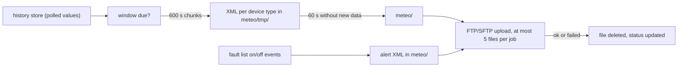

# Third-party upload (FTP/SFTP XML)

Both dongles can push monitoring data to a server the owner names, independently of iSolarCloud.
The feature is called "Third-party cloud" in the web UI (System > Communication settings), its
link name is `mc_cloud`, and the transport is labelled "FTP/SFTP". The dongle periodically writes
small XML files with measured values, plus a separate XML file for every fault or alarm event, and
uploads them by FTP or SFTP. It is off by default. The WiNet-S and WiNet-S2 behave the same; the
differences are in buffer sizes only.

The XML dialect uses the namespace `http://api.sspcdn.com/mii` with a `datalogger` profile,
version 2.0, a format used by third-party PV monitoring portals.

## Configuration

The settings are saved with `POST /transmit/webupdate` and `name` = `mc_cloud`
([web-api.md](web-api.md)). They are stored in the dongle's own settings and survive a restart.

| Form key | Meaning | Values |
|---|---|---|
| `enable` | master switch | 0 off (default), 1 on |
| `ip` | server host: a DNS name or an IP address | up to 64 characters, no default |
| `port` | server TCP port | 1–65535; choosing FTP fills 21, SFTP fills 22 |
| `protocol` | transfer protocol | 0 FTP (default), 1 SFTP. There is no FTPS option |
| `usr_name` | login name | up to 20 ASCII characters |
| `password` | login password | up to 20 characters; stored in plain text and returned in clear when the page reads the settings back |
| `ftp_path` | remote directory | default `/`; up to 64 characters of letters, digits, `_` and `/` |
| `samp_period` | sampling cycle, minutes | 5, 10, 15 or 60 |
| `trans_period` | transmission cycle, minutes | 5, 15, 60 or 1440 |

Two read-only status values sit next to them: the time of the last upload result
(`YYYY-MM-DD HH:MM:SS`) and the result itself (0 success, 1 failure).

### When it runs

- Nothing is built or sent while `enable` is 0.
- The page refuses to switch the feature on (error **348**) while bit 10 of the dongle's
  remote-control mask is clear. The mask is the same one that gates groups of cloud commands
  ([cloud-commands.md](cloud-commands.md)); its default (0x4FF on the WiNet-S2) has bit 10 set.
- A change of mask bit 10 writes the enable switch directly, so changing the mask on the web
  "Remote control" page can switch the upload on or off, even with no server
  configured.
- The UI text says that enabling the third-party cloud stops uploads to iSolarCloud. Nothing in the
  dongle enforces that: saving this page writes only the third-party settings, and the iSolarCloud
  link keeps running alongside.
- Nothing is built until the dongle's clock is valid.

## Cadence



The task works from the dongle's own history of polled values, not from new RS-485 reads.

| Rule | Behaviour |
|---|---|
| First window | Until the first window with data has been built, the window is the 5-minute slot aligned to 300 s, tried once a minute. This start-up mode repeats after every restart |
| Later windows | A window is due when the transmission period P has passed since the end of the last one; it is requested about 60 s later and covers `[last, last + P]` |
| Period | P = transmission cycle × 60 s, kept in **16 bits**. For 1440 minutes this gives 20864 s, so a "daily" setting uploads about every 5 h 48 min |
| Chunks | windows longer than 600 s are read in 600 s chunks; windows shorter than 300 s are skipped |
| Samples | only values whose timestamp is an exact multiple of the sampling cycle are written (300 s during the first window) |
| Staging | a file is complete after 60 s without new data, then moved to the upload directory |
| Upload job | data files first, then alert files, at most 5 per job |
| Result | checked once a second; after 600 checks (about 10 min) the file counts as failed |
| Clock goes back | the window start is reset to the current time |

**Failures lose data.** A file is deleted whether its upload succeeded or failed. After a failed
data file the dongle schedules a back-fill, but it starts at the end of the failed window, so the
failed window is not re-sent and the following one may be sent twice. A failed alert file is lost.
There is no back-off when the server is unreachable.

## Files

| Kind | Name | Content |
|---|---|---|
| Data | `NNNNN_YYYYMMDD_HHMM_HHMM.xml` (counter, date, window start, window end; end shown as `0000` when it falls on the next day) | one file per device **type** per window |
| Alert | `NNNNN_YYYYMMDD_HHMMSS.xml` (counter, time the file was made) | one event |

The counter starts at a random value between 10000 and 29999 after each restart and increases by
one per file. All times in names are local time. New alerts are dropped while more than 120 alert
files are waiting. The files are staged in `/usrdataout/log/meteo/`.

### Data file

```xml
<?xml version="1.0"?>
<mii xmlns="http://api.sspcdn.com/mii" targetNamespace="http://api.sspcdn.com/mii" version="2.0">
 <datalogger>
  <configuration xmlns="http://api.sspcdn.com/mii/datalogger/configuration">
   <uuid> … static dongle values (name, model, serial, vendor, firmware) … </uuid>
   <next-scheduled-transfer>2026-10-24T10:20:00Z</next-scheduled-transfer>
   <devices>
    <device id="inverter-1" type="inverter"><uid>1</uid> … static device values … </device>
   </devices>
  </configuration>
  <datapoints xmlns="http://api.sspcdn.com/mii/datalogger/datapoints">
   <datapoint timestamp="2026-10-24T10:05:00Z" interval="900">
    <device id="inverter-1"><mv t="E_DAY" v="12.3000"/><mv t="U_DC1" v="352.1000"/></device>
   </datapoint>
  </datapoints>
  <events xmlns="http://api.sspcdn.com/mii/datalogger/events"/>
 </datalogger>
</mii>
```

| Element / attribute | Meaning |
|---|---|
| `device/@id` | `<type name>-<device id>` |
| `device/@type` | type name: `inverter`, `sc-inverter`, `logger` or `meter` |
| `uid` | device id |
| `next-scheduled-transfer` | window start plus the transmission cycle |
| `datapoint/@timestamp` | sample time, `YYYY-MM-DDTHH:MM:SSZ` |
| `datapoint/@interval` | the transmission period in seconds (with the same 16-bit limit), not the sampling cycle |
| `mv/@t` | value name, for example `E_DAY`, `E_TOTAL`, `E_YEAR`, `OT_AC_TOTAL`, `T_WR`, `U_DC1`, `I_DC1` |
| `mv/@v` | value: integers as decimal, scaled values with four decimals (`%.4f`), text copied |

Every timestamp in these files (sample times, the next transfer and alert times) is **local time
with a `Z` suffix**. A receiver that takes the `Z` at face value shifts all data by the site's UTC
offset.

The value list is a fixed per-device-type table with its own short names, separate from the
iSolarCloud point ids. Tables exist for string inverters (device type 1), residential and hybrid
inverters (21 and 35), the dongle itself and meters (18). Static values (name, model, serial,
vendor, firmware) go into the `configuration` section; the rest are data points.

### Alert file

An alert file has the same skeleton without `uuid` and `devices`, and one `alert` element under
`events`:

| Element / attribute | Meaning |
|---|---|
| `alert/@timestamp` | time the event was passed on (not a time stored with the event) |
| `alert/@device_id` | `<type name>-<device id>` |
| `uid` | running counter |
| `code` | fault or alarm code ([../appendix/error-codes.md](../appendix/error-codes.md)) |
| `severity` | `alarm` or `fault` |
| `state` | `on` or `off` |
| `short-description` | up to 10 reason codes joined as `a-b-c`; only present when there are any |

Events come from the dongle's own fault list: one when a fault appears, one when it clears. A
repeat of an identical "on" event is dropped.

## Transport

| Item | Value |
|---|---|
| URL | `<scheme>://<user>:<password>@<host>:<port><ftp_path>/<file>`, scheme `ftp` or `sftp`; user and password percent-encoded |
| Connect timeout | 60 s |
| Certificates / host key | never checked; an SFTP host key is accepted whatever it is |
| FTP | plain text, login included |
| Remote directory | must exist; it is not created |
| Interfaces | each network interface is tried in turn until one succeeds |
| Transfer timeout | none |

The upload shares the dongle's single file-transfer worker with firmware downloads and log-export
uploads ([diagnostics-and-log-export.md](diagnostics-and-log-export.md)), so a stalled server can
delay those too.

## The transmit configuration surface

The web UI groups every outbound or server link under "Communication settings", served by the
`/transmit/*` routes. Each link has a link name:

| Link name | What it is | Page |
|---|---|---|
| `sg_cloud` | the iSolarCloud MQTT link | [cloud-mqtt.md](cloud-mqtt.md) |
| `mc_cloud` | this third-party FTP/SFTP upload | this page |
| Fupin link | a regional TCP monitoring link with its own certificate import | [regional-and-legacy-features.md](regional-and-legacy-features.md) |
| `mb_tcp_svr1` | the Modbus TCP server on port 502 | [modbus-tcp.md](modbus-tcp.md) |
| `iec104` | IEC 60870-5-104 settings (configurable, but the dongle never listens) | [regional-and-legacy-features.md](regional-and-legacy-features.md) |

| Route | Purpose |
|---|---|
| `/transmit/list` | the links with host, port and enable state |
| `/transmit/getOption` | the full settings of one link, including the stored password in clear |
| `/transmit/webupdate` | save one link's settings (`name` selects the link) |
| `/transmit/importCrt` | certificate upload; for the Fupin link no file is stored |

`/transmit/webupdate` answers:

| Code | Meaning |
|---|---|
| 348 | `mc_cloud` save with `enable` 1 while mask bit 10 is clear; nothing written |
| 347 | any `sg_cloud` save while mask bit 0 is clear; nothing written |
| 210 | link name not found ("protocol not found"); a save of the Fupin link always ends here |

Every save that passes the 347/348 checks, for any link, first sets the iSolarCloud TLS flag to
"TLS" and copies the current iSolarCloud endpoint into the backup endpoint used by the server-switch
rollback. That includes saves of the Fupin link, which then fail with 210.

## Not yet known

- Exactly which values end up in the `uuid` and `device` sections of a real file.
- Whether receivers expect the sampling cycle rather than the transmission period in
  `datapoint/@interval`.
