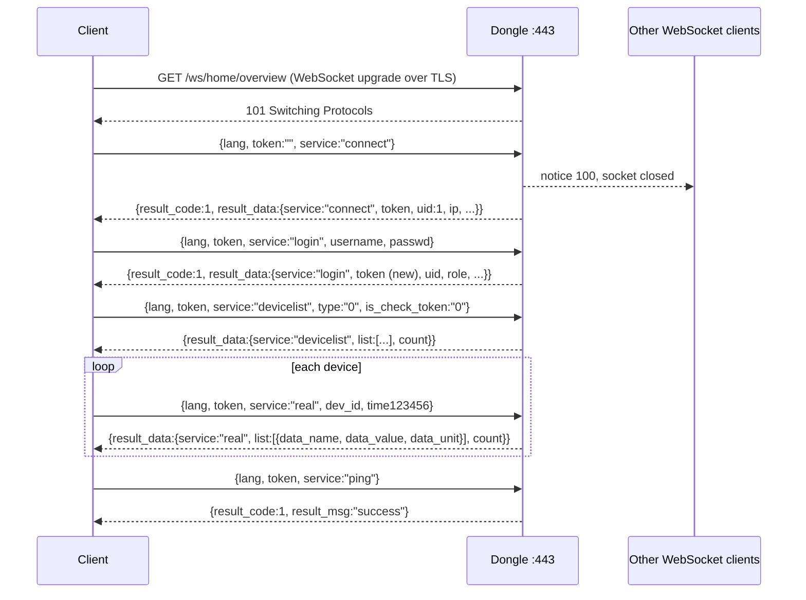

# Local web API (HTTPS, WebSocket and the phone app's near mode)

Both dongles serve one local web interface: a single-page web app, a JSON REST API and a JSON WebSocket channel,
all on the same TLS listener. The iSolarCloud phone app's local ("near") mode uses the same API; it has no protocol
of its own. This page describes the interface as shipped in WiNet-S2 SV300 P032 and WiNet-S V200 P046. Differences
between the two are marked; everything else is the same on both.

Modbus addresses on this page are the 1-based numbers of Sungrow's published Modbus documentation (wire address =
documented address − 1).

For a gentler introduction see [Local access](../../guide/05-local-access.md); for the security consequences see
[Security and privacy](../../guide/09-security-and-privacy.md).

## Listeners

| Port | Protocol | When | What it serves |
|---|---|---|---|
| 443 | HTTPS + WSS | always | the web app files, the REST API (146 routes on the WiNet-S2, 135 on the WiNet-S) and the WebSocket `/ws/home/overview` |
| 80 | plain HTTP | **WiNet-S2 only**, and only when a WiMeter is in the saved device list at boot | three handlers: `GET /*` (static web-UI files, and `/download/Update*` from the update staging area), `POST /device/addWiMeter`, `POST /upload/*`. No API, no WebSocket, no web app. See [WiMeter and WiProxy](../devices/wimeter-and-wiproxy.md) |
| 8082 | — | never | No listener exists on either dongle; there is no plain `ws://` endpoint on any port |

On the WiNet-S the two WiMeter routes live on the HTTPS server like every other route.

The HTTPS server allows 10 open sockets (oldest idle one purged when full), a 5 s receive/send timeout and up to 160
URI handlers (200 on the WiNet-S). Routes are matched in registration order; a pattern ending in `/*` matches only
longer paths, so `/system/upgradeCheck/x` matches but `/system/upgradeCheck` answers 404.

### Certificate

The server certificate and key are read from the dongle's user-data partition. If either file is missing, the
dongle writes a built-in **self-signed** default pair and starts anyway. The built-in pair is the same on
every dongle of one generation (one pair for all WiNet-S2, another for all WiNet-S), and its private key is
recoverable from the public firmware image. Clients must skip certificate verification or pin the certificate. The
pair can be replaced with `POST /system/importCert` (`cert_type` 1, see [HTTP routes](#http-routes)).

### Web app files

Any `GET` that no API route takes is served from the internal web-app partition (`index.html` for a path ending in
`/`, `.gz` variants tried automatically, `Cache-Control: max-age=86400`). Static files carry HSTS,
`X-Content-Type-Options`, `X-Frame-Options`, `X-XSS-Protection` and the three `Cross-Origin-*` headers; the
WiNet-S2 adds a Content-Security-Policy and a Referrer-Policy. API replies carry none of these. Static files need no
token, and the path is not normalised, although a `..` cannot leave the web-app partition.

## Message envelope

The REST API and the WebSocket share one reply shape.

| Direction | Shape |
|---|---|
| WebSocket request | `{"lang": "en_us", "token": "<token>", "service": "<name>", ...fields}` — numbers are normally sent as decimal strings |
| WebSocket reply | `{"result_code": <n>, "result_msg": "<text or key>", "result_data": {"service": "<name>", ...}}` |
| HTTP request | `lang`, `token` and route fields as query string (GET) or form / JSON body (POST) |
| HTTP reply | `{"result_code": <n>, "result_msg": "...", "result_data": {...}}`, always **HTTP 200**, no CORS headers, default `text/html` content type |

| Field | Meaning |
|---|---|
| `result_code` | `1` = success; anything else is an error code |
| `result_msg` | `"success"` on success. For an error code the dongle sends a language-independent message key from a 61-entry table; the client translates it with its own language table. A code with no table entry (110, 120, 200, 201, 210, 215, 401 …) is sent as the generic "internal abnormal" key |
| `result_data` | per service or route; on WebSocket errors only `{service}` is present |

Rules that apply to every request:

- A WebSocket frame without `service` or `lang` is ignored; with `lang` but no `service` the reply is code 201.
  Binary frames are parsed as JSON text too. Replies go only to the requesting socket as one unfragmented text frame.
- HTTP parameters are looked up in the query string, then a form body, then a top-level JSON key. Query and form
  values longer than 127 bytes are not found there and the lookup moves on to the next source (a JSON string value is taken whole); a body over 8 191 bytes is refused with an HTTP 500 page; only one request body is
  buffered at a time.
- The token is read **only** from the `token` parameter. The web app also sends a `token` HTTP header; it is
  ignored. The password is sent in clear inside the TLS session.

Common error codes (full list in [Error codes](../appendix/error-codes.md)):

| Code | Meaning |
|---:|---|
| 106 | token belongs to a session that was replaced |
| 110 | privilege too low |
| 116 | developer login while the remote-maintenance window is closed |
| 119 | local access disabled (see [Local-access switch](#local-access-switch)) |
| 120 | token unknown; 200 = token parameter missing |
| 201 | missing or invalid parameter |
| 206 / 209 / 217 | internal message could not be queued / no answer in time / no free buffer |
| 210 | `dev_id` unknown |
| 212 | wrong HTTP method |
| 215 | unknown WebSocket service |
| 401 | visitor session calling a WebSocket service other than `connect`, `login`, `ping` |
| 431 / 432 / 434 / 444 / 451 | Modbus read-holding / read-input / write-single / write-multiple / read-write failure |

## Sessions and tokens

The dongle keeps **five** session slots. A session holds a 64-character lower-case hex token (random per session),
a role and an idle countdown.

| Step | Behaviour |
|---|---|
| `connect` | Creates a visitor session and returns a token. A `connect` that carries a known token **resumes** that session on the new socket (a page reload keeps the login). A socket close does not end a session |
| Every later frame | Must echo the current token. `connect`, `login` and `ping` are the only WebSocket services without a token check |
| `login` | Checks the password and issues a **new** token; role taken from the user name |
| Eviction on connect | A `connect` from any socket, even one that fails, sends notice 100 to **every other** WebSocket connection, closes them and frees their sessions. Only one browser stays logged in; a script that merely connects to read data logs the browser out |
| Eviction on login | A successful login for a role already held by another session kicks that session (notice 101) |
| App connect | `POST /user/connect` evicts every WebSocket client with notice 108. Sessions created by the HTTP `/user/login` path survive later WebSocket connects |
| Idle logout | Default **10 minutes**, configurable with `POST /user/updateSessionInfo` (`time_out`, minutes; read with `/user/getSessionInfo`). Every token-checked HTTP request reloads the countdown; on the WebSocket only `upgrade` and `devicelog` do, so a WebSocket-only client is probably logged out (notice 103) ten minutes after its last `connect` or `login` however busy it is |
| Sixth session | The longest-idle session is recycled (notice 100) |

### Login lockout

Failed logins are counted per role. After 5 failures the role is locked for 180 s, then 600 s on the next lock.
The failure reply is `result_data = {service: "login", errorcnt, unlocktime}`: `errorcnt` is the number of
attempts left, `unlocktime` the remaining lock time in minutes (rounded up). The HTTP `/user/login` reply also
carries `lockstatus` and `maxerrcnt`.

### Local-access switch

A global switch can disable local logins: while it holds 0x0055, every `connect`/`login`/`logout` answers code
119 and all sessions are dropped with notice 120. The only writer is unit 247 register 8022 on the
[Modbus-TCP server](modbus-tcp.md#logger-registers-on-unit-247), which has no authentication. The value is not
persistent: a reboot re-enables local login.

### Server notices

Sent without a request as `{"result_code": <n>, "result_msg": "<English text>", "result_data": {"service": "notice"}}`.

| Code | Text | Cause |
|---:|---|---|
| 100 | `normal user limit` | another client sent `connect`, or the session table was full |
| 101 | `other user login` | the same role logged in elsewhere |
| 103 | `login timeout` | idle countdown reached 0 |
| 108 | `app login,normal user limit` | the phone app connected over HTTP |
| 120 | `login timeout` | local access was switched off |

## Roles and privilege

| Role | User name | Level | Typical user |
|---|---|:---:|---|
| visitor | none (token from `connect` without login) | 1 | anyone on the network |
| user | `user` | 2 | plant owner |
| admin | `admin` | 3 | installer, O&M |
| develop | `develop` | 4 | Sungrow factory / support |

- The role comes **only from the user name**; the password decides pass or fail. Login replies return the role
  number as `uid`; the field named `role` is a 0/1 flag that is 1 only after a developer login.
- `user` and `admin` each have a stored password, which starts as a default shared by every dongle and can be
  changed; the dongle also accepts a rotating, date-keyed password for both roles, so setting your own password
  removes the shared default but does not make the web UI private.
  `develop` uses a **rotating time-based password** and
  additionally needs the **remote-maintenance window** to be open: it is opened by `POST /user/rdSwitch` (admin)
  or by an iSolarCloud command and stays open for up to 24 h. With the window closed a developer login answers 116
  and is not counted as a failure. See [Remote access](remote-access.md).
- `POST /user/getAuthCodeVerifyResult` forwards an installer auth code to iSolarCloud; on a positive answer the
  dongle raises the session to admin and returns a new token.
- Each HTTP route and each WebSocket service has a required level. The dongle finds it by testing every row of a
  per-URL (or per-service) table as a **substring** of the request; the **last** matching row wins and no match
  means level 0 (any valid token, including a visitor token). The request passes when required ≤ session level.
- A session created by the phone app's HTTP login (`_vc` app version above 2024053000) counts as **level 4 on every
  HTTP route** when its role is user or admin.
- Parameter tiers that appear in the installer pages (owner / installer / developer parameters) are not enforced by
  the dongle: any level-2 session can read and write every parameter through `/device/setParam`.

Routes that need **no token at all**: `/user/connect`, `/product/list`, `/device/addChargingStation`,
`/device/addWiMeter`, `/upload/*` (WiNet-S2), `/device/upgradeCheck/*` (WiNet-S2; the WiNet-S checks),
`/system/upgradeCheck/*` and `/device/updateresult`. Routes with no table row and therefore open to a visitor
token include every `/upgrade/*` route except `/upgrade/export`, `/iconfig/{deletepubkey,get_key,upgrade_result}`,
`/historyfault/list` and `/system/{get,set}RemoteControl*`. Together these let an unauthenticated client upload and
start a dongle firmware package; the package signature check ([Update channels](../firmware-update/update-channels.md))
is then the only barrier. `/device/updateresult` never sends an HTTP reply at all.

## Typical session

`connect` reply fields: `token`, `uid` (1 for a new session, the resumed role otherwise), `tips_disable`, `ip` (the
client's address as the dongle sees it), `virgin_flag`, `isFirstLogin`, `forceModifyPasswd`. Both dongles send
`ip`; it does not distinguish WiNet-S from WiNet-S2. The HTTP `/user/connect` reply adds `network_mode_enable`,
`certificatetype`, `passwd_unified` and `supportSecurity`, omits `ip`, and fills `service` with an unrelated
internal name. `devicelist` items carry `dev_id, dev_code, dev_type, dev_procotol` (sic), `inv_type, dev_sn,
dev_name, dev_model, port_name, phys_addr, logc_addr, link_status, init_status, dev_special, optimizer_insert,
shutter_insert, dev_opt_total_fault`. `data_value` is `"--"` when no value is known, and `data_name` is a
translation key resolved by the client.

## WebSocket services

34 services on the WiNet-S2, 33 on the WiNet-S. "Level" is the required privilege after the substring rule
(0 = any valid non-visitor token).

| Service | Level | Request fields | Purpose |
|---|:---:|---|---|
| `connect` | 1 | — | create or resume a session, get a token |
| `login` | 1 | `username`, `passwd` | authenticate; no reply if `passwd` is absent |
| `logout` | 2 | — | end the session |
| `passwd` | 2 | `uid`, `old_passwd`, `new_passwd` | change the password (`uid` must match the session) |
| `ping` | 1 | — | keepalive; reply has no `result_data` and does not refresh the idle timer |
| `devicelist` | 2 | `type`, `is_check_token` | device list; `is_check_token: "0"` skips the token check, so it works without a session |
| `staticdevicelist` | 2 | `type`, `is_check_token` | static device list; always token-checked |
| `logdevicelist` | 2 | `type`, `is_check_token`, `branch` | devices that support log export; honours `is_check_token: "0"` |
| `real` | 2 | `dev_id`, optional `string_id`, `block_id` | live values of one device from the poll cache |
| `real_battery` | 2 | `dev_id` | live battery values |
| `direct` | 2 | `dev_id` | MPPT / string voltages and currents (`name, voltage, voltage_unit, current, current_unit`) |
| `statistics` | 2 | — | statistics block |
| `fault` | 2 | — | current fault list |
| `state` | 2 | — | device / connection state |
| `local` | 2 | — | local configuration list |
| `samp_aidido` | 2 | — | analogue / digital input and output samples |
| `proto_modbus104` | 2 | `seq` | protocol list for the "add network device" dialog |
| `vpn` | 0 | — | VPN list |
| `param` | 3 | parameter list | write parameters through the WebSocket (see [Setup and provisioning](setup-and-provisioning.md)) |
| `deviceCheck` | 3 | — | device check |
| `self_checking` | 3 | — | register read/write self-check |
| `autosearch` | 3 | `cmd_type`, `com_id`, `seq` | start / poll the RS-485 device search ([Device discovery](device-discovery.md)) |
| `deviceadd` | 3 | `dev_type`, `dev_code`, `dev_count`, `port_name`, `protocol`, `ip`, `port`, `seq` | add devices by type |
| `upgrade` | 3 | — | device firmware-update progress per device; refreshes the idle timer |
| `stalist` | 3 | — | Wi-Fi scan result (`ssid, signal, secury, encrypt`) |
| `devicelog` | 3 | — | device log-export progress; refreshes the idle timer |
| `waveRecord` | 3 | — | waveform-record progress |
| `gridRecord` | 3 | — | grid-record progress (**WiNet-S2 only**) |
| `optautosearch` | 3 | `devid` | optimizer auto-search status (**WiNet-S2 only**) |
| `runtime` | 2 | — | runtime block (**WiNet-S only**) |
| `setNet` | 2 | `name`, `mode`, `count`, `devid_array`, `net_id` | set the PLC network id ([below](#plc-services-setnet-and-rebootnet)) |
| `rebootNet` | 3 | `name`, `mode`, `count`, `devid_array` | PLC "reboot" ([below](#plc-services-setnet-and-rebootnet)) |
| `xmlUpdateProgress` | 0 | — | progress of the settings-template update (`status` 0/1/2) |
| `upgradeIconfigPackageProgress` | 3 | — | progress of the iConfig package pull |
| `iconfigCertProgress` | 0 | — | progress of the iConfig certificate import |

On the WiNet-S, `autosearch` and `deviceadd` need only level 2.

## HTTP routes

All API routes take `lang` and `token`. Methods: GET for read-style routes, POST for everything that changes state.
The full families are `/about`, `/device`, `/download/log`, `/ethernet`, `/4g`, `/gridRecord`, `/historyfault`,
`/iconfig`, `/inverter`, `/local`, `/log`, `/message`, `/product`, `/serial`, `/system`, `/time`, `/transmit`,
`/upgrade`, `/user`, `/waveRecord`, `/wifi` and `/wifi_sta`. The routes that matter most:

| Route | Method | Level | Purpose |
|---|---|:---:|---|
| `/user/connect`, `/user/login`, `/user/logout` | POST | 1 | HTTP twins of the WebSocket session services; same tokens |
| `/user/password` | POST | 2 | change password (`uid`, `old_passwd`, `new_passwd`) |
| `/user/rdSwitch`, `/user/rdSwitchStatus` | POST / GET or POST | 3 | open / query the remote-maintenance window that the develop role needs |
| `/product/list` | GET | none | model name, model code and the app feature word ([near mode](#phone-app-near-mode)) |
| `/device/list` | POST | 1 | device inventory |
| `/device/getParam` | GET or POST | 2 | **live** raw register read: `dev_id`, `dev_type`, `dev_code`, `type`, `param_addr`, `param_num`, `param_type`; reply `result_data.param_value` = space-separated hex bytes (`"0F B2 00 0B "`). Always a fresh RS-485 read, never the cache. Battery devices (type 44) use their own read path |
| `/device/setParam` | POST | 2 | parameter write: one parameter per call (`param_type`, then `param_name` or `param_addr` + `param_size` + `param_value`) for device types 1, 21, 35, 46 and 92; a separate path for batteries (type 44); a JSON `list` of `{…, value}` items for other types. No range or tier check on the dongle |
| `/device/passthroughway` | POST | 2 | raw Modbus RTU frame relay ([below](#pass-through-relay)) |
| `/device/getInitParam`, `/device/xmlUpdate` | GET / POST | 2 | installer parameter pages built from the per-region settings templates ([below](#settings-template-fetch)) |
| `/device/upgradeCheck/<name>`, `/device/upgradeStart` | POST | 3 | upload and start a connected-device firmware update ([Device firmware relay](../firmware-update/device-firmware-relay.md)); the upload needs no token on the WiNet-S2 |
| `/system/upgradeCheck/<name>` | POST | none | upload a dongle `.sgu` package and run its check (wildcard route; no token check) |
| `/system/upgradeStart`, `/upgrade/systemUpgradeStart` | POST | 3 / 0 | start the dongle update; `/upgrade/*` status routes mirror cloud-driven updates too ([Update channels](../firmware-update/update-channels.md)) |
| `/system/importPublicKey` | POST | 3 | replace the public key that verifies dongle packages, with its version label |
| `/system/importCert`, `/system/getCertInfo` | POST | 3 | replace / show a certificate pair: `cert_type` 1 = HTTPS server, 2 = Modbus-TCP TLS server; `terminal_type` must be 1; `crt_data`, `key_data` = PEM text. The pair is validated and must match; error 118 = expired |
| `/iconfig/*` | POST | 3 / 0 | browser-driven pull of a firmware package and trust key from a Sungrow iConfig tool on the LAN; the dongle acts as an HTTPS client to `https://<entered IP>:<20001…20901>/v2/web/*` and reports progress over the WebSocket |
| `/transmit/list`, `/transmit/update` | GET / POST | 2 / 1 | forwarding links: cloud, Modbus-TCP servers `mb_tcp_svr1…15`, client links, RTU slave `mb_rtu` ([Modbus TCP](modbus-tcp.md)) |
| `/transmit/getWhiteList`, `/transmit/setWhiteList` | GET / POST | 3 | Modbus-TCP source-IP allow-list: `name`, `white_enable`, `white_ip1` … `white_ip5` |
| `/transmit/importCrt` | POST | 3 | creates a certificate directory for a link type; stores no file |
| `/user/getSessionInfo`, `/user/updateSessionInfo` | POST | 3 | read / set the idle timeout |
| `/system/maintenance` | POST | 3 | `reboot` |
| `/message/*`, `/download/log` | POST (`/message/getPort` GET) | 3 | timed RS-485 frame capture and its download ([Diagnostics](diagnostics-and-log-export.md)) |
| `/device/addWiMeter`, `/upload/*` | POST | none | pair a WiMeter and serve it files; port 80 on the WiNet-S2 |

WiNet-S2 only: `/4g/v6list`, `/4g/v6update`, the six `/gridRecord/*` routes and the optimizer routes
`/device/{optAutoSearch,optlist,optrealdata,optalldata,setOptimizerSwitch,getOptAutoSearchProcess}`. WiNet-S only:
`/transmit/add`. Rows for `/dispatch/*` and `/di/*` exist in the privilege table but no handler does.

### Pass-through relay

`POST /device/passthroughway` sends one raw frame to the RS-485 bus and returns the answer. It needs a logged-in
session of level 2 (`user`) or higher.

| Field | Meaning |
|---|---|
| `dev_id` | device from the device list; selects the COM port, the device lock and its timing, **not** the slave address on the wire |
| `msgType` | 0 or 2 = raw RTU frame, sent unchanged (client supplies slave, function code and CRC); 1 = Modbus-TCP frame (MBAP header removed, CRC added, reply re-wrapped in MBAP); 3 = Sungrow private function codes 0x70–0x74 only (WiNet-S2 only) |
| `msgLength` | number of bytes, must equal half the length of `msgValue`; at most 253 bytes reach the wire |
| `msgValue` | the frame as hex text, no separators |

Reply: `result_code` 1 and `result_data = {type, result, length, data, port_state}`. `result` 0 = answered,
1 = no answer or bad CRC, 2 = device busy; `data` is the reply frame in upper-case hex, with inverter exceptions passed
through unchanged. `port_state` (WiNet-S2 only) tells why the COM port is busy: 1 update, 2 log export, 3 IV scan,
4 device search. `result_code` stays 1 when the bus failed, so clients must read `result`. The web wait is up to
about 15 s; the RS-485 timeout is the device's own (2 s for inverters).

For types 0 and 2 the dongle does not inspect the frame: any slave, function code and register range can be
written by a level-2 session, bypassing every installer check. The WiNet-S2 watches for writes to the inverter's
persistent baud-rate registers (30456, then the commit register 30459) and, after the commit, switches its own UART
to the new rate and saves it; if the commit gets no reply it returns a made-up success echo.

### Phone app near mode

The app talks to the dongle directly over HTTPS on port 443, either through the dongle's hotspot (SSID `SG-`
followed by the dongle serial, gateway `11.11.11.1`) or through the home LAN.

1. `GET /product/list` (no token). Reply: `product_name` (`WiNet-S2` / `WiNet-S`), `product_code` (17 / 9),
   `product_func_enum1`, `net_location_id`, and `country_attr: 2` when the cloud host contains `.eu`. Each call
   also increments a "probe counter" that is reported to the cloud with the time of the first call; the web app
   calls this route on every page load.
2. `POST /user/connect`, then `POST /user/login` (evicts the browser session, notice 108).
3. Register access with `POST /device/passthroughway` when bit 0 of the feature word is set, otherwise
   `/device/getParam` and `/device/setParam`. Some app flows use [Modbus TCP](modbus-tcp.md) on port 502 instead.

`product_func_enum1` is a constant per firmware build: **55103** (0xD73F) in WiNet-S2 P032 and **53547** (0xD12B)
in WiNet-S P046. The app tests single bits:

| Bit | App behaviour when set | S2 | S |
|---:|---|:---:|:---:|
| 0 | use `/device/passthroughway` for register access | ✓ | ✓ |
| 1 | show the EV-charger channel setting | ✓ | ✓ |
| 2 | secure upgrade (public-key import menu, signed offline packages), alternative cloud-address scheme | ✓ | |
| 3 | new-style upgrade information | ✓ | ✓ |
| 4 | encrypted MQTT broker address and port | ✓ | |
| 5 | download logs with `POST /download/log` | ✓ | ✓ |
| 8 | verify the dongle's HTTPS certificate | ✓ | ✓ |
| 9 | off-grid battery upgrade supported | ✓ | |
| 10 | WiNet-Mini style fast network configuration | ✓ | |
| 12 | remote-control entry for user / admin | ✓ | ✓ |
| 13 | longer upgrade timeout | | |
| 14 | pick the cloud address by `cloudId` from `/transmit/getOption` | ✓ | ✓ |
| 15 | auth-code login (`/user/getAuthCodeVerifyResult`) | ✓ | ✓ |

Bits 6, 7 and 11 are not used by the app.

### Settings template fetch

The installer and grid-code pickers come from four per-region settings templates that the dongle refreshes from
iSolarCloud itself (contents: [Device types and grid profiles](../devices/device-types-and-grid-profiles.md)).

| Item | Behaviour |
|---|---|
| Triggers | once per calendar day (the day is saved **before** the request, so a failed fetch waits until the next day); when the setup picker is opened for region code 6 (check only); `POST /device/xmlUpdate` starts the download |
| Request | `POST https://augateway.isolarcloud.com/v1/commonService/getTemplateResConfig`, or `https://base.isolarcloud.com:8770/…` when the configured broker host starts with `base`, `newbaseiot` (or `newbaseiotv6` on the WiNet-S2). A fixed `sys_code` header; JSON body with a fixed application key, `product_type: 2`, `version: "1.2"`. No login, no device identity |
| Reply | `result_data.template_config_info.config[]` with `file_name`, `file_url`, `file_version` per template |
| Download | every template whose version **differs** (newer or older) is fetched from `https://file.isolarcloud.com/presetTemplate/webResourcesConfig/<version>/<name>` and written in place, up to 50 resumed attempts |
| Commit | the new versions are recorded only when every file succeeded; a template that fails to parse is reset to version "0.0.0" before the next check |
| Security | TLS certificates are **not verified** on the request or the downloads, redirects are followed, and there is no hash or signature on the files |

A factory-fresh dongle has no templates until its first successful fetch.

### PLC services setNet and rebootNet

Two WebSocket services address the power-line (PLC) network of optimizer systems. Nothing in the shipped web app
calls either; only a hand-written client can. `name` must be `"COM1"`; `devid_array` is a comma-separated list of
`count` device ids (1–17, WiNet-S 1–13) and is required in both modes.

| `mode` | `setNet` | `rebootNet` |
|---|---|---|
| 0 (devices) | writes `net_id` to register **32538** of each listed device (function 0x10). The SG5.0RS stores it as its PLC PAN id (1–255); the SH10RS refuses with exception 4 | writes 0xAA to register **30031** of each listed device. On both the SH10RS and the SG5.0RS this **stops the inverter and restarts its main controller** (about 0.4 s later on the SG5.0RS, roughly a second on the SH10RS); it is not a PLC-modem reset |
| 1 (dongle PLC master) | **dead**: the request goes to an internal command that nothing handles; no reply, error 209 after about 15 s | same |

The mode-0 reply lists every device on the COM with `dev_id, dev_code, dev_type, dev_sn, dev_name, net_id,
result`; entries for devices that were not in the request show stale results (0 after boot). See
[Optimizers and MLPE](../devices/optimizers-and-mlpe.md).

## Device types

Device type numbers as they appear in `dev_type` of the device list and the routes above:

| Type | Role | Type | Role |
|---:|---|---:|---|
| 1 | string inverter | 25 | third-party inverter |
| 8 | combiner box | 34 | Sungrow logger |
| 11 | meteo station | 35 | residential hybrid inverter |
| 13 | MVS (medium-voltage station) | 36 | real-time extra |
| 14 | tracking axis | 37 | real-time extra |
| 15 | PID module | 44 | battery |
| 18 | meter | 46 | ESS / charger |
| 20 | meteorological sensor | 47 | extra device |
| 21 | residential inverter | 48 | extra device |
| 22 | cleaning robot | 92 | Energy Bridge / communication device |
| 23 | communication device | | |
| 24 | central inverter | | |

The SG5.0RS appears as type 21, the SH10RS as type 35 and each SBR192 stack as type 44. See
[Device types and grid profiles](../devices/device-types-and-grid-profiles.md).

## Not yet known

- The reply fields of the less-used WebSocket services (`statistics`, `state`, `local`, `samp_aidido`, `vpn`,
  `deviceCheck`, `self_checking`) beyond their names.
- The field names of the table-driven `list` / `update` routes (`/wifi`, `/ethernet`, `/4g`, `/serial`, `/local`,
  `/about`, `/system/{setValue,getValue}`).
- When a client meets code 106 in practice.
- Whether a package uploaded through the unauthenticated upload routes is the one `/upgrade/systemUpgradeStart`
  installs.
