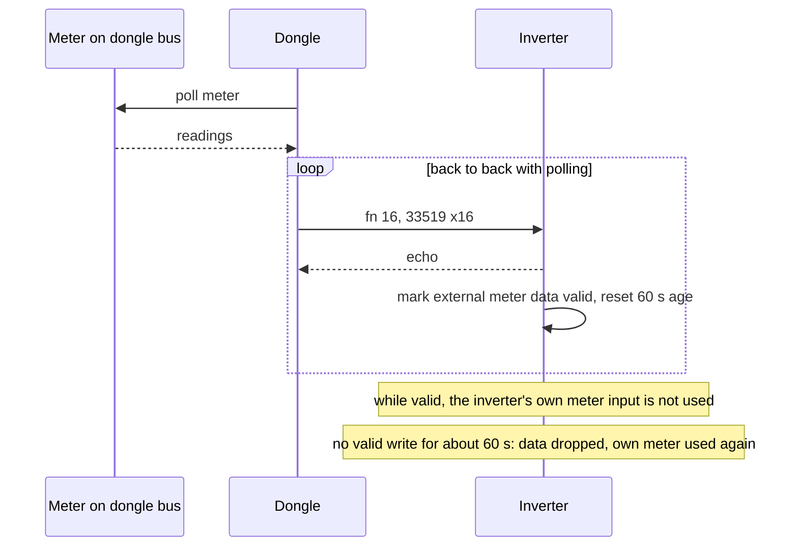

# Parameter writes and meter sync

How a register write reaches a device on the RS-485 bus, how on-demand reads travel the same way, and
which writes the dongle sends on its own, including the meter-sync feature that feeds meter readings
into the inverter. Polling is on [rs485-master.md](rs485-master.md), the function codes on
[modbus-function-codes.md](modbus-function-codes.md).

> Register numbers are the 1-based numbers of Sungrow's published Modbus documentation. Frame dumps
> show the wire address, which is one lower.

## Where writes come from

Every on-demand request, from any surface, becomes one internal read or write job for the target
device. The dongle turns each job into Modbus frames on the same port queue the poller uses.

| Surface | Route | RS-485 function |
|---|---|---|
| Web UI setup and installer pages | WebSocket `param` service | 16, items in the order the browser sent them |
| Web UI single parameter | `POST /device/setParam` | 16; on the WiNet-S2, 0x76 when `param_type` is 2 (sent only by the optimizer pages) |
| Web UI hex write | `setParamUpgrade` | 6 for one register, 16 for more |
| Web UI raw read | `GET /device/getParam?type=3` | `param_type` 0 = function 4, 1 = function 3, any other value = 0x77 |
| iSolarCloud `setparam` (10303, 10383) | MQTT command | 16, or 0x76 when `mode` is 1 |
| iSolarCloud `getparam` (10325) | MQTT command | 3 or 4, or 0x77 when `mode` is 1 |
| Modbus-TCP function 5, 6 or 16 to an inverter unit | port 502 | the same function code, forwarded |
| Modbus-TCP function 3 of an unmapped register | port 502 | a live function-3 read of the whole requested range |
| Modbus-TCP function 16 to unit 0 | port 502 | plant-level values are applied by the dongle; other registers are broadcast to all inverters |

Routes and payloads are on [web-api.md](web-api.md), [cloud-commands.md](cloud-commands.md) and
[modbus-tcp.md](modbus-tcp.md). A small set of control values (start/stop at 5006 and the power
limitation at 5007, 5019, 5036, 5039 and 5040) can also be set as named values in the dongle's own
value store; each such set is turned into a function-16 write of the bound register.

### Validation

The dongle's RS-485 layer **does not check values**. There is no range check, allow-list or
enumeration check on any write path, local or cloud. What the dongle checks is structure only:

- the request length matches its item list;
- each item has 1 to 125 registers;
- the target device has answered at least once since boot.

Ranges, allowed values and which parameters a role may change are defined in the installer
parameter tables: per-region settings templates and parameter descriptors that the web UI and the
phone app use to build their forms ([setup-and-provisioning.md](setup-and-provisioning.md)).
A client that bypasses those forms, such as a Modbus-TCP client or a raw `setParam` request, can write
any value. The last line of defence is the inverter itself, which rejects many out-of-range values
with exception 04.

The "answered once" flag is never cleared. After a device goes offline, requests are still accepted and
then time out on the wire.

## Frames

| Request | Frame | Notes |
|---|---|---|
| read, function 3 or 4 | `addr fn <start> <count> CRC` | 1 to 125 registers |
| write single, function 6 | `addr 06 <register> <value> CRC` | one frame per item |
| write multiple, function 16 | `addr 10 <start> <count> <byte count> <data> CRC` | 1 to 123 registers |
| private read 0x77, private write 0x76 | as function 3 / function 16 | WiNet-S2 only |

- Adjacent items (one ending where the next starts) are merged into one frame for reads and for
  function 16 and 0x76 writes; a gap starts a new frame. Function 6 items are always separate.
- A merged write of 124 or 125 registers passes the length check but no frame is built; the request
  stays pending until the caller gives up.
- A 2-register value supplied by the web UI or the cloud is written **low word first**, the inverters'
  word order. A Modbus-TCP client's register words are written unchanged.
- Function 0x60 and 0x71 pass the request check but build no frame (0x60 to unit 0 is the exception,
  see [modbus-function-codes.md](modbus-function-codes.md#0x60-dispatch-list-and-batch-access)).

## Queueing and gating

1. On-demand frames go into the port's **priority queue**, which is drained before the cyclic queue. A
   frame already on the wire is not interrupted.
2. While a parameter operation is in flight, the device is busy: its frames queue behind the round
   that is running, and **no new poll round starts until the operation ends**.
3. A second request that arrives during an operation is parked in a one-element queue. A parked
   Modbus-TCP request replaces any older parked one and expires after 3 s; a parked cloud request
   expires after 30 s. An expired or rejected park gets status "queue full".
4. A single-register 0x76 write of 0x55 to 14510 or 14518 (optimizer search stop) is accepted even
   while the device is busy.
5. Each frame uses the device's normal gap (18 ms for an inverter) and 2000 ms timeout, and is sent
   once.

## Replies and error mapping

Each item ends with one status. The inverter's Modbus **exception code is never passed on**; only the
exception function byte is kept.

| Item status | Meaning | Modbus-TCP client | Web `result_code` | Cloud `readResult` |
|---|---|---|---|---|
| 0 | written, or data returned | normal reply | success | "1" |
| 1 | no usable reply: timeout, CRC error, send failure, or device never answered (reads) | exception 4 | 391 (writes), 301 (reads) | "4" |
| function + 0x80 | the device answered with an exception | exception 4 | status + 300: 0x83 → 431, 0x84 → 432, 0x86 → 434, 0x90 → 444, 0x97 → 451 | "0" |
| queue full / expired | parked request dropped | exception 4 | 314 | write "2" |
| rejected | device never answered (writes), or busy and not parkable | exception 4 | 299 | "0" |

A Modbus-TCP write reply is built from the request, not from the inverter's echo. The Modbus-TCP
server times out a forwarded request after at least 5 s (about 9 s under load) and answers
exception 4. Error codes are listed on [../appendix/error-codes.md](../appendix/error-codes.md).

## Writes the dongle sends on its own

| Write | Target | Registers | When |
|---|---|---|---|
| clock broadcast | all inverters (slave 0) | 5000 to 5005 | after each clock set, and hourly when "Inverter time synchronization" is on (off by default); see [rs485-master.md](rs485-master.md#clock-synchronisation) |
| accessory clock | WiMeter, WiProxy | 19195 to 19200 | after each clock set, with every clock broadcast, and when the accessory comes online |
| tracker clock | solar tracker | 29013 to 29018 | periodically, from the generic device timer |
| start / stop broadcast | all inverters (slave 0) | 5006 = 0xCF (start) or 0xCE (stop) | when start/stop is set on the plant device from the cloud or locally |
| feed-in limit schedule | first online inverter of device type 1 or 21 | 31221, 31222 (and 30105, 30106) | at whole-hour period boundaries of a cloud-supplied schedule |
| limit close | the device named by the cloud, or the schedule target after a factory reset | 30105 = 0x55, then 31221 = 0x55 | cloud point 99785 value 85; factory reset |
| baud negotiation | inverter | 21004 to 21018 | see [device-discovery.md](device-discovery.md#baud-switch-to-115200) |
| meter sync | every inverter | 33519 to 33534 | continuously, while a meter is attached to the dongle |

### Feed-in limit schedule

iSolarCloud can send a time-of-day export-limit schedule (cloud point 99783 carries a download URL;
[cloud-commands.md](cloud-commands.md)). The dongle stores it as a JSON file and reloads it at boot.

| Key | Content |
|---|---|
| `"30105"` → `"dataValue"` | string: value for 30105 (170 arms, 85 disarms) |
| `"30106"` → `"dataValue"` | string: value for 30106 |
| `"workday"`, `"saturday"`, `"sunday"` | arrays of up to 12 objects `{ "time_start": "HHMM", "time_end": "HHMM", "limit_power": "<value>" }`; all values are strings |

Behaviour:

- A 1 s timer checks the schedule but acts **only at whole hours** (minute 00); a period that starts or
  ends at another minute never fires. The clock is the dongle's local time without daylight saving.
- At a period start it writes 31221 = 0xAA with 31222 = the period's limit (0.01 kW units), in one
  frame. At a period end with no adjoining period it writes 31221 = 0x55.
- It writes **one device only**: the first online inverter of device type 1 or 21. A hybrid inverter
  (device type 35, such as the SH10RS) is never scheduled, and several inverters are not fanned out.
- It runs only when the inverter's capability bitmap reports the feed-in limit (word 28 bit 4) or the
  fail-safe (word 47 bit 13).
- When the file is loaded or a device comes online, the dongle re-applies the state of the day's
  **first** period only, plus the 30105 / 30106 pair. If that first period has already ended, it writes
  0 to both 31221 and 31222, which is not a valid switch value.
- An error reply is re-sent up to 3 times. A write that cannot be queued is retried every 100 ms with
  no limit.
- The WiNet-S applies only the first period of each day (plus one directly following period), and from
  Tuesday to Friday only Monday's first period.

On the SG5.0RS, **30105 / 30106 are a communication-loss fail-safe**: with 30105 = 0xAA, if no Modbus
frame reaches the inverter for at least about 3 minutes, export is clamped to the limit in 30106 until
traffic returns. 31221 / 31222 keep reading their stored values while the clamp is active. On the
SH10RS, 31221 and 31222 are the same settings as 13087 and 13074 (13074 in W, 31222 in 0.01 kW), and
30105 / 30106 are not served. See [../devices/sg5rs/registers.md](../devices/sg5rs/registers.md) and
[../devices/sh10rs/control-and-ems.md](../devices/sh10rs/control-and-ems.md).

The cloud limit close also deletes the schedule file, so the schedule stays off after a reboot.

## Meter sync

When a Modbus meter is attached to the dongle's own RS-485 bus (a device of type 18, see
[../devices/meters.md](../devices/meters.md)), the dongle copies ten of its readings into the inverter
with function 16. The inverter then uses them as its grid-meter reading. The push is one-way: the
inverter cannot request it, and no read path exists for these registers. Both dongles do this, with the
same register block and value table.

### When it runs

- The dongle's device list holds a meter (the first type-18 device is used), and both the meter and
  the inverter are online. A site whose meter is wired to the inverter's own meter terminals has no
  meter device on the dongle, so nothing is sent.
- Every inverter on the dongle receives the same data, at its own address, on its own port.
- One write is in flight at a time. The next write follows the reply to the previous one, so the sync
  runs back to back with the poll traffic: roughly one write every 0.1 to 0.2 s at 9600 baud when
  nothing else is queued, otherwise one per free slot between poll frames. The values change only when
  the dongle polls the meter, so the inverter receives the same values many times.
- A timeout counts as a failed reply. After more than 10 consecutive failures the dongle sends one
  attempt every **10 minutes** until a reply succeeds. These failures do not count toward taking the
  inverter offline.
- Nothing is sent while the inverter's port is locked (for example during a search or a baud switch).

### Frame

`addr 10 82 EE 00 10 20 <32 data bytes> CRC`: function 16, start 33519, 16 registers. The expected
reply is the 8-byte function-16 echo.

| Register | Count | Type | Content | Scale written |
|---|---|---|---|---|
| 33519 | 2 | s32 | total active power, W (positive = import) | meter kW × 1000 |
| 33521 | 2 | s32 | phase A active power, W | × 1000 |
| 33523 | 2 | s32 | phase B active power, W | × 1000 |
| 33525 | 2 | s32 | phase C active power, W | × 1000 |
| 33527 | 1 | u16 | grid frequency, 0.01 Hz | × 100 |
| 33528 | 2 | u32 | import energy, 0.01 kWh | × 100 |
| 33530 | 2 | u32 | export energy, 0.01 kWh | × 100 |
| 33532 | 1 | u16 | phase A voltage, 0.1 V | × 10 |
| 33533 | 1 | u16 | phase B voltage, 0.1 V | × 10 |
| 33534 | 1 | u16 | phase C voltage, 0.1 V | × 10 |

32-bit values are sent **low word first**, each register big-endian. Values are truncated toward zero;
16-bit values wrap rather than saturate. A meter value that is not available is replaced by a
placeholder: 0x7FFFFFFF (s32), 0xFFFFFFFF (u32), 0x7FFF (s16) or 0xFFFF (u16). The inverter
recognises only the s32 placeholder in the total-power field.

### What the inverter does with it

Both the SH10RS and the SG5.0RS accept the block.

- A write whose total power is not 0x7FFFFFFF marks the external meter data **valid**, resets its age
  counter and clears the inverter's "meter communication lost" flag.
- While the data is valid, the inverter **skips its own meter path completely**: the meter wired to
  its meter port is neither polled for the measurement nor used. The dongle's values become the grid
  meter reading behind the public meter registers (5601 onward on the hybrid, including frequency and
  phase voltages) and feed the inverter's import and export energy counters. Phase currents are set to
  invalid, since the dongle sends none.
- If no valid write arrives for about **60 s**, the data is dropped and the inverter returns to its own
  meter path.
- Register **33498** (0xAA or 0x55) marks the meter as installed in reverse: powers are negated and the
  two energy counters swapped, both for dongle data and for the inverter's own meter.
- On the SH10RS, while **whole-home backup mode** (31216) is 0xAA and dongle data is valid, neither the
  dongle data nor the inverter's own meter updates its grid-meter reading.

These registers are not in Sungrow's public maps and the inverter accepts the write from any master.

### Why it is hazardous on a hybrid system with its own meter

A hybrid inverter such as the SH10RS normally has its grid meter wired to its own meter port and runs
its battery and export control from that reading. If a meter is also added to the dongle's bus, the
dongle starts the sync and the inverter **prefers the dongle's data**:

- Export limiting, self-consumption and battery dispatch then follow whatever meter the dongle polls,
  at the dongle's polling cadence, instead of the inverter's own meter, which it reads every 100 to
  200 ms.
- The values are only as fresh as the dongle's last meter poll and are re-sent unchanged in between.
- A placeholder in any field other than total power is stored as a real value (for example 0xFFFF as a
  voltage).
- If the dongle stops (reboot, firmware update, bus fault), the inverter keeps acting on the last
  values for up to 60 s before falling back.
- Nothing in the dongle checks whether the inverter already has a meter.

The feature is meant for sites where a supported meter sits on the dongle's bus and the inverter has
no meter of its own. A meter on the dongle's bus must not be added on a site whose inverter already
has one.

## Not yet known

- The actual sync write rate on a site with a meter on the dongle's bus, and how it interleaves with
  queued poll frames.
- Whether a reply timeout on a feed-in schedule write goes through the same 3-resend path as an error
  reply.
- Whether the iSolarCloud schedule editor allows period boundaries at minutes other than 00.
- The SG5.0RS fail-safe delay, given as at least about 3 minutes.
